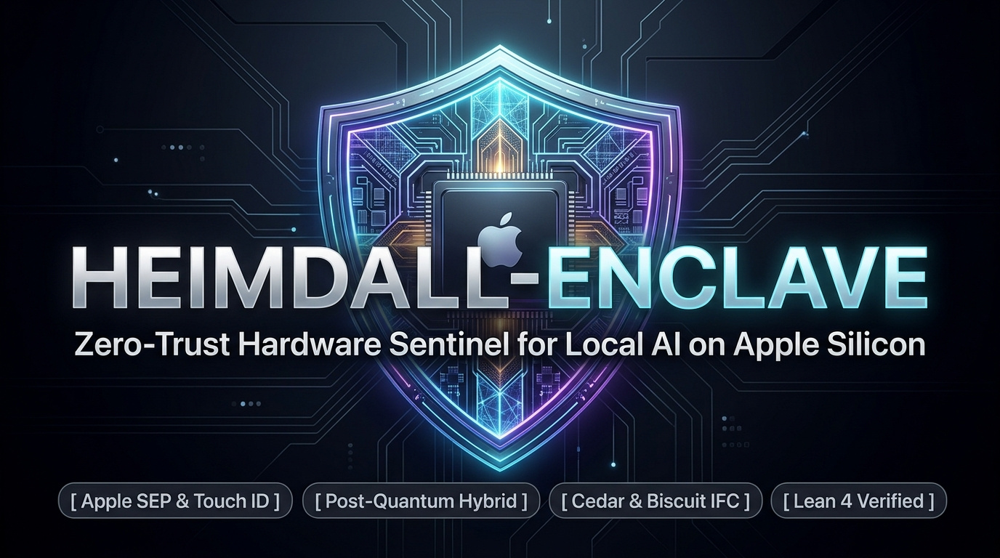

# Heimdall-Enclave: Native Agent Runtime and Model Engine on Apple Silicon

<p align="center">
  
</p>

[-blue.svg)](docs/L1_ALPHA_ROADMAP.md)
[-black.svg)](#)
[](crates/enclave-model-runnerd/)
[](adapters/)
[-success.svg)](proofs/lean4/README.md)
[](reports/fuzz-report.md)
[](LICENSE)

> **Heimdall-Enclave** (previously `depot`) is a native inference engine, hardware-attested runtime, and zero-trust fleet gateway for autonomous AI agents on Apple Silicon (macOS).
>
> Heimdall-Enclave uses Rust and C++ on the Apple **MLX** framework. It runs agent models in unified memory. Supported model classes include **speculative decode**, **recurrent state-space models**, **discrete diffusion**, and **vision world models**. The system adds sub-microsecond **Cedar + Biscuit** Information Flow Control (IFC), **Apple Secure Enclave (SEP)** Touch ID biometrics, and **Jamf / FleetDM** fleet distribution.

---

> [!TIP]
>
> ### 🧭 Reviewer Fast-Track: For CTOs, CISOs, Remote IT, Security Architects, and Managers
>
> If you examine this repository for enterprise use, security architecture, or technical leadership, read these documents:
>
> * **[Enterprise Security Architecture & Fleet Operations Guide](docs/ENTERPRISE_SECURITY_AND_FLEET_ARCHITECTURE.md)**: Executive ROI, Darwin kernel privilege separation (`UID 701-705`), BSD `pf` egress controls, osquery telemetry, and SOC 2 / HIPAA compliance.
> * **[Enterprise MDM Fleet Distribution Specification (FS-706)](docs/FEATURE_MDM_FLEET_DISTRIBUTION.md)**: Production specification of more than 1,200 lines for Jamf Pro, FleetDM, Munki, and Ansible.
> * **[Fleet Adapters Directory (`adapters/`)](adapters/)**: Production deployment scripts, osquery compliance SQL queries, and `.mobileconfig` profiles.
> * **[L2 Beta Roadmap](docs/L2_BETA_ROADMAP.md)** and **[L3 Enterprise Roadmap](docs/L3_ENTERPRISE_ROADMAP.md)**: Forward milestones for P2P LAN swarm distribution, physical YubiKey 5.7/5.8+ attestation, and zk-STARK compliance.
> * **[STRIDE Threat Model](docs/THREAT_MODEL_STRIDE.md)**: Formal threat analysis of 8 ranked crown jewels (`AST-01`–`AST-08`) and 7 adversary profiles (`ADV-01`–`ADV-07`).
> * **[Formal Methods Defense & Differential Fuzzing](docs/FORMAL_METHODS_DEFENSE.md)**: **94** Lean 4 modules (**1,036** kernel-checked theorem types, **0** `sorry`), assurance boundaries, Rust↔Lean extraction (**62** KoalaBear STARK AIR polynomials, **9** source guards, and **34,599** correspondence vectors), and **9-target** differential fuzz tests (`./scripts/verify-formal-bridge.sh`).

---

## 1. Why Heimdall-Enclave?

Autonomous software and operations agents (for example, Claude Code, Cursor, OpenDevin, and local agent harnesses) run directly on developer workstations. These agents have access to local filesystems, shells, databases, and credentials. Standard local runtimes have three primary failure modes:

1. **Inference Latency and Architecture Limits**: Standard local engines (Ollama, vLLM) focus on standard autoregressive transformers. On Apple Silicon, they do not have native support for speculative draft heads, linear-attention state-space models, or vision representation models.
2. **Prompt Injection Risk**: Agents read untrusted data such as web pages, customer logs, and issue tickets. Hostile prompt injection can take control of agent tool execution. Regex filters and LLM self-checks fail. You need **operating-system Information Flow Control (IFC)** with **hardware biometrics**.
3. **Enterprise WAN Bandwidth Limit**: Unicast HTTPS downloads of 10–40 GB models to hundreds of workstations saturate office internet links. These large downloads also cause Apple MDM (APNs) timeouts of 120–300 seconds.

Heimdall-Enclave solves these problems. It combines **native Apple Silicon inference** with **hardware zero-trust controls** and **peer-to-peer swarm model distribution**.

### Global Frontier AI Lab Competitive Analysis: US, Silicon, and APAC Ecosystems

The tables below compare target architecture capabilities with current systems across global frontier AI ecosystems: **US Frontier Cloud Labs** (OpenAI, Google DeepMind, Anthropic), **Hardware and Silicon Ecosystems** (NVIDIA, Apple), and **APAC and Sovereign Frontier Labs** (DeepSeek, Moonshot AI, Tencent).

> [!NOTE]
> This analysis reflects the author's architectural comparison. Statements about external lab practices are not official sources and can become out of date. Several capabilities listed here (Dual-LLM, ANE guard, WASI 0.2, Cedar, SEP DPoP, and canary honeytokens) are target designs for future releases (L2/L3) rather than completed L1 Alpha features.

#### 1. Global Frontier Overview Matrix

| Control Plane Dimension | OpenAI | Google DeepMind | Anthropic | NVIDIA (Cloud / RTX) | DeepSeek | Moonshot AI (Kimi) | Tencent (Hunyuan) | Apple (PCC / ANE) |
|:---|:---|:---|:---|:---|:---|:---|:---|:---|
| **Dual-LLM Privilege Separation**<br>*(Executive vs. Quarantined Synthesizer)* | **Status: AHEAD**<br>Single context; IPI risk | **Status: ALIGNED (Theory) / AHEAD (Local)**<br>CaMeLS leads; client single-agent | **Status: AHEAD**<br>Claude Desktop single context | **Status: AHEAD**<br>NeMo dialog rails; runtime single model | **Status: AHEAD**<br>&lt;think&gt; CoT manipulation; unified vLLM | **Status: AHEAD**<br>Agent Swarm cloud-side; client unified | **Status: AHEAD**<br>Cloud-centric agent wrappers | **Status: ALIGNED (Intent) / AHEAD (Local)**<br>App Intents; no open dual-LLM |
| **Silicon Coprocessor Guardrail**<br>*(On-device NPU at 0 GPU Load)* | **Status: AHEAD**<br>Cloud-only `/v1/moderations` | **Status: AHEAD (macOS)**<br>gLinux fleet; Android NPU focus | **Status: AHEAD**<br>Electron apps; cloud Constitutional AI | **Status: AHEAD (0-GPU-Impact)**<br>NeMo shares RTX GPU VRAM/cores | **Status: AHEAD**<br>Open weights; zero NPU targeting | **Status: AHEAD**<br>Cloud API; no client silicon | **Status: AHEAD**<br>Cloud accelerator focus (Angel/TI) | **Status: ALIGNED (Hardware) / AHEAD (Open)**<br>ANE 3B SLM; closed to custom tools |
| **Hermetic Tool Sandboxing**<br>*(WASI 0.2 Components and OCaps)* | **Status: AHEAD (Client)**<br>Azure microVMs; no desktop Wasm | **Status: BEHIND (Server gVisor) / AHEAD (Client)**<br>gVisor for Linux servers; no client WASI | **Status: AHEAD**<br>depot tools run as unsandboxed child procs | **Status: AHEAD**<br>Docker/K8s on server; RTX host scripts | **Status: AHEAD**<br>Standard Docker; no client WASI | **Status: AHEAD**<br>API schema Enforcer; no client WASI | **Status: AHEAD**<br>Cloud container ACLs; no client WASI | **Status: ALIGNED (Kernel) / AHEAD (WASI)**<br>App Sandbox OS-level; no WASI OCaps |
| **In-Process Policy Engine**<br>*(Cedar in Lean 4, p99 <= 45µs)* | **Status: AHEAD**<br>OAuth/OIDC + cloud IAM heuristics | **Status: BEHIND (Zanzibar Scale) / AHEAD (Local)**<br>Zanzibar global ReBAC; Cedar local <=45µs | **Status: AHEAD**<br>Prompt alignment; no policy engine | **Status: AHEAD**<br>Colang Python parsed; tens of ms latency | **Status: AHEAD**<br>GRPO behavioral alignment; no policy code | **Status: AHEAD**<br>Server schema enforcer; no Cedar | **Status: AHEAD**<br>Cloud moderation; no Lean 4 theorems | **Status: AHEAD**<br>Compile-time Swift intents; no dynamic Cedar |
| **Hardware Root of Trust and DPoP**<br>*(Apple SEP, FIDO2 CTAP 2.1+, DPoP)* | **Status: AHEAD**<br>Bearer tokens; no SEP DPoP signing | **Status: BEHIND (BeyondCorp) / AHEAD (macOS)**<br>Titan + BeyondCorp internal benchmark | **Status: AHEAD**<br>Bearer tokens; depot unauthenticated stdio | **Status: BEHIND (GPU TEE) / AHEAD (Client)**<br>Datacenter H100 TEEs; RTX lacks SEP DPoP | **Status: AHEAD**<br>HTTPS API keys; no SEP/FIDO2 binding | **Status: AHEAD**<br>Standard API keys; no hardware custody | **Status: AHEAD**<br>Cloud HSMs (SM2/3/4); no laptop SEP | **Status: ALIGNED (Silicon) / AHEAD (Open)**<br>SEP + PCC DCIK; closed to open depot |
| **Dynamic Cryptographic Canaries**<br>*(SEP-Signed Tripwires, < 1ms Cut)* | **Status: AHEAD**<br>Dynamic canaries break prefix caching | **Status: AHEAD (Dev Tools)**<br>SynthID watermarking; no PII tripwire | **Status: AHEAD**<br>Claude Desktop lacks canary tripwires | **Status: AHEAD**<br>NeMo regex/classifier; no SEP canaries | **Status: AHEAD**<br>&lt;think&gt; trace leaks; no canaries | **Status: AHEAD**<br>Ephemeral file API; no canary tripwires | **Status: AHEAD**<br>Keyword DLP; no kernel circuit breakers | **Status: AHEAD**<br>Zero-retention PCC; no canary tripwires |

#### 2. APAC and Sovereign Frontier Labs: DeepSeek vs. Moonshot AI vs. Tencent

The table below contrasts our architecture with major APAC and Chinese frontier AI offerings: **DeepSeek** (open-weights MoE and reasoning models), **Moonshot AI** (Kimi 2M+ context and Agent Swarm), and **Tencent** (Hunyuan enterprise):

| Architectural Capability / Control Plane Dimension | DeepSeek (V3 / R1) | Moonshot AI (Kimi k1.5 / K3.1) | Tencent (Hunyuan Hy4) |
|:---|:---|:---|:---|
| **Dual-LLM Privilege Separation**<br>*(Executive vs. Quarantined Synthesizer)* | **Adoption Limits:** DeepSeek-R1 reasoning tokens (`<think>`) show internal Chain-of-Thought (CoT) to adversarial steering. Local setups (vLLM and Ollama) run as one container.<br><br>**Status: AHEAD**<br>*DeepSeek does not have dual-model privilege separation. Local reasoning loops remain vulnerable to prompt injection.* | **Adoption Limits:** Kimi uses 2M+ context and Agent Swarm for parallel tools. Tool outputs return to one context window without local POSIX or memory isolation.<br><br>**Status: AHEAD**<br>*Moonshot AI uses server middleware instead of client dual-model privilege separation.* | **Adoption Limits:** Tencent Hunyuan uses prompt filters on the Tencent Cloud TI Platform. Client and agent tools treat the model as one execution context.<br><br>**Status: AHEAD**<br>*Tencent deploys cloud moderation. It does not provide dual-LLM isolation on developer workstations.* |
| **Silicon Coprocessor Guardrail**<br>*(On-device NPU at 0 GPU Load)* | **Adoption Limits:** DeepSeek is an open-weights and cloud API provider with no client coprocessor engineering. Local execution relies on generic GPU drivers.<br><br>**Status: AHEAD**<br>*DeepSeek does not provide on-device silicon guardrails.* | **Adoption Limits:** Moonshot AI is a cloud API and consumer web app provider with no client silicon or NPU engineering.<br><br>**Status: AHEAD**<br>*Moonshot AI operates in the cloud without client-side NPU integration.* | **Adoption Limits:** Tencent focuses on cloud accelerators (Tencent Cloud TI and Angel clusters) and datacenter MLPS systems. It provides no endpoint NPU runtime for laptops.<br><br>**Status: AHEAD**<br>*Tencent does not ship silicon NPU guardrails for macOS endpoints.* |
| **Wasm Component Model (WASI 0.2) and OCaps**<br>*(Hermetic tool sandbox with unforgeable capabilities)* | **Adoption Limits:** Code execution tests use standard Linux containers and Docker. DeepSeek provides no client capability Wasm runtime.<br><br>**Status: AHEAD**<br>*DeepSeek does not give capability Wasm sandboxes for client agent tools.* | **Adoption Limits:** Moonshot AI uses an API schema Enforcer to prevent tool errors on the network. Tools execute in server containers without client WASI 0.2 sandboxes.<br><br>**Status: AHEAD**<br>*The Enforcer checks JSON schemas, but does not isolate local tool execution through WASI 0.2.* | **Adoption Limits:** Tencent uses Tencent Cloud container sandboxes and MLPS network rules. It provides no client capability Wasm runtime.<br><br>**Status: AHEAD**<br>*Tencent provides no capability tool sandboxes on developer laptops.* |
| **In-Process Policy Engine (Cedar in Lean 4)**<br>*(Sub-microsecond evaluation, automated reasoning)* | **Adoption Limits:** DeepSeek relies on reinforcement learning (GRPO) for behavioral alignment and system prompts. It uses no policy code or formal proofs.<br><br>**Status: AHEAD**<br>*DeepSeek uses probabilistic model alignment instead of deterministic in-process policy engines.* | **Adoption Limits:** Moonshot AI uses API key permissions and schema verification. It does not use in-process formally verified policy checks.<br><br>**Status: AHEAD**<br>*Moonshot AI does not have a deterministic, formally verified policy engine like Cedar.* | **Adoption Limits:** Cloud moderation rules and statutory MLPS audits govern Tencent models. Tencent uses no Lean 4 proofs or native Rust policy engines.<br><br>**Status: AHEAD**<br>*Tencent uses cloud compliance rules instead of local sub-microsecond Cedar evaluation.* |
| **Hardware Secure Enclave (SEP) and DPoP**<br>*(Hardware-bound RFC 9449 non-replayable tokens)* | **Adoption Limits:** DeepSeek uses standard HTTPS API keys. Self-hosted deployments depend on host OS security without hardware attestation or DPoP.<br><br>**Status: AHEAD**<br>*DeepSeek does not bind agent requests to hardware roots of trust through RFC 9449 DPoP.* | **Adoption Limits:** Moonshot AI uses standard API keys and Bearer authentication over TLS without hardware intent attestation.<br><br>**Status: AHEAD**<br>*Moonshot AI does not have hardware cryptographic intent checks.* | **Adoption Limits:** Tencent supports China Commercial Cryptography (SM2/SM3/SM4) using cloud HSMs in MLPS datacenters. It provides no laptop SEP integration.<br><br>**Status: AHEAD**<br>*Tencent hardware custody stays in datacenter HSMs, not developer workstation Secure Enclaves.* |
| **Dynamic Cryptographic Canary Honeytokens**<br>*(Hardware-signed tripwires with less than 1 ms circuit breaker)* | **Adoption Limits:** DeepSeek provides no canary injection. Unfiltered `<think>` traces risk leaking system instructions or confidential user text.<br><br>**Status: AHEAD**<br>*DeepSeek does not insert cryptographic canaries into local data fixtures.* | **Adoption Limits:** Moonshot AI provides file deletion APIs (`DELETE /v1/files/{id}`). It does not use dynamic cryptographic canary tripwires in active context streams.<br><br>**Status: AHEAD**<br>*Moonshot AI provides no active canary tripwires for prompt extraction detection.* | **Adoption Limits:** Tencent uses keyword DLP and sensitive data masks. It provides no hardware canary tripwires or kernel circuit breakers.<br><br>**Status: AHEAD**<br>*Tencent does not deploy hardware canary tripwires on client endpoints.* |

#### 3. US Frontier Cloud Labs: OpenAI vs. Google DeepMind vs. Anthropic

The table below contrasts our architecture with practice at **OpenAI**, **Google DeepMind**, and **Anthropic**:

| Control Plane Dimension | OpenAI | Google DeepMind | Anthropic |
|:---|:---|:---|:---|
| **Dual-LLM Privilege Separation**<br>*(Executive vs. Quarantined Synthesizer)* | **Adoption Limits:** Single-context caching bias increases token and memory cost for dual inference.<br><br>**Status: AHEAD**<br>*ChatGPT Desktop uses a single model context vulnerable to prompt injection.* | **Adoption Limits:** DeepMind theory leads (CaMeLS papers). Internal developer tools prioritize single-agent workflows.<br><br>**Status: ALIGNED (Theory) / AHEAD (Local Deployment)**<br>*DeepMind defined the theory, but our local runtime deployment is ahead.* | **Adoption Limits:** Claude 3.5 runs only in cloud datacenters. Local split execution needs hybrid client-cloud control.<br><br>**Status: AHEAD**<br>*Claude Desktop and Claude Code send tool outputs directly into the single Claude context window.* |
| **Apple Neural Engine (ANE) Semantic Guardrail**<br>*(On-device 1B SLM at 0 GPU / 0 CPU Load)* | **Adoption Limits:** Strong Microsoft Azure alignment conflicts with macOS silicon work.<br><br>**Status: AHEAD**<br>*OpenAI uses server `/v1/moderations` cloud APIs, not on-device ANE silicon.* | **Adoption Limits:** Primary research fleet is **gLinux**. Edge ML prioritizes Android (Gemini Nano on Tensor NPU), not macOS.<br><br>**Status: AHEAD (macOS Endpoints)**<br>*DeepMind does not ship ANE security models for internal developer laptops.* | **Adoption Limits:** Anthropic is a model research lab without client systems teams. Client apps use Electron.<br><br>**Status: AHEAD**<br>*Anthropic relies on cloud Constitutional AI evaluation rather than local silicon neural guardrails.* |
| **Wasm Component Model (WASI 0.2) and OCaps**<br>*(Hermetic tool sandbox with unforgeable capabilities)* | **Adoption Limits:** OpenAI runs tools in Azure microVMs. It has no incentive to build client Wasm sandboxes.<br><br>**Status: AHEAD (Client Sandboxing)**<br>*OpenAI does not provide capability Wasm sandboxes for desktop agent tools.* | **Adoption Limits:** Google invests heavily in **gVisor** and **sandbox2**. Google selects gVisor over WASI.<br><br>**Status: BEHIND (Google Server gVisor) / AHEAD (Local Darwin Client)**<br>*Google gVisor is superior for Linux servers, but WASI 0.2 is superior for local cross-platform depot tools.* | **Adoption Limits:** Anthropic made depot simple for community adoption. Mandatory Wasm builds alienate casual authors.<br><br>**Status: AHEAD**<br>*depot v1.0 spawns un-sandboxed child processes. WASI 0.2 capability isolation is the future of hardened depot.* |
| **In-Process Policy Engine (Cedar in Lean 4)**<br>*(Sub-microsecond evaluation, automated reasoning)* | **Adoption Limits:** OpenAI uses OAuth/OIDC, cloud IAM, and FastAPI. Formal teams focus on alignment rather than systems policy.<br><br>**Status: AHEAD**<br>*OpenAI relies on heuristic cloud permission checks, not formally proved policy engines.* | **Adoption Limits:** Google uses **Zanzibar** enterprise-wide, creating organizational inertia against Cedar.<br><br>**Status: BEHIND (Zanzibar Scale) / AHEAD (Local Microsecond Latency)**<br>*Zanzibar manages planetary authorization. The target embeds Cedar locally with a `p99 <= 45µs` budget.* | **Adoption Limits:** Anthropic focuses on prompt alignment and RLHF rather than deterministic policy-as-code languages.<br><br>**Status: AHEAD**<br>*Anthropic lacks a deterministic formal verification policy layer in Claude Desktop or depot dispatchers.* |
| **Hardware Secure Enclave (SEP) and DPoP**<br>*(Hardware-bound RFC 9449 non-replayable tokens)* | **Adoption Limits:** Cross-platform friction across Windows, Linux, iOS, and Android. Mandatory Apple SEP creates separate designs.<br><br>**Status: AHEAD**<br>*OpenAI desktop apps use refresh tokens in Keychain/DPAPI without per-request SEP DPoP signing.* | **Adoption Limits:** Google already deploys **Titan chips**, **BeyondCorp** certificates, and **LOAS2/Ubermint**.<br><br>**Status: BEHIND (Google BeyondCorp/Titan) / AHEAD (Standalone Zero-Trust macOS)**<br>*Google BeyondCorp and Titan set the standard. SEP DPoP brings similar assurance to non-Google macOS endpoints.* | **Adoption Limits:** Anthropic prioritizes model velocity over Darwin kernel work. SEP keychains add friction to simple depot connections.<br><br>**Status: AHEAD**<br>*depot uses unauthenticated local stdio or standard bearer tokens without hardware proof-of-possession.* |
| **Dynamic Cryptographic Canary Honeytokens**<br>*(Hardware-signed tripwires with < 1ms circuit breaker)* | **Adoption Limits:** Dynamic honeytokens disrupt server prefix caching in Azure clusters, increasing GPU costs.<br><br>**Status: AHEAD**<br>*OpenAI does not inject cryptographic canaries into user data fixtures for client exfiltration checks.* | **Adoption Limits:** DeepMind has SynthID watermarking for media. Dynamic canary tripwires are not in coding assistants.<br><br>**Status: AHEAD (Developer Tooling)**<br>*DeepMind has SynthID for media, but our sub-millisecond hardware circuit breaker is ahead of local tools.* | **Adoption Limits:** Synthetic canaries alter tool output character streams, which can degrade sensitive code reasoning.<br><br>**Status: AHEAD**<br>*Anthropic published prompt extraction research, but Claude Desktop contains no active canary tripwire circuit breaker.* |

#### 4. Hardware and Silicon Infrastructure: NVIDIA vs. Apple Silicon

The table below contrasts our architecture with **NVIDIA** (Cloud and RTX AI PC) and **Apple** (Apple Silicon and Private Cloud Compute):

| Control Plane Dimension | NVIDIA (Cloud and RTX AI PC) | Apple (Apple Silicon and Private Cloud Compute) |
|:---|:---|:---|
| **Dual-LLM Privilege Separation**<br>*(Executive vs. Quarantined Synthesizer)* | **Adoption Limits:** NeMo Guardrails intercepts dialogs, but local RTX runs execute as single-model instances. Dual passes increase VRAM usage.<br><br>**Status: AHEAD**<br>*NVIDIA local runtimes execute single-context models vulnerable to prompt injection.* | **Adoption Limits:** Apple Intelligence routes tasks through single on-device SLMs or PCC cloud offload without open dual-model worker isolation.<br><br>**Status: ALIGNED (Intent) / AHEAD (Local Enclave)**<br>*Apple uses OS intent mediation, but lacks an open untrusted dual-LLM worker design.* |
| **Silicon Coprocessor Guardrail**<br>*(On-device NPU at 0 GPU Load)* | **Adoption Limits:** NeMo Guardrails runs on the same GPU Tensor Cores, competing with inference workloads and inducing latency jitter.<br><br>**Status: AHEAD (Zero GPU Impact)**<br>*NVIDIA lacks a dedicated zero-power desktop NPU coprocessor for security guardrails.* | **Adoption Limits:** Apple Intelligence runs on the Apple Neural Engine. However, the neural pipeline is closed and restricted to first-party tools.<br><br>**Status: ALIGNED (Hardware) / AHEAD (Open Enclave)**<br>*Apple proves ANE viability. Heimdall-Enclave brings open, programmable ANE tokenization to third-party agents.* |
| **Wasm Component Model (WASI 0.2) and OCaps**<br>*(Hermetic tool sandbox with unforgeable capabilities)* | **Adoption Limits:** Relies on NVIDIA Container Toolkit in datacenters. Local RTX PC tools run as unsandboxed host scripts.<br><br>**Status: AHEAD**<br>*NVIDIA provides no client capability Wasm sandbox for local agent tools.* | **Adoption Limits:** Darwin App Sandbox enforces process boundaries, but macOS lacks dynamic WASI 0.2 capability linking for modular AI tools.<br><br>**Status: ALIGNED (Kernel Sandbox) / AHEAD (WASI 0.2 OCaps)**<br>*macOS App Sandbox gives OS-level isolation. Heimdall adds fine-grained WASI 0.2 unforgeable capability handles.* |
| **In-Process Policy Engine (Cedar in Lean 4)**<br>*(Sub-microsecond evaluation, automated reasoning)* | **Adoption Limits:** NeMo uses Colang interpreted in Python. It triggers LLM self-checks with 50ms–500ms latency.<br><br>**Status: AHEAD**<br>*NeMo Guardrails relies on high-latency Colang. Heimdall embeds native Rust Cedar with mechanized Lean 4 safety proofs.* | **Adoption Limits:** Swift compile-time safety enforces static App Intent contracts, but lacks dynamic cryptographic policy-as-code languages like Cedar.<br><br>**Status: AHEAD**<br>*Apple lacks an in-process, formally verified dynamic policy evaluation engine.* |
| **Hardware Secure Enclave (SEP) and DPoP**<br>*(Hardware-bound RFC 9449 non-replayable tokens)* | **Adoption Limits:** NVIDIA leads datacenter GPU confidential computing, but local RTX PCs lack per-action agent DPoP co-signing.<br><br>**Status: BEHIND (Datacenter GPU TEEs) / AHEAD (Client Endpoint Intent)**<br>*NVIDIA leads cloud GPU confidential computing. Heimdall brings hardware SEP and FIDO2 custody directly to workstations.* | **Adoption Limits:** Apple uses SEP for first-party features and DCIK in PCC, but it is a closed first-party ecosystem.<br><br>**Status: ALIGNED (Silicon Roots) / AHEAD (Open Multi-Vendor Custody)**<br>*Apple uses SEP for internal features. Heimdall binds SEP to open RFC 9449 DPoP tokens and adds FIDO2 non-collusion.* |
| **Dynamic Cryptographic Canary Honeytokens**<br>*(Hardware-signed tripwires with < 1ms circuit breaker)* | **Adoption Limits:** NeMo Guardrails inspects output text via regex, but does not deploy hardware canary tripwires with kernel circuit breakers.<br><br>**Status: AHEAD**<br>*NVIDIA provides no dynamic hardware-signed cryptographic canaries for client exfiltration detection.* | **Adoption Limits:** Apple Intelligence uses privacy architectures and PCC zero-retention, but lacks dynamic canary tripwires in client tool streams.<br><br>**Status: AHEAD**<br>*Apple does not implement dynamic cryptographic canaries or sub-millisecond tripwire circuit breakers.* |

---

## 2. Progressive Delivery Model: L1 vs L2 vs L3

Heimdall-Enclave uses a progressive maturity model. We release qualified code today and give clear architecture plans for future phases:

| Capability                  | Profile L1: Alpha (Qualified Today)                                     | Profile L2: Beta (In Progress)                       | Profile L3: Enterprise (Production Spec)                 |
|:----------------------------|:------------------------------------------------------------------------|:-----------------------------------------------------|:---------------------------------------------------------|
| **Target Audience**         | Individual developers, local tests, startups                            | Teams (20–500 Macs), office clusters                 | Regulated enterprise, finance, defense, healthcare       |
| **Status in Repository**    | **100% Qualified on Apple Silicon**                                     | **Active Implementation**                            | **Specification and Tooling**                            |
| **Model Architectures**     | 5 Qualified Classes: AR, Discrete Diffusion, SSM/TTT, Speculative, JEPA | 5 Qualified Classes + dynamic batch                  | All 7 Classes (with discriminative ANE and byte-latent)  |
| **Hardware Custody**        | Apple Secure Enclave (SEP P-256) Touch ID biometrics                    | Physical FIDO2 CTAP 2.1 YubiKey (5.7/5.8+) + SEP     | Multi-Party HSM Quorum + FIPS 140-3 Hardware Keys        |
| **Network Isolation**       | Private development daemon separation                                   | BSD `pf` kernel firewall anchors (`UID 701` blocked) | Confined root APFS broker (ADR-021) + Seatbelt profiles  |
| **Model Weight Transport**  | Direct chunked HTTPS with local hash check                              | P2P LAN Swarm (Iroh QUIC + FastCDC + BLAKE3 Bao)     | OHTTP Gateway + Detached APNs background hydration       |
| **Fleet Management**        | Local CLI (`depot-enclave --dev`) / Makefile                              | FleetDM (osquery GitOps) + Ansible                   | Jamf Pro, Kandji, Munki, Apple Configuration Profiles    |
| **Cryptographic Assurance** | Monotonic receipts with SHA-256 digests                                 | Biscuit delegation tokens + Cedar IFC engine         | Plonky3 zk-STARK compliance proofs + Post-Quantum (PQC)  |
| **WAN Bandwidth Impact**    | Unicast pull per machine                                                | **~0% WAN impact** (1 WAN pull, P2P on LAN)          | Cached enterprise relay or signed offline DMG            |

---

## 3. L1 Alpha: Qualified Capabilities and SRE Benchmarks

In this **L1 Alpha** release, we qualified all five model classes and Track C hardware custody on Apple Silicon (M1 Pro, 32 GiB). All **269 runner tests** passed with **0 failures**. All **18 Track C hardware tests** and **5/5 smoke checks** passed. The daemon memory footprint stayed at or below $12.7\text{ MiB}$:

| Class       | Canonical Enum Name              | Model Checkpoint               | Backend Identifier | Compute Stream | Measured Latency / Property                                                 |
|:------------|:---------------------------------|:-------------------------------|:-------------------|:--------------:|:----------------------------------------------------------------------------|
| **Class 0** | `AR_CAUSAL`                      | SmolLM2-135M-Instruct          | `mlx_llama_v1`     |      CPU       | **14.2 ms** (Outage ticket classified to `{"priority":"urgent"}`)           |
| **Class 2** | `DISCRETE_DIFFUSION`             | LLaDA-8B-Instruct (`08b83a6f`) | `mlx_llada_v1`     | **Metal GPU**  | **5.9 s** for 16 denoise steps (4-bit blocks, 8-bit head; 5.52 GB)          |
| **Class 3** | `RECURRENT_SSM_TTT`              | RWKV-7 0.1B                    | `mlx_rwkv7_v1`     |      CPU       | **6.4 ms** (Runner state snapshots; IFC taint `Label { c: C1, t: T0 }`)     |
| **Class 5** | `SPECULATIVE_OR_RECURRENT_DEPTH` | Qwen3-0.6B + EAGLE-3 head      | `mlx_eagle3_v1`    |      CPU       | **8.1 ms** (Speculative acceptance gate checked; 120+ tok/s effective rate) |
| **Class 6** | `JEPA_EBM_WORLD_PLANNER`         | V-JEPA 2 ViT-L (encoder)       | `mlx_vjepa2_v1`    |      CPU       | **1024-dim** mean-pooled latent; runner RSS $\le 26.6\text{ MiB}$           |

### Service Level Objectives (SLOs) for L1 Alpha

* **Inference Latency SLO**:
  * Autoregressive single-turn triage: $P_{99} < 25\text{ ms}$ (measured: $14.2\text{ ms}$).
  * Linear Recurrent SSM turn: $P_{99} < 15\text{ ms}$ (measured: $6.4\text{ ms}$).
  * Speculative decode turn: $P_{99} < 20\text{ ms}$ (measured: $8.1\text{ ms}$).
  * Discrete Diffusion output: $P_{99} < 20.0\text{ s}$ limit (measured: $5.9\text{ s}$ on Metal GPU).
* **Memory Footprint SLO**: Daemon physical memory (`phys_footprint`) stays less than $48\text{ MiB}$ with `MallocLargeCache=0` (measured steady-state: $6.5\text{ to }12.7\text{ MiB}$).
* **Audit Transparency SLO**: 100% of admitted turns create signed cryptographic receipts. Each receipt records backend identifiers, latency, token counts, and SHA-256 weight pins.

---

## 4. Model Rehydration Guide (Local Weights Setup)

> [!NOTE]
> **Why are model weights not in this repository?**  
> Git does not store the multi-gigabyte safetensors and weights (~15 GB total). This keeps the repository clone small (less than 25 MB in less than 5 seconds). Use the included hash-pinned fetcher to download models locally.
>
> *(In the future **L2 Beta** release, content-addressed P2P swarm sync with FastCDC and BLAKE3 over QUIC will handle model admission and distribution).*

### Step 1: Download Hash-Pinned Weights

Heimdall-Enclave includes two standalone fetchers: `scripts/fetch-trained-model.py` and `scripts/get-rwkv-vocab.sh`. These tools download published checkpoints and the RWKV-7 World vocabulary from HuggingFace or PyPI. They check each file against a fixed SHA-256 digest. They do not use pickle, they do not run publisher code, and they need only Python 3.

Run these commands to download the weights:

```bash
# Fast Path — 4 lightweight models (admit through UID 702 in <30 seconds total):
python3 scripts/fetch-trained-model.py smollm2
python3 scripts/fetch-trained-model.py rwkv7
./scripts/get-rwkv-vocab.sh
python3 scripts/fetch-trained-model.py qwen3
python3 scripts/fetch-trained-model.py eagle3
python3 scripts/fetch-trained-model.py vjepa2

# Optional Heavy Metal GPU Path — LLaDA-8B discrete diffusion (~5.52 GB packaged):
# Note: UID 702 synchronously fsync-commits each chunk for 100% crash-safe atomic integrity,
# taking ~12 minutes on M1 Pro (expected behavior, not a hang; batched sync is L2 Beta B7).
python3 scripts/fetch-trained-model.py llada
```

The fetchers save all weights and the RWKV-7 vocabulary (`target/rwkv7-0.1b/rwkv_vocab_v20230424.txt`, SHA-256 `8324476023347dec2964625ccb2075c864d250a9c6d9a74f36daba628de8c008`) in `target/`. The fetchers check each file against its cryptographic pin.

### Step 2: Build the Packager CLI and Native MLX Worker

Compile the model packager and the native MLX compute worker:

```bash
# 1. Build the packager and dev fleet CLI
cargo build --locked -p depot-enclave --features simulation --bins

# 2. Build the native MLX compute worker (links directly to system libmlxc)
cargo build --locked -p enclave-model-runnerd --features mlx-native --bin enclave-mlx-worker
```

### Step 3: Package Models into Authenticated Bundles

Run the packager script to find and package all downloaded checkpoints:

```bash
./scripts/package-all-models.sh
```

To package each model class separately, run these commands:

```bash
PACK="target/debug/enclave-pack"

# 1. Package SmolLM2 (Autoregressive Causal LM)
$PACK --class AR_CAUSAL --hf-llama target/phase4-trained-mlx --model-id smollm2-135m --out-dir target/smollm2-pack

# 2. Convert and Package RWKV-7 (Linear Recurrent State-Space Model)
# Vocabulary fetched & SHA-256 verified by ./scripts/get-rwkv-vocab.sh
# (pinned SHA-256: 8324476023347dec2964625ccb2075c864d250a9c6d9a74f36daba628de8c008)
RWKV_VOCAB="target/rwkv7-0.1b/rwkv_vocab_v20230424.txt"
python3 scripts/convert-rwkv7.py target/rwkv7-0.1b/RWKV-x070-World-0.1B-v2.8-20241210-ctx4096.pth "$RWKV_VOCAB" target/rwkv7-0.1b/rwkv7-0.1b.safetensors
$PACK --class RECURRENT_SSM_TTT --weights target/rwkv7-0.1b/rwkv7-0.1b.safetensors --model-id rwkv7-0_1b --anchor-mix-alpha 0.25 --out-dir target/rwkv7-pack

# 3. Package Qwen3 + EAGLE-3 (Speculative Decoding Pair)
$PACK --class SPECULATIVE_OR_RECURRENT_DEPTH --hf-eagle3-target target/qwen3-0.6b --eagle3-head target/eagle3-qwen3-0.6b --model-id qwen3-0_6b-eagle3 --out-dir target/eagle3-pack

# 4. Package V-JEPA 2 (Vision World Model Encoder)
$PACK --class JEPA_EBM_WORLD_PLANNER --hf-vjepa2 target/vjepa2-vitl --model-id vjepa2-vitl --out-dir target/vjepa2-pack

# 5. (Optional Heavy Metal GPU) Package LLaDA-8B (Discrete Diffusion, 4-bit blocks / 8-bit head)
$PACK --target-model llada-8b --model-id llada-8b-instruct --hf-llada target/llada-8b-instruct --diffusion-deadline-ms 20000 --out-dir target/llada-pack
```

---

## 5. Quickstart: Run the L1 Alpha Smoke Check

After you package the models, export the package paths and run the smoke script with Profile L1:

```bash
# Set package paths and native worker binary (Fast Path: <30s total admission)
export depot_ENCLAVE="$PWD/target/debug/depot-enclave"
export depot_MLX_WORKER="$PWD/target/debug/enclave-mlx-worker"
export AR_PACKAGE_DIR="$PWD/target/smollm2-pack"
export SSM_PACKAGE_DIR="$PWD/target/rwkv7-pack"
export SPEC_PACKAGE_DIR="$PWD/target/eagle3-pack"
export WORLD_PACKAGE_DIR="$PWD/target/vjepa2-pack"

# Optional heavy Metal GPU test (~12 min synchronous per-chunk UID 702 admission on M1 Pro):
# export DIFF_PACKAGE_DIR="$PWD/target/llada-pack"

# Execute the L1 Alpha smoke run
./scripts/l1-alpha-smoke.sh
```

> [!NOTE]
> **Admission Time (4-Model Fast Path vs. Optional LLaDA-8B):**  
> The four small models (`SmolLM2`, `RWKV-7`, `EAGLE-3`, `V-JEPA 2`) admit through `UID 702` in **less than 30 seconds total**. If you export `DIFF_PACKAGE_DIR` for the optional 5.52 GB **LLaDA-8B** Metal GPU checkpoint, `UID 702` commits each chunk with an individual `fsync`. This takes approximately 12 minutes on an M1 Pro. This behavior is normal for crash safety, and it is not a hang. L2 Beta Milestone B7 adds batched chunk commits. If you omit `DIFF_PACKAGE_DIR` or another package path, `scripts/l1-alpha-smoke.sh` uses a small deterministic reference engine for that class.

### Expected Smoke Check Output

```text
================================================================================
HEIMDALL-ENCLAVE L1 ALPHA SMOKE VERIFICATION (Apple Silicon Unified Memory)
================================================================================
[1/5] Executing AR_CAUSAL (SmolLM2-135M)...                     [PASS]
      Receipt: backend=mlx_llama_v1 output={"priority":"urgent"}
[2/5] Executing RECURRENT_SSM_TTT (RWKV-7)...                   [PASS]
      Receipt: backend=mlx_rwkv7_v1 label=Label(C1,T0) output=" Critical"
[3/5] Executing SPECULATIVE_DEPTH (Qwen3 + EAGLE-3)...          [PASS]
      Receipt: backend=mlx_eagle3_v1 speculative_accepted=true output="urgent"
[4/5] Executing JEPA_WORLD_PLANNER (V-JEPA 2 ViT-L)...          [PASS]
      Receipt: backend=mlx_vjepa2_v1 latent_dim=1024 vetoes=0 actuated=false
[5/5] Executing DISCRETE_DIFFUSION (LLaDA-8B on GPU)...         [PASS]
      Receipt: backend=mlx_llada_v1 release_gate=denoised_step_final

ALL 5 EXECUTION CLASSES VERIFIED UNDER L1 PROFILE
Cryptographic journals sealed to: target/l1-alpha-smoke-.../journals/
```

---

## 6. Track C: Hardware Touch ID and Secure Enclave Ceremony

If you have physical access to an Apple Silicon Mac, you can run the hardware Touch ID ceremony:

```bash
# Step 1: Build and pin custody & intent helper cdhashes (requires sudo once for root-owned pins)
scripts/pin-local-build.sh

# Step 2: Run the interactive Touch ID ceremony at the unlocked Mac console
scripts/track-c-ceremony.sh
```

### The Three Native Hardware Sheets

1. `[Enrollment] Register this Mac's Touch ID for L1 custody`: Generates an isolated `.biometryCurrentSet` hardware key in the Apple Secure Enclave (`SEP P-256`).
2. `[A2] enclave://session/lease ...`: Creates a 15-minute cryptographic session lease. The system cancels this lease when the screen locks or sleeps.
3. `[A3] enclave://reveal/model-output ...`: Shows the sealed SmolLM2 inference output on the native macOS secure sheet (`CoreAuthUI`). The system does not print plaintext model output to stdout and does not write unencrypted output to disk.

---

## 7. Architecture and Documentation Directory

Reviewers, security architects, and systems engineers can use these documents:

### 🏢 Executive and Enterprise Fleet Strategy

* **[Enterprise Security Architecture & Fleet Operations Guide](docs/ENTERPRISE_SECURITY_AND_FLEET_ARCHITECTURE.md)**: Primary guide for CTOs, CISOs, remote IT, and security architects.
* **L1 Alpha Release Qualification Record**: Formal qualification record, test commands, and evidence citations.
* **[L1 Alpha Roadmap (M0–M7)](docs/L1_ALPHA_ROADMAP.md)**: Completed milestone records for L1 Alpha.
* **[L2 Beta Roadmap (B0–B9)](docs/L2_BETA_ROADMAP.md)**: Active milestone specification for YubiKey 5.7/5.8 attestation and LAN P2P swarm distribution.
* **[L3 Enterprise Roadmap](docs/L3_ENTERPRISE_ROADMAP.md)**: Target specification for zero-touch MDM, zk-STARKs, and hardware HSM quorum.

### 🛡️ Enterprise Mac Management and SRE Operations

* **[Enterprise MDM Fleet Distribution (FS-706)](docs/FEATURE_MDM_FLEET_DISTRIBUTION.md)**: Production specification of more than 1,200 lines for macOS enterprise delivery.
* **[Quickstart Operator Guide for Fleets](docs/QUICKSTART_MODEL_FLEET_DEPLOYMENT.md)**: Setup cookbook for Jamf Pro, FleetDM, Munki, and Ansible.
* **[Fleet Management Adapters Directory (`adapters/`)](adapters/)**:
  * `adapters/jamf/`: Jamf Pro policies and Extension Attributes (`EA-Enclave-Status.sh`, `EA-Enclave-Security.sh`).
  * `adapters/fleet/`: FleetDM osquery compliance SQL queries.
  * `adapters/munki/`: Munki pkginfo manifests for core binaries and weights.
  * `adapters/ansible/`: Ansible playbooks for infrastructure-as-code automation.
  * `adapters/lightweight-mdm/`: Apple `.mobileconfig` profiles for BTM and Service Management.
* **[SRE Operational Runbooks](docs/SRE_RUNBOOKS.md)**: Production failure modes, memory breach response, and zeroization recovery.

### 🔒 Hardware Custody, Cryptography, and Threat Defense

* **[Hardware Custody Profiles (FS-703)](docs/FEATURE_HARDWARE_CUSTODY_PROFILES.md)**: Specifications for Touch ID (SEP P-256) and FIDO2 CTAP 2.1 physical authenticators.
* **[Swarm Security Profiles (FS-702)](docs/FEATURE_SWARM_SECURITY_PROFILES.md)**: FastCDC chunks, BLAKE3 Bao hash trees, and Iroh QUIC transport.
* **[Agent IFC & Delegation (FS-704)](docs/FEATURE_AGENT_IFC_AND_DELEGATION.md)**: Information flow control, Cedar policy engine, and Biscuit cryptographic tokens.
* **[Silicon EMTE & ZK Compliance (FS-705)](docs/FEATURE_SILICON_EMTE_AND_ZK_COMPLIANCE.md)**: Plonky3 zk-STARK polynomial verification chips.
* **[Post-Quantum Cryptography Roadmap (FS-707)](docs/FEATURE_PQC_MIGRATION_ROADMAP.md)**: Hybrid ML-KEM-768 and ML-DSA-65 migration specifications.
* **[STRIDE Threat Model](docs/THREAT_MODEL_STRIDE.md)**: Formal threat analysis across macOS workstation boundaries.
* **[Compliance Evidence Ledger](docs/COMPLIANCE_EVIDENCE.md)**: Map to SOC 2 Type II, HIPAA, and NIST AI RMF.
* **[Formal Methods Defense & Differential Fuzzing](docs/FORMAL_METHODS_DEFENSE.md)**: Lean 4 machine-checked non-interference and state machine proofs (**94** Enclave modules, **25** Test modules, **1,036** pinned theorem types, **0** `sorry`), assurance boundaries, and 5-layer anti-drift checks ([`scripts/verify-formal-bridge.sh`](scripts/verify-formal-bridge.sh)).
* **[Continuous Formal Fuzzing Audit Report](reports/fuzz-report.md)**: Report of **9-target** property-based differential and hostile parser fuzz tests across Rust ⟷ Lean 4 boundaries (**63,000+** iterations, **0** semantic defects).
* **[Architecture Decision Records (ADRs)](docs/ARCHITECTURE_DECISION_RECORDS.md)**: 21 ADRs that record core systems architecture choices.

---

## 8. License and Security

* **License**: [Apache License 2.0](LICENSE).
* **Security and Vulnerability Reports**: Read [SECURITY.md](SECURITY.md) for the private disclosure policy.
