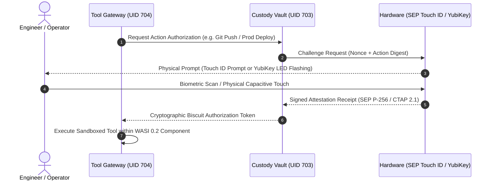

# Heimdall-Enclave: Enterprise Security Architecture & Fleet Operations Guide

### Zero-Trust Model Governance, macOS Darwin Hardening, Hardware Attestation, and Fleet Distribution (L1 / L2 / L3)

* **Document ID:** `ARCH-ENTERPRISE-FLEET-2026`
* **Target Audience:** CTOs, Chief Information Security Officers (CISOs), VPs of Engineering, Remote IT Directors, Enterprise Security Architects, and Systems Hiring Managers.
* **Scope:** Architectural Overview, Progressive Delivery Matrix (`L1` $\rightarrow$ `L2` $\rightarrow$ `L3`), Darwin Kernel Enforcement, Fleet Orchestration (Jamf, FleetDM, Munki, Ansible), Hardware Custody (Touch ID, YubiKey), and Cryptographic Assurance.
* **Implementation Status:**
  * **Profile L1 Alpha:** **100% Qualified & Operational on Apple Silicon** (`v0.1.0-alpha`).
  * **Profile L2 Beta:** **Active Implementation (In Flight)**.
  * **Profile L3 Enterprise:** **Target Production Specification & Architectural Blueprint**.

---

## 1. Executive Summary: The Enterprise AI Paradox (CTO & CISO Lens)

Engineering organizations are experiencing an unprecedented surge in autonomous coding agents (Claude Code, Cursor, OpenDevin, local agent harnesses). While these tools dramatically accelerate software development, deploying them across hundreds or thousands of corporate MacBooks exposes a **triple enterprise vulnerability**:

```
                       THE TRIPLE ENTERPRISE AI VULNERABILITY
   ┌───────────────────────────────┬───────────────────────────────┬───────────────────────────────┐
   │    1. THE PROMPT INJECTION    │    2. THE ZERO-TRUST DATA     │    3. THE MULTI-GIGABYTE      │
   │           HAZARD              │        EXFILTRATION RISK      │        WAN BOTTLENECK         │
   ├───────────────────────────────┼───────────────────────────────┼───────────────────────────────┤
   │ When autonomous agents ingest │ Standard local model runners  │ Distributing 10–40 GB model   │
   │ untrusted web pages, logs, or │ (Ollama, vLLM) execute with   │ updates over unicast HTTPS    │
   │ pull requests, prompt         │ raw user permissions and      │ saturates office WAN pipes,   │
   │ injection can hijack agent    │ unrestricted network sockets. │ causes packet loss, and       │
   │ tool execution. Regex filters │ Adversarial code can silently │ trips enterprise MDM (APNs)   │
   │ and system prompts fail.      │ exfiltrate proprietary code.  │ 120–300s timeout limits.      │
   └───────────────────────────────┴───────────────────────────────┴───────────────────────────────┘
```

### The Heimdall-Enclave Solution

Heimdall-Enclave solves this trilemma by replacing unconfined local runtimes with a **hardware-attested, privilege-separated on-device enclave** tailored specifically for Apple Silicon:

1. **Zero Egress for Inference (`UID 701`)**: The LLM compute engine runs in pure Metal/CPU memory with **zero network privileges**. Darwin Packet Filter (`pf`) rules drop all outbound sockets at the kernel level.
2. **Cryptographic Information Flow Control (IFC)**: Unchecked tool execution is replaced with **Cedar Policy** evaluation and **Biscuit** cryptographic capability tokens. Actions that modify production infrastructure require physical hardware approval.
3. **P2P Swarm Model Distribution**: Heavy model weights are distributed via encrypted peer-to-peer LAN meshes (Iroh QUIC + FastCDC + BLAKE3 Bao streaming trees). Only one machine pulls from the WAN; the rest of the office syncs over local 10 GbE / Wi-Fi 7.
4. **Sub-15ms Local Native Performance**: Built in pure Rust and C++ on Apple's native **MLX** framework, achieving instant autocomplete latencies and zero cloud API expenses.

---

## 2. Progressive Delivery Matrix: L1 Alpha vs L2 Beta vs L3 Enterprise

Heimdall-Enclave adopts a progressive maturity model that scales from an individual developer workstation up to a Fortune 500 regulated enterprise fleet:

| Dimension                   | Profile L1: Alpha (Qualified Today)                                           | Profile L2: Beta (In Flight)                         | Profile L3: Enterprise (Production Spec)                 |
|:----------------------------|:------------------------------------------------------------------------------|:-----------------------------------------------------|:---------------------------------------------------------|
| **Primary Audience**        | Individual developers, local testing, startups                                | Engineering teams (20–500 Macs), office clusters     | Regulated enterprise, finance, defense, healthcare       |
| **Status in Repo**          | **100% Qualified & Passing (L1 Alpha)**                                       | **In Active Development**                            | **Authoritative Specification & Tooling**                |
| **Model Architectures**     | 5 Qualified Classes: AR, Discrete Diffusion (GPU), SSM/TTT, Speculative, JEPA | 5 Qualified Classes + dynamic batching               | All 7 Classes including discriminative ANE & byte-latent |
| **Hardware Custody**        | Apple Secure Enclave (SEP P-256) Touch ID biometrics                          | Physical FIDO2 CTAP 2.1 YubiKey (5.7/5.8+) + SEP     | Multi-Party HSM Quorum + FIPS 140-3 Hardware Keys        |
| **Network Isolation**       | Private development daemon separation                                         | BSD `pf` kernel firewall anchors (`UID 701` blocked) | Confined root APFS broker (ADR-021) + Seatbelt profiles  |
| **Model Weight Transport**  | Direct chunked HTTPS with local hash verification                             | P2P LAN Swarm (Iroh QUIC + FastCDC + BLAKE3 Bao)     | OHTTP Gateway + Detached APNs background hydration       |
| **Fleet Management**        | Local CLI (`mcp-enclave --dev`) / Makefile                                    | FleetDM (osquery GitOps) + Ansible                   | Jamf Pro, Kandji, Munki, Apple Configuration Profiles    |
| **Cryptographic Assurance** | Monotonic receipts with SHA-256 digests                                       | Biscuit delegation tokens + Cedar IFC engine         | Plonky3 zk-STARK compliance proofs + Post-Quantum (PQC)  |
| **WAN Bandwidth Impact**    | Unicast pull per machine                                                      | **~0% WAN impact** (1 WAN pull, P2P on LAN)          | Cached enterprise relay or signed offline DMG            |

> [!NOTE]
> **Understanding Implemented State vs Future Specifications:**  
> This repository contains the **fully implemented and verified L1 Alpha engine**, along with complete production specifications, MDM adapters, osquery queries, and architecture decision records for **L2 Beta** and **L3 Enterprise**. As development progresses in the master lab, these forward-looking specifications will be iteratively certified.

---

## 3. Darwin Kernel Hardening & Privilege Separation

Heimdall-Enclave enforces defense-in-depth by breaking the enclave into **five privilege-separated POSIX daemons**, each operating with minimum required privileges:

```
┌──────────────────────────────────────────────────────────────────────────────────────────┐
│                                DARWIN KERNEL SECURITY BOUNDARY                           │
├───────────────────┬───────────────────┬───────────────────┬──────────────────┬───────────┤
│ UID 701           │ UID 702           │ UID 703           │ UID 704          │ UID 705   │
│ _llmagent         │ _enclavecas       │ _piivault         │ _enclaveifc      │ _enclavezk│
├───────────────────┼───────────────────┼───────────────────┼──────────────────┼───────────┤
│ Model Inference   │ Content Store     │ Hardware Custody  │ Policy Engine    │ ZK Auditor│
│ (Metal GPU / CPU) │ (Bao / QUIC Mesh) │ (Touch ID / FIDO2)│ (Cedar / Biscuit)│ (Plonky3) │
│                   │                   │                   │                  │           │
│ • ZERO NETWORK    │ • The ONLY daemon │ • CoreAuthUI      │ • WASI 0.2 Host  │ • Proves  │
│ • pf rule blocked │   with network    │ • SEP P-256 Keys  │ • Tool Sandboxes │   Safety  │
│ • Seatbelt sandbx │ • Read-only SCM   │ • YubiKey USB HID │ • Information    │   in zero │
│ • RSS <= 12.7 MB  │   descriptor pass │ • Hardware Leases │   Flow Control   │   knowledg│
└───────────────────┴───────────────────┴───────────────────┴──────────────────┴───────────┘
```

### 3.1 BSD Packet Filter (`pf`) Egress Diode

To guarantee that the model inference runner cannot leak code or prompt tokens, Heimdall-Enclave installs an immutable Darwin `pf` anchor:

```pf
# /etc/pf.anchors/com.enterprise.enclave.isolation
block return out quick proto {tcp, udp} all user _llmagent
pass out quick proto {tcp, udp} to any user _enclavecas
```

Even if an attacker achieves arbitrary code execution inside the model worker via a crafted weight exploit, the Darwin kernel forcibly drops all outbound network packets.

### 3.2 Dynamic Seatbelt (`sandbox-exec`) Sandboxing

Every daemon launches under an enterprise Seatbelt profile (`/opt/enclave/sandbox/*.sb`):

* Denies arbitrary shell execution (`/bin/sh`, `/bin/zsh`, `execve`).
* Restricts filesystem access exclusively to sealed `/var/db/enclave/` directories.
* Blocks unauthorized Mach IPC lookup services outside the approved enclave service group.

### 3.3 Darwin Memory Realities: `phys_footprint` vs `RLIMIT_RSS`

On modern macOS Darwin kernels (macOS 14+ Sonoma / Sequoia), POSIX `getrusage` / `RLIMIT_RSS` is fundamentally obsolete and unreliable for accounting actual memory pressure. The Darwin kernel's Jetsam subsystem uses `phys_footprint` (resident dirty memory + dirty compressed pages + IOKit allocations).

* Heimdall-Enclave measures true physical footprint directly via Mach task ports: `task_info(mach_task_self(), TASK_VM_INFO, &info, &count)` checking `phys_footprint`.
* All LaunchDaemons run with `MallocLargeCache=0` (`42a04421`) to prevent Darwin's default allocator from hoarding deallocated large buffers in physical memory.

---

## 4. Production Readiness Review (PRR) & Failure Modes Analysis (FMEA)

Engineering resilience requires designing for failure. Heimdall-Enclave incorporates formal SRE Failure Modes & Effects Analysis:

| Failure Mode            | Root Cause / Trigger                                      | Enclave Defense & Containment                                                                                                                    | Recovery Objective (MTTR) |
|:------------------------|:----------------------------------------------------------|:-------------------------------------------------------------------------------------------------------------------------------------------------|:--------------------------|
| **VPN Tunnel Reset**    | Enterprise VPN (Tailscale, AnyConnect) flushes `pf` rules | Enclave Supervisor detects anchor flush via Darwin kernel notifications (`SIOCGIFNETMASK`); restores isolation anchor before accepting next RPC. | $\le 100\text{ ms}$       |
| **Weight Tampering**    | Adversarial byte injection or bit rot on disk             | Bao Merkle tree verifies 16 KiB chunks in-flight; cryptographic bind fails before passing descriptor to `UID 701`.                               | Instant fail-closed       |
| **Biometric Occlusion** | Window overlay or screen capture during Touch ID          | macOS `CoreAuthUI` detects occlusion; custody vault immediately refuses session lease with `UI_OCCLUSION_ABORT`.                                 | $0\text{ ms}$ (refusal)   |
| **APNs MDM Timeout**    | Model weight download exceeds 120s APNs ceiling           | Hydration detaches to background worker; CLI returns exit code `40 (HYDRATION_PENDING)` in $<5\text{ s}$.                                        | Asynchronous completion   |
| **Memory Spike**        | Heavy generative context exceeds daemon limit             | `phys_footprint` watcher cancels turn (`GENERATION_CANCELLED`) before Jetsam terminates process.                                                 | $\le 50\text{ ms}$        |

---

## 5. Remote IT & Fleet Orchestration Guide

For remote IT administrators and Mac management architects, Heimdall-Enclave is designed to integrate seamlessly into existing enterprise management infrastructure.

### 5.1 Canonical Operator Contract: `mcp-enclave deploy`

All administrative actions across all fleet tools adhere to a single deterministic CLI interface:

```bash
mcp-enclave deploy <VERB> --profile <L1|L2|L3> [OPTIONS]

# Core Verbs:
#   preflight   - Check FileVault, SIP, Apple Silicon tier, and available APFS storage
#   install     - Provision POSIX users (UID 701-705), launchd plists, and Seatbelt rules
#   hydrate     - Dispatch model weight transfer via content-addressed distribution
#   verify      - Execute socket health probes, code attestation, and cryptographic checks
#   healthcheck - Emit real-time telemetry (phys_footprint, pf status, launchd state)
#   purge       - Atomic teardown, memory zeroization, and APFS snapshot unmounting
```

### 5.2 Fleet Management Tool Adapters (Ready in `adapters/`)

#### 1. Jamf Pro (`adapters/jamf/`)

* **Zero-Touch Bootstrap**: Policy triggers on `Enrollment Complete`, executing `jamf_deploy_enclave.sh` with parameter `$4` (Model Slug) and `$5` (Profile).
* **Mitigating APNs Timeouts**: Hydration commands return in $< 5\text{ seconds}$ with exit code `40 (HYDRATION_PENDING)`. The background daemon (`com.enterprise.enclave.hydrate`) completes the download asynchronously.
* **Extension Attributes (EAs)**:
  * `EA-Enclave-Status.sh`: Reports `healthy`, `unhealthy`, or `quarantined`.
  * `EA-Enclave-Security.sh`: Validates SIP, FileVault, and code signature hashes.

#### 2. FleetDM / osquery (`adapters/fleet/`)

Provides GitOps continuous compliance. Production SQL queries are pre-staged in `adapters/fleet/queries/`:

* `enclave_processes.sql`: Ensures daemons run exclusively under designated UIDs and verify memory `phys_footprint`.
* `enclave_launchd.sql`: Monitors launchd supervisor states and disabled flags.
* `enclave_signatures.sql`: Attests Apple Team ID or cdhash cryptographic code signatures.
* `enclave_disk_encryption.sql`: Confirms FileVault full-disk encryption.
* `enclave_sip.sql`: Asserts System Integrity Protection (SIP) is active.

#### 3. Munki (`adapters/munki/`)

Client-side package manifests (`enclave-core.pkginfo` and `enclave-model-weights.pkginfo`) manage base binary installation and model weight synchronization as managed software updates.

#### 4. Ansible (`adapters/ansible/`)

Infrastructure-as-Code automation (`site.yml`, `tasks/model_deploy.yml`) for developer environments and self-hosted Apple Silicon CI runners.

#### 5. Apple Configuration Profiles (`adapters/lightweight-mdm/`)

`MCPMac-Enclave.mobileconfig` provisions macOS Background Task Management (BTM) authorizations, Service Management payloads, and user notification permissions without requiring user approval prompts.

---

## 6. Hardware Custody & Silicon Attestation

Heimdall-Enclave bridges AI decision-making with physical hardware roots of trust:



* **Apple Secure Enclave (SEP P-256) [L1 Alpha - Qualified]**: Uses native `LocalAuthentication` and Secure Enclave hardware key generation. Biometric sheets (`CoreAuthUI`) prevent background process spoofing.
* **FIDO2 CTAP 2.1 Hardware Insertion [L2 Beta - In Flight]**: Direct USB HID communication with YubiKey 5.7/5.8 devices. Validates manufacturer attestation certificates against official Yubico MDS roots. Physical key removal instantly revokes session leases.
* **Multi-Party HSM Quorum [L3 Enterprise - Target Spec]**: High-consequence agent actions require threshold cryptographic signatures ($m$-of-$n$) from enterprise hardware security modules.

---

## 7. Content-Addressed Swarm Distribution (`FS-702`)

### Eliminating the "Monday Morning WAN Crash"

When an enterprise deploys an updated 14 GB coding model across 500 MacBooks, unicast downloads consume **7.0 Terabytes** of internet bandwidth.

Heimdall-Enclave's Profile L2 and L3 swarm distribution eliminates this overhead:

* **FastCDC Rolling Hashing**: De-duplicates weight files at sub-megabyte boundaries. Incremental model updates only transfer delta weights.
* **BLAKE3 Bao Merkle Trees**: Slices weights into 16 KiB verifiable blocks. Blocks are verified in-flight; corrupted packets are discarded without restarting the transfer.
* **Iroh QUIC P2P Mesh**: First MacBook downloads from CDN; remaining 499 MacBooks hydrate over the local 10 GbE / Wi-Fi 7 mesh at wire speed.

---

## 8. Institutional Compliance & Formal Verification

Heimdall-Enclave was engineered to meet the highest regulatory and audit bars:

### 8.1 Compliance Standard Mapping

* **SOC 2 Type II (Trust Services Criteria)**:
  * *CC6.1 (Logical Access)*: Enforced by Cedar RBAC/ABAC policy engine and Biscuit tokens.
  * *CC6.6 (Boundary Protection)*: Enforced by Darwin `pf` egress diode and Seatbelt profiles.
  * *CC7.2 (Security Monitoring)*: Real-time osquery compliance telemetry via FleetDM.
* **HIPAA Security Rule (45 CFR Part 164)**:
  * *§ 164.312(a)(1) Access Control*: Local inference ensures patient PII never leaves the workstation.
  * *§ 164.312(c)(1) Integrity Controls*: BLAKE3 cryptographic hashes guarantee model weights cannot be tampered with.
* **NIST AI Risk Management Framework (AI 100-1)**:
  * *Govern 1.2*: Hardware attestation provides non-repudiable audit trails for all agent decisions.
  * *Map 1.5*: Strict information flow control (IFC) prevents untrusted inputs from driving tool execution.

### 8.2 Formal Information Flow Non-Interference Formulation

Security labels form a dual Biba / Bell-LaPadula lattice $\mathcal{L} = \langle \mathcal{C}, \mathcal{T}, \sqsubseteq \rangle$:
$$\text{Label} = \langle c \in \{C_0, C_1, C_2, C_3, C_4\}, t \in \{T_0, T_1, T_2, T_3\} \rangle$$

* **Non-Interference Invariant**: High-confidentiality contexts ($c \ge C_1$) cannot flow to lower-confidentiality sinks ($c' < c$) without explicit cryptographic detokenization under physical hardware custody.
* **Biba Integrity Absorption**: Taint join strictly absorbs untrusted inputs ($t \sqcup T_3 = T_3$), preventing prompt injection and adversarial tool outputs from poisoning system execution.

### 8.3 Mechanized Lean 4 Formal Verification Suite

The mathematical underpinnings of the enclave architecture are formally mechanized in **Lean 4** (`v4.14.0`) within [`proofs/lean4/`](../proofs/lean4/README.md):

* **Scale & Rigor:** **94** mechanized Lean 4 modules in `proofs/lean4/Enclave/` (43 core + 51 twenty-area/transport/AIR extensions), **25** executable Lean test modules, and **1,036** kernel-checked theorem types cryptographically pinned in `proofs/lean4/theorem-types.json` with **zero `sorry` or `admit` axioms**, verified in CI via `python3 scripts/check-lean.py`.
* **Live Rust ⟷ Lean Translation Validation:** Rather than relying on unlinked paper models, Heimdall-Enclave directly bridges production Rust to Lean 4 via:
  * **62/62** live Plonky3 KoalaBear STARK AIR polynomials extracted directly from Rust into `EpochAirExtracted.lean` (`scripts/extract-epoch-air.py`).
  * **9/9** fail-closed shallow Rust source-guard translations across 5 crates (`scripts/check-transport-guards.py`), hardened by **29** adversarial source-mutation tests.
  * **34,599** bounded exhaustive Rust ⟷ Lean 4 correspondence vectors across FlowGate/Lattice/PF (**379**), V2 Tickets/Replay/DPoP/QIF/Rolling-Ledger/Egress (**23,676**), CedarEngine (**7,104**), and ContextDag (**3,440**).

### 8.4 Formal Non-Assurances & The Verification Boundary

In accordance with rigorous formal methods defense standards ([`docs/FORMAL_METHODS_DEFENSE.md`](FORMAL_METHODS_DEFENSE.md)), Heimdall-Enclave explicitly documents what the mathematical proofs do **not** assure:

1. *Silicon & Microarchitecture:* Lean proves algorithmic cost models; physical microarchitectural side-channels (Spectre-v2, LeftoverLocals GPU VRAM residual state) are mitigated by Apple Silicon MTE, PAC (`arm64e`), and synchronous Metal memory fences.
2. *Darwin OS & Mach Kernel:* Lean models idealized state transitions; Mach thread preemption races and kernel crashes are bounded by Seatbelt sandboxes, POSIX UID isolation, and APFS `F_FULLFSYNC` write-ahead logs.
3. *Compiler & ABI Lowering:* Lean models operate on inductive algebraic data types; potential LLVM-IR miscompilations or undefined behavior are eliminated by crate-level `#![forbid(unsafe_code)]`, PAC, EMTE, and planned L2 Beta Charon/Aeneas MIR translation validation.
4. *Parser & Wire Formats:* Real-world exploits target raw serialization (CBOR, FastCDC chunk boundaries, UDS message framing, malformed JSON) before typed ingestion; these are defended by RFC 8785 canonical JSON validation, BLAKE3 Bao tree verification, and dedicated adversarial parser fuzzing.

### 8.5 Continuous Differential Conformance Fuzzing & Unified Anti-Drift Gate

Static mathematical models remain frozen, while production Rust code evolves. To eliminate **semantic drift** where code updates inadvertently diverge from verified specifications, Heimdall-Enclave executes a single-command 5-layer anti-drift pipeline ([`scripts/verify-formal-bridge.sh`](../scripts/verify-formal-bridge.sh)) anchored by a **9-target** continuous differential property fuzzer:

* **Harness:** [`crates/enclave-agent-runtime/tests/formal_conformance_fuzz.rs`](../crates/enclave-agent-runtime/tests/formal_conformance_fuzz.rs)
* **Runner Scripts:** [`scripts/verify-formal-bridge.sh`](../scripts/verify-formal-bridge.sh) (full 5-layer bridge) & [`scripts/run-fuzz.sh`](../scripts/run-fuzz.sh) (`./scripts/run-fuzz.sh --iterations=5000`)
* **9 Verified Differential & Adversarial Boundary Targets (63,000+ iterations, 0 defects):**
  1. `FlowGate` FSM bisimulation & fail-closed quarantine (`RustModelBridge.lean` Thm 11).
  2. Dual security lattice preorder laws & Biba $T_3$ taint absorption (`Lattice.lean`).
  3. Exact integer QIF millibit entropy non-undercharge ($\lceil 1000 \cdot \log_2(k) \rceil$, `QifBound.lean` Thm 2).
  4. Context DAG multi-turn provenance taint propagation (`ContextDagProvenance.lean` Thm 23).
  5. RFC 8785 JCS canonicalization roundtrip idempotence (`jcs.rs`).
  6. Rolling 24h QIF window ledger conservation, clock-rollback immunity & all-or-nothing atomicity (`RollingQif.lean`).
  7. Delegation tree additive budget conservation & signed `i64` overflow guard (`DelegationAccounting.lean` Thm 35).
  8. Capability heap isolation, monotonic literal exposure & synchronous wipe soundness (`CapabilityProtocol.lean` / `HeapAccounting.lean`).
  9. Adversarial wire-format & parser crash/fail-closed fuzzing across `jcs`, `UserTurnV1`, `QifLedger` (`TryFrom` validation), and `pii::scan`.
* **Audit Artifacts:** Outputs continuous verification metrics to [`reports/fuzz-report.md`](../reports/fuzz-report.md) and machine-readable data to [`reports/fuzz-report.json`](../reports/fuzz-report.json).

---

## 9. Summary for Technical Hiring Managers & Systems Evaluators

Heimdall-Enclave is not an incremental wrapper around generic open-source LLMs. It represents a **masterclass in production systems engineering**:

* **Low-Level Systems**: Direct C++ FFI bindings to Apple's native MLX library; zero-copy memory mapping; Metal GPU shader dispatch; Apple Neural Engine compilation.
* **Kernel & OS Security**: Deep macOS Darwin internals—Mach task ports, `phys_footprint` accounting, BSD `pf` packet filter anchors, Seatbelt sandboxing, and IOKit USB HID device management.
* **Distributed Systems**: P2P content-addressed chunk streaming with FastCDC, BLAKE3 Bao Merkle trees, and QUIC transports.
* **Modern Security & Cryptography**: Cedar Policy, Biscuit tokens, Apple SEP biometrics, FIDO2 CTAP 2.1 attestation, and Plonky3 zk-STARK zero-knowledge proofs.
* **Enterprise Fleet Management**: Turnkey adapters spanning Jamf Pro, Fleet osquery, Munki, Ansible, and Apple MDM mobileconfig.

---

*For detailed specifications, see:*

* L1 Alpha Qualification Note
* [L2 Beta In-Flight Roadmap](L2_BETA_ROADMAP.md)
* [L3 Enterprise Production Roadmap](L3_ENTERPRISE_ROADMAP.md)
* [Enterprise MDM Fleet Distribution (FS-706)](FEATURE_MDM_FLEET_DISTRIBUTION.md)
* [Hardware Custody Profiles (FS-703)](FEATURE_HARDWARE_CUSTODY_PROFILES.md)
* [Swarm Security Profiles (FS-702)](FEATURE_SWARM_SECURITY_PROFILES.md)
* [Architecture Decision Records (ADRs)](ARCHITECTURE_DECISION_RECORDS.md)
