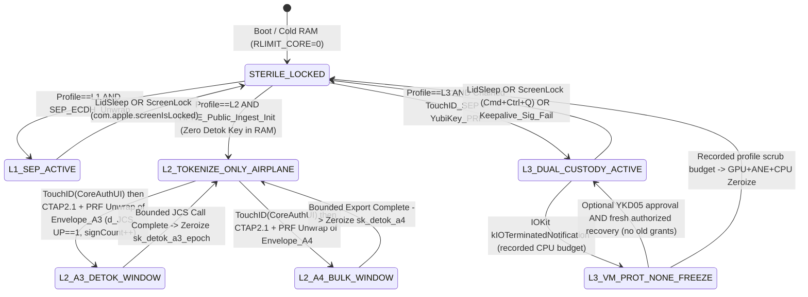

# Feature Design & SRE Production Specification: Cumulative Hardware Custody Profiles (`L1 ⊂ L2 ⊂ L3`), FIDO2 `CTAP 2.1+` & Chained Biometric-Token Intent Signing

* **Doc ID:** `DESIGN-HW-CUSTODY-2026-004` (`FS-703`, **Rev 2.2** — approved decisions `YKD-01–04/06–11/13–15` and Track C (2026-11-18); YKD-05 and YKD-12 remain open; see `§10 Revision History`)
* **Generation:** `v3.0-Target` · **Precedence:** highest tier (with `FS-701..705`, `ADR-006+`) per [`README.md §1.2`](../README.md#12-normative-precedence--architectural-lineage)
* **Implementation Status:** **Partial implementation; qualification incomplete.** Portable logic and bounded native fixtures have evidence; the full profile contract, approved amendments and signed installed hardware acceptance remain open. The earlier blanket software-complete/no-Apple-silicon claim is superseded by this evidence-bound statement (`YKD-15`). See implementation ledger, native validation, and current YubiKey handoff. §11 preserves historical checkpoints; they do not establish current full conformance.
* **Protocol Basis (`F-008`, `ADR-013`):** standard **FIDO2 `CTAP 2.1`** (`authenticatorGetAssertion 0x02`, `hmac-secret` PRF, `pinUvAuthProtocol=2`); **no CTAP 2.2/2.3 extension is used**. Protocol examples include YubiKey 5 Series firmware `>= 5.7.0` (`Ed25519`) or `>= 5.4` (`ES256`); profile qualification additionally requires the actual PRF, UV, attestation, counter and lifecycle capabilities. CTAP version or product name alone does not establish compatibility (`YKD-06`).
* **Author:** Principal Security & SRE Architecture Fellow (Google Distinguished Engineer Standard)
* **Reviewers:** Applied Cryptography, Darwin Kernel & `IOKit` Systems, Apple Silicon `SEP` / Secure Enclave Engineering, Developer Experience (DevEx) SRE
* **Status:** `DRAFT — DESIGN COLLABORATION` (Pre-Implementation Specification; implementation gated on `§8.2` prerequisites and bare-metal validation of `ADR-010`)
* **Target Hardware Baseline:** Apple Silicon `M1` (8GB Unified Memory safe, `arm64e`, macOS 14.0+) with progressive hardware acceleration on `M2` / `M3` / `M4` (`PAC` + `AMX`) and `M5+` (`Apple MIE` / `EMTE` Memory Tagging)
* **Companion Specifications:**
  * Parent Research Track: [Track 4 in `bleeding_edge_future_adoption.md`](bleeding_edge_future_adoption.md#track-4-cumulative-hardware-custody-tiers-l1--l2--l3--monotonic-action-intent-signing-apple-sep-touch-id-yubikey-ctap-23--2-of-2-split-custody)
  * Swarm Distribution Plane (`L1` / `L2` / `L3`): [`FEATURE_SWARM_SECURITY_PROFILES.md`](FEATURE_SWARM_SECURITY_PROFILES.md) (`DESIGN-CAS-SWARM-2026-003`)
  * Post-Autoregressive & World-Model Governance (`Classes 1–6`): [`FEATURE_POST_AR_MODEL_ADAPTERS.md`](FEATURE_POST_AR_MODEL_ADAPTERS.md) (`DESIGN-POST-AR-ADAPTERS-2026-001`)
  * Deterministic Agent IFC & `PoP-Biscuit` Delegation (`C1..C4` $\times$ `T0..T3`): [`FEATURE_AGENT_IFC_AND_DELEGATION.md`](FEATURE_AGENT_IFC_AND_DELEGATION.md) (`DESIGN-AGENT-IFC-2026-005`)
  * Silicon `EMTE` (`M1`–`M5+`) & ZK Compliance Proofs (`L1 ⊂ L2 ⊂ L3`): [`FEATURE_SILICON_EMTE_AND_ZK_COMPLIANCE.md`](FEATURE_SILICON_EMTE_AND_ZK_COMPLIANCE.md) (`DESIGN-EMTE-ZK-2026-006`)

---

## Table of Contents

1. [Context, Motivation & "The Post-Unlock Open Door"](#1-context-motivation--the-post-unlock-open-door)
2. [Goals, Explicit Non-Goals & Alternatives Rejected](#2-goals-explicit-non-goals--alternatives-rejected)
3. [Unified `HardwareCustodyEngine` Architecture & Chained Co-Signature Cryptography](#3-unified-hardwarecustodyengine-architecture--chained-co-signature-cryptography)
   * 3.1 Monotonic Taxonomy (`L1 ⊂ L2 ⊂ L3` $\times$ `A1 < A2 < A3 < A4`) & Anti-Downgrade Binding
   * 3.2 Canonical RFC 8785 (JCS) Transaction-Bound Intent Payload & Anti-Prompt-Bombing
   * 3.3 FIDO2 `CTAP 2.1` Wire Assertion & `pinUvAuthProtocol=2` Encrypted USB Bus Semantics
   * 3.4 Sequential Chained Dual-Silicon Co-Signature (`Touch ID SEP` $\to$ `YubiKey CTAP 2.1+`)
   * 3.5 Cross-Track Integration Matrix (Tracks 1, 2 & 3 $\times$ `HardwareCustodyEngine`)
4. [Detailed Specification of the Three Cumulative Custody Profiles (`L1`, `L2`, `L3`)](#4-detailed-specification-of-the-three-cumulative-custody-profiles-l1-l2-l3)
   * 4.1 Profile `L1`: `sep-biometric` (\$0 Extra Hardware | Startup Day-1 Baseline)
   * 4.2 Profile `L2`: `step-up-yubikey` (Airplane-Safe Dual-Key Asymmetric Vault + Chained `CTAP 2.1+` Step-Up)
   * 4.3 Profile `L3`: `dual-custody-deadman` (`2-of-2` `SEP || YubiKey PRF` Vault + `profile-budgeted` Yank-to-Zeroize)
5. [Engineering Deep-Dive: Resolving WindowServer Occlusion, USB Dock Glitches & Clamshell Paradoxes](#5-engineering-deep-dive-resolving-windowserver-occlusion-usb-dock-glitches--clamshell-paradoxes)
   * 5.1 Challenge A: Defeating macOS WindowServer Overlay & "Pop-Under-Finger" Attacks on Intent Sheets
   * 5.2 Challenge B: Solving Thunderbolt / USB-C Hub Micro-Drops Without Evil-Maid Windows (`Lock-Then-Scrub`)
   * 5.3 Challenge C: Qualified, Event-Driven Silent Presence (`L3`, `YKD-06`)
   * 5.4 Challenge D: Closed-Clamshell Operation Without Factor Substitution (`YKD-08`)
   * 5.5 Challenge E: Deterministic `CustodyLifecycleFSM` Hardware State Machine
6. [Frontier AI Lab Standards Crosswalk: Google DeepMind, Anthropic, and OpenAI](#6-frontier-ai-lab-standards-crosswalk-google-deepmind-anthropic-and-openai)
7. [Production Readiness Review (PRR) & Operational SRE Runbooks: SLIs, SLOs, Lost-Key Recovery, FMEA & Audit Receipts](#7-google-sre-production-readiness-review-prr-slis-slos-lost-key-recovery-fmea--audit-receipts)
   * 7.1 Service Level Indicators (SLIs) & Service Level Objectives (SLOs)
   * 7.2 Failure Modes & Effects Analysis (FMEA) & Zero-Brick Lost-Key Recovery Runbook
   * 7.3 Daemon Footprint (`launchd` Hard Caps) & Zero-PII Hardware Intent Receipt (Track-6 ZK Seam)
8. [Future Section: Formal Verification & Mathematical Security Proofs Roadmap (`L2` & `L3`)](#8-future-section-formal-verification--mathematical-security-proofs-roadmap-l2--l3)

---

## 1. Context, Motivation & "The Post-Unlock Open Door"

Most enterprise endpoint architectures—and virtually every open-source depot agent runner in 2026—conflate **boot-time machine authentication** with **per-action human intent**. Once a developer unlocks their MacBook at 9:00 AM, local AI agents operate behind an "open door" exposed to four compounding failure modes:

1. **Confused-Deputy Abuse of Non-Interactive Keys:** Apple Silicon Secure Enclave Processor (`SEP`) workload keys configured without biometric flags (so routine background depot calls do not trigger Touch ID popups every 20 seconds) can be invoked via IPC by malicious npm/PyPI post-install scripts, compromised IDE extensions, or Electron RCEs running under the developer's POSIX UID.
2. **Software-Only Agent Confirmation Buttons:** Clicking *"Allow Tool"* inside an Electron chat window (`Claude Desktop`, `Cursor`, browser-based CUA agents) proves zero physical human presence—any local process with Accessibility (`AXUIElement`) permissions or renderer-process code execution can synthesize the click in `<1ms`.
3. **Blind Biometric Prompts ("What You See $\neq$ What SEP Signs"):** Standard macOS Touch ID dialogs verify *whose* fingerprint touched the ring, not *which exact SQL AST or row count* is being authorized underneath a spoofed user-space window.
4. **The Flush-Mounted YubiKey 5C Nano Gap & FIDO2 PIN Keylogging:** Conversely, relying on a standard non-biometric YubiKey 5C Nano left plugged flush into a MacBook USB-C port allows *any* nearby human finger (tailgating / shoulder-reach tap) to satisfy hardware User Presence (`UP`), while requiring a keyboard-typed FIDO2 PIN exposes that PIN to user-space keyloggers and creates repetitive developer friction.

This specification defines **`HardwareCustodyEngine`**—a single, unified Rust/Swift hardware trust subsystem whose **three cumulative Custody Profiles (`L1 ⊂ L2 ⊂ L3`)** align 1-to-1 with our [Swarm Security Profiles](FEATURE_SWARM_SECURITY_PROFILES.md), paired with **four monotonically increasing Action Sensitivity Classes (`A1 < A2 < A3 < A4`)** and a **chained `Touch ID (SEP, CoreAuthUI)` $\to$ `YubiKey CTAP 2.1+` co-signature** on **every** `A3` and `A4` action in `L2` and `L3`. `L1` and `L2` preserve zero FIDO2 PIN typing; `L3` permits secure entry of the existing FIDO2 PIN on the Mac when required for authenticator UV. The approximately 1.5-second two-touch gesture describes a PIN-free path, not every `L3` cold-PIN ceremony. The approved profile-specific contract is in §3.1.1 (`YKD-01`).

---

## 2. Goals, Explicit Non-Goals & Alternatives Rejected

### 2.1 Goals

* **G1 (\$0 Extra Hardware Startup Floor):** Operate `Profile L1` (`sep-biometric`) on Day 1 using **only built-in Apple Silicon `SEP` + MacBook Touch ID** (\$0 peripheral cost across every `M1`–`M5` Mac).
* **G2 (Strictly Monotonic, Cumulative Architecture):** Guarantee that **a larger number always signifies higher sensitivity and stronger hardware assurance** across both Custody Profiles (`L1 ⊂ L2 ⊂ L3`) and Action Classes (`A1 < A2 < A3 < A4`), eliminating $2^N$ mix-and-match configuration permutations.
* **G3 ("The Airplane Test" + Profile-Specific PIN UX, `YKD-01`):** Ensure `Profile L2` developers on flights **without a YubiKey plugged in** retain 100% zero-prompt productivity on routine `A1`/`A2` tokenized workflows. Every `A3`/`A4` action in `L2` and `L3` enforces a **cryptographically chained `Touch ID (CoreAuthUI) -> YubiKey` co-signature**. **Zero keyboard FIDO2 PIN typing applies to `L1`/`L2`; `L3` allows secure host PIN entry when needed for actual signed UV.** The existing $\le 1.8\text{s}$ interactive target and `10.0s` hard ceremony cap are not relaxed by this UX decision: measure cold-PIN and reusable-token cases separately, include any PIN entry within the ceremony's elapsed time, and record target misses. Lifecycle calibration follows `YKD-02`; ceremony/token clock details remain under `YKD-09`.
* **G4 (Physical Dead-Man's Switch & Recoverable Access, `YKD-02`):** In `Profile L3`, YubiKey removal triggers fail-closed release fencing, CPU-access restriction, accelerator fencing and zeroization of $K_{\text{vault}}$, the ephemeral PII vault and affected model/backend state. **Calibrate timing before implementing the timing-sensitive changes: allow broad measured latitude for `L1`/`L2` and tighter evidence-based limits for `L3`.** Numeric profile budgets are pending the native baseline in §5.2. Earlier `<0.5 ms`/`≤4.5 ms`/`p99.9 ≤5 ms` figures are historical engineering references, not current fixed release thresholds or achieved guarantees. DMA isolation requires actual accelerator-fence evidence; recoverable enterprise access does not recover wiped ephemeral plaintext.

### 2.2 Explicit Non-Goals

* **NG1:** Storing persistent unencrypted or vault-encrypted production databases on developer laptop SSDs (laptop PII vaults hold *ephemeral session translation tables* in `mlock()` RAM only).
* **NG2:** Custom proprietary JavaCard applets requiring non-standard YubiKey firmware flashes (100% compatible with off-the-shelf **YubiKey 5 Series** running `FIDO2 CTAP 2.1+` — firmware `>= 5.7` for `Ed25519`, `>= 5.4` for `ES256` (`OQ-07`) — with `hmac-secret`/PRF). Interactive threshold-signature protocols (RFC 9591) are not used because stock firmware cannot run them (`ADR-013`).
* **NG3:** macOS kernel extensions (`kexts`). All hardware transport runs strictly in user space via `Security.framework`, `LocalAuthentication`, `AuthenticationServices`, and `IOKit` (`IOHIDManager`).

### 2.3 Alternatives Considered & Rejected

| Candidate Approach                                                           | Apparent Advantage                                               | Reason for Distinguished-Engineer Rejection                                                                                                                                                                                                                                                                                     |
|:-----------------------------------------------------------------------------|:-----------------------------------------------------------------|:--------------------------------------------------------------------------------------------------------------------------------------------------------------------------------------------------------------------------------------------------------------------------------------------------------------------------------|
| **Disconnected Feature Flags (Separate SEP, Touch ID, CTAP & Yank Modules)** | Maximum toggle granularity.                                      | Produces $2^4 = 16$ partially tested security states, ambiguous failure modes in docked/airplane edge cases, and cognitive drift from `L1`/`L2`/`L3`.                                                                                                                                                                           |
| **Inverted SRE Risk Numbering (`Tier 2` Low $\to$ `Tier 0` High)**           | Familiar to legacy IAM teams.                                    | Directly contradicts monotonic `L1`–`L3` profiles and `D1`–`D4` PII data classifications; causes dangerous operator misconfiguration.                                                                                                                                                                                           |
| **Unconditional FIDO2 PIN Typing on Every Critical Prompt**                  | Standard PIN-authenticated UV is available on nonbiometric keys. | Rejected as a universal workflow: `L1`/`L2` remain PIN-free. `L3` explicitly permits the existing PIN through a trusted host provider when UV requires it (`YKD-01`), with bounded least-privilege token reuse and residual host-input risk; fresh typing on every prompt is not required when valid scoped reuse is permitted. |
| **Standalone YubiKey Capacitive Tap Without Touch ID on `L3` / `A4`**        | Single hardware touch.                                           | Flush-mounted YubiKey 5C Nano keys have no biometric sensor—a passerby shoulder-tap or physical probe satisfies `UP=1` without proving owner identity.                                                                                                                                                                          |

---

### 2.4 Core Specification Dependencies & Invariant Deltas

| Item                                   | Disposition in `FS-703`                                                                                                                                                                                                                                                |
|:---------------------------------------|:-----------------------------------------------------------------------------------------------------------------------------------------------------------------------------------------------------------------------------------------------------------------------|
| **Requires (`CORE-V2`)**               | `CNRY_SEP_*` canary tripwires are emitted from `_piivault` (`UID 703`) responses (`OQ-04`); Cedar PDP (`UID 704`) issues `Custody::ReversibleTokenize` grants (`ADR-007`).                                                                                             |
| **Requires (`v3.0`)**                  | `FS-704` `UserTurnV1` (so pasted content can never trigger `A3`/`A4` as `T1`, `ADR-014`); `FS-705` `SecureSlabAllocator` (root keys on dedicated guard pages) and `HardwareIntegrityQuarantine`.                                                                       |
| **Amends `CORE-V1 §2.3` Invariant 3**  | Bounded, hardware-gated detokenization to a **human** (never into model context) is permitted: `C3` single rows under `Envelope_A3`; `C4` only in `L2`/`L3` under `Custody::ReversibleTokenize` via `Envelope_A4`. PANs and credentials are never vaulted (`ADR-007`). |
| **Retains `CORE-V1 §2.3` Invariant 4** | All custody keys are SEP- or YubiKey-resident; the Python simulation is explicitly non-compliant.                                                                                                                                                                      |
| **Supersedes**                         | `ADR-004` irreversible-only masking (for `L2`/`L3` with grant); the single shared `sk_detok_root` of `Rev 1.3` (`ADR-009`); RFC 9591 quorum option (`ADR-013`).                                                                                                        |
| **Shared contracts**                   | `schemas/intent-payload-v1.schema.json` (JCS intent, factor rules), `EnclaveAuditEnvelopeV1` journals, `rpc_seq_u64` under SEP-signed `boot_epoch_id` (`ADR-010`).                                                                                                     |

---

## 3. Unified `HardwareCustodyEngine` Architecture & Chained Co-Signature Cryptography

### 3.1 Monotonic Taxonomy (`L1 ⊂ L2 ⊂ L3` $\times$ `A1 < A2 < A3 < A4`) & Anti-Downgrade Binding

The workstation's active hardware custody profile is locked to the exact same anti-downgrade floor as [`FEATURE_SWARM_SECURITY_PROFILES.md` Section 3.2](FEATURE_SWARM_SECURITY_PROFILES.md):

$$\text{Profile}_{\text{effective}} = \max\Big(\text{WorkstationCedarPolicy.min\_profile}, \;\text{SignedTUFManifest.min\_profile}, \;\text{ModelManifest.min\_swarm\_profile}\Big)$$

Every enclave operation across Tracks 1–6 deterministically resolves to one of four **monotonically increasing Action Sensitivity Classes (`A1 < A2 < A3 < A4`)**:

| Action Class *(Larger = Higher Risk)* | Canonical Enclave Triggers (Tracks 1–6) | **`L1: sep-biometric`**<br>*(Startup Zero-Ops | \$0 Key)* | **`L2: step-up-yubikey`**<br>*(Enterprise Mesh | Airplane-Safe)* | **`L3: dual-custody-deadman`**<br>*(Classified Enclave | `2-of-2`)* |
|:---|:---|:---|:---|:---|
| **`A1: Routine Tokenized`** | Scrubbed SQL/API reads (`SYNTH-SSN-...`), `jev` call $\le 12.0\text{b}$ entity QIF cap, local `LLaDA`/`Mamba-3` code synthesis | **0 Prompts:** Non-interactive Apple `SEP` P-256 workload key + DPoP | **0 Prompts (100% Airplane-Safe):** `SEP` workload key in `Tokenize-Only` vault mode; **no YubiKey needed** | **0 Extra Touch Prompts:** Requires YubiKey inserted (`2-of-2` unlocked vault + passive HID binding) + `SEP` DPoP |
| **`A2: Elevated Session`** | Cross-domain depot join, reading `INTERNAL` schemas, refreshing `L2` `Biscuit` swarm capability lease | **15-min Touch ID Lease** (`LAContext` biometric cache in `SEP`) | **15-min Touch ID Lease** + `Biscuit` Datalog attenuation check | **15-min Dual-Bound Lease:** Touch ID + continuous `IOKit` YubiKey USB presence |
| **`A3: Critical Intent`** | **Single-record `C3` detokenization** (`C4` only in `L2`/`L3` under `Custody::ReversibleTokenize`), `jev` $>12.0\text{b}$ QIF step-up, local DB DDL schema mutation | **Per-Action Touch ID** (`.biometryCurrentSet`, SIP-protected `CoreAuthUI`) + Anti-Occluded XPC JCS Sheet | **Chained `Touch ID` (`CoreAuthUI`) $\to$ `YubiKey` Tap** (`CTAP 2.1` `UP=1` over `d_JCS` + monotonic `signCount`; `10s` window) | **Chained `Touch ID` $\to$ `YubiKey` Co-Signature with `PIN/UV=1`** + synchronous ZK egress gate (`FS-705`) |
| **`A4: Extreme / Break-Glass`** | **Bulk (`> 1`-row) or `C4` export** (no `C4` in `L1`), world-model OOD energy override, `pf` firewall bypass, TUF root/policy mutation | **Per-Action Touch ID + Out-of-Band OIDC IdP Step-Up** | **Chained `Touch ID` $\to$ `YubiKey` Co-Signature** *(+ `k`-of-`n` `Ed25519` lead quorum for org TUF)* | **Chained `Touch ID` $\to$ `YubiKey` Co-Signature with `PIN/UV=1`** *(+ offline `k`-of-`n` `Ed25519` YubiKey quorum for org roots)* |

**Strict Nesting Invariant (`MUST`, `F-013`):** for every action class $a \in \{A1..A4\}$, $\text{RequiredFactors}(L1, a) \subseteq \text{RequiredFactors}(L2, a) \subseteq \text{RequiredFactors}(L3, a)$. Concretely at `A3`: `L1 = {TOUCH_ID_COREAUTHUI}` ⊆ `L2 = {TOUCH_ID_COREAUTHUI, YUBIKEY_UP}` ⊆ `L3 = {TOUCH_ID_COREAUTHUI, YUBIKEY_UP, YUBIKEY_PIN_UV, ZK_EGRESS_GATE}`. SIP-protected `CoreAuthUI` is in the `WYSIWYS` path of **every** `A3`/`A4` approval in every profile; a cancelled Touch ID fails the ceremony closed and never arms the YubiKey. `schemas/intent-payload-v1.schema.json` encodes this rule (an `L2` `A3` intent listing only `YUBIKEY_UP` is invalid).

#### 3.1.1 Approved profile-specific PIN/UV contract (`YKD-01`, 2026-11-15)

The accepted user decision
resolves the previous blanket zero-PIN promise as follows. This subsection
governs PIN input methods; the existing required-factor matrix remains binding.

| Profile | FIDO2 PIN input contract          | Required hardware/verification boundary                                                                                                                                                                                                                                       |
|---------|-----------------------------------|-------------------------------------------------------------------------------------------------------------------------------------------------------------------------------------------------------------------------------------------------------------------------------|
| `L1`    | **NO_TYPED_FIDO2_PIN**            | Built-in SEP/Touch ID remains the baseline; no external key or new biometric peripheral is required.                                                                                                                                                                          |
| `L2`    | **NO_TYPED_FIDO2_PIN**            | Preserve Touch ID followed by the required external-key proof. Qualify a compatible biometric authenticator for paths requiring on-key UV; those paths fail closed if PIN-free UV is unavailable. Existing UP-only action requirements do not become universally UV-required. |
| `L3`    | **SECURE_HOST_FIDO2_PIN_ALLOWED** | Secure entry of the existing FIDO2 PIN on the Mac is allowed when needed. Verify the actual signed `UV=1` on every UV-required assertion; keep separate Touch ID, UP, intent binding and all other applicable factors.                                                        |

**MUST:** A PIN prompt required by a device in `L1`/`L2` causes an explicit
unsupported-path refusal; it never silently enables the `L3` input policy.
Biometric-device selection must qualify actual PRF/hmac-secret, algorithms,
attestation, counter and lifecycle capabilities for the intended action. A
product name or fingerprint sensor alone does not establish compatibility.
PIN-free `L2` paths using the already-required Touch ID plus key UP remain
within the existing factor matrix. Selecting biometric hardware for qualification
does not require every `L2` action to acquire a new UV factor.

**MUST:** The `L3` PIN UI and authenticated provider channel stay on the Mac;
PINs/tokens must not enter the container, runner/controller output, logs, argv,
environment or receipts. Use minimum token permissions and RP/authenticator/session
binding. **YKD-09 supersedes the earlier bounded-reuse possibility:** no host-held
PIN/UV token reuse between ceremonies in the initial implementation. Discard
the token at ceremony end, and sooner on failure/invalidation; the critical
ceremony still has its complete 10 s cap. Do not cache the PIN to reacquire a
token silently. Invalidate and scrub owned
PIN/token state on removal, lock, sleep, cancellation, expiry and relevant policy
change. Missing UI/provider, failed authentication or unverifiable signed UV
refuses the action. Host PIN entry retains host-compromise/input-capture risk;
it does not provide an absolute keylogger-resistance guarantee.

This decision permits a software input flow, not PIN changes, reset, retry
exhaustion, credential deletion or application reconfiguration. The existing
physical key's PIN/PUK and unrelated credentials remain preserved. Actual PIN
submission/enrollment is separately scoped. `YKD-02` now selects measured,
profile-specific timing (§5.2); its numeric budgets remain pending. `YKD-03`
attestation, `YKD-08` factor exceptions and `YKD-09` token/clock details remain open.

**OIDC implementation boundary (2026-11-15, current source):** inherited A4 IdP
requirements apply across all profiles. The bounded token verifier and consuming
acquisition bind the independently configured expected principal, fresh signed
`auth_time` floor, unpredictable nonce, complete intent/boot/original deadline and
current console audit session; five production-library software probes passed.
A separate browser authorization-code/S256 PKCE broker now has native production
and private-test compile evidence, including task/session ambient-auth refusal;
the exact third native receipt
and source/deployment handoff
bound that result. Private protocol probes perform no browser, IdP, PIN, Touch ID,
credential or installed operation. Genuine independently provisioned IdP/client/
redirect/TUF principal authority, protected root per-login identity renewal,
initial screen-lock readiness, actual GUI/IdP cancellation and original-cap
inherited factors remain OPEN. Installed distinct UID/signing/entitlement and
resource qualification remain separate; source/build results establish no full
A4 or L1/L2/L3 qualification. Organization-quorum collection remains refused in
production. Local candidate durable partial-approval storage returns statistics,
not a guarded-signer authorization; its separate legacy plain-digest CTAP format
must never be cast to the reviewed chained proof or standard TUF signatures.

### 3.2 Canonical RFC 8785 (JCS) Transaction-Bound Intent Payload & Anti-Prompt-Bombing

To defeat parameter-reordering, whitespace malleability, prompt-injected UI summaries, or cross-tool replay attacks, every `A3` and `A4` authorization serializes a strict **RFC 8785 JSON Canonicalization Scheme (JCS)** structure prior to hashing:

The payload validates against [`schemas/intent-payload-v1.schema.json`](../schemas/intent-payload-v1.schema.json). `Rev 1.4` replaces the machine-local `monotonic_ts_ns` / `monotonic_boot_uuid` fields with `boot_epoch_id` + `rpc_seq_u64` + `ts_utc_ms` (`ADR-010`, `ADR-015`):

<!-- schema: intent-payload-v1 -->
```json
{
  "v": 1,
  "schema_version": "enclave.intent.v1",
  "action_class": "A4",
  "profile": "L3",
  "data_class": "C3",
  "spiffe_id": "spiffe://corporate.internal/enclave/uid/704",
  "tool_name": "depot://analytics/export_csv",
  "target_namespace": "prod-analytics",
  "human_summary_trusted": "Export <= 120 C3 rows via depot://analytics/export_csv",
  "row_count_bound": 120,
  "arguments_jcs_sha256": "e3b0c44298fc1c149afbf4c8996fb92427ae41e4649b934ca495991b7852b855",
  "canonical_arguments_blake3": "7b3c0e5a1d9f2864ab07c3e1f5d9b2a68c4e0f1a3b5d7c9e2f4a6b8c0d1e3f5a",
  "model_blake3": "9a4f8c2e1b0d7743a51908c4e6b2d1f0883a7c5e9d1b4f2a6c8e0d2f4a6b8c0e",
  "policy_blake3": "7f8a9d2c4e1b09a38851c2d4f6a8b0c2e4d6f8a0b2c4e6d8f0a2b4c6e8d0f2a4",
  "qif_millibits_delta": 0,
  "custody_grant": "none",
  "boot_epoch_id": "7b2e9a10-4c11-4f88-9d21-0019e2a4b7f1",
  "rpc_seq_u64": 88514,
  "ts_utc_ms": 1762308012405,
  "required_factors": ["SEP_WORKLOAD_KEY", "TOUCH_ID_COREAUTHUI", "YUBIKEY_UP", "YUBIKEY_PIN_UV", "ZK_EGRESS_GATE", "KOFN_ED25519_QUORUM"]
}
```

1. **Zero Untrusted Summary Text & Hard Post-Call Output Truncation:** `human_summary_trusted` is **never supplied by the LLM agent or external depot server metadata**—it is synthesized deterministically inside the trusted Cedar Policy Proxy from the parsed SQL/JSON AST (`canonical_verb`, `target_namespace`, `row_count_bound`). Furthermore, `row_count_bound` and `qif_bits_delta` act as **hard post-execution truncators** inside the proxy (aborting before IPC return if a query attempts to emit `121` rows under a `120`-row grant).
2. **Canonical Digest & 4-Word BIP-39 Visual SAS:** $d_{\text{JCS}} = \text{SHA-256}(\text{RFC8785\_Bytes}(\text{IntentPayloadV1}))$. The top 44 bits of $d_{\text{JCS}}$ map deterministically to four 11-bit English words (e.g., `cobalt-tiger-velvet-orbit`) injected directly into Apple's SIP-protected `CoreAuthUI.app` Touch ID prompt string (`LAContext.localizedReason`).
3. **Anti-MFA-Bombing Circuit Breaker (`SERIALIZED_SINGLEFLIGHT`):** To prevent a runaway or prompt-injected loop from spamming hardware prompts until an annoyed developer reflexively taps Touch ID / YubiKey, `HardwareCustodyEngine` enforces **at most 1 in-flight hardware ceremony globally**, a hard cap of **3 `A3`/`A4` prompts per 60-second window**, and a session-local **`PromptCooldown60s`** state (renamed from `QuarantineLock` to end the collision with `FS-705`'s hardware latch, `F-013`/`F-017`) entered only when the user explicitly selects **"Report Suspicious Prompt"** or after **`>= 5` consecutive timeouts**. `PromptCooldown60s` suppresses new prompts for `60 s`, is clearable locally via Touch ID, and **never writes SEP NVRAM** — so a buggy agent cannot lock a developer out by spamming two prompts while they are away.

### 3.3 FIDO2 `CTAP 2.1` Wire Assertion & `pinUvAuthProtocol=2` Encrypted USB Bus Semantics

This is plain `CTAP 2.1` (`F-008`): the intent binding comes from passing `d_JCS`-derived bytes as the opaque 32-byte `clientDataHash`, not from any transaction-signing extension. Screenless keys prove physical presence only; the trusted display is `CoreAuthUI`.

When challenging a YubiKey 5 Series or YubiKey Bio token over native USB-C/NFC `IOHIDManager` (`FIDO` usage page `0xF1D0`, command `authenticatorGetAssertion = 0x02`), the hardware Secure Element signs the concatenated WebAuthn/CTAP2 assertion structure:

$$M_{\text{CTAP2}} = \underbrace{\text{SHA-256}(\text{"enclave.local.internal"})}_{32\text{B } \text{rpIdHash}} \;\parallel\; \underbrace{\text{flags}}_{1\text{B}} \;\parallel\; \underbrace{\text{signCount}}_{4\text{B BE}} \;\parallel\; \underbrace{\text{ext}_{\text{hmac-secret}}}_{\text{AES-256-CBC}} \;\parallel\; \underbrace{\text{clientDataHash}}_{32\text{B}}$$

The enclave verifier **rejects (`EACCES`)** any YubiKey assertion unless all applicable hardware invariants hold simultaneously:

1. `rpIdHash` matches the enclave's pinned relying-party digest and credential ID matches the developer's enrolled TUF/IdP hardware key certificate (`AAGUID` verified against genuine Yubico FIDO2 attestation roots). **Attestation mode (`F-015`):** `L2` uses verified Basic Attestation (approved model/AAGUID policy). `L3` permits either verified Enterprise Attestation bound to the authenticated asset inventory, or verified Basic Attestation plus **independently authenticated asset enrollment** (`YKD-03`). Basic Attestation establishes approved model/credential evidence, not a manufacturer-attested unique asset serial; a supplied serial, USB descriptor, AAGUID or successful GetInfo is not independent inventory authentication. Organization-required Enterprise policy remains mandatory, with no silent fallback. `none`/self attestation is rejected at enrollment in `L2`/`L3`. **First L3 setup MUST disclose** the selected mode, weaker per-device assurance of Basic plus inventory, Enterprise Attestation rationale, remaining risks and organization policy; retain a non-secret policy/disclosure receipt. Documentation alone or a printed warning does not implement asset admission. See YKD-03. **Lifecycle:** the enrolled `AAGUID + firmwareVersion` is **re-validated on every TUF refresh** of `fido-mds-allowlist.json`; any key matching a `REVOKED` status report or below `min_firmware_version` is rejected on its very next assertion (`RB-201`). **Offline revocation window (`MUST`, `F-015`):** `A3`/`A4` assertions are accepted only while the host's TUF `timestamp` metadata is fresher than **`24h` in `L3`** and **`72h` in `L2`**; the `168h` offline grace applies solely to read-only use of cached models and policies, never to custody assertions. On expiry, `A3`/`A4` fail closed (`EPERM: CUSTODY_METADATA_STALE`) until TUF refreshes, bounding a stolen key + observed PIN to that window. Reported key loss is pushed as a TUF `fido-mds-allowlist.json` revocation entry, not by waiting for metadata expiry.
   **Freshness clarification (`YKD-07`, MUST):** age equal to `24 h` (`L3`)
   or `72 h` (`L2`) is stale. Earlier applicable signed expiry, known revocation
   or unavailable trustworthy freshness evidence refuses the affected custody
   assertion sooner. Read-only cached model/policy grace is subject to its own
   expiry/access controls; it does not grant PII access, custody, a new lease or
   a profile downgrade. Refresh/counter/presence success alone does not restore
   cancelled authority. See YKD-07.
2. `flags & 0x01 == 0x01` (**Physical User Presence `UP` bit set**—confirming live capacitive/biometric actuation since the challenge arrived). The only scoped exception is the restricted silent-presence check in §5.3 (`YKD-06`); it establishes no action authorization and cannot replace required UP/UV or Touch ID.
3. **Strict Monotonic Counter Anti-Clone Check:** $\text{signCount}_{\text{assertion}} > \text{signCount}_{\text{persisted}}$, where $\text{signCount}_{\text{persisted}}$ is stored inside an Apple `SEP`-MACed monotonic state file. If a cloned hardware emulator ever presents a stale `signCount`, the enclave triggers an immediate `SEV-1` revocation alert.
4. **Encrypted USB Bus Transport for `hmac-secret` / `PRF` (`pinUvAuthProtocol = 2`):** Whenever `hmac-secret` (`PRF`) outputs are exchanged (`L2`/`L3` `Envelope_A3`/`Envelope_A4` unwrapping or `L3` morning `2-of-2` unlock), `_piivault` negotiates an ephemeral **CTAP2 `authenticatorClientPIN (getKeyAgreement = 0x02)` ECDH P-256 shared secret** (`HKDF-SHA-256` $\to$ `AES-256-CBC` + `HMAC-SHA-256`) directly with the YubiKey Secure Element (`CredRandomWithoutUV` when `UP=1` with zero PIN; `CredRandomWithUV` when `UV=1`)—guaranteeing passive Thunderbolt/USB-C hub sniffers capture **zero plaintext PRF key bytes** on the USB wire!
5. Valid `Ed25519` (`COSE alg = -8`, firmware `>= 5.7`) or `ECDSA P-256` (`COSE alg = -7`, firmware `>= 5.4`) signature over $M_{\text{CTAP2}}$.
6. **HID Contention Hardening (`F-014`, unvalidated on hardware):** during a ceremony `_enclavecustody` opens the FIDO HID interface with `kIOHIDOptionsTypeSeizeDevice`; repeated `CTAP2_ERR_CHANNEL_BUSY` or unexplained `signCount` jumps between ceremonies (evidence of `uid=501` processes driving the key) raise a security event and require re-enrollment review. `L3` additionally rejects any key enumerated behind an external USB hub (`IOUSBHostDevice` topology depth `> 1` from the Apple root controller, `OQ-12`).

**Profile UV requirement (`MUST`, `YKD-01`):** Any action requiring
`YUBIKEY_PIN_UV` must verify the signed authenticator UV flag (`flags & 0x04`).
Touch ID success, a PIN-provider acknowledgement or protocol-2 key agreement
does not establish that flag. For `L3`, obtain the required UV through the
permitted secure host PIN flow when needed. `L2` must satisfy any required
on-key UV without typed FIDO2 PIN input, or refuse that path (§3.1.1).

### 3.4 Sequential Chained Dual-Silicon Co-Signature (`Touch ID SEP` $\to$ `YubiKey CTAP 2.1+`)

For **every `A3` and `A4` gate in `L2` and `L3`**, `HardwareCustodyEngine` executes a **Sequential Cryptographically Chained Co-Signature** across Apple's Secure Enclave (`SEP`) and Yubico's Secure Element within a hard **$10.0\text{-second}$ monotonic clock budget**:

```
  [depot Proxy Freezes Execution & Computes d_JCS = SHA-256(RFC8785(IntentPayloadV1))]
                                        |
                                        v
  STEP 1: APPLE SILICON SEP BIOMETRIC IDENTITY (`WHO` — Live Fingerprint Match)
  +--------------------------------------------------------------------------------+
  | • Anti-Occlusion XPC Sheet verifies zero overlapping windows in WindowServer   |
  | • Invokes `SecKeyCreateSignature` on `.biometryCurrentSet` SEP P-256 key       |
  | • SIP-protected `CoreAuthUI` displays: "[A4] Export 120 rows | cobalt-tiger"   |
  | • Output: sigma_SEP = Sign_SEP(d_JCS || nonce_enclave || t_start_ns)           |
  +--------------------------------------------------------------------------------+
                                        |
            (If Touch ID fails or cancels -> ABORT; YubiKey LED never arms!)
                                        |
                                        v  (< 20ms transition)
  STEP 2: EXTERNAL YUBIKEY CTAP 2.1 INTENT BINDING (`WHAT & WHERE` — Second Silicon)
  +--------------------------------------------------------------------------------+
  | • Enclave binds SEP signature into challenge:                                  |
  |     clientDataHash = SHA-256(d_JCS || sigma_SEP || t_start_ns)                 |
  | • Sends CTAP 2.1 `GetAssertion(UP=true)` over USB-C `0xF1D0` HID               |
  | • L2: PIN-free key actuation; qualify biometric UV where required             |
  | • L3: secure host PIN when needed; verify signed UV=1 on UV-required actions  |
  | • Enforces: (t_complete_ns - t_start_ns) <= 10_000_000_000 ns (10.0s hard cap) |
  | • Output: sigma_YK = Sign_YubiKey(authenticatorData || clientDataHash)         |
  +--------------------------------------------------------------------------------+
                                        |
                                        v
      [Inseparable Proof Tuple `(d_JCS, sigma_SEP, authData, sigma_YK)` Verified]
```

All PIN entry/provider time occurring within this ceremony counts toward its
existing `10.0s` monotonic cap. Do not stop/restart the clock for a PIN prompt
or reuse an old Touch ID proof after timeout. Token reuse lifetime remains a
separate bounded authority; it never waives a fresh required action proof.

* **Sequential Chaining and Profile-Specific PIN UX:**
  1. **PIN-Free Path and Scoped PIN Path (`YKD-01`):** `L1`/`L2` preserve zero FIDO2 PIN typing; the approximately 1.5-second two-touch `L2` gesture remains a target subject to hardware qualification. `L3` supports secure entry of the existing FIDO2 PIN when needed for signed UV, and separately measures cold-PIN versus valid bounded-token paths. PIN input adds host-input exposure; the chain binds intent and preserves distinct factors rather than eliminating every keylogger threat.
  2. **Non-Spliceable Binding & Biometric Enrollment Tamper-Eviction:** Because $\sigma_{\text{SEP}}$ is hashed inside `clientDataHash` *before* the YubiKey signs, an attacker cannot stitch a pre-recorded Touch ID signature onto a shoulder-tapped YubiKey assertion. Moreover, keying Step 1 strictly to **`kSecAccessControlBiometryCurrentSet`** (never `.biometryAny`) guarantees that if an attacker knowing the macOS login password adds a new fingerprint in System Settings, Apple Silicon `SEP` **permanently destroys key access in hardware**.

### 3.5 Cross-Track Integration Matrix (Tracks 1, 2 & 3 $\times$ `HardwareCustodyEngine`)

`HardwareCustodyEngine` acts as the shared physical root of trust across our [Swarm Distribution Plane (`Track 3`)](FEATURE_SWARM_SECURITY_PROFILES.md) and [Post-AR / World-Model Adapters (`Tracks 1 & 2`)](FEATURE_POST_AR_MODEL_ADAPTERS.md):

| Companion Subsystem                                                           | `L1` (`sep-biometric`) Binding                                                                                                           | `L2` (`step-up-yubikey`) Binding                                                                                           | `L3` (`dual-custody-deadman`) Binding                                                                                                                                |
|:------------------------------------------------------------------------------|:-----------------------------------------------------------------------------------------------------------------------------------------|:---------------------------------------------------------------------------------------------------------------------------|:---------------------------------------------------------------------------------------------------------------------------------------------------------------------|
| **Track 3: `enclave-cas` Swarm**                                              | Signs local audit receipts (`sep_receipt_sig`); cached models valid for `168h` offline grace TTL.                                        | Namespace-scoped `A2` Touch ID lease refreshes `Biscuit` swarm tokens; `168h` offline model access needs **0 YubiKeys**.   | `2-of-2` unlock derives $K_{\text{cas\_session}}$ for `L3` namespace `KEK`s; **USB yank wipes $K_{\text{cas\_session}}$ + unmounts idle `L3` APFS model snapshots**. |
| **Track 1: `Class 1` (`jev` RLCD Diode)**                                     | Entity QIF $\le 12\text{b}$ is `A1` (`0` prompts); $>12\text{b}$ single-entity triggers `A3` Touch ID sheet.                             | $>12\text{b}$ single-entity triggers `A3` chained `Touch ID -> YubiKey`; multi-entity cohort triggers `A4` Chained Co-Sig. | All $>12\text{b}$ QIF declassifications require Chained `Touch ID -> YubiKey` Co-Sig (`A3`/`A4`).                                                                    |
| **Track 1: `Class 2, 3, 4 & 5` (`LLaDA`, `Mamba-3`, `BLT`/`LCM`, `EAGLE-3`)** | Lid-close sleep (`kIOMessageSystemWillSleep`) & Screen Lock (`com.apple.screenIsLocked`) zeroize tainted `MTLHeap` & `StateSnapshotDAG`. | Same sleep/lock wipe; `A1` tokenized code-audit runs 100% offline on airplanes.                                            | **Direct `IOKit` yank fan-out scrubs `MTLHeap`s (`IOGPU`), ANE `IOSurface`s (`Class 4`), & `20ms` IPC pacing buffers (`Class 5`) in $<5\text{ms}$!**                 |
| **Track 2: `Class 6` (`AMI Labs` `H-JEPA` / `EBM`)**                          | Pre-encoder `IOSurface` blur active; OOD conformal halt ($E > E_{0.99}$) triggers `A4` Touch ID + OIDC (or local admin auth offline).    | OOD conformal energy override ($E > E_{0.99}$) requires **`A4` Chained `Touch ID -> YubiKey` Co-Sig**.                     | Chained Co-Sig for any OOD override + **`profile-budgeted` episodic `STM` `MTLHeap` & ANE `IOSurface` zeroization on YubiKey yank or Screen Lock**.                  |

---

## 4. Detailed Specification of the Three Cumulative Custody Profiles (`L1`, `L2`, `L3`)

### 4.1 Profile `L1`: `sep-biometric` (\$0 Extra Hardware | Startup Day-1 Baseline)

* **Target Adopter:** Seed/Series-A startups, OSS contributors, and solo developers on any `M1`–`M5` MacBook with zero external security keys.
* **Darwin Packaging (`MUST`, `ADR-010`, `F-014`):** `UID 703` ships as a single binary `enclave-custody-vaultd` (`<= 24 MiB` RSS) inside a signed `.app` bundle (`/Library/Application Support/EnterpriseEnclave/EnclaveCustody.app/Contents/MacOS/enclave-custody-vaultd`) with a provisioning profile granting `keychain-access-groups` + `application-identifier`, because `kSecAttrTokenIDSecureEnclave` keys live in the Data Protection Keychain and a bare Mach-O daemon fails with `errSecMissingEntitlement (-34018)`. **D2 is authoritative (`YKD-04`):** the console GUI-session helper performs fresh biometric-gated signing of the daemon's bound challenge; UID 703 verifies the SEP proof and retains tier/vault keys, raw ECDH and PRF. Cross-audit-session transfer of `LAContext.externalizedContext` is superseded by the failed spike and D2 decision in §11.1 `GAP-14`. An opaque biometric signing blob/reference delivered to the helper is not permission to export vault/tier keys. Authenticate both peers, intent/challenge/session/boot/policy and proof freshness; refusal on missing GUI/identity or failed verification remains mandatory. Installed entitlements and key ownership still require native acceptance. See YKD-04. **Sequence numbers** are an in-RAM atomic `u64` (`rpc_seq_u64`) anchored to a per-boot SEP-signed `boot_epoch_id`, checkpointed to SEP only at boot, clean shutdown and hourly (`<= 30` writes/day) — never a per-RPC NVRAM write (`< 12µs` receipts are impossible with ~5–25 ms SEP counter commits). Exact `UID 703` vs. user Data-Protection-Keychain behaviour on macOS 15+ MUST be validated on hardware before kickoff (`§8.2`).
* **Privilege-Separated `LaunchDaemon` (`UID/GID 703`) & `audit_token_t` Peer Pinning:**
  * Aligning with `_llmagent` (`UID 701`) and `_enclavecas` (`UID 702` in [`FEATURE_SWARM_SECURITY_PROFILES.md`](FEATURE_SWARM_SECURITY_PROFILES.md)), `_piivault` and `_enclavecustody` run as root-spawned system `LaunchDaemons` under dedicated **`UID/GID 703`** (`PT_DENY_ATTACH`, `RLIMIT_CORE = 0`, `M5 EMTE` tagged)—preventing `uid=501` npm/Electron malware from sending `SIGKILL` or tampering with daemon state. All XPC/UDS callers are verified via kernel **`audit_token_t` (`LOCAL_PEERTOKEN` + `SecCodeCopySigningInformation` `cdhash` pinning)**, eliminating PID-reuse (`LOCAL_PEERPID`) TOCTOU races. Only the stateless UI renderer `_enclaveintent` executes in the user's `Aqua` GUI session, holding zero vault keys.
  * Ephemeral $K_{\text{vault}}$ is derived via `SecKeyCreateSharedSecret` (`ecdhKeyExchangeStandardX963SHA256`) against a non-exportable Apple `SEP` P-256 key, pinned in `mlock()` RAM, and wiped synchronously on **both** `kIOMessageSystemWillSleep` (lid-close) **and** `com.apple.screenIsLocked` / `CGSession` console-lock (`Cmd+Ctrl+Q`) interrupts.
* **Runtime Enforcement (`A1`–`A4`):**
  * `A1`: Non-interactive `SEP` workload key signs per-RPC DPoP proofs (`<1.2ms`, 0 prompts).
  * `A2`: **Namespace-Scoped 15-Minute Biometric Lease:** Authenticated via `LAContext` (`touchIDAuthenticationAllowableReuseDuration = 0` at OS level, with the `900s` TTL enforced inside `HardwareCustodyEngine` **strictly scoped to `(caller_spiffe_id, target_namespace, biscuit_root)`**, and revoked immediately on `com.apple.screenIsLocked`).
  * `A3`: Fresh per-action `.biometryCurrentSet` `SEP` signature paired with our anti-occluded XPC JCS Intent Sheet.
  * `A4`: Per-action Touch ID + browser-isolated OIDC IdP re-authentication (`max_age=0` WebAuthn/Passkey check; if offline on an airplane targeting strictly non-production `localhost` namespaces, falls back to `.biometryCurrentSet` Touch ID + SIP `CoreAuthUI` local admin password, while `prod-*` namespaces fail-closed offline).

### 4.2 Profile `L2`: `step-up-yubikey` (Airplane-Safe Dual-Key Asymmetric Vault + Chained `CTAP 2.1+` Step-Up)

* **Target Adopter:** Regulated engineering fleets (no SOC 2 / ISO 27001 / HIPAA attestation is implied) where developers roam between offices, homes, and airplanes.
* **Strict Cumulative Inheritance:** Inherits 100% of `L1` (including Touch ID + `CoreAuthUI` on every `A3`/`A4`) and **adds** an external YubiKey `CTAP 2.1` tap chained after Touch ID.
* **Cryptographic "Airplane-Safe" Asymmetric Vault Architecture (Dual-Envelope `A3` vs. `A4` Hardware Split):**
  * To guarantee developers can code on airplanes **without a YubiKey plugged into USB-C** while mathematically preventing both offline RAM dumps *and* single-tap shoulder-reach bulk exports, `L2` isolates `Tokenize()` inside `_piivault` (`UID 703`):
    1. **Cryptographic Tier Separation (`MUST`, `ADR-009`, `F-012`):** `Rev 1.3` wrapped the **same** `sk_detok_root` in both envelopes, so one non-biometric `A3` unwrap exposed the key protecting every bulk `A4` ciphertext. `_piivault` MUST NOT wrap the same private key across tiers. For newly created tiers at morning enrollment (and per epoch), it generates **two cryptographically independent hybrid X25519 + ML-KEM-768 keypairs** (`YKD-11`, FS-707 §4.1):
       * **`(pk_detok_a3_epoch, sk_detok_a3_epoch)` → `Envelope_A3`:** wrapped by `SEP .biometryCurrentSet` ECDH $\oplus$ YubiKey `PRF("depot-A3-Row-v1")` (normalizing `CredRandomWithoutUV` on YubiKey 5C and `CredRandomWithUV` on YubiKey Bio). Restricted at ingress to **`C3` fields only**, at most **`64` surrogates per epoch** before mandatory re-key, and released only for `row_count_bound == 1` under the `3/60s` rate cap.
       * **`(pk_detok_a4, sk_detok_a4)` → `Envelope_A4`:** wrapped by a distinct `SEP .biometryCurrentSet` ECDH share $\oplus$ YubiKey `PRF("depot-A4-Bulk-v1")`. **Exclusively** seals every `C4` surrogate (only present under `Custody::ReversibleTokenize`, `ADR-007`) and every bulk (`> 1` row) set.
       * **Envelope version and conditional classical use (`YKD-11`):** authenticate the tier/purpose, envelope version, KEM suite, key lengths, wrapping/PRF domains, policy and migration state. Hybrid composite public/private/encapsulation sizes are 1,216 / 2,432 / 1,120 bytes. Newly created A3/A4 tiers use hybrid envelopes by default. A legacy or other conditional classical use must be explicitly permitted by authenticated scoped policy with a named owner, finite validity/review and migration/retirement criteria; disclose to the operator/affected parties that it lacks post-quantum protection. Never silently retry as classical or claim hybrid qualification when policy requires hybrid. Preserve the existing bespoke combiner labels/bytes for compatibility pending cryptographic review; this approval is not a security proof. Classical SEP/FIDO authentication remains a separately disclosed hardware limitation, not a reason to describe the envelope or USB exchange as wholly post-quantum. See YKD-11.
       * Unwrapping `Envelope_A3` reveals **zero bits** of `sk_detok_a4`: even under full `UID 703` RAM compromise during an `A3` unwrap, `C4` and bulk ciphertexts remain unrecoverable (except with probability $\approx 2^{-128}$).
    2. **Forward `Tokenize(raw_pii) -> surrogate` Path (`A1`/`A2` Airplane-Safe):** Inside `_piivault` (per-boot `SEP`-sealed secret + per-record random nonce inside the ciphertext, blocking $10^9$-entry GPU dictionary brute-forcing of 9-digit SSNs), each value is routed by class: `C3` → `c_i = HPKE.Seal(pk_detok_a3_epoch, raw_pii_i, aad = session_id || synth_token_i)`; `C4` with grant → `HPKE.Seal(pk_detok_a4, …)`; `C4` without grant, PANs and credentials → **irreversible erasure** (never sealed). No decryption key is present on disk or in Airplane-Mode RAM.
    3. **Reverse `Detokenize(surrogate) -> raw_pii` Path (`A3`/`A4` Hardware-Unwrapped):** Completing the chained `Touch ID -> YubiKey` ceremony with `pinUvAuthProtocol=2` encrypted `prf` transiently reconstructs **only the tier's** key (`sk_detok_a3_epoch` for `A3`, `sk_detok_a4` for `A4`) in a dedicated `SecureSlabAllocator` root-key page for exactly `row_count_bound` records, then calls `explicit_bzero()` within `<2ms`.

<a id="43-profile-l3-dual-custody-deadman-2-of-2-sep--yubikey-prf-vault--5ms-yank-to-zeroize"></a>

### 4.3 Profile `L3`: `dual-custody-deadman` (`2-of-2` `SEP || YubiKey PRF` Vault + `profile-budgeted` Yank-to-Zeroize)

* **Target Adopter:** Defense/GovCloud contractors, payment processors, frontier AI model-weight custodians, and clinical workstations (no PCI-DSS or HIPAA attestation is implied).
* **Root-Port-Only Topology (`MUST`, `OQ-12`):** the YubiKey MUST be inserted directly into an Apple root USB-C port; keys enumerated behind unauthenticated external hubs or docks (topology depth `> 1`) are rejected (`EPERM`), because a hub interposed before unlock can fake a port-status change without breaking root D+/D- continuity (`F-014`).
* **Strict Cumulative Factor Inheritance:** Inherits all `L2` security factors + adds mandatory `2-of-2` morning vault custody, chained co-signing on *all* `A3` & `A4` prompts, and measured profile-budgeted physical USB yank-to-zeroize (§5.2). The approved `YKD-01` input-method exception permits secure existing-PIN entry in `L3`; PIN-free UX is profile-specific and is not a security factor that removes the signed `L3` UV requirement.
* **Dual-Hardware `2-of-2` Morning Unlock Ceremony:**
  * Neither Apple `SEP` nor the YubiKey alone can initialize an `L3` enclave session. At morning unlock, the developer performs the `Touch ID -> YubiKey` ceremony (including secure existing-PIN entry when required by §3.1.1) deriving $K_{\text{vault}}$ (and `L3` `enclave-cas` session unwrapping key $K_{\text{cas\_session}}$) via **Dual-Silicon HKDF-SHA256**:
    $$K_{\text{vault}} = \text{HKDF-SHA256}\Big(\text{IKM} = \text{ECDH}_{\text{SEP}}\big(\text{sk}_{\text{SEP}}, Q_{\text{eph}}(s_t)\big) \;\parallel\; \text{FIDO2-PRF}_{\text{YubiKey}}(s_t), \;\text{salt}=s_t, \;\text{info}=\text{"enclave-l3-vault-v2"}\Big)$$
  * Here $s_t = \text{SHA-256}(\text{boot\_uuid} \parallel \text{monotonic\_epoch} \parallel \text{tuf\_policy\_root})$ and $Q_{\text{eph}}(s_t)$ is an ephemeral P-256 public point stored only in `mlock()` session state (zeroized on sleep/yank), ensuring strict forward secrecy across lock cycles.
* **Asynchronous $m$-of-$n$ Hardware Quorum (`A4` Organizational Root Mutations):**
  * Publishing an `L3` TUF root/targets manifest or signing an org-wide policy override requires **discrete `k`-of-`n` `Ed25519` multi-signatures** (`ADR-013`): `k` distinct enrolled custodian YubiKeys each produce a standard `CTAP 2.1` assertion over the same JCS grant digest after their local `Touch ID -> YubiKey` gesture (`10.0s` each), collected within a bounded **24-hour JCS quorum-collection TTL** and verified natively in Cedar/TUF. Threshold Schnorr (RFC 9591) is not used: stock YubiKey 5 firmware cannot run its interactive rounds.

---

## 5. Engineering Deep-Dive: Resolving WindowServer Occlusion, USB Dock Glitches & Clamshell Paradoxes

### 5.1 Challenge A: Defeating macOS WindowServer Overlay & "Pop-Under-Finger" Attacks on Intent Sheets

* **Threat:** Compromised user-space malware either **(a)** spawns a borderless floating window (`NSWindow.Level.screenSaver`) over our Intent Sheet, OR **(b)** times a sudden popup right as the user reaches for Touch ID / keyboard ("Pop-Under-Finger" temporal TOCTOU race).
* **Four-Layer Darwin Mitigation:**
  1. **Isolated LaunchAgent & Hardened Runtime (`_enclaveintent`):** The UI sheet runs in a dedicated, minimally privileged helper binary compiled with Hardened Runtime (`ptrace(PT_DENY_ATTACH)`, library validation enforced, `allow-jit = false`, `allow-dyld-environment-variables = false`) and `window.sharingType = .none` (blocking malicious screen-scrapers from reading SAS words).
  2. **Pre-Arm Z-Order Occlusion Verification:** Immediately prior to arming `LAContext` *and* continuously at $60\text{Hz}$ during the prompt, the helper queries `CGWindowListCopyWindowInfo([.optionOnScreenAboveWindow, .excludeDesktopElements], sheetWindowID)`. **If *any* window not owned by Apple's SIP-protected `loginwindow` / `CoreAuthUI` overlaps the Intent Sheet's screen rectangle (or `window.occlusionState` drops `.visible`), the ceremony aborts instantly (`EPERM: UI_OCCLUSION_ABORT`)!**
  3. **`500ms` Mandatory Unoccluded Human-Read Dwell Gate:** Hardware biometric (`LAContext`) and `CTAP 2.1` challenges **remain cryptographically unarmed for the first $500\text{ms}$** after the Intent Sheet renders unoccluded on screen (`t_touch - t_visible >= 500ms`)—rejecting involuntary reflex taps triggered by temporal bait-and-switch timing!
  4. **SIP-Protected `CoreAuthUI.app` Canonical Binding:** Because `LAContext.localizedReason` is rendered inside Apple's own System-Integrity-Protected `CoreAuthUI.app` process (which user-space malware cannot draw over without `CoreAuthUI` itself rejecting biometric focus), we embed `[A4] <tool_name> (<row_count> rows) | SAS: <4-words>` directly inside `localizedReason`.

### 5.2 Challenge B: Solving Thunderbolt / USB-C Hub Micro-Drops Without Evil-Maid Windows (`Lock-Then-Scrub`)

**Approved policy (`YKD-02`, 2026-11-15):** Conduct native baseline tests on the
existing implementation and bounded synthetic-secret harness immediately before
the timing-sensitive implementation work. Derive bounded, practical `L1`/`L2`
limits with wide engineering latitude; derive tighter `L3` limits from comparable
actual measurements. The accepted decision and measurement protocol
supersede the previously conflicting fixed lifecycle deadlines in G4, this
section, §7.1 and the relevant proof obligations. **No numeric budget has yet
been selected, measured or qualified.**

| Profile | Lifecycle timing policy     | Applicability                                                                                                                                                        |
|---------|-----------------------------|----------------------------------------------------------------------------------------------------------------------------------------------------------------------|
| `L1`    | **BROAD_MEASURED_LATITUDE** | Baseline lock/sleep/cancellation and owned-state cleanup; YubiKey removal is N/A when no external key is required.                                                   |
| `L2`    | **BROAD_MEASURED_LATITUDE** | Baseline the applicable critical-action/lease/lock/sleep/removal paths and record which state actually exists; airplane-safe A1/A2 work retains its no-key behavior. |
| `L3`    | **TIGHTER_MEASURED_BUDGET** | Baseline continuous custody, removal-to-fence and full owned-state/accelerator cleanup; use tighter bounds than comparable L1/L2 paths where applicable.             |

**Measurement and calibration requirements (`MUST`):**

1. Record the profile, native hardware/macOS/build/source, exact owned buffers,
   backend/checkpoint/load, power/thermal state and trigger. Separate cold/idle,
   loaded, backpressured and in-progress final-handoff cases. An emulator or SSH
   round trip cannot supply the native timing baseline.
2. Timestamp physical removal if instrumented; otherwise record its delivery
   uncertainty. Separately timestamp kernel/event observation, each daemon's
   handler, authorization/release fence establishment, CPU protection, GPU/ANE
   completion and final scrub. Do not reset the origin after a blocking handoff
   or conflate notification delivery with the physical unplug instant.
3. Report raw samples, sample count, p50/p95/p99 where supported, maxima, misses,
   measurement overhead and unobservable components. A sample maximum is not a
   hard OS bound; do not claim p99.9 from an inadequate sample or partial owner
   coverage. Derive and record finite budgets/slack and timeout/error handling
   for each applicable endpoint/profile **before** implementing its timing change.
4. After implementation, rerun the same matrix and hostile interleavings against
   the recorded budgets. Native/installed/physical acceptance remains separate.
   Rebaseline after material host/backend/source changes; keep old results and
   explain revisions. An absent baseline is `MEASUREMENT_PENDING`, not PASS.
   Independent portable work and instrumentation may proceed meanwhile.

**Security semantics (`MUST`, unchanged):** A final handoff completed before the
serialized fence remains valid; queued/subsequent in-flight old handoffs cannot
succeed after it. A bounded in-progress final handoff may delay fence establishment;
include its actual wait and uncertainty in the measurement. The current local
CAS socket deadline is two seconds, not a measured freeze/wipe bound or an
atomic distributed custody-to-CAS fence. No broad tolerance authorizes stale
leases, unbounded waiting, skipped scrubbing, auto-resume, or retroactive recall
of delivered bytes/FDs. Missing/failed safety mechanisms refuse the affected work.

**Native mechanism boundary:** Each sensitive process requires its own reliable
trigger and cleanup coverage. `mach_vm_protect(..., VM_PROT_NONE)` restricts CPU
access only; already-submitted Metal/ANE work and DART mappings require actual
accelerator completion/fence evidence. Direct IOKit registration avoids a
central relay hop but does not establish zero event-delivery/scheduling delay.
Scrub CPU, GPU/ANE, CAS-session, model/STM/KV/IPC and other registered owned
state; do not claim all-host erasure from a successful vault callback.

**Optional recovery remains separate (`YKD-05`):** The historical 250 ms frozen
re-enumeration proposal is not selected or retimed by YKD-02. Any future enabled
recovery must have its own approved policy and measured budget, prove the exact
enrolled credential and preserve cancellation of old grants/handoffs. USB
reappearance alone never authorizes resume.

<a id="53-challenge-c-defeating-dummy-usb-power-spoofers-across-yubikey-5--bio-skus-without-eeprom-flash-wear-l3"></a>

### 5.3 Challenge C: Qualified, Event-Driven Silent Presence (`L3`, `YKD-06`)

**Approved policy, 2026-11-15:** A touch-free cryptographic check may establish
only that the enrolled credential answered a fresh challenge. It MUST NOT
release a key, unwrap a tier envelope, authorize an action, replace required
Touch ID/UP/UV, extend a lease, or revive cancelled work. Required interactive
ceremonies retain §3.1/§3.3/§3.4 factors. USB identifiers, power, GetInfo and a
model-level AAGUID alone do not establish enrolled-key identity.

1. **Restricted proof:** use a separately domain-bound, unpredictable fresh
   challenge with `authenticatorGetAssertion(up=false, uv=false)` only on
   hardware qualified for this exact operation. Verify pinned RP, enrolled
   credential/public key, signature, freshness, lifecycle generation and counter
   state before accepting the presence result. Do not request PRF/hmac-secret
   output for this check. Silent and action proof consumers reject each other's
   challenges/results, including a valid signature spliced across purposes.
2. **Qualification and failure:** record actual model, firmware, credential
   policy, flags, CTAP errors and counter behavior. Advertising CTAP/FIDO2 or
   belonging to YubiKey 5/Bio does not qualify silent assertions. Unsupported,
   failed or unverifiable silent proof cannot qualify this L3 path; it never
   triggers a factor downgrade. No universal SKU support is asserted.
3. **Event-driven scheduling:** use passive IOKit session/port-topology watching
   between bounded checks, rather than continuous assertion polling. Relevant
   topology changes, 15-minute A2 renewal attempts and screen-unlock transitions
   can trigger a check only while the lifecycle/policy permits it. A topology
   discontinuity/removal is processed by the cancellation/fence path first;
   a later presence result cannot restore old grants or authorize reconnection.
   Coalesce duplicate events without postponing required removal handling. A
   silent result alone never renews an A2 lease or completes a fresh ceremony.
4. **Durable counters:** retain strict monotonic per-enrolled-credential
   high-water marks and serialize silent checks with interactive assertions.
   Persist verified consumed counter progress before returning success, including
   when downstream work fails, as required by §11.1 GAP-28. Zero, repeated,
   regressed, exhausted or unverifiable counter state does not qualify this
   strict-counter path. Do not compare independent credentials as if their
   counters necessarily form one global sequence. Record actual global versus
   per-credential device behavior and authorized concurrent activity; a jump
   alone is not proof of cloning. The §3.3(6) contention/security review remains
   required for unexplained jumps. Missing/tampered/rolled-back state fails closed.
5. **Workload and wear evidence:** record uptime, all trigger types, coalescing,
   renewals, screen transitions, retries, interactive assertions and other known
   credential activity. Fifteen-minute renewals alone can reach 96 checks in a
   24-hour workload, so no unconditional fewer-than-35-writes/day guarantee is
   valid. Assertion counts are not measurements of physical flash writes.
   Replace the historical universal-support, write/day and 80-year endurance
   claims with per-device measured operation counts and, where available,
   separately sourced manufacturer endurance evidence. Unknown physical wear
   remains unknown; never exhaust a physical key to qualify it.

This is an approved requirement, not an implementation or hardware PASS. See
the decision and acceptance protocol.

<a id="54-challenge-d-closed-clamshell-external-monitor-mode-appleclamshellstate-without-downgrades"></a>

### 5.4 Challenge D: Closed-Clamshell Operation Without Factor Substitution (`YKD-08`)

**Approved policy, 2026-11-15:** Every `A3`/`A4` approval in every profile
requires actual Touch ID as the separate SEP-backed user factor, preserving
§3.1 strict nesting and every additional IdP/key/UV/proof/quorum requirement.
Use the built-in sensor with the lid open or a qualified Apple Touch ID keyboard
paired to the Mac. Detecting an accessory is not proof of successful biometrics;
verify the fresh biometric-gated proof and actual installed helper/session trust.

Apple Watch approval, the Mac login/passcode fallback, and a YubiKey fingerprint
MUST NOT replace that Touch ID factor. On-key biometrics may satisfy the key's
separate signed UV requirement where qualified under YKD-01. No biometric UI,
unavailable Touch ID, absent GUI session, unsupported accessory or rejected
proof means refusal/deferment, never auto-approval or a silent lower profile.
A mechanical keyboard in clamshell mode therefore requires opening the lid or
using the qualified Touch ID keyboard before an A3/A4 ceremony can complete.

A2 retains its existing Touch ID lease and approved profile factors; the earlier
proposed Watch/key-only/passcode exceptions are not enabled. Delegated A2 work
is subject to §11.2 and the expiry conjunction below, not a substitute for fresh
A3/A4 approval. No new external-key requirement is added to L1.

**Prerequisite honesty:** public/entitled SEP, IOKit and GUI APIs, hardware
monotonic storage, installed signing/pinning, named custodians, backup keys,
MDM/TUF authorities and quorum collection policy need their own evidence.
YKD-08 selects factors, not the existence of those capabilities or authorities.
In particular §11.3's hardware-counter model does not establish a usable
`AppleSEPManager` API. Unavailable requirements remain blocked; a software
provider or model theorem cannot stand in for production hardware evidence.
See the decision and remaining prerequisites.

### 5.5 Challenge E: Deterministic `CustodyLifecycleFSM` Hardware State Machine



---

## 6. Frontier AI Lab Standards Crosswalk: Google DeepMind, Anthropic, and OpenAI

> **Non-normative author positioning.** Comparisons below are the author's unverified perception of other organisations' products and internal programs, set against an **unimplemented** design. They impose no requirement.

| Enclave Custody Profile                                                                                                        | Google DeepMind Internal Equivalent                                                                                                                                                                                                                                                                                                                                                                                            | Anthropic Internal Equivalent                                                                                                                                                                                                                                                                                                                                               | OpenAI Internal Equivalent                                                                                                                                                                                                                                                                                       |
|:-------------------------------------------------------------------------------------------------------------------------------|:-------------------------------------------------------------------------------------------------------------------------------------------------------------------------------------------------------------------------------------------------------------------------------------------------------------------------------------------------------------------------------------------------------------------------------|:----------------------------------------------------------------------------------------------------------------------------------------------------------------------------------------------------------------------------------------------------------------------------------------------------------------------------------------------------------------------------|:-----------------------------------------------------------------------------------------------------------------------------------------------------------------------------------------------------------------------------------------------------------------------------------------------------------------|
| **`L1: sep-biometric`**<br>*(Apple `SEP` + Anti-Occluded Touch ID JCS Sheet; \$0 Key)*                                         | **BeyondCorp Standard `gMac` (`Touch ID` + Platform `SEP` Certificate)**<br>• Equivalent to baseline BeyondCorp device identity (`LOAS` workstation certs), **upgraded** with per-action JCS digest binding inside `CoreAuthUI` rather than ambient 20-hour session cookies.                                                                                                                                                   | **RSP `ASL-2` Public Developer Baseline — Vastly Ahead of Claude Desktop**<br>• Today, Claude Desktop depot tool approvals are pure Electron UI buttons clickable by any local `AXUIElement` script; `L1` enforces hardware `.biometryCurrentSet` + WindowServer anti-occlusion at \$0 hardware cost.                                                                         | **Preparedness Baseline / macOS ChatGPT & Codex CLI — Vastly Ahead**<br>• Replaces pure TUI `y/N` prompts and Electron confirmation clicks with non-exportable Apple Silicon `SEP` signatures over canonical RFC 8785 tool payloads.                                                                             |
| **`L2: step-up-yubikey`**<br>*(Airplane `Tokenize-Only` + Chained `Touch ID -> CTAP 2.1` on `A3`/`A4`)*                        | **Internal `Gnubby` / Titan Security Key (`touch-to-sudo` & `MPA` Action Gates)**<br>• Google pioneered physical security-key touch (`gcert` / `touch-to-sudo`) for production access.<br>• *Advancement:* Traditional `gcert` mints a time-bounded ambient SSH/LOAS ticket; our `L2` binds the hardware touch **cryptographically to the exact single depot tool AST (`d_JCS`)** while preserving YubiKey-free airplane coding! | **RSP `ASL-3` Enterprise & Internal Security Tooling Standard**<br>• Protects sensitive customer PII and internal red-team/classifier workflows against IDE/npm RCEs on unlocked developer laptops via out-of-band EAL6+ Secure Element intent verification.                                                                                                                | **Internal Production Bastion Hardware-Key Tier — Extended to Local AI Agents**<br>• Brings hardware-key step-up authorization directly onto the local macOS depot JSON-RPC bus with asymmetric HPKE `Tokenize-Only` offline developer ergonomics.                                                                 |
| **`L3: dual-custody-deadman`**<br>*(`2-of-2` `SEP \|\| YubiKey PRF` + Chained Co-Sig + `profile-budgeted` Yank-Wipe + Quorum)* | **DeepMind FSF `SL3–SL4` Red-Zone Custody + `BCID` SLSA L4 Two-Party Quorum**<br>• Matches crown-jewel weight/data handling: **dual-vendor silicon non-collusion** (`Apple SEP` + `Infineon/NXP`), profile-specific biometric-to-token chaining (secure host PIN permitted in `L3`, `YKD-01`), physical dead-man's RAM sterilization on walk-away, and $m$-of-$n$ hardware quorum.                                             | **RSP `ASL-4` Crown-Jewel / Nation-State Insider & Theft Resistance**<br>• Targets unlocked evil-maid theft, flush-plugged Nano shoulder taps and single-silicon compromise through distinct factors. The permitted `L3` host-PIN path retains host-input/keylogger risk and needs actual provider qualification; this comparison is not proof that the risk is eliminated. | **Classified / High-Security Enclave Posture — Exceeds Endpoint State of the Art**<br>• Combines Dual-Chip HKDF vault wrapping, hardware-qualified event-driven silent presence checks with no action authority (§5.3), and `profile-budgeted` fence-synced Metal GPU + CPU memory zeroization on macOS laptops. |

---

## 7. Production Readiness Review (PRR) & Operational SRE Runbooks: SLIs, SLOs, Lost-Key Recovery, FMEA & Audit Receipts

### 7.1 Service Level Indicators (SLIs) & Service Level Objectives (SLOs)

| SLI Metric                                                 | Measurement Mechanism                                                                                                                                               | Target SLO (`M1` Baseline $\to$ `M5`)                                                                                                                                                                         | Automated Error-Budget Action                                                                                                                                        |
|:-----------------------------------------------------------|:--------------------------------------------------------------------------------------------------------------------------------------------------------------------|:--------------------------------------------------------------------------------------------------------------------------------------------------------------------------------------------------------------|:---------------------------------------------------------------------------------------------------------------------------------------------------------------------|
| **`A1` Routine `SEP` DPoP Overhead**                       | p99 wall-clock latency added to autonomous tokenized depot RPCs (in-RAM `rpc_seq_u64`, zero per-call SEP NVRAM writes)                                                | **$p99 \le 1.2\text{ms}$ (0 human prompts)**                                                                                                                                                                  | Cache `SEP` key reference handle in daemon; alert if `Security.framework` IPC $>3\text{ms}$.                                                                         |
| **Chained `Touch ID -> YubiKey` Ceremony (`A3`/`A4`)**     | Report post-gesture crypto/HID latency and full ceremony time, including any PIN entry; separate PIN-free, cold-PIN and bounded-token cases (`YKD-01`).             | **$p95 \le 85\text{ms}$ silicon crypto**; approximately 1.5s describes the PIN-free human gesture, not every `L3` path. Existing interactive target remains in G3; misses remain visible.                     | Enforce hard `10.0s` monotonic timeout without pausing for PIN UI; abort before the protected action. Consumed authenticator/retry/counter state is not rolled back. |
| **Profile lifecycle freeze/fence/wipe latency (`YKD-02`)** | Separate physical/event/handler, serialized fence, CPU protection, accelerator completion and final owned-state scrub timestamps; include handoff wait/uncertainty. | **MEASUREMENT_PENDING**: broad L1/L2 budgets and tighter comparable L3 budgets, calibrated per §5.2 before timing-sensitive implementation. Previous <0.5/≤4.5/p99.9 ≤5 ms figures are historical references. | Record misses and refuse unsafe work; validate completion/residual coverage against the recorded finite budgets. Missing observation is not PASS.                    |
| **Root-Port Re-Enumeration False-Positive Wipe Rate**      | Unintended L3 session wipes per 8-hour shift on supported root ports                                                                                                | Existing <0.01%/shift target remains unqualified                                                                                                                                                              | Measure events and cleanup; any optional recovery requires separate YKD-05 policy and measured bounds. Never revive old grants/handoffs automatically.               |
| **SEP NVRAM Writes**                                       | Secure-storage counter commits per day                                                                                                                              | **`<= 30` / day**                                                                                                                                                                                             | Alert if exceeded (suggests per-RPC counter regression, `ADR-010`).                                                                                                  |
| **Occluded / Spoofed UI Approvals**                        | `A3`/`A4` signatures completed while non-system window overlaps Intent Sheet                                                                                        | **$0$ approvals ($100\%$ hard invariant)**                                                                                                                                                                    | `CGWindowListCopyWindowInfo` z-order abort (`EPERM: UI_OCCLUSION_ABORT`) + security telemetry event.                                                                 |

### 7.2 Failure Modes & Effects Analysis (FMEA) & Zero-Brick Lost-Key Recovery Runbook

| Failure Scenario                                                                             | Blast Radius if Unmitigated                                                                                                | Automated Deterministic Mitigation                                                                                                                                                                                                                                                                                                                                                                                                                                                                                                                                                                                                                                                      |
|:---------------------------------------------------------------------------------------------|:---------------------------------------------------------------------------------------------------------------------------|:----------------------------------------------------------------------------------------------------------------------------------------------------------------------------------------------------------------------------------------------------------------------------------------------------------------------------------------------------------------------------------------------------------------------------------------------------------------------------------------------------------------------------------------------------------------------------------------------------------------------------------------------------------------------------------------|
| **Developer Loses or Breaks YubiKey on Business Travel (`L2` / `L3`)**                       | Fear of permanent production data lockout or stranded developer.                                                           | **Zero-Brick Guarantee:** Laptop vault holds *ephemeral RAM surrogates only*. In `L2`, developer continues `A1`/`A2` airplane coding immediately; in `L3`, developer authenticates to corporate IdP with pre-enrolled **Backup YubiKey** (mandatory `2-key minimum` enrollment rule at `L3` onboarding, sealing `Envelope_A3`/`Envelope_A4` independently per enrolled key) or a temporary `L2` **travel-downgrade token** issued by a `k`-of-`n` `Ed25519` SecOps quorum (schema below).                                                                                                                                                                                               |
| **Prompt-Injected Agent Spams 40 `A3`/`A4` Popups ("MFA Bombing")**                          | Annoyed developer reflexively touches Touch ID / YubiKey to clear screen.                                                  | `SERIALIZED_SINGLEFLIGHT` + max `3 prompts / 60s` rate cap + session-local **`PromptCooldown60s`** on "Report Suspicious Prompt" or `>= 5` consecutive timeouts (never an NVRAM latch).                                                                                                                                                                                                                                                                                                                                                                                                                                                                                                 |
| **Firmware / Side-Channel Advisory Against Enrolled Keys**                                   | Vulnerable firmware keeps passing assertions after enrollment.                                                             | TUF `fido-mds-allowlist.json` refresh re-validates `AAGUID + firmwareVersion`; matching keys are rejected on their next assertion (`RB-201`). For `A3`/`A4` custody assertions, metadata age must remain strictly below `24 h` in `L3` / `72 h` in `L2`, subject to earlier signed expiry or known revocation (§3.3(1), `YKD-07`). At the bound, refuse with `CUSTODY_METADATA_STALE` until verified refresh. The `168 h` grace is limited to read-only cached models/policies and never extends custody authority. Lost-key response also calls for an authenticated MDM session wipe where that separate authority/integration is actually configured; it is not assumed to have run. |
| **Attacker Leaves YubiKey 5C Nano Plugged In & Shoulder-Taps Gold Contact**                  | Standard `UP=1` check (or compromised user-space daemon) would authorize an `A3`/`A4` action.                              | **Protocol + Cryptographic Dual Gate:** (1) every `A3`/`A4` in `L2`/`L3` requires Touch ID before the YubiKey arms, AND (2) `Envelope_A3` and `Envelope_A4` each require a `.biometryCurrentSet` SEP share and wrap **independent** keys (`ADR-009`) — a shoulder-tap without live Touch ID cannot unwrap either tier, and an `A3` unwrap never exposes `sk_detok_a4`.                                                                                                                                                                                                                                                                                                                  |
| **Malware Keylogger Hooks `CGEventTap` to Steal FIDO2 PIN**                                  | Captures a typed PIN or compromises the host provider, then attempts a background assertion.                               | `L1`/`L2` prohibit typed FIDO2 PINs. `L3` permits only the trusted host UI/authenticated provider flow, bounded least-privilege tokens, owned-buffer cleanup and verified signed UV, while preserving Touch ID/intent/UP checks (`YKD-01`). Host-input compromise remains a residual risk; no absolute keylogger immunity is claimed.                                                                                                                                                                                                                                                                                                                                                   |
| **Docked Walk-Away (`Cmd+Ctrl+Q` Without Sleep) or `uid=501` Malware `SIGKILL` / PID Spoof** | Docked Macs lock screen without firing `kIOMessageSystemWillSleep`; same-UID malware kills vault or races `LOCAL_PEERPID`. | `_piivault` & `_enclavecustody` run as root-spawned `UID/GID 703` `LaunchDaemons` verifying XPC/UDS callers via kernel `audit_token_t` (`cdhash`), and subscribe to `com.apple.screenIsLocked` to wipe active sessions & `A2` leases immediately on console lock.                                                                                                                                                                                                                                                                                                                                                                                                                       |
| **Cloned / Emulated FIDO2 Token Presented Over USB**                                         | Replays captured credential material.                                                                                      | Hardware AAGUID attestation check + **strictly monotonic `signCount` high-water mark** sealed by Apple `SEP` rejects stale counters and revokes the SVID.                                                                                                                                                                                                                                                                                                                                                                                                                                                                                                                               |
| **Thunderbolt Monitor Wake Causes USB Bus Reset (`L3`)**                                     | A bus glitch may cancel work and require fresh authorization.                                                              | Restrict CPU access, fence release/accelerators and scrub owned state under measured §5.2 budgets. Historical 90/250 ms recovery examples establish no zero-exposure or automatic-resume guarantee; YKD-05 remains separate.                                                                                                                                                                                                                                                                                                                                                                                                                                                            |

#### 7.2.1 `L2` Travel-Downgrade Token Schema (`F-015`)

A temporary downgrade from `L3` to `L2` (lost key on travel) is a JCS object `{ "v": 1, "kind": "travel_downgrade", "subject_spiffe_id", "device_serial", "from_profile": "L3", "to_profile": "L2", "not_before_utc_ms", "not_after_utc_ms" (TTL <= 72 h), "reason_ticket", "quorum": [{ "custodian_credential_id", "ed25519_sig" }] }` carrying `k`-of-`n` (default `2`-of-`N`) custodian `Ed25519` signatures over the JCS digest. It is single-use per device, logged as an `EnclaveAuditEnvelopeV1` entry, and never permits `C4` detokenization (`L2` without the backup key holds no `Envelope_A4`).

### 7.3 Daemon Footprint (`launchd` Hard Caps) & Zero-PII Hardware Intent Receipt (Track-6 ZK Seam)

1. **8GB Base M1 Resource Footprint:** `com.enterprise.enclave.custody` runs with `HardResourceLimits` **RSS $\le 24\text{ MiB}$**, `RLIMIT_CORE = 0`, `ProcessType = Interactive` (only during active `A3`/`A4` gesture, dropping to `Background` E-cores when idle, $<0.05\%$ idle CPU).
2. **Hash-Chained Zero-PII Hardware Intent Receipt (`/var/log/enclave/custody-audit.jsonl`):** Every `A2`, `A3`, `A4`, `PromptCooldown60s`, and `YankZeroize` event appends an `EnclaveAuditEnvelopeV1` line (dual-hash `prev_blake3` + `prev_poseidon2`, contiguous `rpc_seq_u64` under a SEP-signed `boot_epoch_id`, `F-039`), dual-signed zero-PII JSONL receipt joining [`cas-audit.jsonl`](FEATURE_SWARM_SECURITY_PROFILES.md) and [`adapter-audit.jsonl`](FEATURE_POST_AR_MODEL_ADAPTERS.md) directly into [Track 6's `_enclavezk` (`UID 705`) Streaming `IVC` Prover (`FEATURE_SILICON_EMTE_AND_ZK_COMPLIANCE.md`)](FEATURE_SILICON_EMTE_AND_ZK_COMPLIANCE.md):

<!-- schema: enclave-audit-envelope-v1 -->
```json
{
  "v": 1,
  "daemon_uid": 703,
  "boot_epoch_id": "7b2e9a10-4c11-4f88-9d21-0019e2a4b7f1",
  "log_seq_u64": 4410,
  "rpc_seq_u64": 88514,
  "ts_utc_ms": 1762308012405,
  "spiffe_id": "spiffe://corporate.internal/enclave/uid/703",
  "prev_blake3": "1c8e4a90b2d1f77300000000000000000000000000000000000000000000000e",
  "prev_poseidon2": "4d19a8f02c73e61000000000000000000000000000000000000000000000000f",
  "payload": {
    "event": "A4_APPROVED",
    "effective_profile": "L3",
    "action_class": "A4",
    "target_namespace": "prod-analytics",
    "intent_jcs_sha256": "4f9a8b2c1d0e7731a5902c8e4b1d9f0283a7c5e9d1b4f2a6c8e0d2f4a6b8c0e1",
    "envelope_tier": "A4",
    "factors": ["TOUCH_ID_COREAUTHUI", "YUBIKEY_UP", "YUBIKEY_PIN_UV", "ZK_EGRESS_GATE"],
    "yubikey_aaguid": "ee882879-721c-4913-9775-3dfcce97072a",
    "yubikey_firmware": "5.7.1",
    "yubikey_sign_count": 322,
    "usb_topology_depth": 1,
    "gesture_elapsed_ms": 1412,
    "ui_occlusion_clean": true
  }
}
```

---

## 8. Future Section: Formal Verification & Mathematical Security Proofs Roadmap (`L2` & `L3`)

> **[STATUS: PLANNED — PHASE 2 POST-ARCHITECTURE LOCKDOWN]**  
> *Part of our 26-theorem formal verification suite across [`FEATURE_SWARM_SECURITY_PROFILES.md`](FEATURE_SWARM_SECURITY_PROFILES.md#8-future-section-formal-verification--mathematical-security-proofs-roadmap-l2--l3), [`FEATURE_POST_AR_MODEL_ADAPTERS.md`](FEATURE_POST_AR_MODEL_ADAPTERS.md#8-future-section-formal-verification--mathematical-security-proofs-roadmap-all-6-classes), [`FEATURE_AGENT_IFC_AND_DELEGATION.md`](FEATURE_AGENT_IFC_AND_DELEGATION.md#8-future-section-formal-verification--mathematical-security-proofs-roadmap-l1l3), and [`FEATURE_SILICON_EMTE_AND_ZK_COMPLIANCE.md`](FEATURE_SILICON_EMTE_AND_ZK_COMPLIANCE.md#8-future-section-formal-verification--mathematical-security-proofs-roadmap-l1l3).*

### 8.1 Planned Proof Obligations & Verification Toolchains

| Proof ID                                                                                                |          Target Profile           | Formal Property to Prove                                                                                                            |                                     Verification Toolchain                                      | Mathematical Guarantee Statement                                                                                                                                                                                                                                                                                                                                                                                                                                                                                                                                                                                                  |
|:--------------------------------------------------------------------------------------------------------|:---------------------------------:|:------------------------------------------------------------------------------------------------------------------------------------|:-----------------------------------------------------------------------------------------------:|:----------------------------------------------------------------------------------------------------------------------------------------------------------------------------------------------------------------------------------------------------------------------------------------------------------------------------------------------------------------------------------------------------------------------------------------------------------------------------------------------------------------------------------------------------------------------------------------------------------------------------------|
| **`PROOF-H1-COSIG`**<br>*Chained Dual-Silicon Co-Signature*                                             | **`L2` (`A4`), `L3` (`A3`,`A4`)** | **EUF-CMA Unforgeability Under Single-Silicon Compromise & Anti-Splicing**                                                          |                               **`CryptoVerif`** + **`EasyCrypt`**                               | Prove in the computational model that an adversary $\mathcal{A}$ who compromises *either* (a) macOS kernel + non-biometric IPC (without live `.biometryCurrentSet` finger) *or* (b) physical YubiKey `UP` touch / USB bus (without Apple `SEP`), **but not both within $\Delta t \le 10\text{s}$**, achieves advantage $\text{Adv}_{\mathcal{A}}^{\text{chained-forge}}(\lambda) \le \text{Adv}^{\text{EUF-CMA}}_{\text{P256}}(\lambda) + \text{Adv}^{\text{EUF-CMA}}_{\text{Ed25519}}(\lambda) + 2^{-256}$.                                                                                                                      |
| **`PROOF-H2-SEPARATION`** (formerly `PROOF-H2-VAULT-2OF2`)<br>*Tier-Separated Asymmetric Vault Privacy* |          **`L2`, `L3`**           | **1. `L2` HPKE `Tokenize-Only`, `A3`/`A4` key independence & bus encryption**<br>**2. `L3` Dual-PRF HKDF Key Indistinguishability** | **`EasyCrypt`** + **`Tamarin`** (lemma `Compromise_UID703_During_A3_Preserves_A4_Bulk_Secrecy`) | 1. Prove in `L2` Airplane Mode that compromising live enclave RAM — **including during an `Envelope_A3` unwrap** — yields $\text{Adv}_{\mathcal{A}}^{\text{IND-CCA2}}(\text{pk}_{\text{detok\_a4}}) \le \text{negl}(\lambda)$ (the `Rev 1.3` shared-key design is refuted by this lemma), `Envelope_A4` remains information-theoretically hidden under single-token (`YubiKey PRF` without `SEP .biometryCurrentSet`) access, and `pinUvAuthProtocol=2` leaks zero PRF bits on USB.<br>2. Prove in `L3` under Dual-PRF `HKDF-SHA256` that $K_{\text{vault}} \approx_c U_{256}$ even if one of `{AppleSEP, YubiKey}` is subverted. |
| **`PROOF-H3-YANK-WIPE`**<br>*Dead-Man's Switch Zeroization*                                             |             **`L3`**              | **Serialized revocation and profile-budgeted CPU/accelerator/owned-state cleanup**                                                  |                            **`TLA+` (`Apalache`)** + **`LLVM-SAW`**                             | Model the event/handler/fence/CPU/accelerator/scrub endpoints separately using measured parameters `t_fence[p]`, `t_cpu[p]`, `t_accel[p]`, `t_scrub[p]` from §5.2. Prove no old successful handoff after the fence and cleanup within the selected model bounds; separately verify source correspondence and non-elidable scrubs/fence waits. Historical 0.5/4.5/5/250 ms constants are not current proof premises. An assumed model bound is not a native scheduling or physical-erasure proof.                                                                                                                                  |
| **`PROOF-H4-REPLAY-JCS`**<br>*Canonical Intent, Peer Pinning & Anti-Clone*                              |           **`L1`–`L3`**           | **Bijective JCS Binding, `audit_token_t` Non-Spoofability & Clone Detection**                                                       |                **`Tamarin Prover`**<br>*(Symbolic Dolev-Yao + Monotonic State)*                 | Prove over unbounded concurrent depot sessions that RFC 8785 canonicalization + kernel `audit_token_t` (`LOCAL_PEERTOKEN` + `cdhash`) + `(boot_uuid, monotonic_ts_ns, signCount)` strictly prevents replay, PID-reuse TOCTOU spoofing, parameter-type confusion, cross-profile downgrade, or acceptance of a cloned authenticator (`signCount_new <= signCount_old`).                                                                                                                                                                                                                                                               |
| **`PROOF-H5-QUORUM`**<br>*Multi-Custodian `A4` Root Governance*                                         |          **`L2`, `L3`**           | **Discrete `k`-of-`n` `Ed25519` Multi-Signature Unforgeability** (threshold FROST replaced, `ADR-013`)                              |                                 **`Lean 4`** + **`EasyCrypt`**                                  | Prove that any coalition of up to $m - 1$ compromised or coerced insiders cannot authorize an `A4` TUF root rotation, `L3` model onboarding manifest, or emergency firewall override.                                                                                                                                                                                                                                                                                                                                                                                                                                             |

### 8.2 Prerequisites Before Commencing Phase-2 Proofs

1. Freeze exact field ordering and integer width rules in `enclave.intent.v1` RFC 8785 JCS schema (Section 3.2).
2. Calibrate profile-specific lifecycle budgets under §5.2/`YKD-02` before timing-sensitive implementation. Separately resolve `YKD-06` event-driven silent-probe/counter/write accounting and any `YKD-05` recovery policy; do not import a historical debounce number as approval.
3. ~~Select the `A4` quorum scheme~~ **Resolved by `ADR-013`:** discrete `k`-of-`n` `Ed25519` multi-signatures (FROST not used); `24h` quorum-collection TTL for `L3` Rekor verification remains to be confirmed.
4. Bare-metal validation of `ADR-010`: `.app`-bundled `UID 703` creates `.biometryCurrentSet` SEP keys with `0` `-34018` errors; `10,000` `A1` receipts with `<= 1` NVRAM write; hub depth `> 1` → `EPERM` in `L3`.
5. Name the SecOps `k`-of-`n` custodian owners and their geographic distribution (`OQ-25`).

---

## 10. Revision History

| Rev     | Date           | Author                                             | Normative Changes                                                                                                                                                                                                                                                                                                                                                                                                                                                                                                                                                                                                                                                                                                                                                                                                                                                                                                                                          |
|:--------|:---------------|:---------------------------------------------------|:-----------------------------------------------------------------------------------------------------------------------------------------------------------------------------------------------------------------------------------------------------------------------------------------------------------------------------------------------------------------------------------------------------------------------------------------------------------------------------------------------------------------------------------------------------------------------------------------------------------------------------------------------------------------------------------------------------------------------------------------------------------------------------------------------------------------------------------------------------------------------------------------------------------------------------------------------------------|
| **2.2** | **2026-11-18** | User-approved Track C (L1 alpha)                   | `L1` Touch ID registration (`EnrollBiometricL1`, sealed `custody/biometric-l1`); `A2` intents reachable at the service, so the §4.1 15-minute lease is live, each approval keeping a <= 10 s dispatch window; the prompt rate limit counts `A2` only when a sheet is shown; `A3` `RevealRecord` releases one UID 704 record to the trusted display only. Development same-UID trust path with builder-generated root-owned cdhash pins (`scripts/pin-local-build.sh`). Installed acceptance unchanged and open. See "2026-11-18 L1 integrated ceremony".                                                                                                                                                                                                                                                                                                                                                                                                   |
| **2.1** | **2026-11-15** | User-approved YKD-03/04/15                         | Approved attestation alternatives with first-L3 disclosure; D2 authoritative; evidence-bound partial status. Cross-reference scoped recovery/helper amendments and unresolved YKD-05/12. No implementation or release acceptance implied.                                                                                                                                                                                                                                                                                                                                                                                                                                                                                                                                                                                                                                                                                                                  |
| 1.0     | 2026-10        | Spec owner                                         | Initial `L1 ⊂ L2 ⊂ L3` × `A1..A4` custody specification.                                                                                                                                                                                                                                                                                                                                                                                                                                                                                                                                                                                                                                                                                                                                                                                                                                                                                                   |
| 1.1     | 2026-10        | Spec owner                                         | Chained `Touch ID -> YubiKey` co-signature; `Lock-Then-Scrub` yank handling.                                                                                                                                                                                                                                                                                                                                                                                                                                                                                                                                                                                                                                                                                                                                                                                                                                                                               |
| 1.2     | 2026-11        | Spec owner                                         | Airplane-safe HPKE `Tokenize-Only` vault; occlusion defenses.                                                                                                                                                                                                                                                                                                                                                                                                                                                                                                                                                                                                                                                                                                                                                                                                                                                                                              |
| 1.3     | 2026-11        | Spec owner                                         | Third-pass internal review: dual envelopes (shared `sk_detok_root`), event-driven `up=false` attestation.                                                                                                                                                                                                                                                                                                                                                                                                                                                                                                                                                                                                                                                                                                                                                                                                                                                  |
| **1.4** | **2026-11-04** | Remediation (`ADVERSARIAL_SPEC_REVIEW_2026-11-04`) | `F-008`: all `CTAP 2.3`/`YubiKey 5.8` claims normalized to `FIDO2 CTAP 2.1+` (`Ed25519` `>= 5.7`, `ES256` `>= 5.4`). `F-012`: independent `sk_detok_a3_epoch` (`C3`, `<= 64`/epoch) and `sk_detok_a4` (`C4` + bulk) keypairs. `F-013`: chained Touch ID (`CoreAuthUI`) → YubiKey on every `L2`/`L3` `A3`/`A4`; strict factor-nesting invariant; `QuarantineLock` renamed `PromptCooldown60s` (no NVRAM). `F-014`: `.app` bundle + `keychain-access-groups`, `LAContext` bridging, boot-anchored `rpc_seq_u64`, `L3` root-port-only keys, `<= 4.5 ms` GPU/ANE DART fence, HID seize. `F-015`: `24h`/`72h` custody-metadata freshness bound (offline theft window), per-refresh MDS firmware revocation, Basic vs. Enterprise attestation, travel-downgrade token schema, discrete `k`-of-`n` `Ed25519` quorums. `F-002`: `ADR-007` routing (PAN/credentials never vaulted; `C4` only with grant in `L2`/`L3`). `F-004`: `§2.4`. `F-039`: envelope receipts. |
| 1.x-p1  | 2026-11-05     | Phase 1 gap remediation (`GapsDeDuped.me` §4)      | No normative requirement changed. Implementation status line updated; §11 Implementation Notes added.                                                                                                                                                                                                                                                                                                                                                                                                                                                                                                                                                                                                                                                                                                                                                                                                                                                      |
| **1.5** | **2026-11-09** | Security hardening (`GAP-51`, `GAP-57`)            | Mechanized Lean 4 proofs and specified runtime controls: (a) Scoped Ephemeral Delegation Grants for autonomous agent loops with bounded TTL, spend caps, and tool allowlists (`proofs/lean4/Enclave/EphemeralDelegation.lean`); (b) Secure Enclave (SEP) hardware monotonic anti-rollback counter binding for epoch progression (`proofs/lean4/Enclave/SepAntiRollback.lean`).                                                                                                                                                                                                                                                                                                                                                                                                                                                                                                                                                                             |
| **1.6** | **2026-11-15** | User-approved `YKD-01`                             | `L1`/`L2` retain zero FIDO2 PIN typing; `L1` needs no external key. Qualify compatible biometric hardware for `L2` on-key UV paths. `L3` permits secure host entry of the existing FIDO2 PIN when needed, with signed UV, separate Touch ID, bounded scoped token handling and credential preservation. Update overview, G3, rejected alternatives, §3.1.1/§3.3/§3.4/§4.3/§5.4, comparisons, SLI and FMEA. Factor exceptions, timing, token TTLs, attestation and implementation/hardware acceptance remain open.                                                                                                                                                                                                                                                                                                                                                                                                                                          |
| **1.7** | **2026-11-15** | User-approved `YKD-02`                             | Measurement-first lifecycle timing: broad L1/L2 latitude, tighter measured L3 budgets. Numeric limits remain pending native baseline before timing-sensitive implementation; preserve release fencing, factor requirements and actual CPU/accelerator/owned-state cleanup. Prior fixed lifecycle latency labels are historical references, not current release thresholds.                                                                                                                                                                                                                                                                                                                                                                                                                                                                                                                                                                                 |
| **1.8** | **2026-11-15** | User-approved `YKD-06/07`                          | Restrict qualified silent proof to presence only; preserve action factors, cancellation and durable counters. Replace universal SKU/write/endurance guarantees with measured compatibility/workloads. Correct firmware FMEA to strict 24 h L3 / 72 h L2 custody freshness; 168 h remains read-only cached model/policy grace. No implementation, hardware qualification or release-gate closure.                                                                                                                                                                                                                                                                                                                                                                                                                                                                                                                                                           |
| **1.9** | **2026-11-15** | User-approved `YKD-08/09`                          | Preserve actual separate Touch ID for every A3/A4, with qualified keyboard or open-lid operation and no Watch/passcode/on-key substitution. Intersect separately scoped lifetimes; no cross-ceremony host PIN/UV token reuse initially. Delegation never waives fresh critical factors. Native APIs, authorities, source integration and hardware qualification remain open.                                                                                                                                                                                                                                                                                                                                                                                                                                                                                                                                                                               |
| **2.0** | **2026-11-15** | User-approved `YKD-11`                             | Align new A3/A4 tier envelopes on independent X25519 + ML-KEM-768 keys and authenticated suite/version policy. Permit classical use only under explicit scoped, time-bounded policy with risk disclosure and no silent fallback or PQ claim. Preserve combiner compatibility pending review; native/hardware/cryptographic acceptance remains open.                                                                                                                                                                                                                                                                                                                                                                                                                                                                                                                                                                                                        |

---

## 11. Implementation Notes (`crates/`, gap remediation)

### 11.0 Mesh, identity and simulation (all daemons)

* **Socket and journal layout (`GAP-01`, `ADR-006`).** Each daemon serves on `<socket_dir>/<suffix>/<suffix>.sock` (`/var/run/enclave/cas/cas.sock`, …) and writes only `<audit_dir>/<suffix>/` and `<state_dir>/<suffix>/`. The per-server socket directory is provisioned by root as `daemon:<client group> 2750`; its socket is `0660`. The client group (`_enclave_<suffix>_c`, GID `8711`–`8715`; `ADR-006` amendment) contains exactly the accounts of `ipc::production_policy`. Daemons verify this layout at bind time and refuse to start on an unsafe directory (`IPC_DIR_INSECURE`); they never create or chmod shared directories. `launchd/provision-accounts.sh` (generated by `depot-enclave launchd render`) creates accounts, groups and directories; Seatbelt profiles grant writes only to the daemon's own sub-directories. Verified with five distinct UIDs by `crates/enclave-core/tests/multiuid.rs` (Linux CI, root).
* **Peer code identity (`GAP-02`, `ADR-005`, `ADR-010`).** On macOS every accepted connection's `audit_token_t` is resolved with `SecCodeCopyGuestWithAttributes` and checked with `SecCodeCheckValidity` against `anchor apple generic and certificate leaf[subject.OU] = "<Team ID>" and identifier "<daemon label>"`; the `cdhash` is read with `SecCodeCopySigningInformation` and bound into the PoP channel binding. `uid 0` is admitted only as the signed CLI `com.enterprise.enclave.ctl`. Clients verify the server the same way before sending. The Team ID comes from `depot_SIGNING_TEAM_ID` at build time; `cdhash` allowlists are supported and will be distributed by TUF (`GAP-20`). Linux CI has no code signing and falls back to the UID matrix. Code: `crates/enclave-core/src/codesign.rs`, `ipc.rs`. Compiled on macOS arm64; not yet exercised against signed binaries.
* **Simulated hardware (`GAP-03`).** Software SEP, scripted/auto-approving CoreAuthUI, the virtual CTAP authenticator and the always-approving `L3` egress gate are compiled only with the `simulation` Cargo feature (never in release builds). `--simulated-hardware` additionally requires `--dev-same-uid`, a non-daemon UID and a non-production socket directory; every simulated custody receipt carries `simulated_hw: true`.
* **One sequence authority for governed slots (`GAP-27`, `ADR-010`, `ADR-016`).** `UID 703` issues every governed `(boot_epoch_id, rpc_seq_u64)` slot: its own `Tokenize`, `ScrubText`, `Detokenize` and `AuthorizeIntent`, and — through `AllocateSlot`, callable only by `UID 704` — each `UID 704` tool call, tool-output ingestion and `declassify_enum` (journaled by 703 as `SLOT_ISSUED` at the slot). Governed journal lines carry `UID 703`'s epoch, `rpc_seq_u64 = slot` and `payload.slot`; non-governed lines keep the daemon's own epoch. `UID 701`, `UID 704` and `UID 705` verify `UID 703`'s SEP-signed `BootEpoch` (P-256 ECDSA over `depot-BootEpoch-v1`) before using a slot of it and pin the signer key in sealed state (`epoch-signer`, trust on first verified epoch over the authenticated 703 channel; any other key is `EPOCH_SIGNER_CHANGED`). `UID 704` hands the signed epoch and slot to `UID 701` with `Declassify`, so one `declassify_enum` is journaled by 701, 703 and 704 under the same `(boot_epoch_id, rpc_seq_u64)`. `UID 702` has no governed RPCs and keeps its own epoch. Code: `crates/enclave-crypto/src/epoch.rs`.
* **Egress registries (`GAP-11`).** `UID 703` and `UID 704` each keep a persisted, fsync'd per-epoch record of the slots they issued and released (`crates/enclave-core/src/egress.rs`, `<state_dir>/<suffix>/egress/`), plus a long-lived tombstone signing key (`<state_dir>/<suffix>/tombstone.key`; a root-owned file in this build, SEP-wrapped in Phase 2). Each refuses to co-sign a tombstone for a slot it released (`TOMBSTONE_SLOT_RELEASED`); `UID 703` also refuses slots it never issued (`TOMBSTONE_SLOT_UNKNOWN`). Both accept `CoSignTombstone` only from `UID 705`.
* **Journal access.** Audit sub-directories are provisioned `daemon:_enclave_journal_r 2750` and journals are `0640`; `_enclave_journal_r` (GID `8720`) has `_enclavezk` as its only member, and only `zk.sb` grants reads of the audit root. Plists set `InitGroups = true`, which supplementary-group access (client groups and the journal group) requires. Every daemon now receives `--state-dir <state_dir>/<suffix>`.
* **Sealed persistent state (`GAP-08`, `GAP-12`, `GAP-28`, `GAP-30`).** Security state that must survive a restart is kept in `enclave_core::sealed::SealedStore`: `<state_dir>/<suffix>/<name>.sealed` holds `{v, domain, generation, body, mac}` with `mac = BLAKE3-keyed(K, domain ‖ generation ‖ body)`, replaced atomically, plus a MAC'd generation checkpoint `<name>.gen` that only grows. Loading fails closed: checkpoint without state is `STATE_MISSING`, a bad MAC or a swapped store is `STATE_TAMPERED`, an older generation (or state without its checkpoint) is `STATE_ROLLBACK`. Stores: `UID 702` `tuf`, `UID 703` `signcount`, `UID 704` `qif-ledger`, `UID 705` `quarantine`. The key derives per store from a `0600` seed `sealing.key` in the daemon's own state directory. **Scope of this build:** the key and the checkpoint are files, so the guarantees hold against peers and against restoring or editing individual files, not against root replacing the directory; generic `SealedStore::open` still treats deletion of both a store and its checkpoint as fresh and must not be used to establish required authority in a directory with a surviving seed. `UID 702` TUF uses `open_required`: an existing `sealing.key` with both persistence files absent (including an interrupted seed-only first initialization) refuses startup with `TUF_STATE` rather than bootstrapping the installation root. Its TUF store uses the daemon-private trusted directory and is the only named store sharing that seed; other authorities use independent child directories/seeds. The required opener preserves the existing envelope format and adds no TUF envelope-size cap. `UID 705` quarantine separately treats an existing seed as initialized and latches missing state. Shared-seed generic callers retain their original initialization semantics. Neither required opener establishes a hardware-monotonic checkpoint or resistance to replacement of the entire directory with a consistent older copy. On hardware (Phase 2) the key is SEP-unwrapped and the checkpoint is the `ADR-010` SEP monotonic checkpoint / NVRAM variable.
* **Peer resource limits (`GAP-39`, `ADR-006`).** `ipc::serve_with` enforces per-daemon `ServeLimits`: the request length is checked before any allocation; bodies are buffered in 64 KiB steps charged to a global in-flight budget (`IPC_BUSY` when exhausted); at most 8 concurrent connections per peer UID (`IPC_PEER_QUOTA`; the 16-connection cap in the single-UID dev mesh); a whole frame, including the wait for its first byte, must arrive within 30 s (`IPC_FRAME_DEADLINE`) — a peer trickling bytes no longer holds a slot forever. `UID 703`: frames `<= 256 KiB`, 1 MiB budget; all others: 1 MiB / 4 MiB. Wipe and zeroize RPCs (`Tamper` 703, `Wipe` 704/705, `Zeroize` 701) are accepted only from `uid 0` (operator / supervisor) or the dev UID (`WIPE_PEER_REJECTED`). Test: `crates/enclave-core/src/ipc.rs` (16 concurrent 1 MiB frames to 703's limits allocate nothing, partial frames never exceed the budget, the server keeps answering).
* **Root revocation supervisor (`GAP-21`).** `depot-enclave supervise` (`com.enterprise.enclave.supervisor.plist`, root) serves `<socket_dir>/supervisor/supervisor.sock` (`root:_enclave_sup_c 2750`; `_enclavecas` is the group's only member) to `UID 702` only, finds the holders of a revoked inode itself and signals only daemon accounts (UIDs 701–705). Code: `crates/enclave-core/src/supervisor.rs`; see `FS-702 §11.3`.

### 11.1 Custody (`UID 703`)

* **Tool step-up intents are built by `UID 703` (`GAP-04`, `GAP-09`, `§3.2.1`).** `VaultRequest::AuthorizeIntent(IntentDraftV1)` accepts only structured facts from `UID 704` (action class, profile, data class, tool, namespace, canonical verb, row bound, argument digests, policy digest, QIF delta, root-mutation flag). `UID 703` synthesises `human_summary_trusted` (`intent::synthesize_summary`), fills `required_factors` from the `§3.1` matrix, stamps its own `boot_epoch_id`, `rpc_seq_u64` and clock, validates the intent, runs the chained ceremony and returns `d_JCS` and the proven factors. Only `UID 704` may call it. Code: `crates/enclave-custody-vaultd/src/service.rs` (`intent_from_draft`).
* **Raw-PII entry points (`GAP-07`).** `Tokenize` and `ScrubText` accept only `UID 704` (and the operator in development); `UID 705` can co-sign tombstones but never hands `UID 703` raw values.
* **No caller-authored detokenization intents (`GAP-09`).** `Detokenize` takes `IntentDraftV1` facts, not an `IntentPayloadV1`; `UID 703` builds the intent and its summary exactly as for `AuthorizeIntent`. Callers: `UID 704` or the operator.
* **Ingress commitments and fold witnesses (`GAP-10`).** The caller-parameterised `IngressAnchor` RPC is removed. When `UID 703` releases a governed slot it computes `C_raw = Poseidon2("depot-C_raw-v1"‖D_raw ‖ r_raw)` with a fresh blinding scalar (zeroized immediately), `H_ingress_mac = Poseidon2(K_ingress ‖ slot ‖ C_raw)`, and keeps `(slot, D_scrub, C_raw, H_ingress_mac)` in a bounded witness ring (4,096 entries / 2 MiB). `FetchWitness { boot_epoch_id, s_start, s_end }` returns them to `UID 705` only, with the next unissued slot. Witnesses do not survive a restart (`WITNESS_EPOCH_GONE`).
* **Sequence authority and tombstones (`GAP-11`, `GAP-27`).** See §11.0. `BootEpoch` returns the SEP-signed epoch other daemons adopt.
* **`signCount` survives restarts (`GAP-28`, `§3.3.3`).** The last-seen counter per credential is sealed in the `signcount` store (`§11.0`), loaded at start before the morning-enrollment assertions, re-sealed after enrollment and after any request that consumed a counter **before the response leaves**. A deleted, edited or rolled-back store refuses to start (`SIGN_COUNT_STATE`: re-enroll the custodian). A cloned authenticator whose counter is at or below the persisted high-water mark — including a counter consumed by a step-up after boot — is `SIGN_COUNT_REGRESSION` at its next assertion. Test: `crates/enclave-custody-vaultd/tests/chained_ceremony.rs` (`sign_count_survives_restart_and_rewound_clone_is_rejected`).
* **Ceremonies do not block the vault (`GAP-39`).** Hardware, the ceremony engine and the `signCount` store sit on their own lock (taken before the state lock, never after). `Tokenize`, `ScrubText` and `AllocateSlot` proceed while a Touch ID → YubiKey ceremony is open; a second concurrent ceremony fails fast with `CEREMONY_IN_FLIGHT` (singleflight). Request frames are capped at 256 KiB with a 1 MiB in-flight budget (`§11.0`); `Tamper` is accepted only from `uid 0` / the dev UID. Test: `ceremony_in_flight_does_not_block_tokenize_and_second_ceremony_fails_fast`.
* **Epoch issuer and checkpoints (`GAP-27`, `ADR-010`).** `UID 703` signs one `BootEpoch` per boot with the SEP epoch key (the simulated SEP keeps its key in `sim-epoch.key`, as the real SEP keeps its key) and journals `SLOT_ISSUED` at every slot it allocates to `UID 704`. It checkpoints the slot high-water mark at boot, hourly and clean shutdown (`CheckpointPolicy`, `<= 30` writes/day, never per RPC) in the sealed `epoch-checkpoint` store and the journal (`EPOCH_CHECKPOINT`); each boot records where the previous epoch ended. On hardware the checkpoint becomes the SEP monotonic checkpoint. Test: `epoch_checkpoints_at_boot_and_shutdown_name_the_previous_epoch`.
* **Authenticator transport and CTAPHID emulator (`GAP-13`, `§3.3`).** Authenticator transport is selected by `--yubikey-transport hid|emulated:<socket>` (`crates/enclave-custody-vaultd/src/ctap/transport.rs`). In production with an emulated authenticator, `enclave-fido-emulator` runs out of process as `_enclavefido` (UID 706, primary GID 8706) under `fido.sb`, serving 64-byte CTAPHID frames over `/var/run/enclave/fido/ctaphid.sock` (`_enclave_fido_c` 0660). UID 703 opens the authenticator, executes `getInfo`, checks its AAGUID and firmware against `--mds-file`, and journals `YUBIKEY_READY` on start. Verified on Apple silicon under launchd and Seatbelt (`packaging/macos/verify-install.sh` section E).
* **Biometric Touch ID spike and D2 architecture (`GAP-14`, Step 2A).** Bare-metal spike proved `LAContext(externalizedContext:)` cannot cross audit sessions into system LaunchDaemon UID 703 (`-2`, `LAErrorUserCancel`). Design D2 is selected: biometric key blob is sealed in UID 703 and provided per-request to `_enclaveintent` helper in the user's Aqua session for $\sigma_{\text{SEP}}$ signing of a fresh challenge ($N_{\text{ceremony}}$); tier keys remain exclusively in UID 703 as daemon SEP keys gated on verification of $\sigma_{\text{SEP}}$. Raw ECDH and PRF never leave UID 703.

### 11.2 Scoped Ephemeral Delegation Grants (`GAP-51`)

* **Autonomous Agent Deadlock Defense:** Autonomous agent workflows require multi-step tool calls without prompting the user with a Touch ID prompt on every loop. To eliminate biometric fatigue and unblock autonomous execution without sacrificing zero-trust guarantees:
  1. An initial interactive biometric ceremony (Touch ID / YubiKey) mints an attenuated **Proof of Possession (PoP) Ephemeral Delegation Grant**.
  2. The grant is cryptographically bounded by: (a) a strict wall-clock TTL (maximum 15 minutes); (b) a cumulative financial/compute credit budget; (c) an explicit allowlist of authorized tools; (d) a monotonic invocation counter.
  3. Attempted invocations after expiration, above the budget, or outside the tool allowlist fail closed unconditionally.
* **Scope clarification (`YKD-08/09`, MUST):** this is an initial A2 delegation,
  not authority to skip fresh A3/A4 Touch ID or any other required factor. Tool
  allowlisting cannot lower an invocation's sensitivity class. Local/network
  child credentials expire no later than their applicable parent limits.

#### 11.2.1 Distinct lifetimes and initial token policy (`YKD-09`)

For every token/session, bind issuer/consumer, purpose, subject, namespace,
profile, transport, clock/boot, policy and revocation generation. Compare
independently validated remaining lifetimes; never compare raw timestamps from
different machines or choose the largest quoted TTL. The earliest applicable
expiry controls access. No renewal or new child extends its parent authority.

| Object                                             | Maximum / clock                                                                                                      | Required scope and consumer                                                                                                                                                                 |
|----------------------------------------------------|----------------------------------------------------------------------------------------------------------------------|---------------------------------------------------------------------------------------------------------------------------------------------------------------------------------------------|
| Critical A3/A4 ceremony and host-held PIN/UV token | Complete ceremony ≤10 s, local monotonic elapsed time; discard token at ceremony end or earlier failure/invalidation | Fresh intent/challenge and factors; native provider/ceremony verifier. No token reuse between ceremonies and no retained PIN to reacquire it. Hardware may enforce an earlier token expiry. |
| A2 session / initial delegation                    | ≤900 s with monotonic elapsed-time enforcement and authenticated expiry                                              | Caller, namespace, allowed tools/budget; custody/runtime verifier. Cannot authorize A3/A4 without a new ceremony.                                                                           |
| Local capability                                   | ≤300 s, local boot-bound continuous clock                                                                            | Attenuated scope/holder/channel; local IFC verifier; also bounded by parent lease/grant.                                                                                                    |
| Cross-node PoP proof                               | ≤30,000 ms, authenticated UTC with existing ±2,000 ms bounded-skew policy                                            | Peer SVID and channel/holder; remote verifier; skew is not an added TTL or permission to refresh a stale parent.                                                                            |
| Swarm pull grant caveat                            | Existing ≤1 h outer grant bound, authenticated expiry                                                                | Namespace/artifact pull authority only; never extends the ≤30,000 ms presentation proof, applicable parent or custody freshness.                                                            |

Removal, lock, sleep, cancellation, policy change and revocation can end
otherwise unexpired authority sooner. Reject expired, replayed, boot/session
mismatched or unverifiable authority. Use continuous elapsed time so suspend
cannot manufacture extra lifetime; authenticated UTC expiry and skew checks
remain necessary across hosts. The historical 60 s CTAP challenge description
in FS-707 does not enlarge the 10 s critical ceremony. Separate DPoP windows,
quorum collection, travel-downgrade and offline metadata TTLs remain their own
contracts, not token-reuse permission.

Cross-ceremony token caching is deferred pending a separately approved policy
and hardware/security/UX qualification. This initial policy can require secure
existing-PIN entry again for a new L3 ceremony; preserve PIN-free L1/L2 behavior,
anti-prompt-bombing limits and cancellation. Discarding host state does not
claim to reset token state inside an authenticator. See
the decision and evidence checklist.

* **Formal Verification:** Mechanized in `proofs/lean4/Enclave/EphemeralDelegation.lean` (`grant_expiry_invariant`, `delegation_grant_bounded_budget`, `unauthorized_tool_rejected`, `attenuated_child_never_widens`).

### 11.3 Secure Enclave (SEP) Hardware Monotonic Anti-Rollback Binding (`GAP-57`)

* **Hardware Monotonic Counter Binding:** Software epoch timestamps and sequence counters are vulnerable to OS-level system clock manipulation or APFS volume rollback. In production, epoch advancement transitions in `enclave-custody-vaultd` (`advanceSepEpoch`) require an authenticated monotonic increment of Apple Secure Enclave (`AppleSEPManager`) NVRAM anti-rollback counters.
* **Qualification boundary (`YKD-08`):** the API/counter claim above is a target requirement and modeled assumption. A publicly usable or entitled native API, provisioning and installed evidence are not established by this text; keep hardware anti-rollback acceptance blocked until they are. Do not emulate it in production.
* **Invariants:** State transitions asserting stale, equal, or decremented hardware counter values are rejected with `ANTI_ROLLBACK_VIOLATION`.
* **Formal Verification:** Mechanized in `proofs/lean4/Enclave/SepAntiRollback.lean` (`sep_counter_strictly_monotonic`, `sep_rollback_rejected`, `epoch_advancement_requires_sep_increment`).

### 11.4 Approved attestation/D2 amendments and quorum hold (2026-11-15)

Rev 2.1 incorporates YKD-03/04/15 and cross-references YKD-13/14. The existing
factor matrix and independent YKD-09 lifetimes remain binding. YKD-05 optional
reinsertion recovery is undecided; conservative cancellation/fresh authorization
is usable without enabling it. YKD-12's two-pass crypto audit found incompatible
signed preimages and an insufficient publisher trust boundary. Statements that
ADR-013 alone resolves the entire hardware quorum protocol are historical,
not current implementation approval. Preserve separate CTAP/SEP and standard TUF
signature verification; use the revised sketch
only as a proposed architecture until its protocol/schema and review gates pass.
No code-hash ordering, unverified biometric bridge, or policy approval supplies
native anti-rollback, physical zeroization or release qualification.

#### 11.4.1 Bounded candidate implementation evidence (2026-11-15)

The disabled YKD-12 candidate verifier now checks exact closed intent shape,
issuer/SEP/actual-CTAP signature bindings, short trusted-time intervals, required
signed UV and exact complete-child TUF diagnostics under separately pinned trust.
Canonical checks and typed conversion MUST preserve the same literal JSON
structure; a library feature must not reinterpret an object as a signed number.
The retained genuine-signature substitution regression covers this boundary.
Ten proof and seven child software cases PASS in the
source-bound continuation
and child evidence.

These functions return diagnostic facts only. They do not establish independent
custodians, current enrollment/required factor outcomes, approved role-byte
linkage, durable emission, signer isolation or production protocol approval.
All original physical/installed/profile and C12 gates remain OPEN; the 10 s
ceremony cap, independent factor/lifetime policies and YKD-12 hold still apply.

## 2026-11-15 authoritative backup membership and setup recovery

OPEN. The public administrator backup-begin/add workflow now creates genuine
backup enrollment evidence, verifies independent inventory receipts and both
full fresh factor chains, and commits one complete immutable checkpoint through
the SAME authoritative version-3 membership ledger. Ordinary startup and action
select one enrolled member; the other enrolled key need not be attached. Native
L3 singleton enrollment remains setup-only until two-member commitment.
Interrupted preparation restores pinned content solely for setup and requires a
strictly newer receipt plus new full proof before commitment.

Source-bound adoption evidence
records 25 workflow software tests PASS and the separate native macOS production
compile with macos-hid and no simulation. Earlier failed attempts remain
retained. Projection, counter and inactive travel-verifier results are separately
source-bound; travel has no service profile transition or audit integration.
Committed receipt renewal, lost-key revocation/replacement, physical two-key
ceremonies, installed identities and full L1/L2/L3 qualification remain OPEN.
Rollbacks preserve ciphertexts, seed, membership and consumed receipt/counter/
policy/revocation floors, and never revive old grants or leases.

## 2026-11-15 namespace backup capsule primitive

OPEN. A bounded inactive capsule primitive now seals the unchanged canonical
namespace KEK with the existing A4 hybrid envelope. It binds the full canonical
envelope, stable member pool/source, current policy/profile and A4 public key;
actual selected A4 possession opens it without a direct-primary fallback. Legacy
migration verifies every selected historical envelope before returning a complete
candidate and retains the parent operation window callback.
Source-bound evidence records six portable software tests PASS and scoped
same-team review. Atomic keyring persistence, explicit service migration and
actual primary/backup service acceptance remain separate increments. No new
protocol approval, physical erasure or full L1/L2/L3 qualification is claimed.
Rollback preserves canonical ciphertext, seed and consumed authority floors.

## 2026-11-15 committed membership renewal and checkpoint retention

OPEN. Committed memberships can now renew with two independently newer signed
receipts for the exact same members and wrappers, full fresh factor chains and
34 possession checks. Durable floors advance before private work; failures and
expected expiry restore sterile setup only, and old generation guards fail.
Checkpoint writers share a publication lease acquired before reading authority.
Only an actual successful save with exact authenticated readback permits bounded
retirement. Current/predecessor and interrupted recovery references are retained;
unknown, partial, linked or uncertain candidates are deferred.
Renewal acceptance records 31 portable workflow tests PASS;
integrated retention acceptance records 31 workflow plus seven hostile,
race, restart and save-fault tests PASS and a native macOS production compile.
Failed attempts remain recorded. Actual61s fixture waits occur outside ceremonies;
the complete10s cap, real CTAP clock and production limiter are unchanged. Native
compilation supplies no physical/installed/full-profile acceptance. Lost-key
revocation/replacement, namespace service activation, travel profile transitions
and the remaining external qualification contracts stay OPEN. Rollback preserves
content, seed and every consumed authority floor; old grants never revive.

## 2026-11-15 atomic namespace capsule keyring

OPEN. The namespace keyring publishes canonical envelopes and KEK capsules in
one bounded candidate/save. A persisted Required mode prevents direct fallback
and downgrade; migration demands the exact complete sorted registered history.
Rotation preserves every historical key and monotonic wrapping floor. Candidate
size includes escaped outer sealed JSON; refusal happens before disk mutation.
Actual uncertain saves poison live access and restart accepts only complete
authenticated state. Source-bound evidence records 11 focused portable
software tests PASS and same-team review. Public service authorization/migration,
physical keys and native/installed/full-profile acceptance remain separate.
Rollback preserves complete paired state and every consumed authority floor.

## 2026-11-15 admitted namespace backup service

OPEN. Admitted members now open the exact stored namespace KEK through their
selected A4 wrapper. Explicit original-primary migration binds and authenticates
the whole historical canonical set, then atomically publishes required capsule
mode; missing, corrupt or incompatible capsules refuse without direct fallback.
Backup-created keys and rotations remain usable by the primary. Both rotation
factor chains share the request start and complete10s cap. Existing enterprise
holder proof, monotonic offboarding and final release fence remain enforced.
Actual acceptance records six namespace tests PASS after correcting
a fixture's signed enterprise principal generation. The other 31 unchanged
workflow cases passed in the retained earlier36PASS/1FAIL run; this is reused
coverage, not a single37PASS run. Native production source/CLI compile passed
and is reused across the test-only correction. Earlier failures, six primitive
regressions and scoped same-team reviews are retained.

The operator command is `vault namespace-backup-migrate --namespace NAME`.
Legacy unmigrated KEKs still require their original primary; no recovery or
physical-erasure promise is added. Permanent lost-member revocation/replacement,
travel service activation, physical two-key and installed/full-profile
qualification remain OPEN. Rollback preserves required mode, exact canonical
history, ciphertexts, seed and all consumed authority/wrapping floors.

#### 2026-11-15 bounded evidence — inactive member-retirement statements

The crate-private `membership_retirement.rs` helper has actual portable build
PASS and13 focused tests PASS for strict existing-inventory-issuer denial-only
retirement, exact original source/pool/current membership/generation/target/
survivor binding, independent credential-ID OR normalized-public-key permanent
tombstones, exact replay/stale-history/alias refusal, bounded exhaustion and
earliest independent expiry. Separately signed replacement candidates are
move-only and inert. This adds no recovery signer roster/quorum or release/
membership/profile authority. Exact source, schema, commands and results
retain all635 immutable source inputs and actual coordinator raw artifacts.

Live service loss and replacement remain OPEN: use the SAME authoritative
workflow with irreversible history/floors, real fence/persist/readback and
sterile restart, scoped exact-code/release authority, both survivor+new complete
fresh factors and all17 actual hybrid wrapper possessions within the ORIGINAL
complete10s. Preserve original v2 pool/source/capsules/content. If ORIGINAL
primary is lost before LegacyDirect namespace migration, retain its bytes and
mark it unavailable; revocation must still commit without missing-key factors.

Receipt v1 has NO stable physical-key inventory ID. Exact credential/key
retirement cannot identify a different newly generated credential on the same
Basic-attested physical key. A separately signed stable per-key inventory
binding/receipt-version migration is prerequisite to that stronger claim;
USB serial/AAGUID/GetInfo cannot supply it. Internal peer review/mainline
integration are separately tracked. No physical/installed/native rollback or
lifecycle, full-profile qualification or protocol approval follows from these
portable helper tests. Preserve all security history/floors on rollback.

#### 2026-11-15 experimental BERT current-array cleanup

OPEN. Experimental native BERT retains real input/result owners, uses checked
public two-dimensional Float32 callbacks, validates all1024 outputs before any
copy, and attempts both current-span volatile scrubs on success/error/exception.
Cleanup failure refuses otherwise successful prediction. Source-bound delivery
records15 macro-on cases,3 macro-off cases and actual trained numerical
acceptance PASS (2loads,5predictions,2full1024oracles, maximum error
3.60633186202719e-06). Actual resource acceptance FAILED:148783800bytes against
the unchanged50331648byte cap; production admission and erasure acceptance
remain false. No baseline subtraction or cap relaxation is permitted.

Current SDK-exposed writable spans exclude inaccessible prior framework backing,
caches, Rust error/public output, stack/register history and physical erasure.
The Rust private output guard is separate pending source. Resource remediation
requires source-bound ownership attribution and passing measurements; it remains
actionable engineering. Native/installed/lifecycle/full-profile gates, original
complete10s cap and release fences remain OPEN/unchanged. Rollback preserves
cleanup and error refusal; it cannot restore acceptance never established.

#### 2026-11-15 bounded travel activation and survivor rewrapping

OPEN. Explicit `vault travel-recovery-activate --token ABS` now activates only
a bounded publicA1/A2 effectiveL2 session, retaining configuredL3 and all
original member/content/wrapper state. Fixed protected issuer/threshold>=2
SecOps roster plus an independent durable linearizable whole-journal rollback
anchor and trustedtime are required. Typed keyless startup precedes USB
selection. Real fsynced audit precedes anchored publication; one-use burns,
expiry/revocation, startup readback and generation/shared-serial release fences
prevent replay or sensitive in-flight handoff after activation. Locked-entry
checks also reject preflight-before-activation queued mutations. Original10s
and earlier returned transport/policy/envelopeboot bounds cap activation before
audit/ack/publication. Missing installed provider explicitly refuses.

Separately reviewed selected-survivor staging can use actual backup wrappers
without the absent originalprimary PRFs, and returns only complete encrypted
originalprimary-to-new overlays after all17 hybrid possessions. It preserves
immutable originalsource/pool/content/wrappers and supplies no loss/replacement
authority. Both scopes share one exact recovery delivery.
Final portable55PASS covers backup9, workflow9, projection2, travelverifier18,
travelservice9, entry2 and namespace6. Linux CLI and production macOS/macoshid
no-simulation compile passed. Earlier isolated workflow8PASS/1FAIL is retained;
its correction updates only the obsolete invalid-v3 test expectation and keeps
unknownversion/minimumtwo/inactive refusal. No production gate was loosened.

Same-store permanent loss/replacement, actual independently deployed trust/time
provider, physical two-key/D2/native/installed/lifecycle/full-profile acceptance
remain OPEN. No A3/A4/namespace/detokenization or enrollment/member/profile
mutation is permitted under travel. Rollback preserves all consumption,
revocations, floors, ciphertexts and required capsule state. Internal review
is scoped same-team review, without external cryptographic certification.

#### 2026-11-15 Rust BERT private-output owner

OPEN. The actual synchronous native encoder now holds an exclusive borrowed
guard over its original fixed1024-value Rust output before native writes.
Native error, late nonfinite refusal, callback failure and unwind scrub that
live source with volatilezero+compilerfence; success preserves exact public
array bits and points, then scrubs the private source before return. The guard
moves only a borrow. Source-bound delivery
records4 actual-helper+2 existing tests PASS and actual trained numerical1 PASS,
with2loads/5predictions/2full1024oracles; prior inlineguard source1 execution and
its avoidable fullarraymove review correction are retained separately.

Latest wholeprocess resourceFAIL148472456bytes versus unchanged50331648cap
(58selfsamples,0unknown) remains explicit. Numerical success establishes no
resource, erasure, lifecycle, production or full-profile acceptance. Native
source3c9fa614 and its15+3 fixture evidence are unchanged and reused. Successful
public arrays/caller copies and prior stack/register/compiler/framework/cache
stores remain separate owners. Native ABI/model/gates, original10s and release
fences remain unchanged. Rollback preserves cleanup and refusal semantics.

#### 2026-11-15 bounded same-store member loss

OPEN. An explicitly provider-backed embedding can now record denial-only loss
in the SAME authoritative workflow as version4, retaining the complete original
source, pool, ciphertext checkpoint, wrappers, capsules, counters and floors.
It authenticates either exact target through the existing inventory issuer and
current policy without requiring expired lost-member receipts or device factors.
A protected independently provisioned exact-head/time owner, fresh nonce,
save/CAS/readbacks and the original complete10s cutoff govern publication and
reconciliation. Ambiguous failures remain sterile. Fresh replay/setup reads
check the entire accepted revision+digest pin. The preferred factory checks
authority before constructing hardware, then checks again before internal use.

The operator transport is `vault member-loss-record --statement ABS`. It accepts
a private bounded signed file and sends no trust, factors or recovery override.
The service requires its configured owner; this embedding refuses all ordinary
access and returns only denial acknowledgment or typed encrypted survivor setup.
The selected survivor retains its actual original/alternate wrapper identity.
History commitment and next-sequence accessors validate before observation.
Exact source, reviews and evidence
record final loss10 PASS plus39 unchanged focused regressions reused from
source2:49 consolidated tests, not one49-test run. Linux CLI and production
macOS/macoshid no-simulation compile passed. The first fixture compile failure,
exact-revision review finding and every earlier source/result remain retained.

Ordinary production entry is unchanged. Protected REQUIRED-mode integration
outside a restored tree and adoption by every active reader/writer/guard remain
OPEN; product-wide permanent denial after restore is NOT established by this
embedding. Active replacement, actual provider deployment, physical two-key/D2,
installed, lifecycle and full-profile qualification remain OPEN. This is real
same-store denial software with explicit scope, not completed recovery. Rollback
preserves version4 history, exact-head authority, all floors/ciphertexts and
sterile refusal; never reset revocations or revive an old grant.

## 2026-11-16 selected attachment bounded implementation

Verified source and actual evidence add original singleton/monitor
and root native-object ownership with39 Linux/38 Mac software passes, normal
native checking/separate test compilation and corrected SDK declarations.
Authenticated persistent ownership, independent blocked-native cancellation,
installed/physical/profile acceptance and all32 complete items remain OPEN.
No approved factor, lifecycle budget,10s ceremony cap or release gate changed.

## 2026-11-16 original transport lifetime and independent cancellation

Verified source and actual evidence record12 Linux/38 Mac transport
software passes and47 Linux/46 Mac attachment/cancellation passes, each with
normal native checking and separate test compilation. The same native handle/owner
metadata and exact original-generation cancellation now prevent replacement or
late bind after cancellation. Gated software races are not native interruption,
cleanup/erasure, physical lifecycle timing or profile qualification. Persistent
authenticated channel/watchdog, runtime listener/monitor composition and installed
readiness remain open source/integration work. All32 complete-item/full L1/L2/L3
gates, approved factors, numeric budget status and complete10s cap are unchanged.

## 2026-11-18 L1 integrated ceremony (Track C, development deployment)

User-approved for the L1 alpha (docs/L1_ALPHA_ROADMAP.md, Track C). These are
source changes with software tests. The supervised physical run is
[docs/TRACK_C_LOCAL_CEREMONY.md](TRACK_C_LOCAL_CEREMONY.md). Installed
acceptance (distinct UID 703 under launchd, signed `.app`, Team ID) stays
open.

**`L1` Touch ID registration.** Before this change, an unenrolled `L1`
custody verified Touch ID against the SEP epoch key. The helper's fresh
biometric key could never match it, so no real `L1` `A2`–`A4` ceremony
could pass, and `Enroll` refuses `L1`. `VaultRequest::EnrollBiometricL1`
(`depot-enclave vault enroll-biometric`) works as follows:
* It is operator-only and `L1`-only.
* It refuses re-enrollment without a wipe.
* It runs one Touch ID whose prompt carries an empty key blob. Inside the
  approval, the helper creates a `.privateKeyUsage | .biometryCurrentSet`
  SEP key and signs custody's challenge with it.
* Custody verifies that signature with the returned public key. It refuses
  an approval that returns no key, or a key that did not produce the
  signature.
* Custody seals `{bio_public_key, bio_key_blob}` at
  `<state>/custody/biometric-l1` **before** adopting the key, and loads it
  at `L1` startup.
* The journal records `BIOMETRIC_ENROLLED_L1` with the key's SAS words. `L2`
  and `L3` keep asset enrollment.

**`A2` lease reachable (§4.1).** `intent_from_draft` refused every draft
below `A3`, so the ceremony's lease table was unreachable from the service.
The changes:
* **Accepted:** `A2` drafts now build intents (`A1` still returns
  `CEREMONY_NOT_REQUIRED`).
* **Lease:** the first `A2` approval in a scope runs Touch ID and grants
  the 15-minute lease. The scope is (caller SPIFFE ID, target namespace,
  root digest taken from `canonical_arguments_blake3`). Repeats in that
  scope are approved from the lease without a prompt.
* **Revocation:** screen lock, sleep, tamper and zeroize revoke every lease.
* **Dispatch window:** every `A2` approval, lease hits included, carries its
  own <= 10 s dispatch window (`deadline_boot_ns`), so a lease never extends
  a single dispatch.
* **Rate limit:** the three-prompts-per-60-s limit now counts `A2` only when
  a sheet is actually shown. `A3`/`A4` are counted at ceremony entry, as
  before. Cooldown and single-flight bind every ceremony.
* **Scope in this alpha:** UID 704 takes the lease per turn. A turn without
  a holder key has no root biscuit, so 704 uses
  `BLAKE3("depot.a2-session-lease.v1\0" ‖ turn_id)` as the root digest.
* **Open:** routing `A2` tool calls through the lease. The alpha's signed
  lock has no `A2` tool.

**`A3` reveal of one record.** `VaultRequest::RevealRecord { value, draft }`
works as follows:
* It accepts UID 704 only, at `A3` only, with a value of 1 to 4096 bytes.
* Custody computes the value's SHA-256 and BLAKE3 itself and binds them as
  the intent's argument digests.
* Custody overrides the caller's tool name, verb and row bound
  (`enclave://reveal/model-output`, `Reveal`, 1). So the sheet text comes
  from custody alone: `[A3] enclave://reveal/model-output on turn (1 rows) | SAS: …`.
* After the chained ceremony (Touch ID at `L1`), the value goes only to the
  prepared helper display. The journal records `REVEAL` with rows, `d_jcs`
  and factors, never the value.
* The wire field's `Debug` prints only its length.
* `Detokenize` and `RevealRecord` share one release path
  (`release_to_display`). It refuses any draft below `A3`, so a lease can
  never release plaintext.

**Development trust path.** In the development fleet, custody runs at the
console user's UID, not `_piivault` (UID 703):
* **Opt-in:** `depot_ENCLAVE_REAL_CUSTODY=1` launches the separately signed
  `enclave-custody-vaultd` without `--simulated-hardware`. The other
  daemons stay simulated.
* **Dev-only helper:** a helper compiled with `-D depot_DEV_SAME_UID`
  accepts a custody peer at the user's own UID, and nothing else. It also
  accepts a socket directory owned by the user with mode 0700.
* **Identity check unchanged:** identifier plus cdhash, read fresh from the
  root-owned pin file (`LocalPins` mode, unchanged).
* **Builder-owned pins:** `scripts/pin-local-build.sh` ad-hoc signs both
  binaries and installs their cdhashes root-owned with one `sudo`. The
  trust root belongs to whoever built the binaries.
* **Release guard:** the development helper carries a marker string, and
  fleet packaging refuses to ship it.
* **Limit:** with no UID boundary, same-user processes can still reach the
  development daemons. The pins stop binary substitution only.

Tests:
* `tests/reveal_record.rs` (4),
* `tests/a2_lease.rs` (1),
* `tests/l1_biometric_enrollment.rs` (3),
* `chained_ceremony.rs` (18, one expectation updated: `A2` now builds an
  intent),
* `enclave-agent-runtime/tests/track_c_turn.rs` (7).

No factor requirement, the 10 s ceremony cap, or any `L2`/`L3` path changed.
