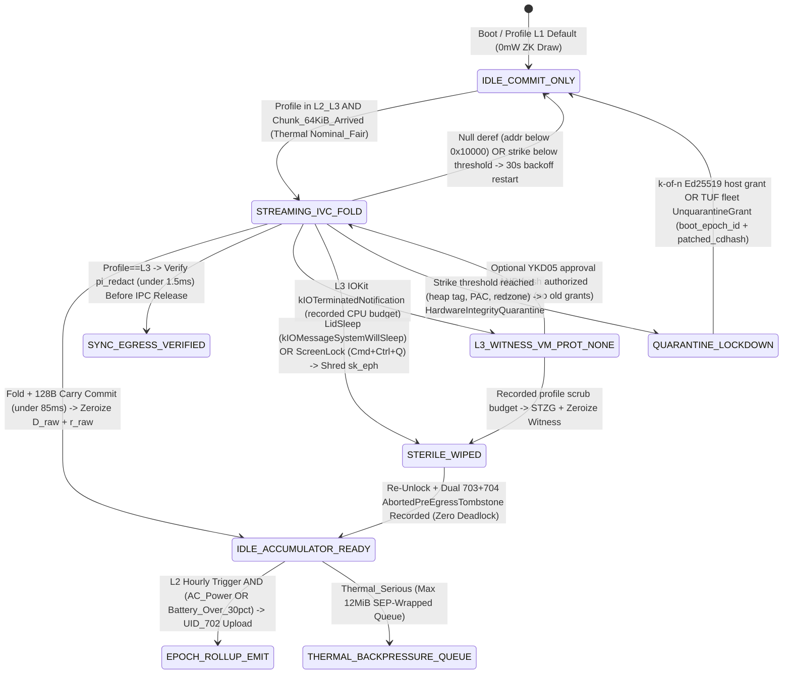

# Feature Design & SRE Production Specification: Progressive Silicon Memory Tagging (`M1`–`M4` Guarded `PAC` $\to$ `M5+` `EMTE`) & Zero-Knowledge Compliance Proofs (`L1 ⊂ L2 ⊂ L3`)

Current implementation checkpoint (2026-11-13): production rollup construction
selects a privately randomized hiding **accounting** prover and distinct v2
key/frame. This does not implement the complete compliance relation below or
establish statistical privacy, membership, witness-memory erasure, installed
hardware acceptance or the stated performance targets. Public sequence numbers,
roots and totals remain visible. See the
version/migration and remaining gates.

* **Doc ID:** `DESIGN-EMTE-ZK-2026-006` (`FS-705`, **Rev 1.8** — remediation of `ADVERSARIAL_SPEC_REVIEW_2026-11-04`; see `§10 Revision History`)
* **Generation:** `v3.0-Target` · **Precedence:** highest tier (with `FS-701..705`, `ADR-006+`) per [`README.md §1.2`](../README.md#12-normative-precedence--architectural-lineage)
* **Implementation Status:** **Partial implementation; full compliance relation and native qualification open.** Accounting proofs, portable memory logic and bounded native fixtures are distinct evidence. They do not establish the specified full ZK relation, native quarantine/anti-rollback, all accelerator erasure or installed acceptance. This supersedes the earlier blanket software-complete/no-Apple-silicon statement (`YKD-15`); retain historical §11 checkpoints. See implementation ledger and current handoff. Every latency, RSS and proof-size figure remains a provisional target gated on the Phase-0 M1 benchmark (§3.5.6) and applicable approved measurement policy.
* **Author:** Principal Security & SRE Architecture Fellow (Google Distinguished Engineer Standard)
* **Reviewers:** Apple Silicon Microarchitecture & Darwin Kernel Engineering, Applied Zero-Knowledge Cryptography, Enterprise Privacy & GDPR Engineering, Developer Experience (DevEx) SRE
* **Status:** `DRAFT — DESIGN COLLABORATION` (Pre-Implementation Capstone Specification; implementation gated on `§8.2` prerequisites)
* **Target Hardware Baseline:** Apple Silicon `M1` (8GB Unified Memory safe, `arm64e`, macOS 14.0+) with progressive hardware acceleration on `M2` / `M3` / `M4` (`PAC` + `AMX` / Metal) and `M5+` (`Apple MIE` / `EMTE` `FEAT_MTE4` + `SPTM`)
* **Companion Specifications (Complete 6-Track Enclave Architecture Suite):**
  * Parent Research Track: [Track 6 in `bleeding_edge_future_adoption.md`](bleeding_edge_future_adoption.md#track-6-silicon-memory-tagging-apple-m5-emte--zero-knowledge-compliance-proofs-nanozk-flashprove)
  * Post-Autoregressive & World-Model Governance (`Classes 1–6`, `UID 701`): [`FEATURE_POST_AR_MODEL_ADAPTERS.md`](FEATURE_POST_AR_MODEL_ADAPTERS.md) (`DESIGN-POST-AR-ADAPTERS-2026-001`)
  * Swarm Distribution Plane (`L1` / `L2` / `L3`, `UID 702`): [`FEATURE_SWARM_SECURITY_PROFILES.md`](FEATURE_SWARM_SECURITY_PROFILES.md) (`DESIGN-CAS-SWARM-2026-003`)
  * Hardware Custody & Chained Intent Signing (`L1 ⊂ L2 ⊂ L3` $\times$ `A1..A4`, `UID 703`): [`FEATURE_HARDWARE_CUSTODY_PROFILES.md`](FEATURE_HARDWARE_CUSTODY_PROFILES.md) (`DESIGN-HW-CUSTODY-2026-004`)
  * Deterministic Agent IFC & `PoP-Biscuit` Delegation (`C1..C4` $\times$ `T0..T3`, `UID 704`): [`FEATURE_AGENT_IFC_AND_DELEGATION.md`](FEATURE_AGENT_IFC_AND_DELEGATION.md) (`DESIGN-AGENT-IFC-2026-005`)

**Lifecycle timing amendment (`YKD-02`, 2026-11-15):** The accepted measurement-first policy and FS-703 §5.2 govern removal/lock/sleep freeze, release-fence and owned-state cleanup latency. Give L1/L2 broad measured latitude and derive tighter comparable L3 budgets from native baseline tests immediately before timing-sensitive implementation. Numeric lifecycle budgets remain pending; previous fixed sub-millisecond/sub-5 ms wipe labels are historical references. Preserve per-class/factor/proof gates, finite waiting, cancellation and complete claimed-owner cleanup. Unrelated inference, proof-fold, network, ceremony and token-lifetime targets are unchanged.

---

## Table of Contents

1. [Context, Motivation & The Dual Endpoint Assurance Gap](#1-context-motivation--the-dual-endpoint-assurance-gap)
2. [Goals, Explicit Non-Goals & Alternatives Rejected](#2-goals-explicit-non-goals--alternatives-rejected)
3. [Unified `SecureSlabAllocator` (`M1`–`M5+`) & `_enclavezk` (`UID 705`) Commit-and-Prove Architecture](#3-unified-secureslaballocator-m1m5--_enclavezk-uid-705-commit-and-prove-architecture)
   * 3.1 Progressive Silicon Memory Hierarchy (`M1`–`M4` Guarded `PAC` $\to$ `M5+` Synchronous `EMTE` + `SPTM`)
   * 3.2 Cryptographic `Commit-and-Prove` Redaction Circuit (`Plonky3` + `Lasso` DFA Lookups + `Poseidon2`)
   * 3.3 Folding All Four Cross-Track Audit Journals via Streaming Incremental Verifiable Computation (`IVC`)
   * 3.4 Optional `L3` Verifiable Linear Safety Heads (`NanoZK` / `FlashProve` Scoped to `Q16.16` `jev` & `LEACE`)
   * 3.5 Normative AIR, Extension Field, FRI & Fiat-Shamir Parameters ($\mathcal{R}_{\text{epoch}}$, `ADR-017`)
   * 3.6 Master 6-Track Enclave Unification Map (`UID 701`–`UID 705`)
4. [Detailed Specification of the Three Cumulative Silicon & ZK Profiles (`L1`, `L2`, `L3`)](#4-detailed-specification-of-the-three-cumulative-silicon--zk-profiles-l1-l2-l3)
   * 4.1 Profile `L1`: `emte-lazy-commit` (Startup Day-1 | `0%` Background ZK Cost)
   * 4.2 Profile `L2`: `emte-epoch-zk-rollup` (Enterprise Mesh | E-Core AC/Idle `IVC` Compliance Rollups)
   * 4.3 Profile `L3`: `emte-sync-zk-gate` (Classified Enclave | Synchronous Per-Egress Proof & `profile-budgeted` Witness Wipe)
5. [Engineering Deep-Dive: Resolving 8GB `M1` Prover Memory, Witness Leakage, `EMTE` Fault Crashes & GDPR Art. 17](#5-engineering-deep-dive-resolving-8gb-m1-prover-memory-witness-leakage-emte-fault-crashes--gdpr-art-17)
   * 5.1 Challenge A: Proving Multi-Megabyte Payloads in $\le 48\text{ MiB}$ RAM on Fanless 8GB `M1` Laptops (`64KiB` Streaming `IVC` + `128B` Boundary Carry)
   * 5.2 Challenge B: Zeroizing Private Prover Witnesses Against Crash, Sleep/Theft, Timing & `L3` USB-Yank Exposure
   * 5.3 Challenge C: Bridging CPU `EMTE` (`M5+`) vs. GPU/ANE DMA & Blocking `launchd` / Cold-Reboot 4-Bit Tag Brute-Forcing
   * 5.4 Challenge D: Reconciling Immutable Compliance Ledgers With GDPR Art. 17 ("Right to Erasure")
   * 5.5 Challenge E: Deterministic `ProverGateFSM` Hardware & Power State Machine
6. [Frontier AI Lab Standards Crosswalk: Google DeepMind, Anthropic (`FlashProve`), and OpenAI](#6-frontier-ai-lab-standards-crosswalk-google-deepmind-anthropic-flashprove-and-openai)
7. [Production Readiness Review (PRR) & Operational SRE Runbooks: SLIs, SLOs, FMEA & Proof Schemas](#7-google-sre-production-readiness-review-prr-slis-slos-fmea--proof-schemas)
   * 7.1 Service Level Indicators (SLIs) & Service Level Objectives (SLOs) (`M1` Baseline $\to$ `M5+`)
   * 7.2 Failure Modes & Effects Analysis (FMEA)
   * 7.3 Complete Privilege-Separated Daemon Map (`UID 701–705`) & `ComplianceRollupProofV1` Wire Schema
8. [Future Section: Formal Verification & Mathematical Security Proofs Roadmap (`L1`–`L3`)](#8-future-section-formal-verification--mathematical-security-proofs-roadmap-l1l3)
9. [References & Verification Status](#9-references--verification-status)
10. [Revision History](#10-revision-history)

---

## 1. Context, Motivation & The Dual Endpoint Assurance Gap

Across Tracks 1 through 5, our macOS enclave enforces post-autoregressive model safety (`UID 701`), content-addressed P2P distribution (`UID 702`), dual-silicon hardware custody (`UID 703`), and deterministic SSA information-flow control (`UID 704`). Yet when presenting an endpoint AI governance architecture to a Fortune-100 CISO, an external privacy or security auditor, or a Principal Security Engineering review board, **two fundamental assurance gaps remain**:

1. **The Native C/C++ FFI Spatial & Temporal Memory Gap:** Even when our enclave daemons are authored in `#![forbid(unsafe_code)]` Rust, high-performance macOS AI and system stacks inevitably cross FFI boundaries into C/C++/Objective-C libraries (`MLX` Metal C++ backends, `SQLite`, `CoreML`, `IOKit` HID). On conventional heaps, a single spatial buffer over-read or temporal use-after-free (`UAF`) in a linked C parser can silently read adjacent 16-byte granules holding raw customer SSNs or `PoP-Biscuit` signing keys.
2. **The Enterprise "SIEM Honeypot vs. Blind Trust" Audit Paradox:** How does an organization *mathematically prove* to an external regulator that 2,000 remote developer MacBooks actually ran TUF-signed PII redaction Policy $v_{1.4}$, respected the `12,000-millibit` (`12.0-bit`) QIF privacy cap, and obtained valid YubiKey co-signatures—**without** shipping raw developer prompts, proprietary source code, or unredacted SQL rows to a central Splunk/Datadog SIEM (which turns the central SIEM itself into a high-value PII breach honeypot)?
3. **The "Full-LLM ZKML" Resource Trap on 8GB `M1` Laptops:** Recent work (`NanoZK` 2026 `[Unverified]`, `FlashProve` `[Unverified — attribution and date not confirmed]`) reportedly proves neural network layers in zero knowledge—**but** generating a zkSNARK over a 7B–32B LLM forward pass still consumes gigabytes of prover memory and minutes of compute, violating our non-negotiable **8GB Unified Memory `M1` baseline** and laptop battery budgets.

This capstone specification resolves all three challenges simultaneously via two tightly coupled subsystems:

* **`SecureSlabAllocator`:** A progressive hardware memory-isolation allocator providing `VM_PROT_NONE` redzoned `PAC` slabs on **`M1`–`M4`** and automatically upgrading at runtime to hardware **Apple Memory Integrity Enforcement (`MIE` / `EMTE` `FEAT_MTE4` + `SPTM`)** synchronous 16-byte granule tagging on **`M5+`**.
* **`_enclavezk` (`UID/GID 705`):** A streaming **`Plonky3` + `Lasso` Commit-and-Prove ZK Compliance Prover** (provisional targets `RSS <= 48 MiB`, `p95 <= 85ms` per 64KiB fold on `M1`, gated on Phase-0 benchmark) designed to prove **deterministic enclave boundary invariants** (DFA PII redaction, 4-journal audit integrity, `i64` millibit QIF conservation, and hardware signature binding) while scoping `NanoZK`/`FlashProve` neural proofs strictly to compact `<10M`-parameter `L3` linear safety heads.

---

## 2. Goals, Explicit Non-Goals & Alternatives Rejected

### 2.1 Goals

* **G1 (Zero-Regression `M1`–`M4` $\to$ `M5+` Progressive Silicon Hardening):** Ship a single universal `arm64e` binary family that enforces guard-page-isolated `mlock()` slabs + Pointer Authentication (`PAC`) on `M1`–`M4`, while automatically activating synchronous hardware `EMTE` 16-byte granule tagging and **tag-rotation-on-zeroize (`STZG`)** on `M5+`.
* **G2 (8GB `M1` Safe ZK Compliance — `<= 48 MiB` RSS, `<85ms` per 64KiB Fold):** Prove deterministic redaction DFAs and fold all four cross-track JSONL journals (`adapter`, `cas`, `custody`, `ifc`) into a **zero-PII compliance proof** (proof size must be measured; versioned binary-CBOR compliance frame ≤320 KiB including encoded fields/headers, with L3 padded to exactly 320 KiB under YKD-10) without touching GPU inference memory or draining laptop batteries.
* **G3 (Closing the "Oracle Input Substitution" Gap):** Cryptographically bind the prover's raw input commitment $C_{\text{raw}}$ to `_piivault`'s (`UID 703`) authenticated ingress MAC and the in-RAM `rpc_seq_u64` sequence anchored to a SEP-signed `boot_epoch_id` (`ADR-010`)—preventing compromised agent code from proving redaction over a fabricated dummy string.
* **G4 (GDPR Art. 17 "Right to Erasure" Immunity):** Guarantee via 256-bit statistically hiding `Poseidon2` commitments ($r_{\text{raw}}$ destroyed immediately post-proof) that central compliance ledgers contain **zero reversible or dictionary-searchable PII hashes**.
* **G5 (Cumulative `L1 ⊂ L2 ⊂ L3` Alignment):** Maintain `0%` background ZK prover load on `L1`, schedule AC/idle E-core `IVC` batch rollups (`<1.2W`) on `L2`, and enforce synchronous pre-egress proofs + `profile-budgeted` YubiKey-yank witness zeroization on `L3`.

### 2.2 Explicit Non-Goals

* **NG1:** Generating zero-knowledge proofs over full multi-billion-parameter generative Transformer/Diffusion/SSM forward passes (`Classes 2–6` backbone weights) on developer laptops.
* **NG2:** Asynchronous / permissive `MTE` fault reporting modes (`MTE_ASYNC`), which allow an attacker's out-of-bounds read instruction to retire and exfiltrate secret bytes before the kernel delivers a delayed fault on the next syscall boundary.
* **NG3:** Uploading raw or deterministic-unsalted hashes (`SHA-256(raw_ssn)`) of customer PII to any central corporate telemetry server.

### 2.3 Alternatives Considered & Rejected

| Candidate Approach                                                | Apparent Advantage                  | Reason for Distinguished-Engineer Rejection                                                                                                                                                                  |
|:------------------------------------------------------------------|:------------------------------------|:-------------------------------------------------------------------------------------------------------------------------------------------------------------------------------------------------------------|
| **Full-Backbone 7B–32B `ZKML` Proving on Developer Laptops**      | Proves every LLM matrix multiply.   | Requires $>16\text{ GiB}$ prover RAM and minutes per token—instantly OOM-killing 8GB `M1` Macs and draining laptop batteries for zero extra PII-redaction assurance beyond our deterministic boundary gates. |
| **Central SIEM Raw/Diff Log Shipping (`Splunk` / `Datadog`)**     | Familiar enterprise audit pipeline. | Concentrates 2,000 laptops' raw customer PII, SSH keys, and proprietary code into one central honeypot; violates GDPR Art. 5(1)(c) data minimization.                                                        |
| **Unsalted `SHA-256(D_raw)` Commitments on Compliance Ledger**    | Simple commitment check.            | The 9-digit US SSN space has only $10^9$ entries—an attacker reading the central ledger can brute-force unsalted `SHA-256(SSN)` commitments on a single GPU in $<0.2\text{ seconds}$!                        |
| **`EMTE` Without Crash-Loop Quarantine (`launchd` Auto-Respawn)** | High daemon availability.           | Because ARM `MTE` tags are 4 bits ($1/16 = 6.25\%$ collision probability), allowing unlimited `launchd` auto-restarts lets an exploit brute-force a heap tag in ~16 crashes (`<3 seconds`).                  |

---

### 2.4 Core Specification Dependencies & Invariant Deltas

| Item                                          | Disposition in `FS-705`                                                                                                                                                                                                       |
|:----------------------------------------------|:------------------------------------------------------------------------------------------------------------------------------------------------------------------------------------------------------------------------------|
| **Requires (`CORE-V2`)**                      | Cedar-only policy bundles (`.cedar` + `.cedarschema`); WASI 0.2 tools executed with **zero JIT** (`ADR-011`).                                                                                                                 |
| **Requires (`v3.0`)**                         | `EnclaveAuditEnvelopeV1` journals from `UID 701–704` joined by `rpc_seq_u64` (`F-039`); `FS-703` `k`-of-`n` `Ed25519` quorums (`ADR-013`); `FS-704` QIF ledger (`global_unstructured_c3_c4_24h_pool`).                        |
| **Amends `CORE-V1 §2.3` Invariant 5 (audit)** | Plain JSONL audit becomes hash-chained envelopes plus optional ZK rollups; the Python `mcp/audit_chain.py` simulation implements only the `SHA-256` chain, not `BLAKE3`/`Poseidon2` or any proof.                             |
| **Amends `CORE-V2` memory budget**            | The `<35MB` topology is Superseded; the canonical budget is `enclave.lock.toml [budget]`: `UID 702–705` = `152 MiB`, five daemons = `200 MiB` steady state, `232 MiB` peak with `_enclaveintent` (`F-038`).                   |
| **Supersedes**                                | Single-fault NVRAM `QuarantineLock` (replaced by `HardwareIntegrityQuarantine`, `ADR-012`); `RFC 9591 FROST` quorums; `~3.8 KB` proof claims; `4 KiB` `OHTTP` frames; out-of-circuit hardware signatures in `L3` (`ADR-016`). |
| **Shared contracts**                          | `schemas/compliance-rollup-proof-v1.schema.json`, `schemas/enclave-audit-envelope-v1.schema.json`, `schemas/enclave.lock.toml`.                                                                                               |

---

## 3. Unified `SecureSlabAllocator` (`M1`–`M5+`) & `_enclavezk` (`UID 705`) Commit-and-Prove Architecture

### 3.1 Progressive Silicon Memory Hierarchy (`M1`–`M4` Guarded `PAC` $\to$ `M5+` Synchronous `EMTE` + `SPTM`)

All five enclave daemons (`UID 701`–`705`) allocate sensitive arenas (`K_vault` surrogates, `Ref<v_i>` SSA handles, `PoP-Biscuit` keys, and ZK private witnesses) exclusively through a unified Rust allocator trait (`SecureSlabAllocator`) that dispatches at process startup via Darwin `sysctlbyname`:

| Silicon Generation                                   | Microarchitecture                                                  | Hardware Memory Primitives Active                                                                                                 | `SecureSlabAllocator` Runtime Enforcement                                                                                                                                                                                                                                                                                                                                                                                                                                                                                                                                                                               |
|:-----------------------------------------------------|:-------------------------------------------------------------------|:----------------------------------------------------------------------------------------------------------------------------------|:------------------------------------------------------------------------------------------------------------------------------------------------------------------------------------------------------------------------------------------------------------------------------------------------------------------------------------------------------------------------------------------------------------------------------------------------------------------------------------------------------------------------------------------------------------------------------------------------------------------------|
| **`M1` / `M2` / `M3` / `M4`**<br>*(Baseline Parity)* | `ARMv8.5-A` $\to$ `ARMv9.2-A` (`arm64e`, **no** user-space `EMTE`) | **Pointer Authentication (`PAC`)** (`PACIA`/`AUTIA`), Hardware Guard Pages (`APFS`/`VM`), `xzone` type-segregated buckets         | • `#![forbid(unsafe_code)]` Rust arenas pinned via `mlock()`<br>• **Root keys only** (`<= 32` pages per daemon: `K_vault`, `pop_sk`, detokenization private keys) receive a dedicated 1-object `16KiB` page bracketed by unmapped `16KiB` `VM_PROT_NONE` guard pages (right-aligned so byte `+1` past the key traps)<br>• All other runtime handles live in type-segregated `16KiB` slabs with **randomized per-object cookies** checked on free — intra-slab overflows are detected at free/scrub time, *not* at the faulting instruction (`F-018`)<br>• Immediate `explicit_bzero()` + `mach_vm_deallocate()` on free |
| **`M5` & Future Silicon**<br>*(Progressive Upgrade)* | `ARMv9.x` + **Apple `MIE` (`EMTE` / `FEAT_MTE4` + `SPTM`)**        | **Synchronous 16-Byte Granule Hardware Tagging** (`LDG`/`STG`/`STZG`), **Secure Page Table Monitor (`SPTM`)** tag-table isolation | • Enabled only after the **`M5` Entitlement Verification Gate** passes (below); the `sysctl` selector `hw.optional.arm.FEAT_MTE4` and entitlement names are `[Unverified]` placeholders<br>• **Strict Synchronous Mode:** CPU faults on the *exact load/store cycle* of any 16B spatial overflow or temporal `UAF`<br>• **Tag-Rotation-on-Zeroize (`STZG`):** Scrubbing a slab zeroes all 16B granules *and* assigns a fresh hardware `RNDR` tag $t' \neq t_{\text{old}}$ (excluding adjacent granule tags $t_{\text{left}}, t_{\text{right}}$ so off-by-one overflows fail $100\%$ deterministically!)                 |

* **Zero-JIT Rule (`MUST`, `ADR-011`, `F-016`):** `com.apple.security.cs.allow-jit` and `MAP_JIT` are **forbidden** across `UID 701–705`. WASI 0.2 MCP tools execute only as offline-compiled, TUF-signed `Wasmtime` AOT `.cwasm` artifacts loaded from signed read-only pages, or under the `Pulley` bytecode interpreter. Verification: `vmmap` shows `0` `MAP_JIT` regions in any enclave daemon while a WASI tool runs; `enclave.lock.toml` sets `allow_jit = false` for every daemon.
* **`M5` Entitlement Verification Gate (`MUST`, `F-016`):** before `FS-705` locks any `EMTE` behaviour, the exact `sysctl` selectors, hardened-process entitlement keys, provisioning-profile requirements and third-party `LaunchDaemon` eligibility MUST be confirmed against Apple's official developer documentation and recorded in `§9` with a citation. Until then, `M5+` hosts run the `M1`–`M4` slab mode and report `silicon_memory_mode = "PAC_GUARDED"`.
* **Apple Framework Heaps (`UID 701`):** `CoreML`/`MLX` internal heaps run on the system allocator; only MCPMac-owned secret and control structures are placed in `SecureSlabAllocator` arenas.
* **Dual-Layer C/C++ FFI Heap Interposition (Closing the `libsystem_malloc` Bypass):** A custom Rust `GlobalAlloc` alone does *not* intercept `malloc`/`operator new` calls inside linked C/C++/Objective-C libraries (`SQLite`, `MLX` C++, `CoreML`, `IOKit`). Every enclave daemon (`UID 701–705`) therefore enforces **two FFI layers**: (1) binaries carry Apple's Hardened Runtime `com.apple.security.hardened-process.checked-allocations` (`TCF=Sync`) + `enable-pure-data` entitlements `[Unverified — subject to the M5 Entitlement Verification Gate]` so **all C/Obj-C `libsystem_malloc` `xzone` allocations** automatically enforce synchronous hardware `EMTE` (`M5+`) and type-segregated zones (`M1`–`M4`), and (2) stateful C engines touching `C3`/`C4` payloads (`SQLite` via `SQLITE_CONFIG_HEAP`, `Wasmtime` linear memories, parser scratchpads) are injected with dedicated pre-allocated `SecureSlabAllocator` arenas so C buffers never share heap pages with keys or `PoP-Biscuit` tokens!
* **Authentic Silicon Boundary Rule (CPU `EMTE` vs. GPU `IOGPU` / ANE DMA):** On Apple Silicon Unified Memory, `EMTE` logical-address tags (`bits [59:56]`) are enforced by the **CPU Load/Store Unit**, *not* inside Metal `IOGPU` shader ALUs or ANE DMA descriptors. Accordingly, even on `M5+`, our architecture never relies on CPU `EMTE` alone to isolate GPU/ANE tensors—preserving [Track 1 & 2's dedicated `MTLHeap` isolation and fence-synchronized `MTLBlitCommandEncoder::fillBuffer(0)` + `IOSurface` scrubbing](FEATURE_POST_AR_MODEL_ADAPTERS.md).

---

### 3.2 Cryptographic `Commit-and-Prove` Redaction Circuit (`Plonky3` + `Lasso` DFA Lookups + `Poseidon2`)

To target (provisionally) `<85ms` proving in $\le 48\text{ MiB}$ RAM on a base `M1`, `_enclavezk` (`UID/GID 705`) uses **`Plonky3`** over the 31-bit **`KoalaBear` prime field** ($p = 2^{31} - 2^{24} + 1$, accelerated natively via ARM64 `NEON` / Apple `AMX` vector lanes) with **FRI trace & evaluation masking polynomials (Honest-Verifier Statistical Zero-Knowledge, `HVZK`)**, **`Lasso` sparse lookup arguments**, and **`Poseidon2` sponge commitments**:

$$\mathcal{R}_{\text{redact}}\Big(\underbrace{C_{\text{raw}}, C_{\text{scrub}}, H_{\text{policy}}, H_{\text{ingress\_mac}}, \text{Root}_{\text{receipts}}}_{\text{Public Compliance Inputs } x}; \;\underbrace{D_{\text{raw}}, r_{\text{raw}}, D_{\text{scrub}}, r_{\text{scrub}}, \vec{q}_{\text{DFA}}, K_{\text{ingress\_eph}}}_{\text{Private Ephemeral Witness } w}\Big) = 1$$

Every proof $\pi_{\text{redact}}$ simultaneously enforces **four mathematical constraints**:

1. **Injective `24-Bit` Limb Packing & `HVZK`-Blinded `Poseidon2` Openings:** Because $p = 2^{31} - 2^{24} + 1 < 2^{32}$, naively packing 4 raw bytes (`32 bits`) into one `KoalaBear` element creates non-canonical modular collisions ($x \equiv x + p \pmod p$). Our sponge absorbs strictly **`3 bytes` (`24 bits` $< p$) per `KoalaBear` field element** with explicit byte-length domain framing (and decomposes `u64`/`i64` counters into `Lasso`-checked `16-bit` limbs):
   $$C_{\text{raw}} = \text{Poseidon2}\big(\text{Domain}_{\text{raw}} \parallel \text{len}_{u64} \parallel \text{Pack}_{24}(D_{\text{raw}}) \parallel r_{\text{raw}} \big), \quad C_{\text{scrub}} = \text{Poseidon2}\big(\text{Domain}_{\text{scrub}} \parallel \text{len}_{u64} \parallel \text{Pack}_{24}(D_{\text{scrub}}) \parallel r_{\text{scrub}} \big)$$
   paired with **randomized degree-$k$ FRI masking columns** so neither $C_{\text{raw}}$ nor the STARK evaluation openings in $\pi_{\text{redact}}$ leak any algebraic function of $D_{\text{raw}}$ once $r_{\text{raw}}$ and FRI masks are zeroized!
2. **Deadlock-Free Contiguous Ingress Binding (`CompletedProof` $\lor$ `AbortedPreEgressTombstone`):** `_piivault` (`UID 703`) assigns the in-RAM **`rpc_seq_u64`** (`+1` per call, anchored to the SEP-signed `boot_epoch_id`; no per-call SEP NVRAM write, `ADR-010`) and computes $H_{\text{ingress\_mac}} = \text{Poseidon2}(K_{\text{ingress\_eph}} \parallel \text{rpc\_seq\_u64} \parallel C_{\text{raw}})$. Crucially, if a legitimate `LidSleep`, `ScreenLock`, or `L3` `USB Yank` wipes an in-flight witness *before* fold completion, strict redaction-only contiguity would permanently deadlock the prover on that missing `seq`! Instead, each contiguous slot $s$ (`seq_i == seq_{i-1} + 1`) satisfies **either** $\text{ValidRedactionFold}(s)$ **or** a dual-signed **`AbortedPreEgressTombstone(s, egress_released = false)`** co-signed by **both** `_piivault` (`UID 703`) **and** the downstream consumer `_enclaveifc` (`UID 704`) attesting slot $s$ was never delivered (`F-025`: a single compromised `UID 703` can no longer forge an abort, because `SEP` signs whatever a caller presents)—preventing both prover deadlocks and cherry-picked receipt omission!
3. **Two-Stage `Lasso` Span Transducer + Algebraic `Poseidon2` Surrogate Synthesis:** Static `Lasso` lookup tables alone cannot verify dynamic per-session format-preserving surrogates (`SYNTH-SSN-904-00-1182-a91f4c` from Tracks 1, 4 & 5). Our circuit solves this in two coupled stages at 1 constraint-row per byte: (a) `Lasso` lookups into the TUF-signed transition table $\mathcal{T}_{\text{policy}}$ (`committed hash` $H_{\text{policy}}$) identify every `C4` PII byte span $(s_k, e_k, \text{class}_k)$ identically to `_piivault`'s Rust `NEON` `Byte-DFA` (**`unredacted_c4_pii_matches == 0`**), and (b) each substituted surrogate inside $D_{\text{scrub}}$ is verified algebraically in-circuit as deterministic $\text{SYNTH-}\langle\text{class}_k\rangle\text{-}\text{Poseidon2\_PRF}(K_{\text{surrogate\_epoch}}, \text{class}_k \parallel D_{\text{raw}}[s_k..e_k])$ anchored to $C_{K_{\text{surr}}}$—proving **referential surrogate integrity** while blocking covert data smuggling inside surrogate suffixes!
4. **Dual-Hash (`BLAKE3` + `Poseidon2`) 4-Journal Fold & Out-of-Circuit Hardware Signature Split:** Proving bitwise `BLAKE3` chains or non-native `ECDSA P-256` (`SEP`) / `Ed25519` (`CTAP 2.1+`) curve ops directly inside a 31-bit `KoalaBear` field would inflate constraints by $>40\times$. Instead, all four enclave daemons (`UID 701–704`) emit **dual receipt commitments**: `prev_receipt_blake3` (for fast CLI forensics) alongside algebraic `receipt_poseidon2` (`<1.8µs` `NEON` `KoalaBear` SIMD over canonical `16-bit`-limb-checked `i64` millibit fields). Inner `Plonky3` folds verify the `Poseidon2` receipt chains and boolean QIF invariant ($\forall e: \Delta\text{QIF}_{24\text{h}}(e) \le 12,000\text{ mb} \lor \text{HasCoSigFlag}$) at native `KoalaBear` speed, while hardware `P-256`/`Ed25519` epoch & `A3`/`A4` signatures are handled per profile: in **`L2`** they attach publicly (`hardware_batch_anchor_sigs`) and are batch-verified natively by the ledger (workstation attribution is expected in `L2`); in **`L3`** **zero hardware signatures or key identifiers appear on the wire** — $\mathcal{R}_{\text{epoch}}$ proves Merkle membership of $(pk_{\text{SEP}}, pk_{\text{YK}})$ in the TUF-signed $R_{\text{fleet\_pk}}$ (`§3.5`, `ADR-016`).

---

### 3.3 Folding All Four Cross-Track Audit Journals via Streaming Incremental Verifiable Computation (`IVC`)

```
  [UID 701: EnclaveModelAdapter]  --> adapter-audit.jsonl  --\
  [UID 702: _enclavecas Swarm]    --> cas-audit.jsonl      ---+--> [UID 705: `_enclavezk` Streaming IVC Folder]
  [UID 703: _piivault / Custody]  --> custody-audit.jsonl  ---+    (0 Network Sockets — 100% `pf` Airgapped!)
  [UID 704: _enclaveifc Flow]     --> ifc-audit.jsonl      --/     • Folds 64KiB chunks (+128B boundary carry)
  (Dual BLAKE3 + Poseidon2 Receipts)                               • Zeroizes r_raw & D_raw per fold (<1ms)
                                                                   • Wraps epoch STARK -> CBOR frame (<=320 KiB total, YKD-10)
                                                                                      |
                                                       (Verified Public Bytes via UDS to `UID 702` `_enclavecas`)
                                                                                      v
                                                           [TLS 1.3 Scavenger (`L2`) / 320KiB compliance-frame `OHTTP` Relay (`L3`)]
                                                                                      |
                                                                                      v
                                                           [Corporate / Auditor Zero-PII Compliance Ledger]
                                                           (0 Raw Prompts | 0 Source Code | 0 Reversible PII)
```

---

### 3.4 Optional `L3` Verifiable Linear Safety Heads (`NanoZK` / `FlashProve` Scoped to `Q16.16` `jev` & `LEACE`)

Rather than attempting intractable multi-gigabyte Transformer ZKML on laptops, **`Profile L3`** optionally enables verifiable neural safety execution (`NanoZK` / `FlashProve` `[Unverified]` lookup-quantized style) **strictly over compact `<10M`-parameter safety boundary layers**:

* **Track 1 `Class 1` (`jev` RLCD Enum Gate, `<5M` params) & `Class 4`/`Class 6` (`LEACE` Orthogonal Concept Erasure $P_{\perp \text{PII}} c_k$):** Evaluated in deterministic **`Q16.16` signed integer fixed-point arithmetic** (`zero` IEEE-754 non-determinism across `M1`–`M5`). Because summing $d = 4,096$ `Q16.16` $\times$ `Q16.16` products requires up to $76\text{ bits}$ (which would wrap modulo our 31-bit `KoalaBear` prime $p$ if unconstrained!), the circuit accumulates dot products across **`4 x 20-bit` carry-checked limbs (`80-bit` exact integer range)** with `Lasso`-verified `16-bit` remainder right-shifts—targeting (Phase-0 gated) `<220ms` proofs that the exact TUF-signed `LEACE` matrix erased linear PII subspaces with **zero $\bmod p$ wrap-around**!

---

### 3.5 Normative AIR, Extension Field, FRI & Fiat-Shamir Parameters ($\mathcal{R}_{\text{epoch}}$, `ADR-017`, `F-024`)

`Rev 1.3` left the Fiat-Shamir transcript, extension field, FRI parameters, cross-journal join key and verifier-key governance unspecified — the two dominant real-world STARK failure classes (weak Fiat-Shamir, e.g. *Frozen Heart*; under-constrained joins). The following are **normative**:

#### 3.5.1 Field, Hash & FRI Parameters (`MUST`)

| Parameter                   | Value                                                                                                                                                                          | Rationale                                                                                                                                                                                                                                                                                                                                                                                                                                                                                                                                                                                                                                                                                                                                                                                                                                            |
|:----------------------------|:-------------------------------------------------------------------------------------------------------------------------------------------------------------------------------|:-----------------------------------------------------------------------------------------------------------------------------------------------------------------------------------------------------------------------------------------------------------------------------------------------------------------------------------------------------------------------------------------------------------------------------------------------------------------------------------------------------------------------------------------------------------------------------------------------------------------------------------------------------------------------------------------------------------------------------------------------------------------------------------------------------------------------------------------------------|
| Base field                  | `KoalaBear` $p = 2^{31} - 2^{24} + 1$                                                                                                                                          | 31-bit, `NEON`-friendly.                                                                                                                                                                                                                                                                                                                                                                                                                                                                                                                                                                                                                                                                                                                                                                                                                             |
| Challenge / extension field | **Quintic** $\mathbb{F}_{p^5}$ (`≈ 154.9` bits)                                                                                                                                | $\mathbb{F}_{p^4}$ gives only `≈ 123.9` bits (`< 128`) — insufficient for the `2^-128` HVZK target. All `Lasso` grand-product, DEEP-ALI and FRI challenges are sampled in $\mathbb{F}_{p^5}$.                                                                                                                                                                                                                                                                                                                                                                                                                                                                                                                                                                                                                                                        |
| Hash / Merkle               | `Poseidon2` width 16 (rate 8, capacity 8)                                                                                                                                      | Algebraic in-circuit receipt chains.                                                                                                                                                                                                                                                                                                                                                                                                                                                                                                                                                                                                                                                                                                                                                                                                                 |
| FRI blowup                  | `4` ($\rho = 1/4$)                                                                                                                                                             |                                                                                                                                                                                                                                                                                                                                                                                                                                                                                                                                                                                                                                                                                                                                                                                                                                                      |
| FRI queries                 | **`84`** (owner decision 2026-11-05, `OQ-18`)                                                                                                                                  | **Proven (Johnson-bound) soundness:** each query contributes $\log_2(1/\sqrt{\rho}) = 1$ bit at $\rho = 1/4$, so $84 + 16 = 100$ bits. The `42`-query alternative reached `100` bits only under the up-to-capacity conjectures, whose strongest forms were disproved in late 2025 (Crites & Stewart, ePrint 2025/2046); it gave ≈ `58` proven bits and is rejected. Cost: prover time and memory unchanged (dominated by the `4×` LDE and Merkle hashing); query-phase proof bytes and verifier time ≈ `2×`. YKD-10 keeps these parameters: measure the complete encoded frame against the 320 KiB total cap, including all fields/header overhead. Oversize refuses; any future framing/epoch change needs a separately versioned, reviewed contract, never fewer queries to fit. Historical 96 KiB proof and 128 KiB frame targets are superseded. |
| Proof-of-work grinding      | `16` bits, absorbed before query-index squeezing                                                                                                                               |                                                                                                                                                                                                                                                                                                                                                                                                                                                                                                                                                                                                                                                                                                                                                                                                                                                      |
| Wire encoding               | Versioned binary CBOR; complete encoded compliance frame `<= 327,680` bytes (`320 KiB`), including all frame headers/fields; `L3` padded to exactly `327,680` bytes (`YKD-10`) | Actual proof payload must leave room for encoding overhead. Pin compatible schema/verifier/encoder/transport revisions; existing JSON schema alone cannot enforce aggregate encoded length.                                                                                                                                                                                                                                                                                                                                                                                                                                                                                                                                                                                                                                                          |

**Complete-frame contract (`YKD-10`, approved 2026-11-15):** the bound applies
to the complete serialized compliance frame, including binary-CBOR lengths,
all public inputs/headers, attached L2 anchors and padding. L2 is at most
327,680 bytes; L3 is exactly 327,680 bytes. The proof cannot itself consume the
whole cap and then add headers. Encode and measure actual bytes before release;
no negative/overflowing padding, truncation, parameter reduction or silent
fallback to an incompatible frame version is permitted. The measured boundary
is the compliance frame before outer OHTTP/TLS/HTTP encapsulation; separately
bound and test transport overhead/reassembly rather than claiming the encrypted
network packet has no overhead.

Bind the frame/schema version, proof relation, verifier key and security
parameters to authenticated policy. Encoder, schema, verifier, relay and ledger
must agree on the same version and byte boundary. Any byte-incompatible revision
requires explicit version/migration handling. The old 96 KiB payload/128 KiB
frame targets are historical only; this approval does not prove that all current
schema/runtime consumers implement the complete-frame bound. Preserve quintic
extension, 84 FRI queries, 16-bit grinding and every existing transcript/join,
nullifier, cohort ≥32, heartbeat and no-static-hardware-identifier requirement.
Wire acceptance remains open pending exact schema/codec/transport checks and
measured final proof bytes. See
YKD-10.

#### 3.5.2 Relation $\mathcal{R}_{\text{epoch}}(x; w)$

* **Public statement** $x = (\text{vk\_digest}, \text{profile} \in \{2,3\}, \text{policy\_blake3}, \text{tuf\_snapshot\_root}, \text{qif\_cap\_mb} = 12000, R_{\text{fleet\_pk}}, J_{\text{prev}}, J_{\text{curr}}, \text{nullifier}_e)$.
* **Private witness** $w = (e, s_{\text{start}}, s_{\text{end}}, \text{id}_{\text{enclave}}, (pk_{\text{SEP}}, pk_{\text{YK}}, \text{merkle\_path}_{\text{fleet}}, \sigma_{\text{batch}}), \{(D_{\text{raw}}^{(s)}, r_{\text{raw}}^{(s)}, D_{\text{scrub}}^{(s)}, \tau_{\text{tomb}}^{(s)}, \text{spans}^{(s)}, \text{qif\_merkle\_proof}^{(s)})\}_{s = s_{\text{start}}}^{s_{\text{end}}})$.
* $\mathcal{R}_{\text{epoch}}(x; w) = 1$ **iff all** hold:
  1. **Nullifier:** $\text{nullifier}_e = \text{Poseidon2}(\text{DOM\_NULL} \parallel \text{id}_{\text{enclave}} \parallel e)$ and $s_{\text{start}} \le s_{\text{end}}$.
  2. **Hardware anchor membership:** $(pk_{\text{SEP}}, pk_{\text{YK}}) \in \text{MerkleVerify}(R_{\text{fleet\_pk}}, \text{merkle\_path}_{\text{fleet}})$ and $\text{VerifyBatchAnchor}(pk_{\text{SEP}}, pk_{\text{YK}}, \sigma_{\text{batch}}, J_{\text{prev}} \parallel J_{\text{curr}} \parallel s_{\text{start}} \parallel s_{\text{end}}) = 1$ (in-circuit in `L3`; in `L2` the signatures may additionally be attached publicly).
  3. **Strict contiguity:** every $s \in [s_{\text{start}}, s_{\text{end}}]$ satisfies **exactly one** of (a) a valid redaction fold — $C_{\text{raw}}^{(s)}$ opening, `LassoDFA` finds `0` unredacted `C4` spans (with `128B` carry reset iff `is_rpc_eof == 1`), and every surrogate span matches $\text{Poseidon2\_PRF}(K_{\text{epoch}}, \cdot)$; or (b) $\text{VerifyTombstone}(pk_{703}, pk_{704}, \tau_{\text{tomb}}^{(s)}, s, \text{egress\_released} = \text{false}) = 1$.
  4. **Cross-journal join & 24h QIF bound:** the `Poseidon2` chain transitions $J_{\text{prev}} \to J_{\text{curr}}$ over `EnclaveAuditEnvelopeV1` records paired by **`rpc_seq_u64 = s`** across `UID 701–704`, and every **Indexed Merkle Tree** update on `qif_root` keeps $\text{millibits\_used}[e_k] \le 12000$ (`4000` for `C4` in `L3`).

#### 3.5.3 Fiat-Shamir `DuplexChallenger` Schedule (`MUST`)

1. `absorb("MCPMac-ComplianceRollup-v1" || vk_digest || profile || policy_blake3 || tuf_snapshot_root || qif_cap_mb || R_fleet_pk || J_prev || J_curr || nullifier_e)` — **all** public inputs before any commitment.
2. `absorb(trace_merkle_root_main)` → `squeeze(beta, gamma ∈ F_{p^5})` (`Lasso`).
3. `absorb(trace_merkle_root_perm_lookup)` → `squeeze(alpha ∈ F_{p^5})` (quotient).
4. `absorb(quotient_merkle_root)` → `squeeze(zeta ∈ F_{p^5})` (OOD point) → FRI commit phase → `absorb(pow_witness_16b)` → squeeze query indices.

Verification: deterministic transcript test vectors, plus a mutation test that flips one bit of any public input (e.g. `policy_blake3`, `nullifier_e`) and asserts `verify` fails; an SMT/Picus-style under-constrained-witness check over the AIR rows.

#### 3.5.4 Verifier-Key Governance (`MUST`)

`vk_digest` is pinned in a TUF-signed `vk_manifest.json` target (role `targets`, threshold per `ADR-013`). Circuit upgrades bump `vk_digest` and the domain string; the ledger rejects proofs whose `vk_digest` is not in the current snapshot. Each circuit revision requires an AIR constraint-completeness review before `vk` publication.

#### 3.5.5 `L3` Anonymity Mode (`MUST`, `ADR-016`, `F-023`)

In `L3`, frames carry **zero static hardware signatures or key identifiers**; `R_fleet_pk` covers a cohort of **`>= 32`** enrolled workstations, and every enclave emits a **constant-rate hourly heartbeat proof** even when `0` RPCs ran (`heartbeat = true`). Indistinguishability test: two `L3` frames from different MacBooks carry the same `R_fleet_pk`, no key material, and identical complete-frame byte length `== 327680` (`YKD-10`).

#### 3.5.6 Phase-0 `M1` Benchmark Gate (`MUST`, `F-025`)

No figure in this document (`85 ms` fold, `48 MiB` RSS, `450 ms` epoch wrap, `1.5 ms` verify, proof size) may be cited as achieved until a standalone Rust `Plonky3` benchmark on a physical base `M1` (E-core via `taskpolicy -b`) publishes p50/p95 wall-clock, peak `phys_footprint` and serialized proof length. If the benchmark misses a target, the target is revised in a new `Rev`, not hidden.

---

### 3.6 Master 6-Track Enclave Unification Map (`UID 701`–`UID 705`)

| Enclave Track                               |              Dedicated Daemon               | Silicon Memory Protection (`Track 6`)                                                                                      | Zero-Knowledge Proof Contribution (`Track 6`)                                                                                                                                                      |
|:--------------------------------------------|:-------------------------------------------:|:---------------------------------------------------------------------------------------------------------------------------|:---------------------------------------------------------------------------------------------------------------------------------------------------------------------------------------------------|
| **Tracks 1 & 2 (`Post-AR & World Models`)** |           `UID 701` (`_llmagent`)           | `MTLHeap` GPU isolation + `SecureSlabAllocator` (`PAC` / `M5 EMTE`) on IPC staging                                         | Proves `topology_fingerprint_blake3`, `DINGO`/`Byte-DFA` conformance, & optional `L3` `Q16.16` `LEACE`/`jev` projection                                                                            |
| **Track 3 (`enclave-cas` P2P Swarm)**       |          `UID 702` (`_enclavecas`)          | `MNT_RDONLY` APFS snapshots + `SecureSlabAllocator` for namespace `DEK`s                                                   | Proves every active model & policy `logical_plaintext_blake3` belongs to a valid TUF-signed corporate manifest                                                                                     |
| **Track 4 (`Hardware Custody & YubiKey`)**  | `UID 703` (`_piivault` / `_enclavecustody`) | `SecureSlabAllocator` (`STZG` retag on `profile-budgeted` yank wipe) over `sk_detok_a3_epoch` / `sk_detok_a4` & surrogates | Computes ingress anchor $H_{\text{ingress\_mac}}$ over `rpc_seq_u64`, co-signs tombstones with `UID 704`, and contributes `CTAP 2.1+` / `SEP` `A3`/`A4` co-signature witnesses                     |
| **Track 5 (`CaMeL + FIDES + PoP-Biscuit`)** |          `UID 704` (`_enclaveifc`)          | `SecureSlabAllocator` over SSA `Ref<v_i>` Capability Heap & `PoP` keys                                                     | Proves monotonic `(C1..C4, T0..T3)` sink non-interference & `i64` millibit QIF conservation ($\le 12,000\text{ mb}$)                                                                               |
| **Track 6 (`EMTE & ZK Compliance Prover`)** |          `UID 705` (`_enclavezk`)           | `SecureSlabAllocator` over `32 MiB` private witness ring (`profile-budgeted` yank wipe)                                    | Generates CBOR `ComplianceRollupProofV1` (complete compliance frame ≤320 KiB including encoding overhead, YKD-10) ($\pi_{\text{redact}}$ / $\pi_{\text{epoch}}$) with **zero central PII storage** |

---

## 4. Detailed Specification of the Three Cumulative Silicon & ZK Profiles (`L1`, `L2`, `L3`)

Matching Tracks 3, 4, and 5, Track 6 enforces $\text{Profile}_{\text{effective}} = \max(\text{Cedar}, \text{TUF}, \text{ModelManifest})$ across **three strictly cumulative tiers (`L1 ⊂ L2 ⊂ L3`)**:

### 4.1 Profile `L1`: `emte-lazy-commit` (Startup Day-1 | `0%` Background ZK Cost)

* **Target Adopter:** Seed/Series-A startups and solo developers (`\$0` extra hardware, `0mW` background battery draw).
* **Active Controls:**
  1. **Automatic Silicon Hardening:** `SecureSlabAllocator` enforces `VM_PROT_NONE` redzoned `PAC` slabs on `M1`–`M4` and automatically enables synchronous hardware `EMTE` (`STZG` tag rotation) on `M5+` with zero configuration.
  2. **Zero-Overhead Local Commitments (`0` Plaintext Retained on Disk):** `_piivault` and `_enclaveifc` emit blinded `Poseidon2` commitments ($C_{\text{raw}}, C_{\text{scrub}}$) + dual `(BLAKE3, Poseidon2)` `SEP`-signed hash-chained JSONL receipts (`<12µs` per call, **zero background SNARK proving** and **`0` raw witnesses cached on disk by default**). If a startup enters a customer security review, the developer can explicitly toggle a bounded `SEP .biometryCurrentSet`-sealed in-RAM spot-audit mode to generate verifiable sample proofs on demand.

### 4.2 Profile `L2`: `emte-epoch-zk-rollup` (Enterprise Mesh | E-Core AC/Idle `IVC` Compliance Rollups)

* **Target Adopter:** Regulated enterprise engineering fleets (no SOC 2 / ISO 27001 / HIPAA attestation implied; `100%` Airplane-Safe).
* **Strict Cumulative Inheritance:** Inherits 100% of `L1` + adds:
  1. **E-Core Scavenger `IVC` Epoch Rollups (`<1.2W` Package Draw):** `_enclavezk` (`UID 705`, **100% `pf`-airgapped with `0` network sockets**) executes strictly on **Apple Silicon Efficiency Cores** (`pthread_set_qos_class_self_np(QOS_CLASS_BACKGROUND, 0)`), gated by `ProverGateFSM`. As individual tool calls complete, `_piivault` streams `64KiB` witness chunks over a kernel-verified `audit_token_t` UDS pipe to `_enclavezk`, which folds each chunk in `<85ms` ($\approx 0.08\text{J}$) and **immediately scrubs $D_{\text{raw}}$ and $r_{\text{raw}}$ from RAM**—retaining only the compact zero-PII running `IVC` accumulator (`<512 KiB`) when offline on an airplane!
  2. **Contiguous Hourly Zero-PII Ledger Upload via `_enclavecas` (`UID 702`):** Once per hour (when on AC or battery $>30\%$), `_enclavezk` wraps the outer epoch proof (provisional `~450ms`), verifies it locally, and hands *only* the public CBOR `ComplianceRollupProofV1` bytes (`profile = 2`, with `hardware_batch_anchor_sigs` attached) over UDS to **`_enclavecas` (`UID 702`)** for scavenger TLS 1.3 (`SO_TC_BK_SYS`) upload—attesting to gap-free `rpc_seq_u64` continuity (`Epoch_k.start == Epoch_{k-1}.end + 1`), 100% `C4` redaction, TUF provenance, and boolean QIF conservation.

<a id="43-profile-l3-emte-sync-zk-gate-classified-enclave--synchronous-per-egress-proof--5ms-witness-wipe"></a>

### 4.3 Profile `L3`: `emte-sync-zk-gate` (Classified Enclave | Synchronous Per-Egress Proof & `profile-budgeted` Witness Wipe)

* **Target Adopter:** Defense/GovCloud, payment processors, frontier AI model-weight custodians, and clinical workstations (no PCI-DSS or HIPAA attestation implied).
* **Strict Cumulative Inheritance:** Inherits 100% of `L2` + adds:
  1. **Synchronous Pre-Egress `ZK Proof-of-Redaction` Gate:** No scrubbed payload $D_{\text{scrub}}$ or declassified enum may cross an external sink or cross-domain IPC boundary until `_enclavezk` (`UID 705`) **synchronously completes and locally verifies $\pi_{\text{redact}}$ (`<1.5ms` verification target)** inside the enclave proxy. Large responses are released **incrementally per verified `64KiB` chunk**; the `L3` egress route uses a per-chunk idle timeout (`5s`) rather than a single whole-response timeout, so a `4 MiB` result never stalls behind Envoy's `5s` route timeout (`F-025`).
  2. **Verifiable `Q16.16` Safety Projections, `320KiB` Complete CBOR Frame & `OHTTP` Transport & ZK-Unlinkable Epoch Nullifiers:** Enables `Plonky3` + `Lasso` proofs over `Class 1` (`jev`) and `Class 4`/`6` (`LEACE`) linear safety heads, quantizes chunk counts into power-of-2 buckets, encodes every proof as **a complete binary-CBOR compliance frame padded to exactly `327,680` bytes (`320 KiB`, including encoded fields/headers, YKD-10)** (the `Rev 1.3` `4 KiB` JSON+Base64 frame could not hold even a `3.8 KB` proof), carries **zero hardware signatures or key IDs** (in-circuit Merkle membership over a cohort `>= 32` with hourly heartbeats, `§3.5.5`), and transmits via `_enclavecas`'s **[Track 3 RFC 9458 `OHTTP` Oblivious Relay](FEATURE_SWARM_SECURITY_PROFILES.md)**. Critically, to prevent the ledger from linking rotating `L3` pseudonyms across hours via public `prev_epoch_rollup` hashes or `88409 -> 88410` sequence numbers, **`L3` moves `(epoch_seq_u64, rpc_seq_start..end)` into the private ZK witness**, publishing only a **re-randomized `Poseidon2` state commitment + spend-once `epoch_nullifier`** proved in-circuit against the fleet's prior-hour Merkle root (achieving *both* cross-epoch unlinkability *and* fleet-wide missing-workstation detection!).
  3. **Profile-Budgeted Dead-Man Witness Zeroization (`YKD-02`):** `_enclavezk` (`UID 705`) observes applicable removal/lock/sleep triggers, fences queued release/late workers and scrubs owned witness/carry/mask/queue state and ephemeral wrapping keys. Apply FS-703 §5.2 measured endpoint budgets: broad L1/L2 latitude where applicable, tighter comparable L3 limits, numeric limits pending the native baseline before timing-sensitive implementation. CPU protection alone is not accelerator isolation or complete witness erasure. Optional recovery remains under YKD-05 and cannot restore old grants/handoffs.

---

## 5. Engineering Deep-Dive: Resolving 8GB `M1` Prover Memory, Witness Leakage, `EMTE` Fault Crashes & GDPR Art. 17

### 5.1 Challenge A: Proving Multi-Megabyte Payloads in $\le 48\text{ MiB}$ RAM on Fanless 8GB `M1` Laptops (`64KiB` Streaming `IVC` + `128B` Boundary Carry)

* **Problem & Split-Token Trap:** If an MCP SQL query returns a $4\text{ MiB}$ CSV/JSON table, building a monolithic SNARK trace over $4,194,304$ DFA transitions consumes $>1.5\text{ GiB}$ RAM—triggering macOS `Jetsam` kills on an 8GB `M1` MacBook Air! Worse, naively splitting chunks at exact `65,536`-byte boundaries creates a **"Byte-65535 Split-SSN Smuggling" bug**: if `"123-4"` lands at the tail of Chunk $j$ and `"5-6789"` lands at byte `0` of Chunk $j+1$, finalizing $C_{\text{scrub}, j}$ before seeing Chunk $j+1$ either misses a boundary-straddling SSN or breaks transducer equivalence!
* **Resolution — `64KiB` Streaming `IVC` Folding With Compile-Bounded `128-Byte` Carry & `EOF` Reset:**
  1. `_enclavezk` (`UID 705`) partitions arbitrarily large payloads into **`64KiB` (`65,536-byte`) streaming folds** ($2^{16}$ rows per `Plonky3` table), reusing the **exact same pre-allocated `32 MiB` `mlock()`/`EMTE` trace slab** across every fold so peak RSS is designed not to exceed **`48.0 MiB`** (provisional, `§3.5.6`) whether redacting `1 KiB` or `100 MiB`!
  2. At policy admission time, the TUF compiler statically rejects unbounded `.*`/`+` PII regexes, enforcing a deterministic leftmost-longest `RE2`-subset grammar with **`max_token_span <= 128 bytes`**. Fold $j$ carries a **`Poseidon2`-blinded `128-byte` holdback register** (`C_carry_j = Poseidon2(carry_raw[0..len] || dfa_state_j || r_carry_j)`) across `64KiB` splits, and enforces a mandatory **`is_rpc_eof == 1` flush-and-reset (`carry_len = 0, dfa_state = q_0`)** at the end of every tool call so partial prefixes never bleed across separate RPCs!

### 5.2 Challenge B: Zeroizing Private Prover Witnesses Against Crash, Sleep/Theft, Timing & `L3` USB-Yank Exposure

* **Threat:** While `_enclavezk` (`UID 705`) is proving fold $j$ (`~85ms`), its private witness buffer transiently holds raw $D_{\text{raw}}$ chunk $j$ and blinding scalar $r_{\text{raw}}$. Likewise, if thermal throttling defers chunks right before a developer locks or closes their laptop, unshredded queue keys could expose raw PII on a stolen MacBook.
* **Four-Layer Witness Isolation:**
  1. **Constant-Time `KoalaBear` Vector Arithmetic:** Witness polynomial assignment and `Poseidon2` permutations execute strictly branchless SIMD vector ops (`0` secret-dependent memory indices or branches).
  2. **Immediate `85ms` Micro-Fold Scrubbing vs. Deferred Outer Epoch Wrapping (`12 MiB` Hard Cap):** Each inner `64KiB` fold costs only `~0.08 Joules` (`<85ms`), so `_enclavezk` folds chunks in RAM immediately even on low battery—deferring only the heavier `~450ms` outer epoch wrapper + TLS upload until AC or battery $>30\%$! Only during acute `.serious` thermal throttling are incoming chunks briefly queued in RAM (**`<= 12 MiB` hard cap**, FIFO backpressure to `UID 703` beyond `12 MiB`, so the queue fits inside the `48 MiB` `UID 705` RSS ceiling — the `Rev 1.3` `64 MiB` queue exceeded it, `F-025`) under an ephemeral key wrapped by `SEP .biometryCurrentSet` (`L2`) / `K_vault` (`L3`), **cryptographically shredding `sk_enclavezk_eph` immediately on `kIOMessageSystemWillSleep`, `com.apple.screenIsLocked`, or `USB Yank`** (`0` decryptable raw witnesses ever survive sleep or console lock!).
  3. **Zero Crash Persistence & Synchronized `Lock-Then-Scrub`:** Runs with `RLIMIT_CORE = 0`, `PT_DENY_ATTACH`, Mach `EXC_CORPSE_NOTIFY` masked, and direct `IOKit` / `Sleep` / `ScreenLock` `VM_PROT_NONE` + `STZG` / `explicit_bzero` hooks.

### 5.3 Challenge C: Bridging CPU `EMTE` (`M5+`) vs. GPU/ANE DMA & Blocking `launchd` / Cold-Reboot 4-Bit Tag Brute-Forcing

* **Adversarial Attack ("1-in-16 `EMTE` Crash-Loop Oracle"):** ARMv9 `MTE`/`EMTE` pointer tags are 4 bits wide (`16` possible tag values, though adjacent-excluded `RNDR` tags reduce spatial neighbors to `0/15` deterministic fail and random temporal `UAF` guesses to $1/14 \approx 7.1\%$). If `launchd` respawns a crashed daemon every $100\text{ms}$—or if an attacker power-cycles the laptop repeatedly—a temporal `UAF` exploit guesses the right 4-bit tag in ~14 attempts!
* **Graduated `HardwareIntegrityQuarantine` (`MUST`, `ADR-012`, `F-017`):** `Rev 1.3` latched a permanent NVRAM `QuarantineLock` on the **first** fault in any daemon, turning one malformed packet or tensor into a fleet-wide brick. `Rev 1.4` replaces it:
  1. **Fault classification:** the root supervisor intercepts the Mach exception before `launchd` respawn and classifies it. Null/page-zero dereferences (`fault_addr < 0x10000`) and stack-guard hits are **benign**: the daemon is killed, zeroized and restarted after a `30s` backoff (`launchd` `ThrottleInterval`); no strike is recorded, but `>= 5` benign faults within `10 min` latch (crash-loop guard). Heap-tag faults (`EXC_ARM_MTE_TAG_FAULT`, `M5+`), `PTRAUTH`/`PAC` failures and `SecureSlabAllocator` redzone or cookie violations are **integrity strikes**.
  2. **Strike thresholds (rolling 24h):** in `L1`/`L2`, **Strike 2** latches `HardwareIntegrityQuarantine`; in `L3`, **Strike 1** latches, but only for heap-tag/`PAC` faults (redzone/cookie strikes still use the Strike-2 rule). A non-latching Strike 1 kills and zeroizes the daemon, rotates tag seeds and delays respawn `300s`. The strike counter and latch are persisted in **NVRAM** (variable `enclave-hiq`, written only by the root supervisor) so they survive cold boot and OS reinstall of `/var`; the value carries a MAC under a SEP-held key, and a missing or invalid MAC is treated as **latched** (fail closed). `[Unverified]`: writability of a custom NVRAM variable by a third-party root daemon under SIP on every supported Apple Silicon generation — confirm on bare metal before lock (`§8.2`).
  3. **Latched effects:** revoke active `PoP-Biscuit` and vault sessions; halt PII daemons (`UID 701, 703, 704, 705`); keep standard networking and read-only `_enclavecas` (`UID 702`) patch pulls online. Tag-guessing is bounded to the strike threshold per 24h instead of unlimited respawns.
  4. **Recovery:** a host-specific grant signed by an authorized discrete **`k`-of-`n`** SecOps quorum plus local Touch ID, **or** a separately authorized TUF-signed fleet `UnquarantineGrant`. **`YKD-13` supersedes ordered-cdhash wording:** a code hash has no software-version ordering. Require exact approved code-hash membership **and** authenticated release/version policy. Bind host or explicitly enumerated fleet scope, current boot/generation, incident, grant purpose, policy/version, validity/expiry and single-use identity; reject stale, replayed, wrong-host/boot/incident/policy and unapproved-code grants. Fleet recovery applies only to nodes whose actual running code and authenticated release satisfy the signed policy, not hashes numerically below a threshold. Separate local/quorum, fleet, lost-key and cooldown authorities. The exact hardware-quorum encoding remains blocked on `YKD-12`; do not call raw-digest signatures CTAP assertions. Native Mach supervision, protected persistent latch and hardware anti-rollback remain unqualified where APIs are unavailable; software grants do not supply those capabilities. See YKD-13. `RFC 9591 FROST` is not used: stock YubiKeys cannot participate (`ADR-013`).
  5. **Verification:** fault-injection tests — (a) a simulated `*(volatile int*)0x8` read restarts after `30s` with no latch; (b) two simulated redzone faults within 24h latch in `L2`; (c) a fleet grant clears `1,000` simulated nodes.

### 5.4 Challenge D: Reconciling Immutable Compliance Ledgers With GDPR Art. 17 ("Right to Erasure")

* **Legal & Cryptographic Paradox:** Suppose Customer Alice exercises GDPR Art. 17 ("Right to Be Forgotten") six months after an engineer queried a table containing Alice's row. If the central compliance ledger stored `SHA-256(Alice_Record)`, auditors or attackers knowing Alice's email/SSN could test `SHA-256` candidates against the immutable ledger—making the ledger itself regulated "personal data" under EDPB guidelines!
* **Resolution — Perfect/Statistical Hiding via Ephemeral 256-Bit Blinding ($r_{\text{raw}}$):**
  Because $C_{\text{raw}} = \text{Poseidon2}(\text{Domain}_{\text{raw}} \parallel D_{\text{raw}} \parallel r_{\text{raw}})$ mixes a **fresh 256-bit uniform random nonce $r_{\text{raw}}$** that is **irrevocably zeroized (`explicit_bzero_and_retag`) on the laptop within $<85\text{ms}$** and *never* transmitted, $C_{\text{raw}}$ has $\ge 254\text{ bits}$ of min-entropy conditioned on $D_{\text{raw}}$. Even an adversary possessing Alice's exact plaintext SSN/record **cannot distinguish Alice's historical $C_{\text{raw}}$ from a commitment to all-zeros**! Thus, central compliance proofs remain verifiable by auditors while being designed to contain **no reversible personal data**. Whether such commitments fall outside GDPR Art. 4(1) is a legal determination that requires DPO/counsel review; this specification makes no legal claim.

### 5.5 Challenge E: Deterministic `ProverGateFSM` Hardware & Power State Machine



---

## 6. Frontier AI Lab Standards Crosswalk: Google DeepMind, Anthropic (`FlashProve`), and OpenAI

> **Non-normative author positioning.** This table compares an **unimplemented** design with the author's unverified perception of other organisations' programs and publications (`FlashProve` attribution is `[Unverified]`). It imposes no requirement and asserts no equivalence or endorsement.

| Enclave Silicon & ZK Profile                                                                                                            | Google DeepMind / Google Security Equivalent                                                                                                                                                                                                                      | Anthropic Equivalent (`FlashProve`)                                                                                                                                                                                                                             | OpenAI Equivalent                                                                                                                                                                                                  |
|:----------------------------------------------------------------------------------------------------------------------------------------|:------------------------------------------------------------------------------------------------------------------------------------------------------------------------------------------------------------------------------------------------------------------|:----------------------------------------------------------------------------------------------------------------------------------------------------------------------------------------------------------------------------------------------------------------|:-------------------------------------------------------------------------------------------------------------------------------------------------------------------------------------------------------------------|
| **`L1: emte-lazy-commit`**<br>*(`M1`–`M4` Guarded `PAC` $\to$ `M5+` `EMTE` + Blinded `Poseidon2` Receipts)*                             | **Chrome/Android `MTE` + `GWP-ASan` + `Trillian` Merkle Commitments**<br>• Brings Google's synchronous hardware MTE & single-fault quarantine philosophy natively to macOS Apple Silicon (`M5 MIE`), paired with zero-PII local Merkle logs at `0%` battery cost. | **RSP `ASL-2` Endpoint Hardening Baseline**<br>• Hardens local MCP/model C++ FFI surfaces (`MLX`, `llama.cpp`) against heap corruption while preparing ZK-ready commitments from Day 1.                                                                         | **macOS Endpoint AppSandbox + Zero-Data-Retention Logging**<br>• Eliminates plaintext local telemetry dumps via `SEP`-signed blinded commitments.                                                                  |
| **`L2: emte-epoch-zk-rollup`**<br>*(E-Core Streaming `Plonky3` + `Lasso` DFA/Audit Rollups, `<= 320 KiB` complete CBOR frame, YKD-10)*  | **BeyondProd Attested Fleet Compliance — Upgraded to Zero-Knowledge**<br>• Replaces shipping gigabytes of developer workstation audit logs to Borg/Chronicle SIEMs with a compact hourly proof of policy/QIF compliance (target).                                 | **Pragmatic Complement to `FlashProve` `[Unverified]` for Laptop Fleets**<br>• Rather than burning laptop batteries proving 30B LLM layers, proves **deterministic redaction DFAs & `PoP-Biscuit` QIF bounds** (target `<85ms` on `M1` E-cores, Phase-0 gated). | **Enterprise Compliance API — Zero Honeypot Risk**<br>• Gives auditors cryptographic evidence of fleet-wide PII scrubbing without central storage of reversible personal data (no compliance attestation implied). |
| **`L3: emte-sync-zk-gate`**<br>*(Sync Pre-Egress $\pi_{\text{redact}}$ + `Q16.16` `LEACE`/`jev` Proofs + `profile-budgeted` Yank Wipe)* | **DeepMind `FSF` `SL4` Red-Zone Egress Diode + Hardware Memory Tagging**<br>• Enforces cryptographic proof-of-sanitization *before* bytes leave the enclave boundary, plus `profile-budgeted` dead-man's witness destruction.                                     | **`FlashProve` Verifiable Safety Projections (`ASL-4` Standard)**<br>• Proves `Q16.16` `LEACE` concept erasure & `jev` enum heads mathematically alongside `M5 EMTE` `STZG` tag rotation on every call.                                                         | **Positioning (unverified)**<br>• Unifies synchronous hardware `EMTE`, streaming `Lasso` DFA SNARKs, and dual-silicon custody on an 8GB `M1`–`M5` MacBook.                                                         |

---

## 7. Production Readiness Review (PRR) & Operational SRE Runbooks: SLIs, SLOs, FMEA & Proof Schemas

### 7.1 Service Level Indicators (SLIs) & Service Level Objectives (SLOs) (`M1` Baseline $\to$ `M5+`)

> **All SLO values in this table are provisional targets gated on the Phase-0 `M1` benchmark (`§3.5.6`).** None has been measured.

| SLI Metric                                             | Measurement Mechanism                                                                   | Target SLO (`M1` 8GB Baseline $\to$ `M5+`)                                   | Automated Error-Budget Action                                                                                              |
|:-------------------------------------------------------|:----------------------------------------------------------------------------------------|:-----------------------------------------------------------------------------|:---------------------------------------------------------------------------------------------------------------------------|
| **`SecureSlabAllocator` CPU Overhead**                 | Benchmark delta across `UID 701–705` (`PAC` Guarded on `M1`–`M4`; sync `EMTE` on `M5+`) | **$\le 1.8\%$ wall-clock CPU overhead**                                      | Pool `16KiB`-aligned slabs for bulk buffers; keep `STZG` inline on ARMv9 `M5+`.                                            |
| **Streaming `64KiB` Redaction Fold Latency**           | `mach_continuous_time()` per `Plonky3` + `Lasso` 64KiB fold (`_enclavezk`)              | **$p95 \le 85\text{ms}$ on `M1` ($\le 35\text{ms}$ on `M4`/`M5`)**           | Use `KoalaBear` `NEON` 4-lane SIMD; defer `L2` epoch wrapping to AC/idle windows.                                          |
| **`_enclavezk` (`UID 705`) Peak Memory (RSS)**         | Kernel `task_vm_info.phys_footprint` during multi-megabyte SQL redaction                | **$\le 48.0\text{ MiB}$ hard RSS cap**                                       | Fixed `32 MiB` ring buffer (`HardResourceLimits`); backpressure `64KiB` chunks FIFO.                                       |
| **Local `L3` Pre-Egress Proof Verify Latency**         | Succinct verifier time inside MCP egress gate before releasing $D_{\text{scrub}}$       | **$p99 \le 1.5\text{ms}$**                                                   | Pre-pinned verifier key in read-only `VM_PROT_READ` page.                                                                  |
| **Central SIEM Raw PII Exposure & Tag-Brute Respawns** | Bytes of unblinded PII uploaded centrally + auto-respawns after `EMTE`/`PAC` fault      | **$0\text{ Bytes}$ & $0\text{ Auto-Respawns}$ ($100\%$ hard invariant)**     | Graduated `HardwareIntegrityQuarantine` supervisor (`§5.3`) blocks `launchd` respawn once the strike threshold is reached. |
| **`.serious` Thermal Witness Queue Size**              | `UID 705` queue byte gauge                                                              | **$\le 12\text{ MiB}$** (fits inside the `48 MiB` RSS cap)                   | FIFO backpressure to `UID 703`; never spill plaintext.                                                                     |
| **`L3` Frame Size & Anonymity**                        | Serialized CBOR length; key-material scan of frames                                     | **`== 327,680` complete compliance-frame bytes; `0` static key identifiers** | Reject frame at `UID 702`; `SEV-1` (`RB-205`).                                                                             |

### 7.2 Failure Modes & Effects Analysis (FMEA)

| Failure Scenario                                                                                                                     | Blast Radius if Unmitigated                                                                              | Automated Deterministic Mitigation                                                                                                                                                                                                                                                                                                             |
|:-------------------------------------------------------------------------------------------------------------------------------------|:---------------------------------------------------------------------------------------------------------|:-----------------------------------------------------------------------------------------------------------------------------------------------------------------------------------------------------------------------------------------------------------------------------------------------------------------------------------------------|
| **Exploit Triggers C++ FFI Heap Overflow or `UAF` (`M1`–`M5+`), Loops/Reboots to Brute-Force Tag, or Upstream `MLX` Bug Hits Fleet** | ~14 rapid restarts/reboots guess a 4-bit `EMTE` tag, OR a compiler bug permanently bricks WFH laptops.   | `checked-allocations` (`TCF=Sync`) + borrowed C arenas + **graduated `HardwareIntegrityQuarantine`** (null-deref exclusion; Strike 2 in `L1`/`L2`, Strike 1 heap/PAC in `L3`; `0` local self-resets); remote laptops recover via a **`k`-of-`n` `Ed25519` host grant or TUF fleet `UnquarantineGrant`** (`UID 702` stays live for patch pull). |
| **Compromised Orchestrator Substitutes Dummy $D'_{\text{raw}}$, Drops Receipts, or Legitimate Sleep/Yank Aborts Mid-Fold**           | Either cherry-picked epochs hide dirty calls OR a legitimate lid-close creates a missing `seq` deadlock! | Circuit verifies `H_ingress_mac` + **contiguous `rpc_seq_u64`** where each slot proves *either* `ValidRedactionFold(s)` *or* a `UID 703 + UID 704` dual-signed `AbortedPreEgressTombstone(s, egress_released=false)` (`PROOF-Z3-INGRESS-BIND`).                                                                                                |
| **4-Byte Packing Overflow ($\ge p$), `Q16.16` Dot-Product $\bmod p$ Wrap, Split-SSN at Byte `65,535`, or Unbounded `.*` Regex**      | Non-canonical `KoalaBear` collisions, fake `LEACE` erasure, or split/cross-RPC SSN leaks.                | Injective **`24-bit` (`3B`) limb packing**, **`4 x 20-bit` (`80b`) `Q16.16` accumulators**, compile-bounded `max_token_span <= 128B` DFAs, `128B` holdback carry, & per-RPC `is_rpc_eof == 1` reset.                                                                                                                                           |
| **Customer Exercises GDPR Art. 17 Erasure After Proofs Were Uploaded to Central Ledger**                                             | Unsalted `SHA-256(SSN)` or unblinded FRI polynomial queries leak algebraic traces of Alice's data.       | 256-bit `Poseidon2` nonce $r_{\text{raw}}$ + **randomized FRI trace/evaluation masking columns (`HVZK`)** are wiped in `<85ms`; ledger proofs are statistically independent of Alice's PII.                                                                                                                                                    |
| **Developer Works 11h Flight on Battery or Closes Lid During `.serious` Thermal Queue (`L2`/`L3`)**                                  | Heavy outer SNARK drains battery, or stolen sleeping laptop exposes queued raw witnesses.                | Inner folds cost `0.08J` (`<85ms`); outer `~450ms` rollup waits for AC / `>30%` battery; `.serious` thermal queue (`<= 12 MiB`) **shreds `sk_enclavezk_eph` on Sleep/ScreenLock/Yank**.                                                                                                                                                        |
| **`L3` Compliance Database Correlates Rotating Pseudonyms via `prev_epoch_rollup` or `88409 -> 88410` Sequence Links**               | Central ledger links anonymous `OHTTP` uploads back to a single red-zone engineer's timeline.            | `L3` moves `(epoch_seq_u64, rpc_seq_u64)` into the **private ZK witness**, emitting only a re-randomized state commitment + spend-once `epoch_nullifier` against the prior-hour fleet Merkle root.                                                                                                                                             |
| **`L3` Ledger De-Anonymizes Workstations via Out-of-Circuit Hardware Signatures**                                                    | Static `pk_SEP`/`pk_YK` identifies the exact laptop and operator on every upload.                        | In-circuit Merkle membership over `R_fleet_pk` (cohort `>= 32`), hourly heartbeats, schema forbids `hardware_batch_anchor_sigs` when `profile = 3` (`ADR-016`).                                                                                                                                                                                |
| **`L3` Synchronous Proof Exceeds Gateway Timeout on Large Responses**                                                                | `4 MiB` result stalls `>5s` and fails.                                                                   | Incremental release per verified `64KiB` chunk with per-chunk idle timeout (`§4.3`).                                                                                                                                                                                                                                                           |

### 7.3 Complete Privilege-Separated Daemon Map (`UID 701–705`) & `ComplianceRollupProofV1` Wire Schema

Across all six tracks, the complete macOS enclave executes inside **five isolated, non-colluding root-spawned `LaunchDaemons`** (plus one key-less `Aqua` UI sheet helper `_enclaveintent`), with a canonical memory budget (`schemas/enclave.lock.toml [budget]`, `F-038`): **`UID 702–705` = `152 MiB`** (`48 + 24 + 32 + 48`; `Rev 1.3` under-counted this sum by `4 MiB`), **all five daemons = `200 MiB` steady state** (adding `UID 701` at `48 MiB`), and **`232 MiB` peak** while the `_enclaveintent` sheet (`<= 32 MiB`) is displaying a prompt — on an **8GB `M1` MacBook Air**:

* **`UID/GID 701` (`_llmagent`):** `EnclaveModelAdapter` (`Classes 1–6`, shared read-only weights, `pf` `lo0`-only airgap; `RSS <= 48 MiB` excluding mapped model weights).
* **`UID/GID 702` (`_enclavecas`):** Content-addressed `FastCDC` + `Iroh` `Bao` + `OHTTP` swarm & public proof transport (`RSS <= 48 MiB`).
* **`UID/GID 703` (`_piivault` / `_enclavecustody`):** HPKE / `2-of-2` PII vault + `SEP` / YubiKey `CTAP 2.1+` custody, packaged as a `.app` bundle with `keychain-access-groups` (`RSS <= 24 MiB`).
* **`UID/GID 704` (`_enclaveifc`):** `CaMeL + FIDES` SSA Capability Heap + `PoP-Biscuit` & SEP-checkpointed 24h QIF journal (`RSS <= 32 MiB`).
* **`UID/GID 705` (`_enclavezk`):** Streaming `Plonky3` + `Lasso` ZK compliance prover (`RSS <= 48 MiB`, **`0` network sockets**—hands verified public proof bytes to `UID 702` over UDS!).

**Zero-PII Compliance Rollup Proof (`ComplianceRollupProofV1`, `ADR-016`/`ADR-017`, `F-023`):** binary CBOR on the wire; the JSON views below validate against [`schemas/compliance-rollup-proof-v1.schema.json`](../schemas/compliance-rollup-proof-v1.schema.json). Field values are illustrative placeholders; `proof_bytes_len` is a placeholder pending the Phase-0 benchmark. **YKD-10:** the JSON schema/example is not aggregate encoded-length verification. Actual wire acceptance additionally needs the pinned version and complete ≤320 KiB frame contract in §3.5.1, exact L3 padding and measured overhead; existing runtime/schema acceptance remains unqualified by this amendment. `L2` (attributed, hardware signatures attached):

<!-- schema: compliance-rollup-proof-v1 -->
```json
{
  "v": 1,
  "encoding": "cbor",
  "profile": 2,
  "public_inputs": {
    "vk_digest": "1a2b3c4d00000000000000000000000000000000000000000000000000000001",
    "policy_blake3": "7f8a9d2c4e1b09a300000000000000000000000000000000000000000000000f",
    "tuf_snapshot_root": "29a1f8c04e71b33200000000000000000000000000000000000000000000000e",
    "qif_cap_mb": 12000,
    "R_fleet_pk": "6d4e81a9c2f0771300000000000000000000000000000000000000000000000d",
    "J_prev": "3e71b904a2c8d11500000000000000000000000000000000000000000000000c",
    "J_curr": "5b3c90e1a8d2441900000000000000000000000000000000000000000000000b",
    "nullifier_e": "0000000000000000000000000000000000000000000000000000000000000000"
  },
  "field": "KoalaBear^5",
  "fri": {"blowup": 4, "queries": 84, "pow_bits": 16},
  "proof_bytes_len": 91234,
  "padded_frame_bytes": 91234,
  "hardware_batch_anchor_sigs": ["3045022100ab", "ed25519ab"]
}
```

`L3` (anonymous cohort membership, constant `320 KiB` frame, **no** hardware signatures):

<!-- schema: compliance-rollup-proof-v1 -->
```json
{
  "v": 1,
  "encoding": "cbor",
  "profile": 3,
  "public_inputs": {
    "vk_digest": "1a2b3c4d00000000000000000000000000000000000000000000000000000001",
    "policy_blake3": "7f8a9d2c4e1b09a300000000000000000000000000000000000000000000000f",
    "tuf_snapshot_root": "29a1f8c04e71b33200000000000000000000000000000000000000000000000e",
    "qif_cap_mb": 12000,
    "R_fleet_pk": "6d4e81a9c2f0771300000000000000000000000000000000000000000000000d",
    "J_prev": "3e71b904a2c8d11500000000000000000000000000000000000000000000000c",
    "J_curr": "5b3c90e1a8d2441900000000000000000000000000000000000000000000000b",
    "nullifier_e": "9c0e44a1b2d3f50600000000000000000000000000000000000000000000000a"
  },
  "field": "KoalaBear^5",
  "fri": {"blowup": 4, "queries": 84, "pow_bits": 16},
  "proof_bytes_len": 91234,
  "padded_frame_bytes": 327680,
  "cohort_size": 48,
  "heartbeat": false
}
```

Each rollup is also recorded locally as an `EnclaveAuditEnvelopeV1` line (`daemon_uid = 705`):

<!-- schema: enclave-audit-envelope-v1 -->
```json
{
  "v": 1,
  "daemon_uid": 705,
  "boot_epoch_id": "7b2e9a10-4c11-4f88-9d21-0019e2a4b7f1",
  "log_seq_u64": 1042,
  "rpc_seq_u64": 88727,
  "ts_utc_ms": 1762311600000,
  "spiffe_id": "spiffe://corporate.internal/enclave/uid/705",
  "prev_blake3": "2c9d4e8100000000000000000000000000000000000000000000000000000001",
  "prev_poseidon2": "4f8e1a2b00000000000000000000000000000000000000000000000000000002",
  "payload": {
    "event_type": "ZK_EPOCH_ROLLUP_EMITTED",
    "effective_profile": "L2",
    "rpc_seq_start": 88410,
    "rpc_seq_end": 88727,
    "tombstones_verified": 3,
    "vk_digest": "1a2b3c4d00000000000000000000000000000000000000000000000000000001",
    "proof_bytes_len": 91234
  }
}
```

---

## 8. Future Section: Formal Verification & Mathematical Security Proofs Roadmap (`L1`–`L3`)

> **[STATUS: PLANNED — PHASE 2 POST-ARCHITECTURE LOCKDOWN]**  
> *Capstone formal verification roadmap completing the proof suite across [`FEATURE_SWARM_SECURITY_PROFILES.md`](FEATURE_SWARM_SECURITY_PROFILES.md#8-future-section-formal-verification--mathematical-security-proofs-roadmap-l2--l3), [`FEATURE_POST_AR_MODEL_ADAPTERS.md`](FEATURE_POST_AR_MODEL_ADAPTERS.md#8-future-section-formal-verification--mathematical-security-proofs-roadmap-all-6-classes), [`FEATURE_HARDWARE_CUSTODY_PROFILES.md`](FEATURE_HARDWARE_CUSTODY_PROFILES.md#8-future-section-formal-verification--mathematical-security-proofs-roadmap-l2--l3), and [`FEATURE_AGENT_IFC_AND_DELEGATION.md`](FEATURE_AGENT_IFC_AND_DELEGATION.md#8-future-section-formal-verification--mathematical-security-proofs-roadmap-l1l3).*

### 8.1 Planned Proof Obligations & Verification Toolchains

| Proof ID                                                                     | Target Profile | Formal Property to Prove                                                                                                                               |            Verification Toolchain             | Mathematical Guarantee Statement                                                                                                                                                                                                                                                                                                                                                                                                                                                                                                      |
|:-----------------------------------------------------------------------------|:--------------:|:-------------------------------------------------------------------------------------------------------------------------------------------------------|:---------------------------------------------:|:--------------------------------------------------------------------------------------------------------------------------------------------------------------------------------------------------------------------------------------------------------------------------------------------------------------------------------------------------------------------------------------------------------------------------------------------------------------------------------------------------------------------------------------|
| **`PROOF-Z1-ZK-SOUND`**<br>*Injective Packing, `80b` `Q16.16` & `HVZK`*      | **`L2`, `L3`** | **1. Bijective `24b` Packing, `80b` Limb No-Wrap & `Lasso` Soundness**<br>**2. FRI-Masked Statistical `HVZK` (GDPR Art. 17)**                          |   **`Arklib` (`Lean 4`)** + **`EasyCrypt`**   | 1. Prove injective `Pack_24` (`< p`) + `4 x 20-bit` `Q16.16` carry-checked dot products eliminate $\bmod p$ collisions/wrap-around ($\Pr[\text{Forge}] \le 2^{-100}$).<br>2. Prove that with randomized degree-$k$ FRI masking columns and erased $r_{\text{raw}}$, $(C_{\text{raw}}, \pi_{\text{hvzk}})$ is statistically indistinguishable ($\le 2^{-128}$) from a simulator given *only* boolean compliance headers.                                                                                                               |
| **`PROOF-Z2-DFA-EQUIV`**<br>*Bounded-Span Carry & `EOF` Equivalence*         | **`L1`–`L3`**  | **Bit-Exact Equivalence Across `64KiB` + `128B`-Carry Folds & Per-RPC `EOF` Flush**                                                                    |                 **`Lean 4`**                  | Prove for every admitted leftmost-longest grammar (`max_token_span <= 128B`) and multi-RPC stream with `is_rpc_eof == 1` resets that the `Lasso` + `Poseidon2_PRF` circuit accepts iff $D_{\text{scrub}} = \text{Run}_{\text{Rust}}(x)$ byte-for-byte with zero split-token or cross-RPC state bleed.                                                                                                                                                                                                                                 |
| **`PROOF-Z3-INGRESS-BIND`**<br>*Deadlock-Free Contiguity & `L3` Nullifiers*  | **`L2`, `L3`** | **1. `Proof` $\lor$ `Tombstone` Gap-Free Liveness & Soundness**<br>**2. `L3` Merkle-Nullifier Unlinkability**                                          |             **`Tamarin Prover`**              | 1. Prove an attacker controlling at most one of `UID 703`/`UID 704` cannot omit any `EgressReleased == true` call while legitimate Sleep/Yank dual-signed `AbortedPreEgressTombstone`s preserve 100% deadlock-free rollup liveness.<br>2. Prove `L3` Merkle-linked `epoch_nullifier`s achieve computational cross-epoch unlinkability over `OHTTP` while detecting missing `L3` endpoints.                                                                                                                                            |
| **`PROOF-Z4-EMTE-QUARANTINE`**<br>*FFI Tagging, Reboot Latch & Unquarantine* | **`L1`–`L3`**  | **1. Rust + C FFI `0%` Adjacent Overflow Survival**<br>**2. `HardwareIntegrityQuarantine` Strike Latch & `k`-of-`n` / TUF `UnquarantineGrant` Safety** | **`Islaris`** *(ARMv9-A Coq)* + **`Tamarin`** | 1. Prove under `checked-allocations` (`TCF=Sync`) + neighbor-excluded `STZG` that contiguous overflows fault with $p = 1$.<br>2. Prove that local malware without `k`-of-`n` SecOps `Ed25519` keys or TUF targets keys is bounded to the strike threshold ($\le 2$, or $\le 1$ heap/PAC in `L3`) of temporal `UAF` attempts per 24h across arbitrary reboots, while valid `(boot_epoch_id, patched_cdhash)` grants restore availability safely.                                                                                       |
| **`PROOF-Z5-WITNESS-WIPE`**<br>*Streaming & Sleep Witness Zeroization*       | **`L2`, `L3`** | **Bounded Fold Witness Lifetime and Profile-Budgeted Lifecycle Key/Memory Cleanup**                                                                    |   **`TLA+` (`Apalache`)** + **`LLVM-SAW`**    | Preserve the one-fold witness-lifetime obligation and its separately provisional ≤85 ms fold target. For removal/lock/sleep, parameterize observation/fence/CPU/worker/queue/key-scrub endpoints with measured profile budgets from FS-703 §5.2 (`YKD-02`). Prove the selected model properties and separately verify actual source/native assumptions and residual-state coverage. Previous 0.5/4.5/5 ms lifecycle constants are historical, not current proof premises. A stopped vault callback does not establish prover cleanup. |

### 8.2 Prerequisites Before Commencing Phase-2 Proofs

1. Freeze the injective `Pack_24` `KoalaBear` `Poseidon2` sponge framing ($t = 16, c = 8$), FRI `HVZK` masking degree $k$ *(field, FRI parameters and Fiat-Shamir schedule now locked in `§3.5`)*, and `64KiB` + `128B`-carry + `is_rpc_eof` `IVC` accumulator layout (Section 3.2 & Section 5.1).
2. Lock the `4 x 20-bit` carry-checked `Q16.16` fixed-point rounding rules (`L3` `LEACE`/`jev`) and `L3` Merkle-nullifier epoch tree depth (Section 3.4 & Section 4.3).
3. Finalize the Darwin Mach `EXC_BAD_ACCESS` (`EXC_ARM_MTE_TAG_FAULT` / `PTRAUTH` / redzone `KERN_PROTECTION_FAILURE`) supervisor classification contract, the `HardwareIntegrityQuarantine` sealed-state schema, and the `k`-of-`n` `Ed25519` / TUF `UnquarantineGrant` wire format (Section 5.3).
4. Publish the Phase-0 `M1` benchmark artifact (`§3.5.6`) and close the `M5` Entitlement Verification Gate (`§3.1`).

---

## 9. References & Verification Status

| Ref | Source                                                                                                                                                                                                                                                             | Status                                                                                                                                                                                         |
|:----|:-------------------------------------------------------------------------------------------------------------------------------------------------------------------------------------------------------------------------------------------------------------------|:-----------------------------------------------------------------------------------------------------------------------------------------------------------------------------------------------|
| R1  | `Plonky3` toolkit (`github.com/Plonky3/Plonky3`) — `KoalaBear`, `Poseidon2`, FRI, `DuplexChallenger`                                                                                                                                                               | Project exists; parameter choices in `§3.5` are this spec's, not upstream defaults.                                                                                                            |
| R2  | Grassi et al., *Poseidon2* (IACR ePrint 2023/323)                                                                                                                                                                                                                  | Cited; parameters not independently re-derived here.                                                                                                                                           |
| R3  | Setty, Thaler, Wahby, *Lasso* (IACR ePrint 2023/1216)                                                                                                                                                                                                              | Cited.                                                                                                                                                                                         |
| R4  | RFC 9458, *Oblivious HTTP*                                                                                                                                                                                                                                         | Published IETF RFC.                                                                                                                                                                            |
| R5  | Trail of Bits, *Frozen Heart* Fiat-Shamir disclosures (2022)                                                                                                                                                                                                       | Motivates `§3.5.3`.                                                                                                                                                                            |
| R8  | Crites & Stewart, *On Reed–Solomon Proximity Gaps Conjectures* (IACR ePrint 2025/2046)                                                                                                                                                                             | Disproves the up-to-capacity correlated-agreement / list-decoding conjectures; motivates proven Johnson-bound parameters in `§3.5.1`.                                                          |
| R9  | Skatharoudis, *SoK: Hash-Based Polynomial Commitments and Low-Degree Tests* (IACR ePrint 2026/1367)                                                                                                                                                                | States Johnson-bound FRI soundness is unaffected by the 2025 disproofs.                                                                                                                        |
| R6  | Apple Developer Documentation, *Configuring the Enhanced Security capability* (Hardware Memory Tagging, `com.apple.security.hardened-process.checked-allocations`, `https://developer.apple.com/documentation/xcode/configuring-the-enhanced-security-capability`) | Documented Xcode capability; `M5+` third-party `LaunchDaemon` availability, `hw.optional.arm.FEAT_MTE4` sysctl selectors remain `[Unverified]` on bare metal — `EmteSync` gated off by `§3.1`. |
| R7  | `NanoZK`, `FlashProve`                                                                                                                                                                                                                                             | `[Unverified]` — titles, authors and dates not confirmed.                                                                                                                                      |

---

## 10. Revision History

| Rev     | Date           | Author                                             | Normative Changes                                                                                                                                                                                                                                                                                                                                                                                                                                                                                                                                                                                                                                                                                                                                                                                                                                                                                                                                                                                                                                                       |
|:--------|:---------------|:---------------------------------------------------|:------------------------------------------------------------------------------------------------------------------------------------------------------------------------------------------------------------------------------------------------------------------------------------------------------------------------------------------------------------------------------------------------------------------------------------------------------------------------------------------------------------------------------------------------------------------------------------------------------------------------------------------------------------------------------------------------------------------------------------------------------------------------------------------------------------------------------------------------------------------------------------------------------------------------------------------------------------------------------------------------------------------------------------------------------------------------|
| **1.8** | **2026-11-15** | User-approved YKD-13/15                            | Exact approved code identity plus authenticated release/version policy and scoped recovery; native quarantine/anti-rollback remain open; evidence-bound partial implementation status.                                                                                                                                                                                                                                                                                                                                                                                                                                                                                                                                                                                                                                                                                                                                                                                                                                                                                  |
| 1.0     | 2026-10        | Spec owner                                         | Initial `SecureSlabAllocator` + `_enclavezk` capstone.                                                                                                                                                                                                                                                                                                                                                                                                                                                                                                                                                                                                                                                                                                                                                                                                                                                                                                                                                                                                                  |
| 1.1     | 2026-10        | Spec owner                                         | Streaming `64KiB` `IVC`, `128B` carry.                                                                                                                                                                                                                                                                                                                                                                                                                                                                                                                                                                                                                                                                                                                                                                                                                                                                                                                                                                                                                                  |
| 1.2     | 2026-11        | Spec owner                                         | `L3` nullifiers, GDPR Art. 17 analysis.                                                                                                                                                                                                                                                                                                                                                                                                                                                                                                                                                                                                                                                                                                                                                                                                                                                                                                                                                                                                                                 |
| 1.3     | 2026-11        | Spec owner                                         | Third-pass internal review: `Pack_24`, `80b` `Q16.16` accumulators, tombstones.                                                                                                                                                                                                                                                                                                                                                                                                                                                                                                                                                                                                                                                                                                                                                                                                                                                                                                                                                                                         |
| **1.4** | **2026-11-04** | Remediation (`ADVERSARIAL_SPEC_REVIEW_2026-11-04`) | `F-016`: zero-JIT rule; `M5` Entitlement Verification Gate; entitlement names `[Unverified]`. `F-017`: graduated `HardwareIntegrityQuarantine` (null-deref exclusion, strike thresholds, `k`-of-`n` `Ed25519` / TUF fleet grants) replaces single-fault NVRAM `QuarantineLock`; `FROST` removed. `F-018`: guard pages scoped to `<= 32` root keys; randomized-cookie slabs otherwise. `F-023`: `L3` in-circuit Merkle hardware membership, cohort `>= 32`, hourly heartbeats, zero wire hardware signatures, `128 KiB` binary CBOR frames. `F-024`: `§3.5` $\mathcal{R}_{\text{epoch}}$ over $\mathbb{F}_{p^5}$, FRI `ρ=1/4`, `42` queries, `16b` PoW, `DuplexChallenger` schedule, `rpc_seq_u64` join, Indexed Merkle QIF root, TUF `vk` pinning. `F-025`: all figures provisional behind the Phase-0 `M1` benchmark; `~3.8 KB` → `<= 96 KiB` proofs; `12 MiB` thermal queue; dual `UID 703 + 704` tombstones; incremental `L3` egress. `F-038`: `152 MiB` / `200 MiB` / `232 MiB` budget. `F-004`: `§2.4`. `F-036`: SOC 2 / HIPAA / PCI attestation language removed. |
| 1.4-a   | 2026-11-05     | Post-remediation audit + owner decision            | `F-024`: soundness accounting corrected; owner locked **`84` FRI queries + `16`-bit PoW at $\rho = 1/4$** for `>= 100`-bit **proven** (Johnson-bound) soundness (`42` queries gave ≈ `58` proven bits). `F-017`: latch persisted in SEP-MACed NVRAM per the locked decision (writability `[Unverified]` pending bare metal); benign-fault crash-loop guard and Strike-1 respawn delay aligned with `ADR-012`.                                                                                                                                                                                                                                                                                                                                                                                                                                                                                                                                                                                                                                                           |
| 1.x-p1  | 2026-11-05     | Phase 1 gap remediation (`GapsDeDuped.me` §4)      | No normative requirement changed. Implementation status line updated; §11 Implementation Notes added.                                                                                                                                                                                                                                                                                                                                                                                                                                                                                                                                                                                                                                                                                                                                                                                                                                                                                                                                                                   |
| **1.5** | **2026-11-09** | Security hardening (`GAP-56`, `GAP-64`)            | Mechanized Lean 4 proofs and specified runtime gates: (a) Plonky3 STARK AIR polynomial underconstraint verification and SMT solver quotient completeness (`proofs/lean4/Enclave/StarkAirSoundness.lean`); (b) APFS crash consistency via native `fcntl(fd, F_FULLFSYNC)` physical Write-Ahead Log (WAL) barriers (`proofs/lean4/Enclave/CrashConsistencyWal.lean`, `fsutil.rs`).                                                                                                                                                                                                                                                                                                                                                                                                                                                                                                                                                                                                                                                                                        |
| **1.6** | **2026-11-15** | User-approved `YKD-02`                             | Measurement-first lifecycle timing: broad L1/L2 latitude, tighter measured L3 budgets. Numeric limits remain pending native baseline before timing-sensitive implementation; preserve release fencing, factor requirements and actual CPU/accelerator/owned-state cleanup. Prior fixed lifecycle latency labels are historical references, not current release thresholds.                                                                                                                                                                                                                                                                                                                                                                                                                                                                                                                                                                                                                                                                                              |
| **1.7** | **2026-11-15** | User-approved `YKD-10`                             | Align all active proof-size/framing clauses on a versioned ≤320 KiB complete encoded frame, exact L3 padding and explicit overhead budget. Preserve proof-security and anonymity requirements; schema/encoder/verifier/transport compatibility and final-size measurements remain open. Historical revision rows are not rewritten.                                                                                                                                                                                                                                                                                                                                                                                                                                                                                                                                                                                                                                                                                                                                     |

---

## 11. Implementation Notes (`crates/`, gap remediation)

### 11.0 Mesh, identity and simulation (all daemons)

* **Socket and journal layout (`GAP-01`, `ADR-006`).** Each daemon serves on `<socket_dir>/<suffix>/<suffix>.sock` (`/var/run/enclave/cas/cas.sock`, …) and writes only `<audit_dir>/<suffix>/` and `<state_dir>/<suffix>/`. The per-server socket directory is provisioned by root as `daemon:<client group> 2750`; its socket is `0660`. The client group (`_enclave_<suffix>_c`, GID `711`–`715`) contains exactly the accounts of `ipc::production_policy`. Daemons verify this layout at bind time and refuse to start on an unsafe directory (`IPC_DIR_INSECURE`); they never create or chmod shared directories. `launchd/provision-accounts.sh` (generated by `mcp-enclave launchd render`) creates accounts, groups and directories; Seatbelt profiles grant writes only to the daemon's own sub-directories. Verified with five distinct UIDs by `crates/enclave-core/tests/multiuid.rs` (Linux CI, root).
* **Peer code identity (`GAP-02`, `ADR-005`, `ADR-010`).** On macOS every accepted connection's `audit_token_t` is resolved with `SecCodeCopyGuestWithAttributes` and checked with `SecCodeCheckValidity` against `anchor apple generic and certificate leaf[subject.OU] = "<Team ID>" and identifier "<daemon label>"`; the `cdhash` is read with `SecCodeCopySigningInformation` and bound into the PoP channel binding. `uid 0` is admitted only as the signed CLI `com.enterprise.enclave.ctl`. Clients verify the server the same way before sending. The Team ID comes from `MCPMAC_SIGNING_TEAM_ID` at build time; `cdhash` allowlists are supported and will be distributed by TUF (`GAP-20`). Linux CI has no code signing and falls back to the UID matrix. Code: `crates/enclave-core/src/codesign.rs`, `ipc.rs`. Compiled on macOS arm64; not yet exercised against signed binaries.
* **Simulated hardware (`GAP-03`).** Software SEP, scripted/auto-approving CoreAuthUI, the virtual CTAP authenticator and the always-approving `L3` egress gate are compiled only with the `simulation` Cargo feature (never in release builds). `--simulated-hardware` additionally requires `--dev-same-uid`, a non-daemon UID and a non-production socket directory; every simulated custody receipt carries `simulated_hw: true`.
* **One sequence authority for governed slots (`GAP-27`, `ADR-010`, `ADR-016`).** `UID 703` issues every governed `(boot_epoch_id, rpc_seq_u64)` slot: its own `Tokenize`, `ScrubText`, `Detokenize` and `AuthorizeIntent`, and — through `AllocateSlot`, callable only by `UID 704` — each `UID 704` tool call, tool-output ingestion and `declassify_enum` (journaled by 703 as `SLOT_ISSUED` at the slot). Governed journal lines carry `UID 703`'s epoch, `rpc_seq_u64 = slot` and `payload.slot`; non-governed lines keep the daemon's own epoch. `UID 701`, `UID 704` and `UID 705` verify `UID 703`'s SEP-signed `BootEpoch` (P-256 ECDSA over `MCPMac-BootEpoch-v1`) before using a slot of it and pin the signer key in sealed state (`epoch-signer`, trust on first verified epoch over the authenticated 703 channel; any other key is `EPOCH_SIGNER_CHANGED`). `UID 704` hands the signed epoch and slot to `UID 701` with `Declassify`, so one `declassify_enum` is journaled by 701, 703 and 704 under the same `(boot_epoch_id, rpc_seq_u64)`. `UID 702` has no governed RPCs and keeps its own epoch. Code: `crates/enclave-crypto/src/epoch.rs`.
* **Egress registries (`GAP-11`).** `UID 703` and `UID 704` each keep a persisted, fsync'd per-epoch record of the slots they issued and released (`crates/enclave-core/src/egress.rs`, `<state_dir>/<suffix>/egress/`), plus a long-lived tombstone signing key (`<state_dir>/<suffix>/tombstone.key`; a root-owned file in this build, SEP-wrapped in Phase 2). Each refuses to co-sign a tombstone for a slot it released (`TOMBSTONE_SLOT_RELEASED`); `UID 703` also refuses slots it never issued (`TOMBSTONE_SLOT_UNKNOWN`). Both accept `CoSignTombstone` only from `UID 705`.
* **Journal access.** Audit sub-directories are provisioned `daemon:_enclave_journal_r 2750` and journals are `0640`; `_enclave_journal_r` (GID `720`) has `_enclavezk` as its only member, and only `zk.sb` grants reads of the audit root. Plists set `InitGroups = true`, which supplementary-group access (client groups and the journal group) requires. Every daemon now receives `--state-dir <state_dir>/<suffix>`.
* **Sealed persistent state (`GAP-08`, `GAP-12`, `GAP-28`, `GAP-30`).** Security state that must survive a restart is kept in `enclave_core::sealed::SealedStore`: `<state_dir>/<suffix>/<name>.sealed` holds `{v, domain, generation, body, mac}` with `mac = BLAKE3-keyed(K, domain ‖ generation ‖ body)`, replaced atomically, plus a MAC'd generation checkpoint `<name>.gen` that only grows. Loading fails closed: checkpoint without state is `STATE_MISSING`, a bad MAC or a swapped store is `STATE_TAMPERED`, an older generation (or state without its checkpoint) is `STATE_ROLLBACK`. Stores: `UID 702` `tuf`, `UID 703` `signcount`, `UID 704` `qif-ledger`, `UID 705` `quarantine`. The key derives per store from a `0600` seed `sealing.key` in the daemon's own state directory. **Scope of this build:** the key and the checkpoint are files, so the guarantees hold against peers and against restoring or editing individual files, not against root replacing the directory; deleting a store *and* its checkpoint reads as a first boot everywhere except `UID 705` (which treats an existing `sealing.key` as "initialised"). On hardware (Phase 2) the key is SEP-unwrapped and the checkpoint is the `ADR-010` SEP monotonic checkpoint / NVRAM variable.
* **Peer resource limits (`GAP-39`, `ADR-006`).** `ipc::serve_with` enforces per-daemon `ServeLimits`: the request length is checked before any allocation; bodies are buffered in 64 KiB steps charged to a global in-flight budget (`IPC_BUSY` when exhausted); at most 8 concurrent connections per peer UID (`IPC_PEER_QUOTA`; the 16-connection cap in the single-UID dev mesh); a whole frame, including the wait for its first byte, must arrive within 30 s (`IPC_FRAME_DEADLINE`) — a peer trickling bytes no longer holds a slot forever. `UID 703`: frames `<= 256 KiB`, 1 MiB budget; all others: 1 MiB / 4 MiB. Wipe and zeroize RPCs (`Tamper` 703, `Wipe` 704/705, `Zeroize` 701) are accepted only from `uid 0` (operator / supervisor) or the dev UID (`WIPE_PEER_REJECTED`). Test: `crates/enclave-core/src/ipc.rs` (16 concurrent 1 MiB frames to 703's limits allocate nothing, partial frames never exceed the budget, the server keeps answering).
* **Root revocation supervisor (`GAP-21`).** `mcp-enclave supervise` (`com.enterprise.enclave.supervisor.plist`, root) serves `<socket_dir>/supervisor/supervisor.sock` (`root:_enclave_sup_c 2750`; `_enclavecas` is the group's only member) to `UID 702` only, finds the holders of a revoked inode itself and signals only daemon accounts (UIDs 701–705). Code: `crates/enclave-core/src/supervisor.rs`; see `FS-702 §11.3`.

### 11.1 Quarantine state (`GAP-12`, `§5.3`, `ADR-012`)

* **Storage.** Strikes, null-page faults and the latch are sealed in the `quarantine` store (`§11.0`) in `UID 705`'s state directory (`--state-dir`, else the directory of `--strike-file`), under the daemon sealing key; no MAC key is written beside the counter. **Missing state on an initialised host ⇒ latched**: a deleted state/checkpoint (with the sealing key present), an edited body or a restored older generation latches, and nothing is written over it until a grant re-initialises the store. `Status` reports `quarantine_integrity=ok|failed`. A pre-`GAP-12` `zk-strikes.json` is imported once if its MAC verifies under the legacy key (else latched) and then removed.
* **Reporter.** `ReportFault` is accepted only from `uid 0` (the `ADR-012` supervisor's identity, code-pinned per `GAP-02`) or the single development UID; any peer daemon gets `FAULT_REPORTER_REJECTED`, so one compromised component cannot latch the fleet.
* **Not yet:** the root supervisor that owns the daemons' Mach exception ports, classifies `EXC_BAD_ACCESS` subcodes and enforces the 300 s respawn delay (`crates/enclave-supervisor/`), and the NVRAM `enclave-hiq` variable (Phase 2). Until then no real fault is reported.
* Tests: `crates/enclave-zk-auditor/src/quarantine.rs` (`deleted_tampered_or_rolled_back_state_is_latched_and_quorum_recovers`, `legacy_strike_file_is_migrated_or_latched`), `crates/enclave-zk-auditor/tests/rollup.rs` (`service_refuses_verification_while_quarantined`).

### 11.2 Witnesses come from the enclave, not the caller (`GAP-10`, `GAP-11`)

* **`ProveEpoch { boot_epoch_id, s_start, s_end, … }`.** The caller names only the slot range of `UID 703`'s epoch (at most 4,096 slots). It no longer supplies slot contents, QIF deltas or journal lines. Policy digest, TUF snapshot root, entity and the `L3` hardware witness are still caller-supplied until `GAP-20` / `GAP-23`.
* **Derivation (`crates/enclave-zk-auditor/src/witness.rs`).** `UID 705` reads the `UID 701`–`704` journals read-only from the audit root, verifies each hash chain and that none shrank or was rewritten since the last epoch this process proved (`AUDIT_*`), and keeps the governed lines of the range. It fetches `UID 703`'s fold witnesses over the authenticated 705→703 channel. Each slot is then exactly one of:
  * a vault fold — a `UID 703` witness, which must have a `UID 703` journal line (`WITNESS_UNJOURNALED`) and a well-formed `C_raw` / `H_ingress_mac`;
  * an orchestrator fold — a `UID 704` journal line, charged the `qif_mb` that `UID 704` recorded;
  * a tombstone, which both co-signers must sign; each refuses slots it released.
  A slot claimed by both daemons is `SLOT_DOUBLE_CLAIM`. A range reaching past `UID 703`'s next slot is `EPOCH_SLOT_UNISSUED`, and a range is proven once (`EPOCH_ALREADY_PROVEN`). Frames hold 64 slots each.
* **Receipts.** `ROLLUP_PROVEN` journal entries record the epoch, range and `redaction_checked: "native"`. Redaction is checked natively, not in the circuit, until `GAP-23`; `C_raw` is not yet opened in-circuit.
* **Not yet:** signed off-host journal anchors (anchors are per-process today), tombstone key ids in `L2` frames and publication of the co-signer keys in TUF (`GAP-11` step 3/4, Phase 2), and in-circuit tombstone verification for `L3` (`GAP-23`).
* Tests: `crates/enclave-zk-auditor/tests/rollup.rs` (`service_derives_witnesses_cosigns_relays_and_chains_journal`), `crates/mcp-enclave/tests/fleet.rs` (five-daemon end-to-end).

### 11.3 Epochs and wipes (`GAP-27`, `GAP-39`)

* `ProveEpoch` first fetches `UID 703`'s current `BootEpoch`, verifies its signature and the pinned signer key (`epoch-signer` in the quarantine state directory; `EPOCH_SIGNER_CHANGED`), and proves only that epoch (`EPOCH_NOT_CURRENT`).
* `Wipe` is accepted only from `uid 0` / the dev UID (`WIPE_PEER_REJECTED`).
* Tests: `crates/enclave-zk-auditor/tests/rollup.rs` (`service_derives_witnesses_cosigns_relays_and_chains_journal`).

### 11.4 STARK AIR Polynomial Underconstraint Verification (`GAP-56`)

* **Underconstraint Risk:** In Plonky3 AIR STARK circuits, underconstrained transition polynomials allow malicious provers to forge witnesses or synthesize false compliance proofs.
* **Verification Invariant:** Adjacent execution trace row constraints (`airTransitionValid`) uniquely and deterministically constrain row sequence progression ($seq_{k+1} = seq_k + 1$) and hash-chain contiguity ($prev_{k+1} = curr_k$), leaving zero unconstrained degrees of freedom.
* **Formal Verification:** Mechanized in `proofs/lean4/Enclave/StarkAirSoundness.lean` (`air_transition_fully_constrained`, `air_quotient_divisibility_soundness`).

### 11.5 APFS Crash Consistency via Native `fcntl(F_FULLFSYNC)` Barriers (`GAP-64`)

* **Darwin NAND Persistence:** On macOS / APFS, POSIX `fsync()` and `fdatasync()` flush dirty pages to the drive's volatile cache, but do not issue a physical flush barrier to Apple Silicon non-volatile NAND media.
* **Remediation Protocol:** `crates/enclave-core/src/fsutil.rs` implements `full_fsync`, calling `libc::fcntl(fd, libc::F_FULLFSYNC)` on Darwin for all state writes, Write-Ahead Logs (WAL), and audit journal commits (`crates/enclave-core/src/audit.rs`).
* **Formal Verification:** Mechanized in `proofs/lean4/Enclave/CrashConsistencyWal.lean` (`wal_crash_recovery_soundness`, `wal_torn_write_detection`, `wal_committed_atomic_prefix`).

### 11.4 Rev 1.8 recovery and status supersession (2026-11-15)

YKD-13 replaces min_patched_cdhash ordering with exact approved hash membership
and authenticated release/version policy in §5.3. Existing v2 grant seams are
partial, not the complete incident/policy/boot/one-use contract. Keep native Mach
exception/NVRAM/anti-rollback blockers explicit. YKD-15 supersedes blanket
implementation claims while retaining historical evidence. YKD-12 guarded-signer
protocol remains a proposal; no ordinary TUF signature proves FIDO/Touch ID.

### 2026-11-15 YKD-10 codec implementation checkpoint

Bounded source/test evidence covers aggregate L2 final bytes, exact L3 length over CBOR boundary transitions, strict supported manifests and existing actual OHTTP receiver authority/duplicate controls. Five codec/mutation and three receiver tests pass in portable software. The missing complete relation, private hardware membership/sequence unlinkability, authenticated production authority, relay/restart and native Phase-0 resources remain separate open gates; this checkpoint changes no normative contract or historical result.

## 2026-11-15 bounded implementation amendment: relay admission

The CAS relay increment verifies complete-frame bounds and TUF-admitted supported manifest/receiver trust before actual OHTTP queueing in L2/L3. BHTTP/OHTTP overhead is independently bounded; the 327680-byte contract ends at the complete compliance frame. Accounting admission and L2 software restart pass; full compliance relation/private hardware witnesses/native restart and lifecycle qualification remain OPEN.

### 2026-11-15 source-bound fault classifier correction

The implementation now uses current SDK27.2 ARM64 BAD_ACCESS PAC0x105 and
MTE0x106/0x107 definitions; debug0x102, instruction aliases, tagged addresses and
unverified GUARD encodings do not establish PAC. The
verified adoption
records six portable and three native numeric checks. Existing conservative
Redzone fallback is not allocator/guard provenance. Native message decoding,
authenticated delivery, installed fault/latch/recovery and physical acceptance
remain OPEN; no policy threshold or release gate changes.
