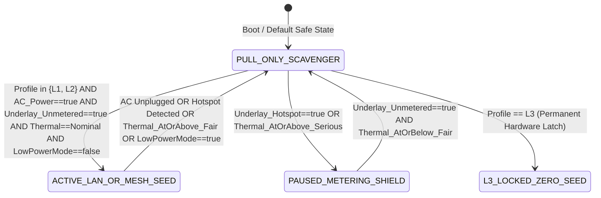

# Feature Design & SRE Production Specification: Tiered Content-Addressed Swarm Distribution (`L1` / `L2` / `L3`)

* **Doc ID:** `DESIGN-CAS-SWARM-2026-003` (`FS-702`, **Rev 2.0** — remediation of `ADVERSARIAL_SPEC_REVIEW_2026-11-04` and `GAP-31`; see `§10 Revision History`)
* **Generation:** `v3.0-Target` · **Precedence:** highest tier (with `FS-701..705`, `ADR-006+`) per [`README.md §1.2`](../README.md#12-normative-precedence--architectural-lineage)
* **Implementation Status:** **Partial implementation with revision-specific native fixture evidence; production acceptance remains open.** Real QUIC/OHTTP hydration, custody orchestration and native listener/startup checks have bounded evidence; authentic publisher/hardware identity, installed isolation and privileged APFS acceptance remain separate. The current closure matrix and both audits are in `docs/remediation/l2l3-20261112/`. Historical implementation notes below do not certify deployment. What is built, what is open and what diverges are tracked in `docs/IMPLEMENTATION_LEDGER.md` and `GapsDeDuped.me`; §11 records implementation decisions made while closing gaps.
* **Author:** Principal Security & SRE Architecture Fellow (Google Distinguished Engineer Standard)
* **Reviewers:** Endpoint Security Engineering, Darwin Kernel Systems, Applied Cryptography, Developer Experience (DevEx) SRE
* **Status:** `DRAFT — DESIGN COLLABORATION` (Pre-Implementation Specification; implementation gated on `§8.2` prerequisites)
* **Target Hardware Baseline:** Apple Silicon `M1` (8GB Unified Memory safe, `arm64e`, macOS 14.0+) with progressive hardware acceleration on `M2` / `M3` / `M4` (`PAC` + `AMX`) and `M5+` (`Apple MIE` / `EMTE` Memory Tagging)
* **Parent Research Track:** [Track 3 in `bleeding_edge_future_adoption.md`](bleeding_edge_future_adoption.md#track-3-content-addressed-p2p--swarm-distribution-fastcdc-iroh-blake3bao-r2-dragonfly)
* **Companion Specifications:**
  * Post-Autoregressive & World-Model Governance (`Classes 1–6`): [`FEATURE_POST_AR_MODEL_ADAPTERS.md`](FEATURE_POST_AR_MODEL_ADAPTERS.md) (`DESIGN-POST-AR-ADAPTERS-2026-001`)
  * Hardware Custody & Chained Intent Signing (`L1 ⊂ L2 ⊂ L3` $\times$ `A1..A4`): [`FEATURE_HARDWARE_CUSTODY_PROFILES.md`](FEATURE_HARDWARE_CUSTODY_PROFILES.md) (`DESIGN-HW-CUSTODY-2026-004`)
  * Deterministic Agent IFC & `PoP-Biscuit` Delegation (`C1..C4` $\times$ `T0..T3`): [`FEATURE_AGENT_IFC_AND_DELEGATION.md`](FEATURE_AGENT_IFC_AND_DELEGATION.md) (`DESIGN-AGENT-IFC-2026-005`)
  * Silicon `EMTE` (`M1`–`M5+`) & ZK Compliance Proofs (`L1 ⊂ L2 ⊂ L3`): [`FEATURE_SILICON_EMTE_AND_ZK_COMPLIANCE.md`](FEATURE_SILICON_EMTE_AND_ZK_COMPLIANCE.md) (`DESIGN-EMTE-ZK-2026-006`)

**Lifecycle timing amendment (`YKD-02`, 2026-11-15):** The accepted measurement-first policy and FS-703 §5.2 govern removal/lock/sleep freeze, release-fence and owned-state cleanup latency. Give L1/L2 broad measured latitude and derive tighter comparable L3 budgets from native baseline tests immediately before timing-sensitive implementation. Numeric lifecycle budgets remain pending; previous fixed sub-millisecond/sub-5 ms wipe labels are historical references. Preserve per-class/factor/proof gates, finite waiting, cancellation and complete claimed-owner cleanup. Unrelated inference, proof-fold, network, ceremony and token-lifetime targets are unchanged.

---

## Table of Contents

1. [Context, Motivation & Problem Statement](#1-context-motivation--problem-statement)
2. [Goals & Explicit Non-Goals](#2-goals--explicit-non-goals)
3. [Core Content-Addressed Pipeline, `ORAS` OCI Layout & Pre-Admission Sanitizer](#3-core-content-addressed-pipeline-oras-oci-layout--pre-admission-sanitizer)
   * 3.1 Two-Level Chunking (`FastCDC` + `Bao` BLAKE3) & Dual-Hash Encrypt-then-Merkle Binding
   * 3.2 Formal `cas://` URI Grammar, `SCM_RIGHTS` IPC Contract & Anti-Downgrade Binding
   * 3.3 `ORAS` / OCI v1.1 Artifact, ANE Portability & SLSA v1.0 Provenance on R2
   * 3.4 Pre-Admission Structural Format Sanitizer (Anti-Deserialization RCE)
4. [Detailed Specification of the Three Swarm Security Profiles (`L1`, `L2`, `L3`)](#4-detailed-specification-of-the-three-swarm-security-profiles-l1-l2-l3)
   * 4.1 Profile `L1`: `startup-zero-ops` (~\$1.50/mo | Zero Servers)
   * 4.2 Profile `L2`: `enterprise-mesh` (Private Capability Swarm & Namespace-Keyed Convergent AEAD)
   * 4.3 Profile `L3`: `classified-enclave` (Zero-Seed / OHTTP / SEP+YubiKey Split Key / Sealed APFS)
5. [Engineering Deep-Dive: Resolving Hardware, Kernel QoS, Lazy `mmap` & Firewall Paradoxes](#5-engineering-deep-dive-resolving-hardware-kernel-qos-lazy-mmap--firewall-paradoxes)
   * 5.1 Challenge A: Dual-Socket QoS Split & `UDP/443` $\to$ `TCP/443` Firewall Fallback
   * 5.2 Challenge B: Preserving Hotspot Detection & LEDBAT++ Inside `L2` Encrypted VPN/WireGuard Tunnels
   * 5.3 Challenge C: Preventing Crypto/SSD Battery Burn & Solving Lazy-Load vs. Sealed APFS in `L3`
   * 5.4 Challenge D: Fault-Safe Lazy Hydration (`FUSE-T` / Range) Without `mmap()` `SIGBUS` Crashes (`L1`/`L2`)
   * 5.5 Challenge E: Kernel Privilege Separation (`_enclavecas` vs. `_llmagent`) Against Swarm Exfiltration
   * 5.6 Deterministic `SeedGateFSM` Hardware State Machine
6. [Frontier AI Lab Standards Crosswalk: Google DeepMind, Anthropic, and OpenAI](#6-frontier-ai-lab-standards-crosswalk-google-deepmind-anthropic-and-openai)
7. [Production Readiness Review (PRR) & Operational SRE Runbooks: SLIs, SLOs, Disk GC, Offline TTL & FMEA](#7-google-sre-production-readiness-review-prr-slis-slos-disk-gc-offline-ttl--fmea)
   * 7.1 Service Level Indicators (SLIs) & Service Level Objectives (SLOs)
   * 7.2 Failure Modes & Effects Analysis (FMEA) & Instant Zero-Copy Rollback
   * 7.3 SSD Disk-Capacity DoS Prevention (`FastCDC` Ref-Counted GC) & 168-Hour Offline Air-Gap TTL
   * 7.4 Daemon Resource Envelope (`launchd` Hard Caps) & Zero-PII ZK-Ready Audit Schema
8. [Future Section: Formal Verification & Mathematical Security Proofs Roadmap (`L2` & `L3`)](#8-future-section-formal-verification--mathematical-security-proofs-roadmap-l2--l3)

---

## 1. Context, Motivation & Problem Statement

Local AI enclaves on developer laptops are no longer syncing 50KB configuration files alone. A production macOS enclave must continuously synchronize four distinct artifact classes from a centralized source of truth:

1. **Signed Cedar Policy Bundles (`.cedar` + `.cedarschema`, `ADR-008`)** ($50\text{KB} - 5\text{MB}$, updated multiple times per day).
2. **Apple Neural Engine (ANE) System-1 / `jev`-Style Guardrail Heads & SAE Concept Matrices** (architecture-neutral CoreML `.mlpackage` MIL + FP16/INT8 weights or `MLX` `.safetensors`, $500\text{MB} - 2.5\text{GB}$, updated weekly or emergency-pushed during active prompt-injection campaigns, then compiled locally per host Apple Silicon ANE generation `M1`–`M5`).
3. **Quantized Local Coding, Synthesis & World Models** (`.safetensors` / `MLX` weights, $8\text{GB} - 64\text{GB}$, updated bi-weekly).
4. **Hermetic `wasm32-wasip2` depot Tool Binaries** ($2\text{MB} - 50\text{MB}$, updated continuously via CI/CD).

Traditional distribution mechanisms force an unacceptable choice:

* **Unicast HTTPS / OCI Registry Pulls:** Melt corporate office Wi-Fi uplinks on Monday mornings, incur thousands of dollars in AWS S3/ECR egress fees, and stall developer cold starts for 15–30 minutes.
* **Legacy BitTorrent (`BEP 3` / `BEP 52`):** Trips enterprise IDS/IPS alarms, leaks swarm membership metadata, invalidates fixed-size piece hashes on single-byte header edits, and chokes asymmetric residential cable upload links (ruining developer video calls and draining MacBook batteries).
* **Heavyweight K8s P2P (`CNCF Dragonfly` + `Harbor`):** Costs \$800–\$2,500+/month in idle control-plane infrastructure and relies on kernel FUSE extensions that require macOS Recovery Mode security downgrades.

This feature specifies **`enclave-cas`**—a single, unified, Rust-native Darwin daemon running under isolated user `_enclavecas` that combines **`FastCDC` content-defined deduplication**, **NEON-accelerated `Bao` (BLAKE3) verified streaming over `Iroh` QUIC**, and **Cloudflare R2 (\$0 egress) `ORAS`-compatible cold seeding** across three policy-switchable security tiers (`L1`, `L2`, `L3`).

---

## 2. Goals & Explicit Non-Goals

### 2.1 Goals

* **G1 (Near-Zero Startup Floor):** Operate `Profile L1` at **$\le \$2.00/\text{month}$ per 100GB stored** with **zero always-on servers** and **\$0.00 cloud egress fees**.
* **G2 (Single-Config Tier Progression & Anti-Downgrade):** Upgrade seamlessly from `L1` (`startup-zero-ops`) $\to$ `L2` (`enterprise-mesh`) $\to$ `L3` (`classified-enclave`) solely via signed policy configuration, with cryptographic anti-downgrade enforcement.
* **G3 (Provable Zero DevEx Degradation — Section 3.3 Compliance):** Enforce zero battery seeding, zero cellular/hotspot tethering bleed, zero SSD capacity exhaustion, zero thermal throttling on fanless M1 MacBook Airs, and $<5\text{ms}$ router queuing delay impact during active Zoom/SSH sessions across *all three profiles*.
* **G4 (Zero Mid-Stream Poisoning & Zero Deserialization RCE):** Reject corrupted bytes in RAM within **16KiB** at $>6\text{ GB/s}$ on M1 silicon before writing to APFS, and structurally validate all headers before exposing read-only file descriptors to consumers.

### 2.2 Explicit Non-Goals

* **NG1:** Public, unauthenticated internet DHT swarming (Mainline BitTorrent DHT and PEX are permanently compiled out of the binary in all profiles).
* **NG2:** Kernel extensions (`kexts`) requiring macOS Reduced Security in Recovery Mode. All virtual filesystem hooks execute strictly in user space (embedded Rust NFSv4 loopback / `FUSE-T`, macOS `FileProvider.framework` `SF_DATALESS` files, or HTTP-Range loopback).
* **NG3:** Arbitrary URL/blob fetching on behalf of agent processes. `_llmagent` can never request arbitrary hashes or push outbound chunks (preventing covert-channel swarm exfiltration).

### 2.3 Alternatives Considered & Rejected

| Candidate Architecture                    | Primary Advantage                            | Reason for Rejection                                                                                                                                                                             |
|:------------------------------------------|:---------------------------------------------|:-------------------------------------------------------------------------------------------------------------------------------------------------------------------------------------------------|
| **Raw BitTorrent v2 (`BEP 52`)**          | Mature 16KiB SHA-256 Merkle specification.   | Trips corporate IDS/IPS BitTorrent signatures; blocked by Wi-Fi client isolation; fixed-size piece boundaries invalidate 100% of hashes when 1 byte shifts at offset 0 of a `.safetensors` file. |
| **`CNCF Dragonfly` + `Harbor` + `Nydus`** | Proven inside Linux Kubernetes data centers. | Prohibitive startup TCO (**\$800–\$2,500+/mo** idle K8s control plane + SRE toil); `Nydus` FUSE kexts require macOS Recovery Mode security downgrades on Apple Silicon.                          |
| **Unicast CDN / S3 Presigned HTTPS**      | Zero endpoint daemon complexity.             | \$0.09/GB egress bills explode at fleet scale; saturates office WAN links on Monday mornings; lacks sub-chunk Merkle streaming recovery and LAN peer offload.                                    |

---

### 2.4 Core Specification Dependencies & Invariant Deltas

| Item                                  | Disposition in `FS-702`                                                                                                                                                                                                        |
|:--------------------------------------|:-------------------------------------------------------------------------------------------------------------------------------------------------------------------------------------------------------------------------------|
| **Requires (`CORE-V2`)**              | Cedar policy bundles (`.cedar` + `.cedarschema` only — no `.rego` in `v3.0`, `ADR-008`/`OQ-03`); WASI 0.2 components validated before admission.                                                                               |
| **Requires (`v3.0`)**                 | `FS-703` SEP/YubiKey key unwrapping for `L3` namespace keys and `k`-of-`n` `Ed25519` TUF quorums (`ADR-013`); `FS-704` `PoPBiscuitWireV1` for `L2` swarm capabilities (`ADR-015`); `FS-705` rollup transport.                  |
| **Amends `CORE-V1 §2.3` Invariant 1** | `UID 702` (`_enclavecas`) is the **only** enclave principal permitted LAN/WAN/`OHTTP` sockets, under its own `pf` anchor `com.enterprise.cas.swarm`; `_llmagent` (`UID 701`) stays loopback-only; `UID 705` holds `0` sockets. |
| **Amends `CORE-V1 §3`**               | GitOps HTTPS bundle sync is superseded by 4-role TUF (`root → timestamp → snapshot → targets`) over `cas://blake3-bao-v1/` artifacts.                                                                                          |
| **Shared contracts**                  | `EnclaveAuditEnvelopeV1` journals; `schemas/enclave-lock.schema.json` for artifact pins (`license_policy`, `jurisdiction_shard`, `lazy_fuse_t`).                                                                               |

---

## 3. Core Content-Addressed Pipeline, `ORAS` OCI Layout & Pre-Admission Sanitizer

### 3.1 Two-Level Chunking (`FastCDC` + `Bao` BLAKE3) & Dual-Hash Encrypt-then-Merkle Binding

```
  [Publisher CI/CD (`oras push` + `enclave-cas pack`)]
  Raw Artifact (.safetensors / .cedar / .wasm / .mlpackage)
         |
         | 1. Gear Rolling Hash (FastCDC-v2020 with the PINNED 256-entry gear table: min=16KiB, avg=64KiB, max=256KiB)
         |    -> Computes immutable `logical_plaintext_blake3_root` (canonical URI identity across L1->L3)
         v
  Content-Defined Chunks (Deduplicates 80%-98% of unchanged tensor layers across versions)
         |
         | 2. Encrypt-then-Merkle: Optional Namespace-Keyed Convergent AEAD (L2/L3, Epoch `e`)
         |    -> Grouped into 4MiB `Bao` Merkle Macro-Blocks (16KiB ciphertext leaves -> `transport_ciphertext_bao_root`)
         v
  OCI v1.1 Artifact Manifest + Signed TUF Targets Metadata
  { logical_plaintext_root, transport_ciphertext_bao_root, key_epoch, min_profile, seq_no, expires }
         |
         +---> Signed via Sigstore Cosign / YubiKey Threshold + SLSA v1.0 Provenance -> Rekor Transparency Log
         +---> Pushed once to Cloudflare R2 (OCI Layout `/v2/<ns>/blobs/blake3:<transport_bao_root>`)
```

* **Deterministic Chunking (`MUST`, `F-028`):** different `fastcdc` crates ship different default gear tables and therefore produce different chunk boundaries and `Bao` roots for identical files. `enclave-cas` MUST use `FastCDC-v2020` with the exact 256-entry gear array whose SHA-256 is pinned as `tuf.fastcdc_gear_table_sha256` in `enclave.lock.toml` (`schemas/enclave-lock.schema.json`) and published in a conformance appendix with a `1 MiB` test vector (expected chunk offsets + root).
* **Dual-Hash Target Metadata (`MUST`):** every TUF target records both `blake3` (`Bao` tree root) and `sha256` (linear file digest for OCI/FIPS interoperability), enabling a future FIPS 140-3 mode (`OQ-22`) without re-addressing.
* **`FastCDC` (64KB average, `Xet`-compatible)** solves **cross-version deduplication**: updating tokenizer metadata or merging LoRA layers in a 32GB model reuses 96%+ identical chunks already cached on the developer's SSD.
* **`Bao` Merkle Trees (16KiB leaves) + Encrypt-then-Merkle (`L2`/`L3`)** solve **untrusted P2P streaming without AEAD DoS**: on the wire, `Bao` hashes *ciphertext* (`transport_ciphertext_bao_root`) so forged 16KiB slices from untrusted peers are rejected in L1 CPU cache via ARM64 NEON BLAKE3 *before* spending cycles on XChaCha20-Poly1305 decryption. Once decrypted in RAM, chunks are verified against `logical_plaintext_blake3_root` before advancing the write cursor.

### 3.2 Formal `cas://` URI Grammar, `SCM_RIGHTS` IPC Contract & Anti-Downgrade Binding

All enclave consumers (Cedar policy engine, MLX/Ollama model loader, Wasmtime depot host) reference artifacts exclusively via canonical `cas://` URIs:

```abnf
cas-uri       = "cas://" cas-alg "/" hex64 "?" cas-params
cas-alg       = "blake3-bao-v1"          ; hash-agile registry (F-028); future algorithms register new tokens
hex64         = 64HEXDIG ; Strictly `logical_plaintext_blake3_root` (100% invariant across L1/L2/L3 & key rotations)
cas-params    = "target=" target-slug "&ns=" namespace [ "&min_profile=" profile-tier ] [ "&rekor=" uint64 ]
profile-tier  = "L1" / "L2" / "L3"
```

* **Zero-Rewrite URI Tier Invariance (`Goal G2`):** Because `<hex64>` always encodes `logical_plaintext_blake3_root` while the signed TUF `targets.json` maps `logical_plaintext_root -> { transport_ciphertext_bao_root, aead_mode, key_epoch }`, upgrading an organization from unencrypted `L1` to encrypted `L2`/`L3`—or rotating namespace encryption epochs—**never alters a single `cas://` URI in developer configs or code**.
* **Cryptographic Anti-Downgrade Invariant:** `min_profile` in a URI query string is treated strictly as an *upward floor hint*, never an authority. The enforced profile is computed deterministically as:
  $$\text{Profile}_{\text{effective}} = \max\Big(\text{WorkstationCedarPolicy.min\_profile}, \;\text{SignedTUFManifest.min\_profile}, \;\text{URI.min\_profile}\Big)$$
  Rewriting `?min_profile=L3` to `?min_profile=L1` in a local config file has **zero effect** because the TUF-signed manifest for that `hex64` root hash pins `min_profile: L3`.
* **`SCM_RIGHTS` Atomic `FDSet` Passing IPC (`/var/run/enclave/cas/cas.sock`, §11.1):** Consumers never traverse `/opt/enterprise/enclave/cas/` directly. They send `ResolveRequest { cas_uri }` over the local Unix Domain Socket; `enclave-cas` verifies caller code-signing identity via macOS kernel audit tokens (`LOCAL_PEERTOKEN` `audit_token_t` + `SecCodeCopyGuestWithAttributes` `csreq`; never a reusable PID, `ADR-010`), verifies full 4-role TUF metadata (`root.json → timestamp.json → snapshot.json → targets.json`) so all delegated `targets/*.json` versions are bound atomically by `snapshot.json` (defeating mix-and-match of a fresh model with stale `companion_safety_layers`, `F-028`), **eagerly hydrates and verifies any mandatory `companion_safety_layers[]`** (`ece_calibration_lut`, `leace_nullspace`, `conformal_energy_lut`, `eagle_draft_head` per [`FEATURE_POST_AR_MODEL_ADAPTERS.md`](FEATURE_POST_AR_MODEL_ADAPTERS.md) even when backbone weights stream lazily in `L1`/`L2`), and returns an **atomic array of read-only file descriptors (`FDSet`, each `O_RDONLY | O_SHLOCK`, sealed against `F_SETFL` write promotion)** via `sendmsg(..., SCM_RIGHTS)`.

### 3.2.1 Exact requested metadata and eager-bundle admission

These requirements refine §3.2 for L1/L2/L3. The bounded Lean task contract is
LAT-05 exact-main admission; its
integer roots, authenticated-catalog input and logical certificates are model
interfaces. They do not implement TUF parsing, cryptography or descriptor delivery.

| ID       | Required behavior                                                                                                                                                                                                                                                                                                                                                                             |
|----------|-----------------------------------------------------------------------------------------------------------------------------------------------------------------------------------------------------------------------------------------------------------------------------------------------------------------------------------------------------------------------------------------------|
| `ADM-01` | Resolve the requested main artifact against one current authenticated metadata snapshot. Preserve its requested identity and all applicable signed length, digest, companion and policy bindings through planning, verification and admission. Matching a content root alone cannot substitute a different metadata record for that main artifact.                                            |
| `ADM-02` | Select the main and its mandatory direct eager companions from that same snapshot. Missing, revoked, stale or unauthorized required members refuse admission. Direct companions do not imply recursive traversal of their own companion lists; recursive closure needs a separately specified policy and implementation.                                                                      |
| `ADM-03` | Deduplicating payload roots cannot erase main identity or companion-role authorization. Selected references sharing content must agree on authenticated content length and digests; validate each reference's role and policy separately. Unselected catalog aliases do not invalidate an otherwise valid selected bundle merely by existing.                                                 |
| `ADM-04` | Fully eager admission requires exact verified payloads for the main and every selected eager companion before logical bundle visibility. Staging or an individual publication attempt is insufficient. Retain current-snapshot, profile, ownership and rollback checks. Existing public-L1 lazy-weight behavior has its own §5.4 contract; this bounded eager model does not prove that path. |
| `ADM-05` | Admit valid complete bundles, including a main without companions and supported repeated companion references. Refusal of every request is not conformance. Define duplicate handling, order and capacity at each interface rather than silently imposing a new wire order.                                                                                                                   |
| `ADM-06` | Trace admission requirements to executable positive/negative checks and conditional proof statements. Distinguish model checks, real authenticated bytes, source correspondence and platform acceptance. A model-only metadata alias regression establishes neither a cryptographic collision nor a production exploit.                                                                       |

For the frozen Lean representation, full `Target` equality covers `root`,
`length`, ordered `eager` and `revoked`. Its selected root list is exactly
`(main.eager ++ [main.root]).eraseDups`, including Lean's pinned duplicate/order
semantics, with at most 15 eager entries **before** deduplication. All selected
same-root records must be equal; an unrelated inconsistent catalog entry may
remain unselected. These are explicit bounded-model rules, not a new manifest
schema, descriptor ordering ABI, universal production root-uniqueness rule or
proof that every signed JSON field is represented by `Target`.

The artifact-admission dossier
records the starting/solution revisions and existing before/after evidence.
Production callers and the broader LAT-05 obligations remain subject to their
separate source and acceptance records.

### 3.3 `ORAS` / OCI v1.1 Artifact, ANE Portability & SLSA v1.0 Provenance on R2

To ensure zero custom CI/CD lock-in and universal `M1`–`M5` silicon compatibility, R2 storage adheres strictly to the **OCI Distribution & Artifact Specification v1.1** (`ORAS`-compatible):

* **Registered Media Types & Apple Silicon ANE Portability:**
  * `application/vnd.enclave.model.safetensors.fastcdc.v1` (Quantized LLM / World Model / `jev` / Diffusion / SSM `MLX` weights; paired with `application/vnd.enclave.model.config.v1+json` topological `execution_class` attestation per [`FEATURE_POST_AR_MODEL_ADAPTERS.md`](FEATURE_POST_AR_MODEL_ADAPTERS.md))
  * `application/vnd.enclave.guard.coreml-mil.v1` (Architecture-neutral CoreML `.mlpackage` containing `MIL` graph + FP16/INT8 weights. *Hardware Portability Note:* Pre-compiled ANE `E5RT` execution binaries inside `.mlmodelc` are microarchitecture-locked to specific Apple Neural Engine generations—e.g., `H13G` on M1 vs. `H14G`–`H17G` on M2–M5—and break universal silicon portability. `enclave-cas` therefore ships portable `.mlpackage` MIL bundles and invokes sandboxed local `MLModel.compileModel(at:)` once per `(AppleSiliconChipID, macOSBuild)` during staging prior to `uchg` / APFS snapshot sealing.)
  * `application/vnd.enclave.policy.cedar.v1` (Signed `.cedar` + `.cedarschema` policy sets — the sole `v3.0` policy format, `ADR-008`)
  * `application/vnd.wasm.component.v1+wasm` (`wasm32-wasip2` hermetic depot tools)
* **SLSA Level 3/4 Provenance Referrers:** Standard `cosign attest --type slsaprovenance1` attachments are linked via the OCI v1.1 `subject` / Referrers API and verified locally by `enclave-cas` alongside TUF target metadata before admission.

### 3.4 Pre-Admission Structural Format Sanitizer (Anti-Deserialization RCE)

Cryptographic hash verification proves *who* signed an artifact, not that an upstream build script didn't accidentally package an unsafe serializer or malformed tensor header. Before committing any hydrated artifact to the readable store, an isolated Rust parser (`QOS_CLASS_BACKGROUND`, sandboxed via `sandbox_init` with zero syscalls except `read`/`exit`) enforces:

1. **Executable & Pickle Magic-Byte Ban:** Instant rejection + `SEV-1` telemetry alert if payload or archive members contain Python `pickle` opcodes (`0x80 0x02..0x05` PROTO headers), PyTorch zip-pickle `archive/data.pkl`, or native `Mach-O` (`0xFEEDFACF`) / `ELF` (`0x7F454C46`) binaries outside signed `.wasm` components.
2. **`.safetensors` Header Bounds & Non-Overlap Verification:** Reads the 8-byte `u64` JSON header size $N$; enforces $N \le 64\text{MiB}$; parses JSON with zero recursion; verifies `dtype` whitelist (`F16`, `BF16`, `F32`, `I8`, `U8`, `I4`); and proves that all tensor `[begin, end)` byte intervals partition `[8 + N, file_size)` **monotonically with zero overlap and zero out-of-bounds offsets** (neutralizing C++/Metal tensor-loader heap overflows).
3. **`.wasm` Component Verification:** Runs `wasmparser::Validator` (WASI 0.2 component model features only; rejects `wasm-threads` shared-memory Spectre gadgets) prior to setting `chflags(fd, UF_IMMUTABLE)` (`uchg`). Components are executed AOT (`.cwasm`) or under the Pulley interpreter — never JIT (`ADR-011`).
4. **`.mlpackage` Sanitizer (`MUST`, `F-029`):** CoreML packages (directories/ZIP containing `Model.mlmodel` Protobuf graphs) are rejected if they contain any symlink or `..` path component, an uncompressed/compressed ratio `> 4x`, a total size `> manifest.byte_size`, Protobuf nesting depth `> 16`, or **any** `customLayer` / embedded Mach-O dylib.

---

## 4. Detailed Specification of the Three Swarm Security Profiles (`L1`, `L2`, `L3`)

### Architectural Comparison Overview

| Subsystem Dimension           | Profile `L1`: `startup-zero-ops`                                                                                          | Profile `L2`: `enterprise-mesh`                                                                  | Profile `L3`: `classified-enclave`                                         |
|:------------------------------|:--------------------------------------------------------------------------------------------------------------------------|:-------------------------------------------------------------------------------------------------|:---------------------------------------------------------------------------|
| **Monthly Infra TCO (100GB)** | **~\$1.50/mo** (Cloudflare R2 only; 0 VMs)                                                                                | **~\$25–\$60/mo** (Stateless `iroh-relay` + R2)                                                  | **~\$80–\$200/mo** (OHTTP Relay + Attested Seed + R2)                      |
| **Peer Discovery**            | Link-local mDNS / Bonjour (`_enclave-cas._udp.local.`)                                                                    | Private SPIFFE-mTLS Coordinator / WireGuard Overlay                                              | **HARD DISABLED** (Zero peer discovery)                                    |
| **Outbound Peer Seeding**     | **Enabled on Office LAN** (AC-power + LEDBAT++ only)                                                                      | **Enabled across Auth Mesh** (Capability-verified peers)                                         | **HARD DISABLED (`Zero-Seed`)**                                            |
| **Swarm Anti-Enumeration**    | LAN link-local scope + epoch-salted bloom TXT filter                                                                      | **QUIC ALPN `Biscuit` Capability Proof before hash exchange**                                    | N/A (No P2P listener socket opened)                                        |
| **Origin Fetch Privacy**      | Standard TLS 1.3 / HTTP/3 presigned R2 URLs                                                                               | TLS 1.3 + SPIFFE client cert to R2 Worker gate                                                   | **Chunked Oblivious HTTP (RFC 9458)** hides client IP                      |
| **Chunk Encryption at Rest**  | Optional public or **Namespace-Keyed Convergent AEAD**                                                                    | **Namespace-Keyed Convergent XChaCha20-Poly1305** (SEP-wrapped)                                  | **Namespace-Keyed Convergent AEAD + HPKE (RFC 9180) + SEP$\oplus$YubiKey** |
| **Manifest Trust Root**       | Keyless GitHub OIDC Sigstore + Rekor + 4-role TUF                                                                         | Corporate 4-role TUF + Private Rekor (SLSA L3 provenance target)                                 | **`k`-of-`n` `Ed25519` YubiKey TUF Quorum** (SLSA L4 provenance target)    |
| **Filesystem Hydration**      | Fault-safe Lazy Range / `FUSE-T` (**public `> 1 GiB` weights only**, `pf`-blocked for `uid=501`) $\to$ atomic `uchg` file | **Eager verified hydration** before `SCM_RIGHTS` hand-off (no `FUSE-T`) $\to$ atomic `uchg` file | **Atomic Pre-Seal + `clonefile(2)` + Read-Only APFS Snapshot**             |

---

### 4.1 Profile `L1`: `startup-zero-ops` (~\$1.50/mo | Zero Servers)

Designed for 2-to-150 engineer startups needing bleeding-edge verification and instant LAN speeds with **zero DevOps maintenance**:
0. **`L1` Scope Restrictions (`MUST`, `F-029`, `F-030`):** mDNS advertisement and seeding are permitted **only** for artifacts with `classification == "public_l1"` **and** `license_policy.allow_p2p_seeding == true` (default `false`; when `false` the artifact is fetched exclusively from the licensed origin and never advertised). The peer table is capped at `<= 32` peers and `<= 1` peer per IPv4 address or IPv6 `/64`; any peer delivering `< 2 MiB/s` over a `500 ms` window is evicted in favour of R2 HTTPS (slow-loris floor).

1. **Control-Plane-Free Discovery (`RFC 6763` Single-Packet Bloom TXT):** On local networks, `enclave-cas` advertises an anonymized Bonjour service via macOS `NWListener` / `dnssd` (`_enclave-cas._udp.local.`) bound strictly to physical LAN interfaces (`en0`). Rather than advertising plaintext model names in mDNS TXT records, peers advertise a **256-byte (2,048-bit, $k=4$) keyed BLAKE3 Bloom filter** salted by the org's daily OIDC epoch secret—comfortably fitting inside a single unfragmented 1500-byte Ethernet mDNS frame (`RFC 6763`) while indexing up to ~150 cached root hashes at $<1.2\%$ false-positive rate and revealing zero metadata to coffee-shop observers. On shared co-working Wi-Fi (e.g., WeWork) with **AP Client Isolation / multicast filtering**, LAN discovery times out silently in $150\text{ms}$ and falls back cleanly to R2.
2. **Serverless Cold Fallback:** When working remotely with zero LAN peers, `enclave-cas` exchanges its OIDC developer token with a stateless Cloudflare Worker for short-lived presigned HTTP/3 (`UDP/443`) or HTTPS TLS 1.3 (`TCP/443`) Range URLs pointing directly at Cloudflare R2 (\$0.00 egress).
3. **Zero-Toil Trust:** Root manifests and SLSA v1.0 provenance predicates are signed in GitHub Actions via keyless Cosign OIDC and verified locally against Sigstore Rekor + monotonic TUF sequence numbers.

### 4.2 Profile `L2`: `enterprise-mesh` (Private Capability Swarm & Namespace-Keyed Convergent AEAD)

Designed for regulated (e.g. FinTech) and multi-team organizations where different engineering groups hold **restricted clearance models or sensitive PII guardrail policies** (no compliance attestation is implied):
0. **Licensing & GDPR Chapter V Fence (`MUST`, `F-030`):** peer seeding over `iroh` is forbidden unless the TUF target sets `license_policy.allow_p2p_seeding == true`. Every `L2` SVID and `PoP-Biscuit` swarm caveat carries a **`jurisdiction_shard ∈ {EU, US, APAC}`**; peers MUST only exchange QUIC handshakes, endpoints and chunks with peers and `iroh-relay` instances in the same shard (an `EU` SVID rejects a `US` peer). Relays keep connection state in RAM only (`<= 5 min`) with zero disk connection logs; deployments document the shard design in `COMPLIANCE_EVIDENCE.md §2`.

1. **Defeating Confirmation-of-a-File & Zero-Reupload Key Rotation (`DEK`/`KEK` Envelope):** Textbook convergent encryption ($K = H(\text{chunk})$) allows an attacker who breaches cloud object storage to run offline dictionary attacks against low-entropy `.cedar` policy chunks. `L2` (and `L3`) derives chunk keys using **BLAKE3 Keyed Mode** bound to an epoch-versioned per-namespace Data Encryption Key $K_{\text{ns\_dek}, e}$:
   $$K_{\text{chunk}} = \text{BLAKE3\_keyed}\big(K_{\text{ns\_dek}, e}, \;\text{"enclave-cas-chunk-v1"} \parallel \text{plaintext\_chunk}\big)$$
   $$\text{Nonce}_{24} = \text{BLAKE3\_derive\_key}\big(\text{"enclave-cas-xchacha-nonce-v1"}, \;K_{\text{chunk}}\big)[0..24]$$
   * **Zero-Reupload Offboarding:** The compact keyring $\{K_{\text{ns\_dek}, 1..e}\}$ is wrapped by the active capability-gated Key Encryption Key $K_{\text{ns\_kek}}$ (unwrapped inside Apple Silicon SEP upon presenting a valid SPIFFE SVID + `Biscuit` token). When an engineer leaves the company, rotating to epoch $e+1$ ($K_{\text{ns\_dek}, e+1}$ + new $K_{\text{ns\_kek}}$) immediately blocks access to all future model/policy releases **without re-encrypting or re-uploading terabytes of historical R2 chunks**.
2. **Zero-Leakage Capability Handshake (`ALPN = "enclave-cas-v2"`):**
   * **Step 1 (Mutual SPIFFE TLS 1.3):** Initiator $P_A$ and Responder $P_B$ authenticate via hardware SEP-bound SPIFFE X.509 SVIDs.
   * **Step 2 (Initiator-First `PoP-Biscuit` Proof):** Before $P_B$ reveals a single bit of its inventory, $P_A$ sends `(namespace_id, root_hash, PoPBiscuitToken)` (per [`FEATURE_AGENT_IFC_AND_DELEGATION.md`](FEATURE_AGENT_IFC_AND_DELEGATION.md), bound to RFC 9266 `tls-exporter` + peer SPIFFE SVID) containing a Datalog grant (`right("cas:pull", namespace_id)`) attenuated with a short TTL ($\le 1\text{h}$). **YKD-09:** this is the outer pull-grant caveat, not the cross-node presentation lifetime. Every PoP proof remains ≤30,000 ms under FS-704 clock/skew rules, and the earliest applicable parent, custody, signed-metadata or revocation limit controls access. A ≤1 h caveat cannot extend any of those bounds.
   * **Step 3 (Constant-Time Indistinguishable Rejection):** If $P_A$'s `Biscuit` token fails validation—or if $P_B$ lacks `root_hash`—$P_B$ replies with a constant-time 256-byte `CHUNK_UNAVAILABLE` frame. Unauthorized insiders learn zero bits about peer holdings.
3. **Automated Byzantine Quarantine:** If a peer sends a 16KiB slice failing `Bao` Merkle verification over mTLS, the receiver emits a signed `PoisonReceipt` (binding TLS session exporter + offending SVID), triggering immediate mesh revocation.

### 4.3 Profile `L3`: `classified-enclave` (Zero-Seed / OHTTP / SEP+YubiKey Split Key / Sealed APFS)

Designed for regulated-data break-glass teams, M&A rooms, defense contractors, and frontier-lab red-zone endpoints (no compliance attestation is implied):

1. **Strict Zero-Seed Socket Lockdown:** Inbound P2P listeners and hole-punching are disabled (`listen_sockets = 0`), eliminating lateral laptop-to-laptop traffic.
2. **Chunked Oblivious HTTP (`RFC 9458` + `HPKE RFC 9180`):** All chunk-group fetches traverse an **OHTTP Relay $\to$ OHTTP Gateway** pair using `HPKE(DHKEM(X25519, HKDF-SHA256), HKDF-SHA256, ChaCha20Poly1305)` padded to fixed quanta (**64KiB** for policies, **4MiB** for model macro-blocks). Neither the Relay (sees IP, blinded to hash) nor the Origin (sees hash, blinded to IP) can link developer identity to artifact fetches.
3. **Dual-Custody Key Unwrapping & $m$-of-$n$ YubiKey TUF Quorum:**
   * Publisher manifests require a **discrete `k`-of-`n` `Ed25519` hardware YubiKey TUF signature quorum** (e.g., 3-of-5 Security Officers, each producing a standard CTAP 2.1 assertion; `ADR-013`).
   * Integrated with [`FEATURE_HARDWARE_CUSTODY_PROFILES.md` (`L3: dual-custody-deadman`)](FEATURE_HARDWARE_CUSTODY_PROFILES.md#52-challenge-b-solving-thunderbolt--usb-c-hub-micro-drops-without-evil-maid-windows-lock-then-scrub): the local namespace session key $K_{\text{cas\_session}}$ for `L3` classified models requires **2-of-2 `Apple SEP` `ECDH` $\parallel$ `Local YubiKey FIDO2 PRF`** (`HKDF-SHA256`), fencing release and zeroizing owned key material on USB YubiKey removal or macOS Screen Lock under the measured profile budgets in FS-703 §5.2 (`YKD-02`). The previous <5 ms label is historical; native per-endpoint limits remain to be calibrated.
4. **Immutable Sealed APFS Snapshot:** Fully verified L3 artifacts are published through the confined root broker in §4.3.1 (ADR-021), using same-volume APFS cloning, `fs_snapshot_create()` and a verified snapshot mount with **`MNT_RDONLY | MNT_NOEXEC | MNT_NOSUID | MNT_NODEV`**. `/opt/enterprise/enclave/sealed/` is the logical sealed namespace; signed routing must identify an independently provisioned dedicated APFS volume. CAS remains UID702; it never mounts snapshots itself.

### 4.3.1 Confined privileged publication contract (ADR-021)

These mandatory clauses refine the original immutable-snapshot requirement. They do not replace APFS snapshots with ordinary files or disk images. The root service is `enclave-apfs-broker`, launch label `com.enterprise.enclave.apfs-broker`. Its default socket is `/var/run/enclave/apfs-broker/broker.sock`; the parent is root-owned, group `_enclavecas` (GID8702), mode 2750, and the socket is 0660. The existing application daemon accounts and client groups remain distinct.

| Stable ID | Mandatory behavior                                                                                                                                                                                                                                                                                                                                                                                                                                                                                                                                                                                                                                                                                  |
|-----------|-----------------------------------------------------------------------------------------------------------------------------------------------------------------------------------------------------------------------------------------------------------------------------------------------------------------------------------------------------------------------------------------------------------------------------------------------------------------------------------------------------------------------------------------------------------------------------------------------------------------------------------------------------------------------------------------------------|
| `SBR-01`  | UID702 remains unprivileged. Only the separately confined root broker performs snapshot creation/mount/retraction. L3 production selection must use the authenticated broker adapter; no direct native, ordinary-file, DMG or lower-profile fallback.                                                                                                                                                                                                                                                                                                                                                                                                                                               |
| `SBR-02`  | Authenticate the CAS kernel peer UID702 and independently provisioned CAS code pin before accepting request fields or FDs. CAS requires kernel server UID0 and a separately pinned broker identity. Missing, stale, foreign or malformed identity/pin refuses; a matching UID alone is insufficient.                                                                                                                                                                                                                                                                                                                                                                                                |
| `SBR-03`  | Broker authority comes from a root-only, bounded, no-follow public TUF replica and retained bootstrap pin, independently verified with consecutive root rotation, snapshot binding, expiry, revocation, rollback/freeze refusal and persisted monotonic state. CAS-writable files and caller-supplied configuration cannot authorize root operations. Root/targets publisher thresholds are at least 2 for L3; physical publisher provenance remains a separate requirement.                                                                                                                                                                                                                        |
| `SBR-04`  | The request vocabulary is only Publish/Reopen/Revoke of a canonical lowercase 64-hex logical root. Reject unknown fields/operations, oversized/truncated frames and invalid roots. No request supplies a path, device, shell text, snapshot name, mount options, owner, entitlement or configuration. Maximum frame 4096 bytes; serialize operations and bound accepted connections and socket waits.                                                                                                                                                                                                                                                                                               |
| `SBR-05`  | Publish receives exactly one O_RDONLY regular-file FD. Reject missing/extra descriptors, special files, invalid access modes and lengths outside the signed target/resource bound. Copy through bounded buffers into an exclusively owned root-private object, then independently verify exact length, BLAKE3 and SHA256 on that stable copy before publication. Do not trust the caller's prior verification or a mutable source pathname.                                                                                                                                                                                                                                                         |
| `SBR-06`  | Obtain sealed volume/device/source/mount routing only from current signed configuration, and resolve the exact unrevoked L3 target from independent authority. Refuse ambiguous duplicate-root target policy. Require a dedicated APFS volume distinct from boot/data; root-owned nonwritable directory ancestry; no symlink, special-file, traversal or foreign-mount substitution. Derive all artifact/snapshot/mount names internally from the exact root.                                                                                                                                                                                                                                       |
| `SBR-07`  | Preflight capacity and bounded staging before copying. Use same-volume clone, create snapshot, mount with every required flag and verify actual kernel filesystem identity, mount source and flags before returning one O_RDONLY exact-payload FD. Unsupported/short/failed observations refuse. Any cross-volume staging copy is bounded and must not be described as zero-copy.                                                                                                                                                                                                                                                                                                                   |
| `SBR-08`  | Persist root-owned transaction/ownership records before privileged effects; mark completion only after verification. An intent is not proof of snapshot ownership: distinguish proved creation from EEXIST and ambiguous creation/crash outcomes. Lost replies and retries cannot fabricate success or remove another transaction's publication. Restart must revalidate recorded authority/ownership and kernel state before reuse or cleanup. Corrupt/missing required persistence cannot silently become fresh authority.                                                                                                                                                                        |
| `SBR-09`  | Failed clone/snapshot/mount/verification, cancellation or postpublication failure returns no success FD/receipt. Cleanup only exact owned artifacts; account for operations with partial effects even when they return errors. Retain original authority and report incomplete cleanup for retry; never unmount foreign resources or erase failure evidence. EEXIST never authorizes deletion. Persist uncertain ownership and refuse automatic snapshot cleanup/retry until trusted diagnosis; a crash before durable ownership evidence remains nonterminal.                                                                                                                                      |
| `SBR-10`  | Reopen repeats current target authorization, mount identity/flags and payload verification. Revoke uses durably retained original publication authority even after signed revocation/configuration rotation, but cannot publish new revoked bytes. CAS remains responsible for current custody leases, full eager-closure admission, cancellation and caller authorization. Already transferred immutable FDs require separately verified holder termination; unmount alone does not prove memory revocation.                                                                                                                                                                                       |
| `SBR-11`  | The broker has no Internet listener/client, signing/custody secrets, arbitrary execution or privilege-changing RPC. Apply deny-by-default confinement before serving, permitting only its fixed signed executable/platform operation and exact protected directories. Root UID and approved snapshot entitlement are independent deployment prerequisites, never assumed from a filename or development signature.                                                                                                                                                                                                                                                                                  |
| `SBR-12`  | Build/sign/pin/launch/package/installer/verify/health/recovery/removal tooling and MDM inventories must represent the L3-only helper consistently. Start its authenticated readiness before L3 CAS publication; stop CAS before broker upgrade/removal. Never stop the broker and delete state while owned publications still need retraction. Preserve independently pinned bootstrap/rollback state on ordinary upgrade. A root deployment command `--quiesce-idle` must serialize with whole accepted operations, validate empty durable ownership and persist a marker preventing subsequent effects before authorizing removal. Diagnostic `--check-idle` alone cannot authorize stop/removal. |
| `SBR-13`  | Log bounded lifecycle outcomes and transaction/root identifiers, never content, custody material or credentials. Report partial cleanup and unavailable entitlement separately from verified serving. Measure broker memory and combined fleet footprint separately; existing five-daemon RSS/SLO targets do not verify the new service.                                                                                                                                                                                                                                                                                                                                                            |
| `SBR-14`  | Every clause, code path, negative/positive assertion and actual result must be linked in the delivery matrix. Independently review alternate callers, compromised-CAS requests, FD/path races, restart/retry, signed rotation and failure cleanup. Private inert-platform tests establish software orchestration only; installed cross-UID identity, native snapshots/mount flags, entitlements and hardware provenance stay BLOCKED/NOT RUN until actually permitted and executed.                                                                                                                                                                                                                 |

Implementation status for these clauses is revision-specific; see the delivery matrix, broker audits and raw logs. A design requirement without executed evidence remains unverified. The corresponding threat boundary is TB-13; fleet deployment obligations are FS-706 §3.2.1.

---

## 5. Engineering Deep-Dive: Resolving Hardware, Kernel QoS, Lazy `mmap` & Firewall Paradoxes

```
+-------------------------------------------------------------------------------------------------------------------+
|          PRIVILEGE-SEPARATED ENCLAVE-CAS KERNEL & QoS TOPOLOGY (M1-M5 DARWIN, APPLIES ACROSS L1, L2, L3)          |
+-------------------------------------------------------------------------------------------------------------------+

  [Quarantined Agent (`_llmagent` GID 701)]
  pf Firewall: ZERO non-loopback packets!
         |
         | UDS `/var/run/enclave/cas/cas.sock`
         | Request: Resolve("cas://blake3-bao-v1/7f8a...?target=guard-v2") -> Returns read-only FD via `SCM_RIGHTS`
         v
  [Isolated CAS Daemon (`_enclavecas` UID/GID 702)]
         |
         +---> [Socket A: `fd_interactive_pull`]                 +---> [Socket B: `fd_scavenger`]
               - Darwin: SO_TRAFFIC_CLASS = SO_TC_BE                   - Darwin: SO_TRAFFIC_CLASS = SO_TC_BK_SYS
               - CPU: P-Cores (QOS_CLASS_USER_INITIATED)               - Quinn: Userspace LEDBAT++ (5ms OWD target)
               - Active blocking header / range misses ONLY            - CPU: Apple E-Cores ONLY (< 1.2W cap)
                                                                       - Gated by `SeedGateFSM` (AC + Non-Hotspot)
```

### 5.1 Challenge A: Dual-Socket QoS Split & `UDP/443` $\to$ `TCP/443` Firewall Fallback

* **Paradox:** Multiplexing foreground pulls and background seeding on one `Iroh` UDP socket with `SO_TC_BK_SYS` causes busy office Wi-Fi to starve foreground developer cold-starts. Furthermore, strict corporate, hospital, or airline firewalls frequently drop outbound `UDP/443` (QUIC) entirely.
* **Resolution:**
  1. **Dual-Socket Split:** Bind two isolated transport endpoints: **`fd_interactive_pull`** (`SO_TC_BE`, active range misses only, zero inbound seed streams) and **`fd_scavenger`** (`SO_TC_BK_SYS`, 100% of `L1`/`L2` peer seeding + `L1`/`L2`/`L3` background prefetching). XNU enforces kernel LEDBAT++ and Wi-Fi WMM `AC_BK` on `fd_scavenger`, yielding upload bandwidth within **1 RTT** whenever router queue delay exceeds $5\text{ms}$.
  2. **Seamless `UDP/443` Blocked Fallback (`TCP/443` TLS 1.3):** If QUIC `UDP/443` handshakes fail within $200\text{ms}$, R2 (`L1`/`L2`), `iroh-relay` WebSocket/HTTP2 (`L2`), and OHTTP Relay (`L3`) automatically fall back to **HTTPS/HTTP2 over `TCP/443` (TLS 1.3)**. Crucially, setting `SO_TRAFFIC_CLASS = SO_TC_BK_SYS` on Darwin `TCP/443` sockets natively activates XNU kernel `tcp_ledbat` LEDBAT++ congestion control, preserving 100% of our uplink DoS protection over TCP!

### 5.2 Challenge B: Preserving Hotspot Detection & LEDBAT++ Inside `L2` Encrypted VPN/WireGuard Tunnels

* **Paradox:** Over `utun*` WireGuard tunnels, `NWPath.isExpensive` falsely reports `false` even when physical `en0` is tethered to an iPhone Personal Hotspot, and userspace `wireguard-go` strips `SO_TC_BK_SYS` on outer UDP packets.
* **Resolution:**
  1. **Physical Underlay Inspector:** `SeedGateFSM` binds a secondary `NWPathMonitor` + `CoreWLAN` check directly to the primary physical underlay (`en0`), catching Apple's iOS Hotspot Information Element (`OUI 00:17:F2`) and cellular `pdp_ip0` paths in $0\text{ms}$.
  2. **Userspace QUIC LEDBAT++:** `fd_scavenger` runs an end-to-end **RFC 6817 / LEDBAT++ one-way delay (OWD) controller** inside `quinn` ($\tau_{\text{target}} = 5.0\text{ms}$), clamping cwnd to $2 \times \text{MTU}$ even inside double-encapsulated tunnels.

### 5.3 Challenge C: Preventing Crypto/SSD Battery Burn & Solving Lazy-Load vs. Sealed APFS in `L3`

* **Paradox:** Decrypting 32GB of HPKE + Convergent XChaCha20-Poly1305 + `Bao` Merkle trees on Performance Cores draws $\sim 16\text{W}$ on battery, and `fs_snapshot_create` cannot seal a partially hydrated file.
* **Resolution:**
  1. **E-Core Silicon Confinement:** All background crypto/verify workers call `pthread_set_qos_class_self_np(QOS_CLASS_BACKGROUND, 0)`, physically pinning execution to **Apple Silicon Efficiency Cores** at $<1.2\text{W}$ package draw.
  2. **Zero-Copy `clonefile(2)` Instant Sealing:** Unchanged `FastCDC` chunks (typically 96%–98% on model updates) are assembled via APFS Copy-on-Write **`clonefile(2)`** in $<20\text{ms}$ with **zero SSD byte copying** prior to `fs_snapshot_create` and `MNT_RDONLY` mounting.

### 5.4 Challenge D: Fault-Safe Lazy Hydration (`FUSE-T` / Range) Without `mmap()` `SIGBUS` Crashes (`L1` Public Weights Only)

> **Scope restriction (`MUST`, `OQ-23`, `F-029`):** `FUSE-T` works by running a user-space **localhost NFSv4 server** that macOS mounts; any local `uid=501` process could otherwise speak NFSv4 to it and read decrypted content. Lazy `FUSE-T` mounts are therefore permitted **only** for `L1` `public_l1` weights `> 1 GiB`, and the `com.enterprise.cas.swarm` anchor MUST `block` loopback connections to the `FUSE-T` port from every UID except `root` / `kernel_task` (`mount_nfs`) — in particular `uid=501`. `L2`/`L3` artifacts are eagerly hydrated and verified before `SCM_RIGHTS` hand-off with `UF_IMMUTABLE` set.

* **Paradox:** Inference engines (`MLX`, `llama.cpp`) map `.safetensors` via `mmap(2)`. If `L1`/`L2` exposes a lazy virtual file via `FUSE-T` (user-space NFSv4 loopback) and the developer closes their laptop or hits a Wi-Fi dead-zone mid-hydration, an unhydrated page fault raises **`SIGBUS`**, crashing the developer's agent process!
* **Resolution (Three-Stage Fault-Safe Hydration):**
  1. **Upfront APFS Space Reservation & Critical Prefix Fetch:** Before returning the `SCM_RIGHTS` FD, `enclave-cas` reserves exact physical disk blocks via `fcntl(fd, F_PREALLOCATE, F_ALLOCATEALL)` (eliminating mid-run `ENOSPC` crashes) and **synchronously hydrates the `.safetensors` JSON header + embedding/norm tensors** ($<400\text{ms}$). Note: Small artifacts ($<64\text{MB}$: Cedar policies, `.wasm` tools) are *always* 100% eagerly hydrated before FD return.
  2. **Sequential Lookahead + Captive-Portal / Offline Guard:** For large models ($>1\text{GB}$) in lazy mode, `fd_interactive_pull` streams layers sequentially ahead of the inference cursor while `FUSE-T` runs with bounded soft-timeout + local page-wait queue (pausing the inference thread up to a configurable $15\text{s}$ reconnect budget rather than emitting immediate `EIO`/`SIGBUS`, and cleanly returning an depot structured timeout error if offline).
  3. **Atomic Promotion to `uchg` Immutable APFS File:** The instant 100% of `Bao` leaves finish background verification, `enclave-cas` materializes the native APFS file, sets `chflags(path, UF_IMMUTABLE)`, and atomically swaps subsequent FD resolutions to direct zero-overhead kernel APFS `mmap`.

### 5.5 Challenge E: Kernel Privilege Separation (`_enclavecas` vs. `_llmagent`) Against Swarm Exfiltration

* **Threat:** If an LLM agent shared network permissions with `enclave-cas`, a prompt-injected agent could encode stolen customer PII into fake chunk hashes or mDNS queries to exfiltrate data to a colluding peer!
* **Defense-in-Depth Boundary:**
  1. **Separate POSIX Principals & `pf` Anchors:** `_llmagent` (GID `701`) remains 100% confined to `lo0` ([`gateway/pf-rules.conf`](../examples/executive-poc/gateway/pf-rules.conf)). `enclave-cas` runs as dedicated daemon user `_enclavecas` (UID/GID `702`) governed by separate `pf` anchor `com.enterprise.cas.swarm` + `EndpointSecurity` (`ES_EVENT_TYPE_AUTH_CONNECT`).
  2. **Zero Arbitrary Hash Requests (Manifest Whitelist Only):** The `cas-resolver.sock` IPC schema **rejects raw arbitrary `hex64` hashes unless that exact `hex64` already exists inside a locally verified, TUF-signed Corporate Targets Manifest**! Even a completely compromised `_llmagent` cannot instruct `enclave-cas` to transmit a single attacker-chosen bit onto mDNS, `Iroh` QUIC, or R2 URLs.

### 5.6 Deterministic `SeedGateFSM` Hardware State Machine



---

## 6. Frontier AI Lab Standards Crosswalk: Google DeepMind, Anthropic, and OpenAI

> **Non-normative author positioning.** Equivalences and "ahead of" statements below compare an unimplemented design with the author's unverified perception of other organisations' internal programs; they are not sourced and impose no requirement.

| Profile Tier                                                                                                           | Google DeepMind Internal Equivalent                                                                                                                                                                                                                                                                                                                                                                                       | Anthropic Internal Equivalent                                                                                                                                                                                                                                                                                                                                              | OpenAI Internal Equivalent                                                                                                                                                                                                                                           |
|:-----------------------------------------------------------------------------------------------------------------------|:--------------------------------------------------------------------------------------------------------------------------------------------------------------------------------------------------------------------------------------------------------------------------------------------------------------------------------------------------------------------------------------------------------------------------|:---------------------------------------------------------------------------------------------------------------------------------------------------------------------------------------------------------------------------------------------------------------------------------------------------------------------------------------------------------------------------|:---------------------------------------------------------------------------------------------------------------------------------------------------------------------------------------------------------------------------------------------------------------------|
| **`L1: startup-zero-ops`**<br>*(Serverless R2 + LAN mDNS + TUF/Rekor + `Bao` + LEDBAT++)*                              | **BeyondCorp Standard Workstation + BCID Level 2 / Frontier Safety Framework (FSF) `SL1–SL2`**<br>• Equivalent to distributing open-weight `Gemma` checkpoints or standard developer artifacts onto managed `gMac` laptops with Binary Authorization transparency.<br>• *Comparison:* Replaces Google's internal CDN edge caches with zero-cost Bonjour LAN swarming + R2.                                                | **Responsible Scaling Policy (RSP) `ASL-2` Developer Baseline**<br>• Vastly **ahead of current public depot / Claude Desktop distribution**, which relies on unchunked HTTPS/npm/PyPI pulls without Merkle streaming, TUF rollback protection, or kernel LEDBAT++ scavenger QoS.                                                                                             | **Preparedness Framework Baseline / Open-Weight Tier**<br>• Equivalent to distributing `Whisper` or OSS guardrail artifacts to macOS client apps, upgraded with `FastCDC` 98% delta deduplication and Rekor transparency logs at \$0 egress cost.                    |
| **`L2: enterprise-mesh`**<br>*(SPIFFE mTLS + `Biscuit` Capability ALPN + Keyed Convergent AEAD)*                       | **BCID Level 3 + Internal `MPM` (Midas Package Manager) over `ALTS` / `Zanzibar`**<br>• Inside Google, `MPM` distributes multi-GB packages peer-to-peer/regionally gated by `LOAS2` identities and `Zanzibar` ACLs so unauthorized peers cannot discover confidential package names.<br>• *Comparison:* `L2` brings **Google `MPM` + `ALTS` capability-gated swarming** to macOS developer fleets without requiring Borg! | **RSP `ASL-3` Internal Research & Enterprise Hardened Tier**<br>• Aligns directly with `ASL-3` security controls against opportunistic insider enumeration and supply-chain poisoning of sensitive Constitutional Classifiers, red-team harnesses, and enterprise depot servers.                                                                                             | **Enterprise Key Management (EKM) & Private Link Mesh Tier**<br>• Replaces costly Azure Private Link + Azure Container Registry Geo-Replication topologies with a lightweight, zero-trust `Biscuit`-attenuated QUIC swarm that survives multi-cloud/WFH roaming.     |
| **`L3: classified-enclave`**<br>*(Zero-Seed + Chunked OHTTP RFC 9458 + $m$-of-$n$ YubiKey TUF + Sealed APFS Snapshot)* | **BCID SLSA Level 4 (Two-Party Verified) + DeepMind FSF `SL3–SL4` (Red-Zone Endpoint Handling)**<br>• Matches DeepMind's strict controls for crown-jewel weights/policies: two-party hardware quorum (`m-of-n` Titan/YubiKey), zero lateral endpoint-to-endpoint sockets (anti-worming), metadata-oblivious retrieval, and `dm-verity` / sealed APFS immutability.                                                        | **RSP `ASL-3+ / ASL-4` High-Assurance Quarantine Standard**<br>• Addresses nation-state traffic correlation (via RFC 9458 OHTTP), compromised storage providers (via namespace-keyed convergent AEAD), single-admin coercion (via $m$-of-$n$ YubiKey TUF), and unprivileged local tampering (via read-only APFS snapshots; hostile root/kernel is outside this assurance). | **Preparedness High-Security / GovCloud & Classified Enclave Tier**<br>• Exceeds current OpenAI macOS endpoint protections by eliminating cloud telemetry/IP correlation via OHTTP and enforcing cryptographic hardware immutability on local Apple Silicon storage. |

---

## 7. Production Readiness Review (PRR) & Operational SRE Runbooks: SLIs, SLOs, Disk GC, Offline TTL & FMEA

### 7.1 Service Level Indicators (SLIs) & Service Level Objectives (SLOs)

| SLI Metric                               | Measurement Mechanism                                                                                               | Target SLO (`L1` / `L2` / `L3`)                      | Error Budget / Automated Action                                                              |
|:-----------------------------------------|:--------------------------------------------------------------------------------------------------------------------|:-----------------------------------------------------|:---------------------------------------------------------------------------------------------|
| **Interactive Zoom/SSH Queue Inflation** | 99th percentile RTT delta on `fd_scavenger` (`OWD - base_OWD`)                                                      | **$\Delta \text{OWD}_{p99} \le 5.0\text{ms}$**       | $>10\text{ms}$ for $3\text{s}$ $\implies$ clamp `fd_scavenger` cwnd to $0$ for $60\text{s}$. |
| **Battery Seeding Leakage**              | Bytes transmitted on `fd_scavenger` while `AC_Power == false`                                                       | **$0\text{ bytes}$ (100% hard invariant)**           | Single violation $\implies$ SEV-1 bug; hard `close(fd_scavenger)`.                           |
| **Unverified / Unsanitized Exposure**    | Bytes mapped into client `mmap` prior to `Bao` + Structural Sanitizer                                               | **$0\text{ bytes}$ (100% hard invariant)**           | Zero tolerance; fail-closed `EIO` / abort stream.                                            |
| **Delta Policy Sync Freshness**          | Elapsed time from Rekor manifest publish to local Cedar hot-swap ($300\text{s} \pm 45\text{s}$ jitter or push wake) | **$p95 < 10\text{s}$ (push) / $< 6\text{m}$ (poll)** | Fallback to direct R2 HTTPS/OHTTP if swarm stalls $>2\text{s}$.                              |
| **32GB Model Minor-Update Hydration**    | Wall-clock time & WAN bytes for a 2% layer/LoRA update via `FastCDC`                                                | **$< 15\text{s}$ on LAN; $< 3\%$ WAN bytes**         | Alert DevEx SRE if `FastCDC` dedup ratio drops $< 75\%$.                                     |

### 7.2 Failure Modes & Effects Analysis (FMEA) & Instant Zero-Copy Rollback

| Failure Scenario                                                                  | Blast Radius                                            | Automated SRE Mitigation                                                                                                                                                                                                                                                                                                                                                                                                                                                                                           |
|:----------------------------------------------------------------------------------|:--------------------------------------------------------|:-------------------------------------------------------------------------------------------------------------------------------------------------------------------------------------------------------------------------------------------------------------------------------------------------------------------------------------------------------------------------------------------------------------------------------------------------------------------------------------------------------------------|
| **All LAN Peers Offline / Shared-Office Wi-Fi Client Isolation / Captive Portal** | Zero impact on availability                             | Happy-Eyeballs race ($150\text{ms}$ TTFB threshold) fails over silently to R2 HTTPS/OHTTP when co-working APs drop multicast mDNS or block L2 peer frames; captive-portal HTML interception is rejected instantly by TUF/TLS/Bao checks without corrupting cache.                                                                                                                                                                                                                                                  |
| **Strict Enterprise / Airline Firewall Blocking `UDP/443` (QUIC)**                | Zero impact on availability or uplink QoS               | Automatic $200\text{ms}$ failover to `TCP/443` TLS 1.3 (R2 HTTPS, `iroh-relay` WebSocket/HTTP2, or OHTTP/H2) with `SO_TC_BK_SYS` activating XNU kernel `tcp_ledbat`.                                                                                                                                                                                                                                                                                                                                               |
| **Compromised `iroh-relay` (`L2`) or OHTTP Relay (`L3`)**                         | Relay sees encrypted QUIC (`L2`) or blinded HPKE (`L3`) | Relay holds **zero TUF signing keys and zero $K_{\text{ns}}$ keys**. Tampered slices fail `Bao` / AEAD within 16KiB and trigger automatic relay failover.                                                                                                                                                                                                                                                                                                                                                          |
| **Bad Policy/Model Push Passes CI**                                               | Fleet receives broken v1.6 manifest                     | **Instant Zero-Copy Rollback:** TUF publishes v1.7 (monotonic `seq_no = 107`) pointing back to v1.5's root hash. Retained APFS snapshots (`L3`) and `FastCDC` chunks (`L1`/`L2`) complete rollback in **$< 15\text{ms}$ with $0\text{ bytes}$ network transfer**.                                                                                                                                                                                                                                                  |
| **Emergency Security Revocation (Poisoned Model / Key Leak)**                     | Compromised artifact active on endpoints                | TUF `timestamp.json` → `snapshot.json` → revoked `targets` triggers immediate unmount/unlink of the revoked root and `SIGHUP` to every consumer holding its FD. Because `unlink(2)` leaves open FDs and `mmap(2)` mappings readable, any consumer that has not closed the FD and unmapped within **`500 ms`** MUST be terminated by a privileged helper with **`kill(pid, SIGKILL)`** after **`ftruncate(fd, 0)`** (forcing `SIGBUS` on residual mappings), followed by disk-extent scrubbing (`F-029`, `RB-202`). |

### 7.3 SSD Disk-Capacity DoS Prevention (`FastCDC` Ref-Counted GC) & 168-Hour Offline Air-Gap TTL

1. **Reference-Counted `FastCDC` Garbage Collector (Preventing Laptop SSD Exhaustion):**
   * Storing unpruned 32GB–64GB model generations on a 512GB MacBook SSD quickly triggers disk-full DevEx outages. `enclave-cas` maintains an embedded SQLite WAL reference table over `/opt/enterprise/enclave/cas/chunks/`:
     * **Pinned Set (Never Evicted):** Currently active `HEAD` artifacts + immediately preceding `N-1` rollback target.
     * **Adaptive Quota Ceiling:** Unpinned cached chunks are bounded to $\min(\text{64 GiB}, \;20\% \text{ of free APFS volume space via } \text{statfs(2)})$, plus automatic response to macOS `CacheDelete` (`com.apple.mobile.cache_delete`) low-disk-space OS callbacks!
2. **Monotonic Replay/Freeze Defense & 168-Hour Airplane Offline Grace TTL:**
   * Every TUF `timestamp.json` and `targets.json` carries a strictly increasing `sequence_number` ($\text{Seq}_{\text{new}} > \text{Seq}_{\text{local}}$) and a signed `expires_at` timestamp evaluated against a monotonic Secure Enclave / `mach_continuous_time()` clock delta (defeating local `ntp` rollback tricks).
   * Disconnected developers (flights, off-grid work) retain **read-only use of cached models and policies** for up to a **168-hour (7-day) Hard Offline TTL**, subject to earlier applicable signed expiry and artifact/profile access controls. This grace never extends custody authorization, permits PII access, renews a lease or overrides revocation. `A3`/`A4` custody assertions separately require metadata age strictly below **24 h in L3 / 72 h in L2** (`FS-703` §3.3(1), user-approved `YKD-07`); at either bound, or earlier expiry/revocation, they fail closed. After the offline hard TTL, PII-touching depot capabilities remain in **Safe-Fail Lockdown** while permitted offline non-PII tools remain operational. Existing narrower public-artifact rules remain separate.

### 7.4 Daemon Resource Envelope (`launchd` Hard Caps) & Zero-PII ZK-Ready Audit Schema

1. **Strict `launchd` Endpoint Footprint Ceiling (8GB M1 Base-Model Safe):**
   * On an entry-level 8GB unified-memory M1 MacBook Air, an infrastructure daemon must never compete with Xcode, Docker, or local LLM KV-caches. `com.enterprise.enclave.cas.plist` enforces kernel `HardResourceLimits` and `jetsam` memory bounds:
     * **Max Resident Set Size (RSS):** **$\le 48\text{ MiB}$** (achieved via pre-allocated fixed $4\text{ MiB}$ streaming `Bao` ring buffers and zero full-blob heap buffering).
     * **Open File Descriptors:** `NumberOfFiles <= 512`; **Background CPU Ceiling:** `CPUPercentage <= 15%` pinned exclusively to Apple Silicon E-cores (`ProcessType = Background`).
2. **Zero-PII Structured Audit Receipt & Public Proof Transport (Track-6 `ZK Proof-of-Redaction` Seam):**
   * Because `_enclavezk` (`UID 705`) is 100% network-airgapped (`0` sockets), `_enclavecas` (`UID 702`) also serves as the dedicated scavenger TLS 1.3 (`L2`) / version-pinned binary-CBOR compliance-frame relay over RFC 9458 `OHTTP` (`L3`, `ADR-016`). Under approved `YKD-10`, L3 complete compliance frames are exactly `320 KiB` including encoded fields/headers/padding; L2 frames are at most `320 KiB`. Preserve local proof verification, no static L3 hardware identifiers, cohort/nullifier/heartbeat requirements and FS-705 §3.5.1 security parameters. OHTTP/TLS overhead is separately bounded; the transport packet is not itself claimed to be 320 KiB. Schema/codec/verifier/relay/ledger compatibility and actual final-byte measurements must pass before wire acceptance; reject unknown/incompatible versions.
   * Every `SCM_RIGHTS` artifact resolution emits a dual-hash (`BLAKE3` + `KoalaBear` `Poseidon2`), zero-PII JSONL receipt to `/var/log/enclave/cas-audit.jsonl` so [Track 6 (`_enclavezk` in `FEATURE_SILICON_EMTE_AND_ZK_COMPLIANCE.md`)](FEATURE_SILICON_EMTE_AND_ZK_COMPLIANCE.md) can algebraically fold `PolicyHash` and `GuardModelHash` into attested TUF provenance without exporting developer prompts:
     Lines use the shared `EnclaveAuditEnvelopeV1` header (`F-039`; `ts_utc_ms`, `rpc_seq_u64`, parameterised trust domain):

<!-- schema: enclave-audit-envelope-v1 -->
```json
{
  "v": 1,
  "daemon_uid": 702,
  "boot_epoch_id": "2b9f6c1e-7d34-4a0b-9e21-5c8d3f6a1b07",
  "log_seq_u64": 77120,
  "rpc_seq_u64": 8810,
  "ts_utc_ms": 1762308012405,
  "spiffe_id": "spiffe://corporate.internal/enclave/uid/702",
  "prev_blake3": "0e91a4c8d2b7330100000000000000000000000000000000000000000000000c",
  "prev_poseidon2": "3b72f109e4a8c51200000000000000000000000000000000000000000000000d",
  "payload": {
    "caller_spiffe_id": "spiffe://corporate.internal/enclave/uid/701",
    "cas_uri": "cas://blake3-bao-v1/7f8a9d2c00000000000000000000000000000000000000000000000000000000",
    "transport_ciphertext_bao_root": "e41b09a300000000000000000000000000000000000000000000000000000000",
    "sha256": "aa11bb2200000000000000000000000000000000000000000000000000000000",
    "tuf_snapshot_version": 108,
    "rekor_log_index": 149281723,
    "key_epoch": 4,
    "effective_profile": "L2",
    "jurisdiction_shard": "EU",
    "ane_chip_target": "apple-m1-h13g"
  }
}
```

---

## 8. Future Section: Formal Verification & Mathematical Security Proofs Roadmap (`L2` & `L3`)

> **[STATUS: PLANNED — PHASE 2 POST-ARCHITECTURE LOCKDOWN]**  
> *Part of our 26-theorem formal verification suite across [`FEATURE_POST_AR_MODEL_ADAPTERS.md`](FEATURE_POST_AR_MODEL_ADAPTERS.md#8-future-section-formal-verification--mathematical-security-proofs-roadmap-all-6-classes), [`FEATURE_HARDWARE_CUSTODY_PROFILES.md`](FEATURE_HARDWARE_CUSTODY_PROFILES.md#8-future-section-formal-verification--mathematical-security-proofs-roadmap-l2--l3), [`FEATURE_AGENT_IFC_AND_DELEGATION.md`](FEATURE_AGENT_IFC_AND_DELEGATION.md#8-future-section-formal-verification--mathematical-security-proofs-roadmap-l1l3), and [`FEATURE_SILICON_EMTE_AND_ZK_COMPLIANCE.md`](FEATURE_SILICON_EMTE_AND_ZK_COMPLIANCE.md#8-future-section-formal-verification--mathematical-security-proofs-roadmap-l1l3). Once `L1`–`L3` wire layouts and state tables are frozen, the formal verification program below will be published as machine-checkable artifacts.*

### 8.1 Planned Proof Obligations & Formal Toolchains

| Proof ID                                                                    | Target Profile | Formal Property to Prove                                                                        |                       Verification Toolchain                       | Mathematical Guarantee Statement                                                                                                                                                                                                                                                                                                                                                                                                                                                             |
|:----------------------------------------------------------------------------|:--------------:|:------------------------------------------------------------------------------------------------|:------------------------------------------------------------------:|:---------------------------------------------------------------------------------------------------------------------------------------------------------------------------------------------------------------------------------------------------------------------------------------------------------------------------------------------------------------------------------------------------------------------------------------------------------------------------------------------|
| **`PROOF-L2-01`**<br>*Capability-Private Swarm Handshake*                   |    **`L2`**    | **Anti-Enumeration / Zero-Knowledge Inventory Privacy**                                         | **`Tamarin Prover`**<br>*(Symbolic Dolev-Yao)* + **`CryptoVerif`** | Prove that an active network adversary $\mathcal{A}$ possessing valid mesh mTLS credentials for namespace $N_1$, but lacking a valid `Biscuit` token for restricted namespace $N_2$, achieves negligible distinguishing advantage $\text{Adv}_{\mathcal{A}}^{\text{enum}}(\lambda) \le \text{negl}(\lambda)$ in determining whether honest peer $P_B$ holds artifact $h \in N_2$.                                                                                                            |
| **`PROOF-L2-02`**<br>*Monotonic Swarm Delegation*                           |    **`L2`**    | **Non-Amplification of `Biscuit` Swarm Capabilities**                                           |           **`Lean 4`**<br>*(Aligned with Cedar proofs)*            | Prove over the Datalog evaluation semantics of `Biscuit` v3 that for any valid token $T$ and arbitrary attacker-appended block sequence $B_1, \dots, B_k$, $\text{AuthorizedHashes}(T \cdot B_1 \cdots B_k) \subseteq \text{AuthorizedHashes}(T)$ strictly holds (capabilities can strictly shrink, never widen).                                                                                                                                                                            |
| **`PROOF-L2/L3-03`**<br>*Verified Streaming & Keyed-MLE Privacy*            | **`L2`, `L3`** | **Zero-Window `Bao` Integrity & IND-CDA Privacy of Namespace-Keyed Convergent AEAD**            |                    **`EasyCrypt`** / **`Coq`**                     | 1. Prove incremental 16KiB `Bao` BLAKE3 decoding exposes zero unauthenticated prefix bytes ($\Pr[\text{Forge}] \le 2^{-128}$).<br>2. Prove `BLAKE3_keyed` convergent XChaCha20-Poly1305 satisfies **PRV\$-CDA (Indistinguishability under Chosen Distribution Attack)** against cloud storage adversaries lacking $K_{\text{ns\_dek}, e}$, even for min-entropy $H_\infty = 0$ policy chunks.                                                                                                |
| **`PROOF-L3-04`**<br>*Oblivious Fetch Unlinkability*                        |    **`L3`**    | **Client-Artifact Unlinkability under Chunked OHTTP**                                           |               **`Tamarin Prover`** + **QIF Bounds**                | Assuming non-collusion between the `L3` OHTTP Relay $\mathcal{R}$ and Origin Gateway $\mathcal{G}$, and given fixed-quantum 64KiB/4MiB padding, prove observational equivalence ($P_1 \approx_{\text{obs}} P_2$) such that $\mathcal{R}$ learns zero bits about `blake3_root` and $\mathcal{G}$ learns zero bits about `Developer_IP` or `SPIFFE_ID`.                                                                                                                                        |
| **`PROOF-ALL-05`**<br>*Hardware QoS, Covert-Channel & Sealed TOCTOU Safety* | **`L1`–`L3`**  | **Temporal Safety of `SeedGateFSM`, Non-Exfiltration via `_enclavecas`, & APFS Seal Atomicity** |              **`TLA+` (`Apalache` Symbolic Checker)**              | Model-check concurrent interleavings of `IOKit` AC-unplug interrupts, `NWPathMonitor` hotspot transitions, `_llmagent` IPC calls, crash-restarts, and `fs_snapshot_create` to prove:<br>1. $\square (\neg \text{AC\_Power} \implies \text{SeedInFlight} = 0)$<br>2. $\square (\text{EgressHash}(h) \implies \text{InSignedTUFManifest}(h))$ (zero covert exfiltration channel)<br>3. $\square (\text{Profile} = L3 \land \text{ModelMapped}(m) \implies \text{MountedReadOnlySnapshot}(m))$. |

### 8.2 Prerequisites Before Commencing Formal Proofs

1. Freeze wire framing of the `ALPN = "enclave-cas-v2"` 256-byte constant-time `CHUNK_UNAVAILABLE` response packet (`L2`).
2. Lock quantum padding sizes ($64\text{KiB}$ policy blocks vs. $4\text{MiB}$ tensor macro-blocks) for `L3` Chunked OHTTP to bound file-length traffic-analysis side channels.
3. ~~Finalize the TUF quorum scheme~~ **Resolved by `ADR-013`:** discrete `k`-of-`n` `Ed25519` multi-signatures (stock YubiKey 5 `>= 5.7`; `ES256` on `>= 5.4`), replacing the earlier FROST option.
4. Publish the `FastCDC-v2020` gear-table conformance appendix and `1 MiB` test vector (`§3.1`).

---

## 10. Revision History

| Rev     | Date           | Author                                             | Normative Changes                                                                                                                                                                                                                                                                                                                                                                                                                                                                                                                                                                                                                                                                                                                        |
|:--------|:---------------|:---------------------------------------------------|:-----------------------------------------------------------------------------------------------------------------------------------------------------------------------------------------------------------------------------------------------------------------------------------------------------------------------------------------------------------------------------------------------------------------------------------------------------------------------------------------------------------------------------------------------------------------------------------------------------------------------------------------------------------------------------------------------------------------------------------------|
| 1.0     | 2026-10        | Spec owner                                         | Initial `L1`/`L2`/`L3` swarm specification.                                                                                                                                                                                                                                                                                                                                                                                                                                                                                                                                                                                                                                                                                              |
| 1.1     | 2026-10        | Spec owner                                         | Encrypt-then-Merkle, dual-socket QoS, `SeedGateFSM`.                                                                                                                                                                                                                                                                                                                                                                                                                                                                                                                                                                                                                                                                                     |
| 1.2     | 2026-11        | Spec owner                                         | Second-pass internal review: fault-safe lazy hydration, disk GC, offline TTL.                                                                                                                                                                                                                                                                                                                                                                                                                                                                                                                                                                                                                                                            |
| **1.3** | **2026-11-04** | Remediation (`ADVERSARIAL_SPEC_REVIEW_2026-11-04`) | `F-028`: 4-role TUF with `snapshot.json`, hash-agile `cas://blake3-bao-v1/` URIs, pinned `FastCDC-v2020` gear table, dual `blake3`/`sha256` target hashes, `LOCAL_PEERTOKEN` replaces `LOCAL_PEERPID`. `F-029`: `L1` mDNS restricted to `public_l1`, Sybil (`<= 32`, `<= 1` per IP or `/64`) and slow-loris (`2 MiB/s` / `500 ms`) floors, `FUSE-T` `L1`-only with `pf` `uid=501` block, `.mlpackage` sanitizer, `500 ms` `SIGKILL` + `ftruncate` revocation. `F-030`: `allow_p2p_seeding` licence gate (default `false`), `jurisdiction_shard` (`EU`/`US`/`APAC`). `F-003`: Cedar-only bundles. `F-015`: `k`-of-`n` `Ed25519` quorum (`§8.2` resolved). `F-004`: `§2.4`. `F-039`: envelope receipts, `corporate.internal` trust domain. |
| 1.x-p1  | 2026-11-05     | Phase 1 gap remediation (`GapsDeDuped.me` §4)      | No normative requirement changed. Implementation status line updated; §11 Implementation Notes added.                                                                                                                                                                                                                                                                                                                                                                                                                                                                                                                                                                                                                                    |
| **1.4** | **2026-11-06** | Gemini Flash 3.8 High (Phase 3 run)                | `GAP-31` / `ADR-019`: TUF metadata signing input and key ID calculation standardise on OLPC Canonical JSON (`securesystemslib` rules); depot-native objects retain RFC 8785 JCS; `TUF_CANONICALISATION_LEGACY` rejects legacy roots; delegated target validation added.                                                                                                                                                                                                                                                                                                                                                                                                                                                                 |

| **1.6** | **2026-11-12** | Bounded admission contract | `ADM-01`–`ADM-06`: exact requested main, direct eager scope, selected content coherence, legitimate admission and model/source/platform boundaries; linked LAT-05 task contract. |
| **1.7** | **2026-11-15** | User-approved `YKD-02` | Measurement-first lifecycle timing: broad L1/L2 latitude, tighter measured L3 budgets. Numeric limits remain pending native baseline before timing-sensitive implementation; preserve release fencing, factor requirements and actual CPU/accelerator/owned-state cleanup. Prior fixed lifecycle latency labels are historical references, not current release thresholds. |
| **1.8** | **2026-11-15** | User-approved `YKD-07` | Restrict the 168 h cached model/policy grace to read-only use under existing access/expiry controls; it cannot extend the strict 24 h L3 / 72 h L2 A3/A4 custody freshness bounds or override revocation. Runtime/native acceptance remains open. |
| **1.9** | **2026-11-15** | User-approved `YKD-09` | Distinguish the ≤1 h outer pull grant from the ≤30,000 ms cross-node PoP proof and all applicable parent/custody expiry; use the earliest applicable limit. No authority extension by transport TTL. |
| **2.0** | **2026-11-15** | User-approved `YKD-10` | Align proof relay with versioned ≤320 KiB complete compliance frames and exact L3 padding, separate from outer transport overhead. Preserve FS-705 proof/anonymity parameters and require cross-consumer qualification before wire acceptance. |

---

## 11. Implementation Notes (`crates/`, gap remediation)

### 11.0 Mesh, identity and simulation (all daemons)

* **Socket and journal layout (`GAP-01`, `ADR-006`).** Each daemon serves on `<socket_dir>/<suffix>/<suffix>.sock` (`/var/run/enclave/cas/cas.sock`, …) and writes only `<audit_dir>/<suffix>/` and `<state_dir>/<suffix>/`. The per-server socket directory is provisioned by root as `daemon:<client group> 2750`; its socket is `0660`. The client group (`_enclave_<suffix>_c`, GID `711`–`715`) contains exactly the accounts of `ipc::production_policy`. Daemons verify this layout at bind time and refuse to start on an unsafe directory (`IPC_DIR_INSECURE`); they never create or chmod shared directories. `launchd/provision-accounts.sh` (generated by `depot-enclave launchd render`) creates accounts, groups and directories; Seatbelt profiles grant writes only to the daemon's own sub-directories. Verified with five distinct UIDs by `crates/enclave-core/tests/multiuid.rs` (Linux CI, root).
* **Peer code identity (`GAP-02`, `ADR-005`, `ADR-010`).** On macOS every accepted connection's `audit_token_t` is resolved with `SecCodeCopyGuestWithAttributes` and checked with `SecCodeCheckValidity` against `anchor apple generic and certificate leaf[subject.OU] = "<Team ID>" and identifier "<daemon label>"`; the `cdhash` is read with `SecCodeCopySigningInformation` and bound into the PoP channel binding. `uid 0` is admitted only as the signed CLI `com.enterprise.enclave.ctl`. Clients verify the server the same way before sending. The Team ID comes from `depot_SIGNING_TEAM_ID` at build time; `cdhash` allowlists are supported and will be distributed by TUF (`GAP-20`). Linux CI has no code signing and falls back to the UID matrix. Code: `crates/enclave-core/src/codesign.rs`, `ipc.rs`. Compiled on macOS arm64; not yet exercised against signed binaries.
* **Simulated hardware (`GAP-03`).** Software SEP, scripted/auto-approving CoreAuthUI, the virtual CTAP authenticator and the always-approving `L3` egress gate are compiled only with the `simulation` Cargo feature (never in release builds). `--simulated-hardware` additionally requires `--dev-same-uid`, a non-daemon UID and a non-production socket directory; every simulated custody receipt carries `simulated_hw: true`.
* **One sequence authority for governed slots (`GAP-27`, `ADR-010`, `ADR-016`).** `UID 703` issues every governed `(boot_epoch_id, rpc_seq_u64)` slot: its own `Tokenize`, `ScrubText`, `Detokenize` and `AuthorizeIntent`, and — through `AllocateSlot`, callable only by `UID 704` — each `UID 704` tool call, tool-output ingestion and `declassify_enum` (journaled by 703 as `SLOT_ISSUED` at the slot). Governed journal lines carry `UID 703`'s epoch, `rpc_seq_u64 = slot` and `payload.slot`; non-governed lines keep the daemon's own epoch. `UID 701`, `UID 704` and `UID 705` verify `UID 703`'s SEP-signed `BootEpoch` (P-256 ECDSA over `depot-BootEpoch-v1`) before using a slot of it and pin the signer key in sealed state (`epoch-signer`, trust on first verified epoch over the authenticated 703 channel; any other key is `EPOCH_SIGNER_CHANGED`). `UID 704` hands the signed epoch and slot to `UID 701` with `Declassify`, so one `declassify_enum` is journaled by 701, 703 and 704 under the same `(boot_epoch_id, rpc_seq_u64)`. `UID 702` has no governed RPCs and keeps its own epoch. Code: `crates/enclave-crypto/src/epoch.rs`.
* **Egress registries (`GAP-11`).** `UID 703` and `UID 704` each keep a persisted, fsync'd per-epoch record of the slots they issued and released (`crates/enclave-core/src/egress.rs`, `<state_dir>/<suffix>/egress/`), plus a long-lived tombstone signing key (`<state_dir>/<suffix>/tombstone.key`; a root-owned file in this build, SEP-wrapped in Phase 2). Each refuses to co-sign a tombstone for a slot it released (`TOMBSTONE_SLOT_RELEASED`); `UID 703` also refuses slots it never issued (`TOMBSTONE_SLOT_UNKNOWN`). Both accept `CoSignTombstone` only from `UID 705`.
* **Journal access.** Audit sub-directories are provisioned `daemon:_enclave_journal_r 2750` and journals are `0640`; `_enclave_journal_r` (GID `720`) has `_enclavezk` as its only member, and only `zk.sb` grants reads of the audit root. Plists set `InitGroups = true`, which supplementary-group access (client groups and the journal group) requires. Every daemon now receives `--state-dir <state_dir>/<suffix>`.
* **Sealed persistent state (`GAP-08`, `GAP-12`, `GAP-28`, `GAP-30`).** Security state that must survive a restart is kept in `enclave_core::sealed::SealedStore`: `<state_dir>/<suffix>/<name>.sealed` holds `{v, domain, generation, body, mac}` with `mac = BLAKE3-keyed(K, domain ‖ generation ‖ body)`, replaced atomically, plus a MAC'd generation checkpoint `<name>.gen` that only grows. Loading fails closed: checkpoint without state is `STATE_MISSING`, a bad MAC or a swapped store is `STATE_TAMPERED`, an older generation (or state without its checkpoint) is `STATE_ROLLBACK`. Stores: `UID 702` `tuf`, `UID 703` `signcount`, `UID 704` `qif-ledger`, `UID 705` `quarantine`. The key derives per store from a `0600` seed `sealing.key` in the daemon's own state directory. **Scope of this build:** the key and the checkpoint are files, so the guarantees hold against peers and against restoring or editing individual files, not against root replacing the directory; deleting a store *and* its checkpoint reads as a first boot everywhere except `UID 705` (which treats an existing `sealing.key` as "initialised"). On hardware (Phase 2) the key is SEP-unwrapped and the checkpoint is the `ADR-010` SEP monotonic checkpoint / NVRAM variable.
* **Peer resource limits (`GAP-39`, `ADR-006`).** `ipc::serve_with` enforces per-daemon `ServeLimits`: the request length is checked before any allocation; bodies are buffered in 64 KiB steps charged to a global in-flight budget (`IPC_BUSY` when exhausted); at most 8 concurrent connections per peer UID (`IPC_PEER_QUOTA`; the 16-connection cap in the single-UID dev mesh); a whole frame, including the wait for its first byte, must arrive within 30 s (`IPC_FRAME_DEADLINE`) — a peer trickling bytes no longer holds a slot forever. `UID 703`: frames `<= 256 KiB`, 1 MiB budget; all others: 1 MiB / 4 MiB. Wipe and zeroize RPCs (`Tamper` 703, `Wipe` 704/705, `Zeroize` 701) are accepted only from `uid 0` (operator / supervisor) or the dev UID (`WIPE_PEER_REJECTED`). Test: `crates/enclave-core/src/ipc.rs` (16 concurrent 1 MiB frames to 703's limits allocate nothing, partial frames never exceed the budget, the server keeps answering).
* **Root revocation supervisor (`GAP-21`).** `depot-enclave supervise` (`com.enterprise.enclave.supervisor.plist`, root) serves `<socket_dir>/supervisor/supervisor.sock` (`root:_enclave_sup_c 2750`; `_enclavecas` is the group's only member) to `UID 702` only, finds the holders of a revoked inode itself and signals only daemon accounts (UIDs 701–705). Code: `crates/enclave-core/src/supervisor.rs`; see `FS-702 §11.3`.

### 11.1 Resolver socket

The `cas-resolver.sock` of `§3.2` / `§5.5` is served at `/var/run/enclave/cas/cas.sock` inside the `UID 702` socket directory (`daemon:_enclave_cas_c 2750`, socket `0660`). The install-time pinned root is `--tuf-root /var/db/enclave/cas/tuf/root.json`.

### 11.2 TUF trust state survives restarts (`GAP-30`, `§7.3.2`)

* **Persisted trusted metadata.** `UID 702` seals `{anchor root, verified root rotations, trusted timestamp/snapshot/targets bytes, clock high-water mark, last refresh time}` in the `tuf` store (`§11.0`) at start, after `TufBootstrap`, and after every successful `TufRefresh` **before the reply leaves**. On start it restores the client (`TufClient::restore`): the anchor is re-bootstrapped, the root chain replayed and every stored document re-verified (signatures, thresholds, version binding, hashes) — expiry is not checked at load, so expired state still acts as the rollback floor. A validly signed older repository replayed after a restart is `TUF_ROLLBACK`.
* **Pinned root.** If `--tuf-root` names a root that is neither the stored anchor nor one of the verified rotations, start fails (`TUF_ROOT_PIN_CHANGED`); roots change only through signed rotation. A deleted, edited or rolled-back store refuses to start (`TUF_STATE`) instead of re-trusting the install root at version 1.
* **Clock.** `TrustedClock::resumed` restarts at `max(wall, persisted high-water)`; the high-water mark is re-sealed on the first request after it has advanced by 300 s (and on every refresh), so setting the wall clock back across a restart cannot un-expire metadata. Within one boot the monotonic anchor applies as before. (The SEP / `mach_continuous_time` source of `§7.3.2` is Phase 2.)
* **168 h offline TTL (Safe-Fail Lockdown).** When more than 168 h of trusted time have passed since the last successful refresh, `Admit` and every `Resolve` / `Fetch` / `SeedDecision` of a non-`public_l1` target fail with `TUF_OFFLINE_TTL`, even if the metadata itself has not expired; `public_l1` artifacts remain usable within their metadata expiry. `Status` reports `tuf_state=sealed|volatile` and `offline_lockdown=true|false`; the lockdown survives a restart and clears on the next refresh. `UID 704` does not yet consume the lockdown flag to lock PII-touching tools.
* **Not yet:** the `24 h` / `72 h` custody freshness of `FS-703 §3.3.1` from the same store (`UID 703` MDS path).
* Tests: `crates/enclave-crypto/src/tuf.rs` (`exported_state_restores_as_a_rollback_floor`, `resumed_clock_never_starts_below_the_high_water_mark`), `crates/enclave-swarm-syncd/tests/admission.rs` (`tuf_trust_state_survives_restart_rollback_freeze_and_offline_ttl`).

### 11.3 Revocation is driven by signed TUF metadata (`GAP-21`, `§7.2`, `RB-202`)

* **Trigger.** There is no peer `Revoke` RPC. A target whose signed policy carries `"revoked": true` is revoked on the `TufRefresh` that adopts it, and again at start if the artifact is still stored. A target that is merely dropped from `targets.json` (an upgrade or a rollback) stops resolving but is not shredded, so running consumers of the previous version are not killed. Revoked targets fail `Resolve` / `Fetch` / `SeedDecision` / `Admit` with `TARGET_REVOKED`.
* **Truncate and retain.** UID702 truncates/fsyncs the canonical inode while retaining its protected name and manifest for retry. Only confirmed holder enforcement permits unlink and unshared-chunk cleanup. This is logical revocation, not physical extent erasure.
* **Enforce.** The separate authenticated `supervisor/held-v1.sock` protocol accepts exactly one eligible read-only artifact FD and derives its kernel identity. Production signals remain limited to daemon UIDs701–705; the root broker pin has only snapshot enforcement authority. Linux observes numeric FD and mmap identities with pidfd signaling. Darwin uses SDK-sized observation and incarnation-addressed signaling, but ambiguous zero-vnode/submap results remain incomplete: healthy native completeness and actual deadline acceptance are still release blockers. The legacy scalar production RPC refuses. The500ms grace is followed by bounded application escalation; synchronous kernel queries can overshoot application budgets.
* **Receipts and recovery.** `KILL` retains holders/released/killed/refused/elapsed_ms and adds complete/incomplete. Terminal `REVOKE` follows confirmed enforcement. Incomplete enforcement retains original ownership and the cancellation latch; Status reports the configured enforcement mode, not its acceptance. Broker state v2 persists holder progress before unmount/deletion.
* **Release boundary.** The user-approved RD-02 contract serializes final reply/SCM_RIGHTS handoff with Wipe and metadata-adoption generations. Completed-before-fence releases remain valid; queued old replies cannot succeed afterward. Access journal events are provisional `RELEASE_PREPARED`, not delivery receipts. Signed host-configuration recovery remains explicit. See the release/ownership contract for expiry, custody-observation, partial-frame, export-promotion and rollback semantics.
* **Scope and evidence.** Actual snapshot inode handoff and mmap observation are wired, but native absence observation remains functionally incomplete and installed acceptance is not established. The phase-one delivery retains independent reviews, positive/hostile portable tests and required native gates. Inert fixtures do not close SBR-10.
* Tests: `crates/enclave-swarm-syncd/tests/admission.rs` (`tuf_revocation_truncates_and_kills_holders_and_peer_revoke_is_gone`), `crates/enclave-core/src/supervisor.rs`, `crates/enclave-core/tests/multiuid.rs` (`multi_uid_revocation_supervisor_kills_cross_uid_holder`, root on Linux: `UID 702` cannot signal a `UID 701` holder; the supervisor kills it in 500–700 ms and does not signal a `uid=501` holder).

### 11.4 TUF Canonical JSON standardisation (`GAP-31`, `ADR-019`)

* **OLPC Canonical JSON:** All TUF signing input and key ID computations (`TufKey::keyid`) strictly use OLPC Canonical JSON (`crates/enclave-crypto/src/canonical_json.rs`) matching `securesystemslib` rules (no whitespace, sorted keys, strings escape only `\` and `"`, integers only, floats fail closed with `CANONICAL_JSON_FLOAT`).
* **JCS separation:** Native depot envelopes, intents, journals, and host configuration payloads retain RFC 8785 JCS.
* **Legacy detection:** Metadata signed under legacy RFC 8785 JCS is detected and rejected with `TUF_CANONICALISATION_LEGACY`.
* **Delegations:** `TargetsMeta` supports standard `delegations` (`keys` and `roles` with glob path patterns), verified via `TufClient::verify_delegated_targets`.
* **Dev repo migration:** Development repositories are migrated and re-signed via `depot-enclave tuf migrate-canonical`.
* Tests: `crates/enclave-crypto/tests/tuf_interop.rs` (root rotation 1->2->3, delegations, 2-of-3 threshold, expired timestamp, mix-and-match, key ID match, roundtrip with `python-tuf`).

### 11.5 Bao roots + L3 OHTTP fetch (`GAP-19` part 1, `D-19a/b`)

* **Bao outboard tree with 16 KiB leaves:** Implemented in `crates/enclave-swarm-syncd/src/bao.rs` with `BlockSize::from_chunk_log(4)` (16 KiB leaves), computing outboard tree CV pairs and roots. `cas://blake3-bao-v1/<hex64>` URIs define `<hex64>` strictly as the plaintext Bao root.
* **Ciphertext Bao root in TUF:** `TargetPolicy` schema and TUF custom metadata define `transport_ciphertext_bao_root` for verifying stream slices during encrypted transit.
* **L3 OHTTP stream verification in RAM:** `crates/enclave-swarm-syncd/src/transport/ohttp_fetch.rs` implements OHTTP decapsulation and streaming slice verification. Plaintext is sliced into 16,368-byte chunks, which with XChaCha20Poly1305 16-byte authentication tags produce exactly 16 KiB ciphertext slices aligned 1:1 with Bao leaves. Slices are verified against the Bao outboard tree in RAM before decryption; any corrupt or poisoned slice terminates the fetch immediately without creating or writing any file to APFS or the CAS store.
* **L3 Zero Listening Sockets:** Enforced by `assert_l3_zero_listeners()` at startup in L3 mode, introspecting daemon file descriptors via `libc::proc_pidinfo(PROC_PIDLISTFDS)` and `libc::proc_pidfdinfo(PROC_PIDFDSOCKETINFO)` on macOS (and `/proc/self/fd` on Linux) to guarantee no TCP or UDP listening sockets are opened.
* Tests: `crates/enclave-swarm-syncd/src/transport/ohttp_fetch.rs` (`test_zero_listeners_assertion`, `test_slice_encrypt_decrypt_roundtrip`, `test_truncated_stream_rejected`, `test_midstream_poisoning_rejected_in_ram`, `test_package_and_verify_clean`, `test_end_to_end_ohttp_relay_fetch`, `test_end_to_end_poisoned_fetch_creates_no_file`), `crates/enclave-swarm-syncd/src/bao.rs` test vectors (sizes 0..100000).

### 11.6 L2 Swarm Transport, R2/ORAS, QoS & Byzantine Receipts (`GAP-19` part 2, `D-19c/d/g`)

* **L2 P2P Swarm Transport:** Implemented in `crates/enclave-swarm-syncd/src/transport/iroh.rs` with QUIC ALPN `enclave-cas-v2`. Authenticates peers by pinned public key node IDs in the host config / peer table, and validates attenuated PoP-Biscuit capability tokens (`right("cas:pull", namespace)`).
* **Constant-Time Rejection:** Implemented in `crates/enclave-swarm-syncd/src/transport/constant_time.rs`. Requests for missing chunks or failing authorization receive a fixed 256-byte `CHUNK_UNAVAILABLE` frame padded to a deterministic time budget, preventing timing side-channel leakage of peer holdings. Verified statistically via Welch t-test ($|t| < 4.5$).
* **Byzantine Quarantine (`PoisonReceipt`):** Implemented in `crates/enclave-swarm-syncd/src/transport/receipt.rs`. If a peer delivers a 16 KiB slice that fails in-RAM Bao verification, the node signs a structured `PoisonReceipt` (binding peer ID, target root, slice index, expected hash, and corrupted bytes), immediately removes the peer from `authorized_peers`, and journals the receipt for UID 705.
* **R2 / ORAS over OCI v1.1:** Implemented in `crates/enclave-swarm-syncd/src/transport/r2.rs`. Speaks OCI Distribution Spec v1.1 for fetching manifests (`/v2/<repo>/manifests/<ref>`) and blobs (`/v2/<repo>/blobs/<digest>`) with HTTP Range support for chunked streaming, using credentials strictly from host config or `_enclavecas`-owned files.
* **Deterministic `SeedGateFSM`:** Implemented in `crates/enclave-swarm-syncd/src/seedgate.rs`. Probes Darwin IOKit IOPS (`IOPSGetTimeRemainingEstimate() == -2.0` for AC power) and thermal states, managing transitions between `PullOnlyScavenger`, `ActiveLanOrMeshSeed`, `PausedMeteringShield`, and permanent `L3LockedZeroSeed`.
* **Dual-Socket QoS & LEDBAT++:** Implemented in `crates/enclave-swarm-syncd/src/transport/qos.rs`. Configures `SO_TC_BE` (0) for interactive requests and `SO_TC_BK_SYS` (`0x100`) for background scavenger traffic. Enforces an RFC 6817 delay-based congestion controller with target queue delay $\tau_{\text{target}} = 5.0\text{ ms}$, automatically clamping transmission to 0 for 60 s if queuing delay exceeds 10.0 ms for $> 3\text{ s}$ per FS-702 §7.1.
* **Seatbelt for UID 702:** Updated `crates/depot-enclave/src/launchd.rs` to permit `(remote udp "*:443")` and `(local udp "*:4433")` for UID 702, re-rendered `launchd/cas.sb`, and added assertions to `crates/depot-enclave/tests/fleet.rs`.
* Tests: `crates/enclave-swarm-syncd/tests/l2_swarm.rs` (`test_two_node_l2_swarm_loopback_and_byzantine_receipt`), `transport/constant_time.rs` (Welch t-test in release mode), `transport/qos.rs`, `transport/receipt.rs`, `transport/r2.rs`, `seedgate.rs`.

### 11.7 L1 FUSE-T, PF Quarantine Fence, APFS Snapshots & Ref-Counted GC (`GAP-19` part 3, `D-19e/f`)

* **L1 FUSE-T Lazy Mount Scope Restriction (`MUST`, `OQ-23`, `F-029`):** Implemented in `crates/enclave-swarm-syncd/src/fuse.rs` behind cargo feature `l1-fuse`. Evaluates `may_lazy_mount`: permitted strictly for `Profile::L1`, public artifacts (`is_public_l1 == true`), and size $> 1\text{ GiB}$ (`MIN_LAZY_MOUNT_SIZE_BYTES = 1073741824`). All other attempts fail closed with `LAZY_MOUNT_DISALLOWED`. If FUSE-T filesystem or binaries are missing, fails closed with `FUSE_T_UNAVAILABLE`.
* **FUSE-T PF Loopback Fence:** Generated in `gateway/pf-fuse-t.conf` and `render_fuse_pf_rules` under anchor `com.enterprise.cas.swarm`. Blocks loopback TCP connections to FUSE-T NFS port 2049 from interactive users (`uid 501`) while permitting `uid 0` (`mount_nfs`), preventing unauthorized unencrypted reads of FUSE-T mounts.
* **APFS `clonefile` & `fs_snapshot_create` Probe:** Implemented in `crates/enclave-swarm-syncd/src/snapshot.rs`. `clonefile(src, dst)` performs copy-on-write APFS file cloning via `libc::clonefile(2)` without SSD data duplication. `probe_fs_snapshot_capability(dir)` checks for `fs_snapshot_create(2)`; in unentitled builds (lacking an Apple Developer Team ID and `com.apple.developer.vfs.snapshot` entitlement), reliably returns `errno == EPERM` (1) and fails closed with `ENTITLEMENT_REQUIRED` (D-19f).
* **Reference-Counted GC & 168 h Offline TTL:** Implemented and validated in `crates/enclave-swarm-syncd/tests/l1_gc_ttl.rs`. Verifies that `store.revoke` cleans unreferenced chunks and manifests while retaining shared chunks. Validates that advancing trusted clock past 168 hours keeps `public_l1` accessible while locking internal artifacts with `TUF_OFFLINE_TTL`.
* Tests: `crates/enclave-swarm-syncd/tests/l1_gc_ttl.rs` (`test_cas_ref_counted_gc_pruning`, `test_168h_offline_ttl_safe_fail_lockdown`, `test_l1_clonefile_and_snapshot_entitlement`, `test_l1_pf_fence_rules`), `snapshot.rs`, `fuse.rs`.

### 11.8 P2P Swarm Rate Limiting, APFS Staging Quota & Byzantine Blacklisting (`GAP-59`)

* **Peer Rate Limiter (`PeerRateLimiter`):** The normative per-peer policy is a 50-request burst ceiling with 10 tokens/sec replenishment and `EAGAIN: PEER_RATE_LIMITED` refusal. `L2SwarmNode::handle_request` now charges a shared `PeerRateLimiter` before capability/signature/replay work or storage. Both the live QUIC adapter and installed seed listener use this path. The key is the mTLS-authenticated certificate public key, never a request field or session exporter; cloned nodes and reconnects share its budget. Fractional refill retains subsecond credit; regressed clocks grant no refill. The map holds at most 1024 entries and replaces only fully replenished buckets, refusing new identities when all entries are active. Internal throttling uses `EAGAIN: PEER_RATE_LIMITED`; the wire preserves the same padded unavailable frame. Independent enterprise-principal identity across certificate rekey, native supported-load/CPU acceptance and review remain open; this change does not supply APR-016 enterprise authority.
* **CAS staging hard disk quota:** The normative transient-payload policy remains $\le 2.5\times$ signed artifact size, with physical preallocation before unverified writes and `EDQUOT: STAGING_DISK_QUOTA_EXCEEDED`. Production `ArtifactStaging` now shares checked integer reservations across sessions, detached work, internal/queued exports and canonical writes; broker attempts retain extra-copy ownership across lost replies, and the seed cache reserves its signed encrypted Bao representation separately. Four-session/16-GiB declared-byte/4-GiB reserve limits remain independent. Retained storage, clone/extents, block rounding and metadata are explicitly distinguished in the accounting contract. Native physical-allocation/low-disk/clone acceptance remains open. The older isolated `StagingQuotaManager` is not evidence of production wiring; existing [bounded guard proofs](formal/transport-guard-source-contract.md) cover only their selected arithmetic/write fragment, not this new ledger or native storage semantics.
* **Byzantine Quarantine Table (`QuarantineTable`):** Implemented in `crates/enclave-swarm-syncd/src/transport/receipt.rs`. Upon generating or verifying a valid `PoisonReceipt`, the detecting node immediately adds the offending peer's public key to `QuarantineTable`. Subsequent connection and slice requests from the peer are rejected with `EPERM: PEER_QUARANTINED_BYZANTINE`.

### 11.9 Current transport/publication evidence and historical-claim correction

The earlier §11 helper-level descriptions do not establish real network distribution or installed snapshot authority. Current production QUIC/OHTTP adapters and service fixtures are separately recorded in the F38 delivery matrix. RFC9458 model-download framing is distinct from ADR016 compliance-proof upload framing. Snapshot orchestration fixtures use an inert platform; no native APFS mutation or installed privilege acceptance has run on the personal Mac. APFS snapshot calls require root and an additional platform entitlement; UID702 does not gain these privileges from a signed path. ADR021 and §4.3.1 define the separately authorized broker correction. Root compromise is outside the model; a read-only snapshot must not be advertised as protection against a hostile root/kernel.

Current implementation gaps remain separate from unexecuted deployment: network TLS/PoP identity currently uses a software Ed25519 key rather than a nonexportable SEP signer; the existing SEP provider uses P256, requiring a compatible versioned issuer/holder protocol. Local namespace inventory and offboarding floors do not establish per-engineer SPIFFE+Biscuit authorization. Signed poison receipts enforce local quarantine; fleet-wide receipt adjudication and revocation delivery are not implemented by that local result. These requirements are retained and nonterminal. Organizational issuer adoption and fleet revocation authority cannot be invented from fixture keys.

The phase-one remediation wires the versioned broker-authenticated held-FD supervisor path and retains daemon-UID signaling limits. SBR-10 still has a concrete native functional gap: the available region API returns ambiguous zero-vnode results, which now refuse completion instead of proving absence. Ordinary anonymous mappings can therefore keep revocation latched. Supported healthy observation and signed installed signaling/exit/timing/storage acceptance remain required. The broker's additional `Prepare` operation is a serialized staging barrier, not a general privileged verb. All five daemon entries and the supervisor require monitor registration for L2/L3; physical trigger/GUI availability/deadline evidence remains separate from those source gates.

Rev1.5 (2026-11-12) adds the owner-authorized privileged publication boundary and stable SBR clauses, and corrects the blanket implementation/hardware claims without erasing historical notes. Code, specification and threat-model agreement must be reassessed together after implementation and review.

Formal follow-up is specified in [Lean 4 L1/L2/L3 additions](FEATURE_LEAN4_ADDITIONS.md),
LAT-01–06. Six bounded model subsets now compile with kernel and adversarial
gate checks; the [implementation record](formal/transport-lean-implementation.md)
states their exact assumptions, counterexamples and remaining refinement work.
Full source, concurrency, durability, cryptographic and platform objectives
remain open; these results do not establish production acceptance of this spec.
