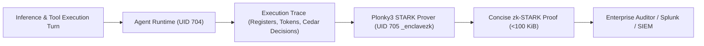

# Heimdall-Enclave: L3 Enterprise Production Roadmap & Architectural Specification

* **Document ID:** `ROADMAP-L3-ENTERPRISE-2026`
* **Status:** `ACTIVE SPECIFICATION (TARGET PRODUCTION BLUEPRINT)`
* **Predecessors:** [`docs/L1_ALPHA_ROADMAP.md`](L1_ALPHA_ROADMAP.md) (L1 Alpha Qualified) · [`docs/L2_BETA_ROADMAP.md`](L2_BETA_ROADMAP.md) (L2 Beta In Flight)
* **Target Audience:** CTOs, Chief Information Security Officers (CISOs), Enterprise Security Architects, Remote Mac IT Directors, and Systems Hiring Managers.
* **Governing Specifications:** [FS-705 (Silicon EMTE & ZK Compliance)](FEATURE_SILICON_EMTE_AND_ZK_COMPLIANCE.md) · [FS-706 (Fleet Distribution)](FEATURE_MDM_FLEET_DISTRIBUTION.md) · [FS-707 (PQC Migration)](FEATURE_PQC_MIGRATION_ROADMAP.md)

---

## 1. Executive Summary: What L3 Enterprise Delivers

**Profile L3 Enterprise** represents the ultimate production tier of Heimdall-Enclave, purpose-built for regulated industries, defense tech, healthcare (HIPAA), and Fortune 500 financial institutions (SOC 2 Type II, ISO 27001).

While **L1 Alpha** delivers standalone on-device execution and **L2 Beta** introduces local P2P swarm distribution and individual YubiKey custody, **L3 Enterprise** solves the full institutional governance challenge:

```
┌───────────────────────────────────────────────────────────────────────────────────────────────────┐
│                                   L3 ENTERPRISE PRODUCTION SUITE                                  │
├─────────────────────────────────────┬─────────────────────────────────┬───────────────────────────┤
│   1. ZERO-TOUCH FLEET GOVERNANCE    │   2. ZERO-KNOWLEDGE PROOF ROOF  │  3. HARDWARE QUORUM & PQC │
├─────────────────────────────────────┼─────────────────────────────────┼───────────────────────────┤
│ • Jamf Pro, FleetDM, Munki, Ansible │ • Plonky3 zk-STARK Batch Proofs │ • Multi-Party HSM Quorum  │
│ • Detached APNs Hydration (<5s exit)│ • In-Circuit Model Safety Verification│ • FIPS 203 (ML-KEM-768)  │
│ • Confined Root APFS Broker (ADR021)│ • Cryptographic Non-Interference│ • FIPS 204 (ML-DSA-65)    │
│ • Emergency Fleet Wipe (<600s)      │ • Verifiable Audit Trails (AIR) │ • Real-Time Revocation    │
└─────────────────────────────────────┴─────────────────────────────────┴───────────────────────────┘
```

---

## 2. Institutional Fleet Orchestration & MDM Integration (`FS-706`)

Deploying local AI models across thousands of enterprise MacBooks introduces unique MDM protocol constraints:

### 2.1 The APNs 120–300 Second Execution Timeout Hazard

Apple Push Notification service (`mdmclient`) enforces a strict timeout of 120–300 seconds per MDM script execution. If an MDM policy attempts to download a multi-gigabyte model checkpoint synchronously, the execution times out, marks the device unmanaged, and triggers infinite retry loops.

**The L3 Solution:**  
Under Profile L3, `mcp-enclave deploy hydrate --profile L3 --target <slug> --async` executes an idempotent pre-flight handshake, registers a detached LaunchDaemon job (`com.enterprise.enclave.hydrate`), and exits with **code 40 (`HYDRATION_PENDING`) in less than 5 seconds**. The background daemon streams the model over content-addressed CAS, and reports completion asynchronously via Jamf Extension Attributes and Fleet osquery.

### 2.2 Turnkey Commercial MDM Adapters

Heimdall-Enclave ships with production-grade, battle-tested adapters located in the `adapters/` directory:

| Management Tool       | Adapter Location            | Primary Function                                                                                                                                |
|:----------------------|:----------------------------|:------------------------------------------------------------------------------------------------------------------------------------------------|
| **Jamf Pro**          | `adapters/jamf/`            | Zero-touch bootstrap policies, self-service model hydration, `EA-Enclave-Status.sh`, `EA-Enclave-Security.sh`.                                  |
| **FleetDM / osquery** | `adapters/fleet/`           | Continuous GitOps compliance queries (`enclave_disk_encryption.sql`, `enclave_integrity.sql`, `enclave_launchd.sql`, `enclave_signatures.sql`). |
| **Munki**             | `adapters/munki/`           | Managed Software Center distribution (`enclave-core.pkginfo`, `enclave-model-weights.pkginfo`).                                                 |
| **Ansible**           | `adapters/ansible/`         | Automated CI and bare-metal orchestration (`site.yml`, `tasks/model_deploy.yml`).                                                               |
| **Apple MDM Profile** | `adapters/lightweight-mdm/` | `.mobileconfig` payloads configuring Background Task Management (BTM), notifications, and Seatbelt anchors.                                     |

---

## 3. Confined Root APFS Broker (`ADR-021`)

In high-compliance enterprise environments, standard file-level copying of multi-gigabyte model checkpoints wastes storage and risks race conditions during model swaps.

L3 implements the **Confined Root APFS Broker** (`enclave-apfs-broker`):

1. **Immutable Snapshot Publication**: Model weights are mounted to a dedicated APFS volume container. The broker creates read-only, cryptographically sealed APFS snapshots.
2. **Instantaneous Model Rollbacks**: Zero-copy snapshot cloning allows instant model rollbacks or atomic blue-green updates in under 20 milliseconds.
3. **Privilege-Separated Broker**: The broker is a tiny, auditable daemon that handles *only* APFS snapshot operations. It has **zero network access**, cannot write to user directories, and never promotes CAS daemons to root.

---

## 4. Zero-Knowledge Compliance & STARK Proofs (`FS-705`)

Traditional compliance frameworks (SOC 2, ISO 27001) rely on self-reported audit logs that can be tampered with by privileged administrators. L3 Enterprise introduces **mathematically verifiable zero-knowledge compliance**:



### 4.1 Plonky3 AIR Constraint Chips

* **Chip 1 (Cedar Policy Compliance)**: Proves in-circuit that every tool execution matched an explicit `permit` rule in the active Cedar policy manifest without disclosing sensitive prompt inputs.
* **Chip 2 (Information Flow Non-Interference)**: Proves that sensitive context labels (`Label { c: C1, t: T0 }`) were strictly maintained and did not cross the network boundary.
* **Chip 3 (Memory Footprint Ceilings)**: Mathematically certifies that daemon memory remained bounded under the $48\text{ MiB}$ ceiling throughout execution.

---

## 5. Post-Quantum Cryptography (PQC) Migration (`FS-707`)

In preparation for NIST Post-Quantum Standards and CNSA 2.0 compliance, L3 establishes a hybrid cryptographic suite:

* **Key Encapsulation (KEM)**: Hybrid `X25519` + **NIST FIPS 203 ML-KEM-768** (Kyber-768) for all inter-daemon and inter-workstation session establishment.
* **Digital Signatures**: Hybrid `Ed25519` + **NIST FIPS 204 ML-DSA-65** (Dilithium-65) for model manifests, TUF metadata, and code attestation.
* **Lean 4 Machine-Checked Proofs**: The hybrid KEM and signature decoders are formally proven in Lean 4 (`proofs/lean4/Enclave/TierThreeAssurance.lean`) ensuring constant-time execution and absence of panic states.

---

## 6. Enterprise Disaster Recovery & Emergency Quarantine

When a security incident occurs (e.g. compromised developer laptop, malicious tool artifact detected), enterprise security operations need guaranteed rapid revocation:

```bash
# Emergency Fleet Quarantine (< 600s across entire enterprise):
# 1. Distribute signed TUF metadata revocation via Jamf / FleetDM
# 2. Enclave daemons detect revocation via monotonic version check
# 3. Automatic fail-closed: BSD pf anchors drop all local sockets, and memory keys zeroize
```

* **Zeroization**: Sensitive cryptographic keys, model state caches, and decrypted buffers are purged with `zeroize::ZeroizeOnDrop`.
* **State Directory Purge**: POSIX permissions prevent unprivileged users from accessing remnants; the broker unmounts all APFS model snapshots.

---

## 7. How Enterprise Architects Evaluate L3 Enterprise Today

Security architects and IT directors can audit the L3 deployment assets directly in the codebase:

```bash
# 1. Inspect the production Jamf Pro deployment scripts
cat adapters/jamf/jamf_deploy_enclave.sh

# 2. Inspect FleetDM osquery continuous compliance queries
cat adapters/fleet/queries/enclave_processes.sql
cat adapters/fleet/queries/enclave_integrity.sql

# 3. Inspect the Apple MDM configuration profiles
cat adapters/lightweight-mdm/MCPMac-Enclave.mobileconfig

# 4. Read the formal compliance evidence mapping
cat docs/COMPLIANCE_EVIDENCE.md
```

*For the complete production specification, see [FS-706 (Enterprise MDM Fleet Distribution)](FEATURE_MDM_FLEET_DISTRIBUTION.md) and [FS-705 (Silicon EMTE & ZK Compliance)](FEATURE_SILICON_EMTE_AND_ZK_COMPLIANCE.md).*
