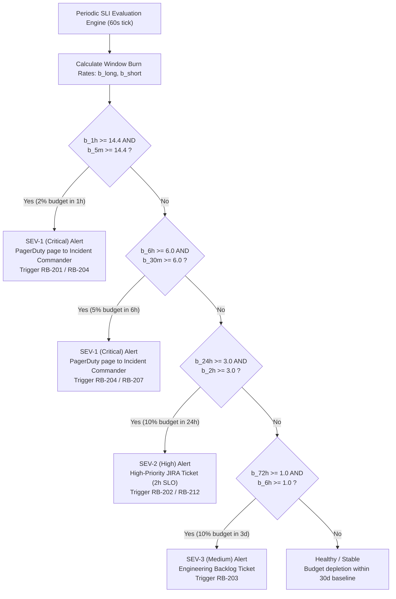

# SRE Operational Runbooks & Reliability Handbook

## MCPMac Local LLM & Agentic PII Governance (macOS Developer Workstations)

* **Document ID:** `GOV-SRE`
* **Document Version:** 3.1.0 (2026-11-08) — remediates `F-010`, `F-031`, `F-035`, `F-039`; updated for Rust `v3.0` production reference workspace
* **Generation:** `v1.0-Legacy` runbooks (`RB-101`–`RB-104`) + `v3.0-Production` runbooks (`RB-201`–`RB-221` for the native Rust `UID 701–705` LaunchDaemons, supervisor, and agentic host integrations)
* **Status:** `ACTIVE` — production reference operations handbook and SRE runbooks
* **Target Audience:** SRE Incident Commanders, Platform Engineers, Security Operations (SOC)
* **Normative Precedence:** see [`README.md §1.2`](../README.md#12-normative-precedence--architectural-lineage). Where an operational runbook and an `FS-70x §7` section disagree, the feature specification wins.

> **Operational status, checked 2026-11-13.** Commands in `§3` describe the educational Python simulation and `v1.0` legacy configs. Section `§4` describes intended native incident procedures; several CLI examples are unsupported in the current binary. Consult the measured command-status register before using a procedure: 12 selected help routes parse, while 11 selected examples refuse usage. Every probe appended `--help`; no operational procedure was executed. The historical `packaging/phase4/verify-phase4.sh` 23/23 result does not establish current installed, fault-recovery or runbook acceptance. The SecOps `k`-of-`n` quorum owner and its geographic distribution remain **unassigned (`OQ-25`)** and must be named before any enterprise pilot. Intended requirements below remain in force; unsupported examples require engineering and an authorized rehearsal.

---

## 1. Service Level Indicators (SLIs) & Service Level Objectives (SLOs)

### 1.1 `v1.0-Legacy` Prototype

| SLI                                 | Measurement Point                     | SLO                        | Alert                  | Severity |
|:------------------------------------|:--------------------------------------|:---------------------------|:-----------------------|:---------|
| Policy evaluation latency           | Envoy `ext_authz` → OPA gRPC          | `p99 < 5.0 ms`             | `p99 > 5 ms` for 5 min | SEV-3    |
| PII leakage in model context / logs | `V13`/`V14` corpora; log scan         | `0`                        | any occurrence         | SEV-0    |
| Gateway availability                | Envoy `127.0.0.1:8443` 2xx/4xx        | `99.95%` / developer-month | `< 99.9%` over 1 h     | SEV-3    |
| Policy bundle freshness             | sync-agent sequence                   | `< 15 min`                 | `> 2 h` out of sync    | SEV-3    |
| Audit chain integrity               | `verify_chain()` on `llm-audit.jsonl` | `100%`                     | any break              | SEV-1    |

### 1.2 `v3.0-Target` Daemons (`UID 701–705`) `[Target]`

| Daemon                  | SLI                                                                      | SLO (Phase-0 targets unless stated)                                                                                     | Alert                                              | Sev     | Owning Team    |
|:------------------------|:-------------------------------------------------------------------------|:------------------------------------------------------------------------------------------------------------------------|:---------------------------------------------------|:--------|:---------------|
| All                     | Resident memory vs. `HardResourceLimits`                                 | `UID 701 ≤ 48`, `702 ≤ 48`, `703 ≤ 24`, `704 ≤ 32`, `705 ≤ 48 MiB`; `UID 702–705` = `152 MiB`; steady-state `≤ 200 MiB` | `> 90%` of limit for 10 min, or any Jetsam kill    | SEV-2   | Platform       |
| `UID 701` `_llmagent`   | Post-step world-model surprise aborts                                    | informational                                                                                                           | `> 5` aborts / 10 min                              | SEV-3   | Model Platform |
| `UID 702` `_enclavecas` | `FUSE-T` page-miss service time (`L1` only)                              | `p99 < 15 s`                                                                                                            | `p99 > 15 s` for 15 min                            | SEV-3   | Platform       |
| `UID 702`               | Seeding bytes while on battery / metered / hot                           | `0 B`                                                                                                                   | any byte                                           | SEV-2   | Platform       |
| `UID 702`               | Revoked-artifact consumers alive after `SIGHUP`                          | `0` after `600 ms`                                                                                                      | any                                                | SEV-1   | Security       |
| `UID 703` `_piivault`   | `A1` receipt latency                                                     | `p99 ≤ 1.2 ms`                                                                                                          | `p99 > 1.2 ms` for 10 min                          | SEV-3   | Security       |
| `UID 703`               | SEP NVRAM writes / day                                                   | `≤ 30` (boot, shutdown, hourly)                                                                                         | `> 30`                                             | SEV-3   | Security       |
| `UID 704` `_enclaveifc` | `Cedar.Allow ∧ Biscuit.Allow` evaluation                                 | `p99 ≤ 45 µs` (M1 P-core)                                                                                               | `p99 > 45 µs` for 10 min                           | SEV-3   | Security       |
| `UID 704`               | `T3_BIBA_VIOLATION` / `QIF_24H_EXHAUSTED` / `E2BIG` events               | informational                                                                                                           | `> 3` / host / hour                                | SEV-2   | SOC            |
| `UID 705` `_enclavezk`  | Fold latency per `64 KiB`                                                | `p95 ≤ 85 ms` (unbenchmarked target)                                                                                    | `p95 > 250 ms` for 1 h                             | SEV-3   | ZK             |
| `UID 705`               | Rollup contiguity (`rpc_seq_u64` gaps without dual-signed tombstone)     | `0`                                                                                                                     | any                                                | SEV-1   | SOC            |
| All                     | `HardwareIntegrityQuarantine` latches                                    | `0`                                                                                                                     | any host (SEV-2); `≥ 5` hosts / hour (SEV-1 fleet) | SEV-1/2 | Security       |
| Fleet Deploy            | Deployment success rate (`exit 0` / total installs over 30d window)      | `≥ 99.5%`                                                                                                               | `< 99.0%` over 24h                                 | SEV-2   | Platform SRE   |
| Fleet Bootstrap         | Bootstrap execution latency (`core/bootstrap_enclave.sh`, excl. weights) | `p95 < 45 s` [target; measurement pending]                                                                              | `p95 > 60 s`                                       | SEV-3   | Platform SRE   |
| Hydration Engine        | Weight slice resume efficiency after network disconnect                  | `100%`                                                                                                                  | any unresumed byte                                 | SEV-2   | Model Platform |
| Fleet Memory            | Mach `phys_footprint` compliance against per-daemon ceilings             | `0 breaches`                                                                                                            | any breach                                         | SEV-2   | Platform SRE   |
| Fleet Revocation        | Emergency revocation propagation latency (TUF publish → process kill)    | `≤ 600 s` [target; measurement pending]                                                                                 | `> 600 s`                                          | SEV-1   | SOC            |

### 1.3 Multi-Window Multi-Burn-Rate Alerting Equations (Site Reliability Engineering Framework)

To prevent alert fatigue and eliminate the trade-off between alert detection latency and false-positive reset cycles, alerting across MCPMac fleet deployments implements the canonical **Multi-Window Multi-Burn-Rate** alerting standard (*Site Reliability Engineering*, Alerting on SLOs).

#### 1.3.1 Mathematical Burn-Rate Formulation

Let $SLO$ be the target objective ratio (e.g. $99.95\%$ availability for fleet orchestration, or $p99 \le 45\mu\text{s}$ for `UID 704` Cedar policy evaluations). The allowable error budget fraction over a standard 30-day rolling evaluation window ($T = 30 \times 24 = 720\text{ hours}$) is:
$$\epsilon = 1 - SLO$$

For any observation window of duration $\Delta t$, the consumed error budget fraction $\Delta B$ is given by:
$$\Delta B = \frac{1 - SLI(\Delta t)}{\epsilon} \times \frac{\Delta t}{T}$$

The instantaneous or windowed **burn rate** $b$ defines the acceleration factor at which the 30-day error budget is being depleted ($b = 1.0$ corresponds to exact $100\%$ budget consumption across exactly 30 days):
$$b = \frac{1 - SLI(\Delta t)}{\epsilon} = \frac{\Delta B}{\Delta t / T}$$

#### 1.3.2 Multi-Window Multi-Burn-Rate Threshold Matrix

To eliminate alerting on transient spikes (which cause false positives) while guaranteeing rapid escalation for severe outages, alerts fire **only** when both a **long window** (measuring total budget erosion) and a **short window** (confirming the incident is actively ongoing, $\approx \frac{1}{12}\text{th}$ the long window) breach the burn-rate threshold:

| Alert Tier           | Severity | Budget Consumed | Long Window ($\Delta t_{\text{long}}$) | Long Burn Rate ($b$) | Short Window ($\Delta t_{\text{short}}$) | Short Burn Rate ($b$) | Action & Notification Protocol                                                    |
|:---------------------|:--------:|:---------------:|:--------------------------------------:|:--------------------:|:----------------------------------------:|:---------------------:|:----------------------------------------------------------------------------------|
| **SEV-1 (Critical)** |  Pager   |     $2.0\%$     |                 1 hour                 |   **$14.4\times$**   |                5 minutes                 |   **$14.4\times$**    | Immediate PagerDuty page to Enclave SRE Incident Commander (`RB-201` / `RB-204`)  |
| **SEV-1 (Critical)** |  Pager   |     $5.0\%$     |                6 hours                 |   **$6.0\times$**    |                30 minutes                |    **$6.0\times$**    | Immediate PagerDuty page to Enclave SRE Incident Commander (`RB-204` / `RB-207`)  |
| **SEV-2 (High)**     |  Ticket  |    $10.0\%$     |                24 hours                |   **$3.0\times$**    |                 2 hours                  |    **$3.0\times$**    | High-priority ticket with 2-hour SLO remediation window (`RB-202` / `RB-212`)     |
| **SEV-3 (Medium)**   |  Ticket  |    $10.0\%$     |           3 days (72 hours)            |   **$1.0\times$**    |                 6 hours                  |    **$1.0\times$**    | Standard engineering queue ticket addressed during core business hours (`RB-203`) |

#### 1.3.3 Enclave Service Level Mapping

The multi-window alerting matrix is applied directly to the core enclave daemon telemetry:

1. **`UID 704` Policy Evaluation Latency ($SLO: p99 \le 45\mu\text{s}$):**
   * $\epsilon = 0.01$ of evaluations allowed above $45\mu\text{s}$.
   * $14.4\times$ burn over 1h: $> 14.4\%$ of Cedar/Biscuit evaluations exceeding $45\mu\text{s}$ for 1 hour AND for the last 5 minutes triggers immediate SEV-1 page.
2. **`UID 702` Swarm Synchronization & Egress Failures ($SLO: 99.9\%$):**
   * $\epsilon = 0.001$.
   * $6.0\times$ burn over 6h: $> 0.6\%$ TUF metadata or FastCDC chunk synchronization errors over 6 hours triggers SEV-1.
3. **Hardware Quarantine & Revocation Events ($SLO: 0\text{ breaches}$):**
   * Zero-tolerance hard invariants trigger discrete immediate alerts: any `HardwareIntegrityQuarantine` latch is a SEV-2 on a single host and SEV-1 if $\ge 5$ hosts latch within a 1-hour window.

#### 1.3.4 Multi-Window Multi-Burn-Rate Decision Flowchart



---

## 2. Component Health Checks & Diagnostic Commands

### 2.1 Verification Suite

```bash
./scripts/verify-enclave.sh            # hardware mode (physical Mac)
./scripts/verify-enclave.sh --ci-vm    # VM / CI: SEP + FileVault checks skipped and reported
```

*Expected:* `PASS/TOTAL` with `0` failures; skipped checks are listed explicitly and never counted as passes.

### 2.2 Inspecting the macOS Packet Filter (`pf`) Anchor

The legacy ruleset reference is the block in [`examples/executive-poc/gateway/pf-rules.conf`](../examples/executive-poc/gateway/pf-rules.conf) (checks `V05`/`V06`); the relative shell paths below assume that legacy example's working directory. Current native installed PF acceptance is separate. Earlier revisions of this section showed `block … quick` ahead of `pass … quick` and allowed `_llmagent` to reach OPA `8181`/`9191` and the raw MCP backend `8080` (`F-010`); both are corrected here:

```pf
loopback_if = "lo0"
llm_group   = "_llmagent"

# BEGIN MCPMAC PF RULES
# 1. Permit ONLY Envoy mTLS ingress (8443) and local inference (11434) on lo0 — NEVER 8181, 9191, 8080 or Envoy admin.
pass out quick on $loopback_if inet  proto tcp from any to 127.0.0.1 port { 8443, 11434 } group $llm_group keep state
pass out quick on $loopback_if inet6 proto tcp from any to ::1       port { 8443, 11434 } group $llm_group keep state
# 2. Default-deny ALL other IPv4 and IPv6 egress (TCP, UDP, ICMP, ICMPv6) from the agent group.
block drop out log (all) quick inet  from any to any group $llm_group
block drop out log (all) quick inet6 from any to any group $llm_group
# END MCPMAC PF RULES
```

Validate and inspect:

```bash
sudo pfctl -vnf gateway/pf-rules.conf
sudo pfctl -a com.enterprise.llm.isolation -s rules
```

*Expected `-s rules` output (pf normalises the source):*

```text
pass out quick on lo0 inet proto tcp from any to 127.0.0.1 port = 8443 group = 701 flags S/SA keep state
pass out quick on lo0 inet proto tcp from any to 127.0.0.1 port = 11434 group = 701 flags S/SA keep state
pass out quick on lo0 inet6 proto tcp from any to ::1 port = 8443 group = 701 flags S/SA keep state
pass out quick on lo0 inet6 proto tcp from any to ::1 port = 11434 group = 701 flags S/SA keep state
block drop out log (all) quick inet all group = 701
block drop out log (all) quick inet6 all group = 701
```

Any `pass` line mentioning `8181`, `9191`, `8080` or `9901`, or any `block` line above a `pass` line, is a SEV-1 misconfiguration.

### 2.3 OPA Daemon Health (`v1.0`, operator as root — never reachable from `_llmagent`)

```bash
sudo curl -s http://127.0.0.1:8181/health
```

### 2.4 Audit Journal

```bash
tail -f "$MCPMAC_AUDIT_LOG" | jq .
python3 -c "from mcp.audit_chain import verify_chain; print(verify_chain('$MCPMAC_AUDIT_LOG'))"
```

Journals contain counts and surrogate classes only — never raw arguments or SQL text (the SQL is recorded as `sql_sha256`).

---

## 3. `v1.0-Legacy` Incident Runbooks

### RB-101: OPA Policy Evaluation Latency Degradation (`p99 > 5 ms`)

* **Severity:** SEV-3
* **Triage:** `ps aux | grep '[o]pa'`; `sudo curl -s http://127.0.0.1:8181/metrics`; check for backtracking regexes in the active bundle.
* **Remediation:** `sudo launchctl kickstart -k system/com.enterprise.pii.opa`; if persistent, roll back: `sudo ln -snf /opt/enterprise/enclave/policies/bundle_prev /opt/enterprise/enclave/policies/current && sudo kill -HUP "$(pgrep opa)"`.
* **Never** "fix" latency by widening the `pf` allowlist or loading rules out of order.

### RB-102: Emergency Break-Glass Network Access

* **Severity:** SEV-1 (requires Security approval and a ticket)
* **Execution:**

  ```bash
  sudo /opt/enterprise/enclave/bin/break-glass.sh --ticket INC-88912 --duration 15m --reason "model integration debug"
  # rehearse without root or changes:
  ./scripts/break-glass.sh --ticket INC-88912 --duration 15m --dry-run
  ```

* **Behaviour** ([`scripts/break-glass.sh`](../scripts/break-glass.sh)): refuses without `(INC|SEC)-NNN`; caps duration at `30m`; validates rules with `pfctl -nf`; writes a hash-chained `BREAK_GLASS_OPEN` record; flushes the anchor; re-loads it on timer expiry or any exit (EXIT trap) and writes `BREAK_GLASS_RELOCK`.
* **Post-incident:** verify both audit records exist and the chain verifies; confirm `pfctl -a com.enterprise.llm.isolation -s rules` matches `§2.2`.

### RB-103: Secure Enclave Key Desync Recovery

* **Severity:** SEV-2
* **Remediation:** `./scripts/verify-enclave.sh --repair-keychain` (deletes the stale `enterprise.enclave.dpop.key` item and re-runs attestation); then `sudo spire-agent api fetch x509 -socketPath /var/run/spire/agent.sock`.
* **Note:** the Python simulation's DPoP keys are software keys; this runbook applies to hardware-mode deployments.

### RB-104: Runaway Autonomous Agent

* **Severity:** SEV-2
* **Automated defence:** Envoy local rate limit (30 burst / 15 per s) returns HTTP 429.
* **Manual:** `pgrep -f 'python.*agent'` → `kill -15 <PID>` → after 5 s `kill -9 <PID>`; inspect the last entries of the audit journal (tool, decision, `sql_sha256`).

---

## 4. `v3.0-Target` Incident Runbooks (`UID 701–705`) `[Target]`

### RB-201: Lost / Compromised YubiKey & FIDO MDS Firmware Revocation (`FS-703 §3.3`, `§7.2`)

* **Severity:** SEV-1 (lost key) / SEV-2 (firmware advisory)
* **Detect:** user report; TUF `fido-mds-allowlist.json` update marking an AAGUID `REVOKED` or raising `min_firmware_version`.
* **Contain:** publish a TUF-signed revocation of the credential ID (stolen key) or of the AAGUID/firmware range (advisory). `_enclavecustody` re-validates `AAGUID + firmwareVersion` on every TUF refresh and rejects the next `A2`–`A4` assertion from a revoked key.
* **Offline window:** offline `L2`/`L3` hosts accept a stolen key until their next TUF refresh (`≤ 168 h`). Push an MDM wipe of `UID 703` session state immediately; for `L3`, require the `k`-of-`n` `Ed25519` travel-downgrade token schema in `FS-703 §7.2` to operate in `L2` until a backup key is enrolled.
* **Recover:** enroll the backup key (Basic Attestation in `L2`, Enterprise Attestation bound to asset inventory in `L3`).

### RB-202: Emergency TUF Artifact Takedown & `SIGKILL` Verification (`FS-702 §7.2`)

* **Severity:** SEV-1
* **Execute:** sign and publish a TUF `targets` revocation and a new `snapshot.json`/`timestamp.json`; hosts unlink the `blake3-bao-v1` root, `SIGHUP` consumers, and **`SIGKILL` + `ftruncate(fd, 0)`** any consumer still holding the FD or mapping after `500 ms`.
* **Verify:** alert `Revoked-artifact consumers alive after SIGHUP` is `0` fleet-wide within `600 ms` of receipt; `cas-audit.jsonl` shows `REVOKE` and `KILL` envelopes sharing the revocation `rpc_seq_u64`.

### RB-203: `HardwareIntegrityQuarantine` Host & Fleet Recovery (`FS-705 §5.3`, `ADR-012`)

* **Severity:** SEV-2 (single host) / SEV-1 (`≥ 5` hosts within 1 h — suspect a deterministic bug or a packet-of-death)
* **Triage:** fetch the signed `FaultTombstone` (fault class, `fault_addr`, daemon UID, strike count). Page-zero faults (`addr < 0x10000`) never count as strikes (only `>= 5` within `10 min` latch); a latch means Strike `2` of a heap-tag/`PAC`/redzone fault within `24 h` (`L1`/`L2`) or Strike `1` (`L3`).
* **Latch location:** NVRAM variable `enclave-hiq` (SEP-MACed; an invalid MAC reads as latched). Never clear it with `nvram -d` — that is detected as tampering.
* **Host recovery:** issue a per-host `UnquarantineGrant` co-signed by `k`-of-`n` SecOps YubiKeys (`Ed25519`, `ADR-013`).
* **Fleet recovery:** when a fix ships, publish a TUF-signed fleet `UnquarantineGrant` bound to the fixed binary's `cdhash`; hosts clear the latch only after installing that binary — no per-laptop ceremony.

### RB-204: Biba / QIF Attack Investigation Across Correlated Journals (`FS-704`)

* **Severity:** SEV-2
* **Investigate:** join `adapter`, `cas`, `custody` and `ifc` journals on `rpc_seq_u64` within `boot_epoch_id`; verify every chain (`prev_blake3`, `prev_poseidon2`); reconstruct the plan (`UserTurnV1.directive_short` hash, `$paste_k` attachment handles) and the `T3` source that reached a structural slot or exhausted the `12,000 mb` budget.
* **Contain:** revoke the session's `PoP-Biscuit` root; pin the offending MCP server's `tools/list` digest as denied.
* **If a journal contains raw PII:** treat as a privacy incident (journals MUST be zero-PII) and follow the DSAR/retention table in `COMPLIANCE_EVIDENCE.md §3`.

### RB-205: ZK Rollup Contiguity Break / `OHTTP` Relay Outage (`FS-705 §4.3`)

* **Severity:** SEV-1 (contiguity) / SEV-3 (relay)
* **Contiguity break:** a gap in `rpc_seq_u64` without a dual `UID 703 + UID 704` co-signed `AbortedPreEgressTombstone` is a potential unproven egress — quarantine the host's `L3` egress and collect journals.
* **Relay outage:** `L3` hosts keep constant-rate dummy heartbeats queued (`≤ 12 MiB` RAM queue, encrypted spool under key shredding); do not fall back to direct TLS in `L3`.

### RB-206: Safe Forward / Rollback Migration Without SEP Anti-Replay Brick

* **Severity:** SEV-2
* **Rule:** sequence numbers are in-RAM `u64` values anchored to a per-boot SEP-signed `boot_epoch_id` (`ADR-010`), so a rollback starts a new epoch instead of reusing counters. Before rolling back: (1) drain and seal the current epoch's journals; (2) record the last `rpc_seq_u64` per daemon; (3) install the previous signed bundle via TUF (`snapshot.json` pins the consistent set); (4) reboot the daemons to mint a new `boot_epoch_id`; (5) confirm `RB-205` contiguity across the epoch boundary.
* **Never** roll back by restoring an older on-disk SEP checkpoint.

### RB-207: Fleet Deployment Failure Triage (`FS-706 §4.2`, `§6.1`)

* **Severity:** SEV-3 (workstation) / SEV-2 (`≥ 1%` fleet deployment failures)
* **Triage:** Inspect exit codes and structured JSON from `mcp-enclave deploy install --json` or MDM execution logs:
  * `Exit 10 (PREFLIGHT_FAILED)`: Evaluate Apple Silicon architecture, macOS ≥ 14 version, FileVault status (`fdesetup status`), SIP status (`csrutil status`), and APFS container free space. Ensure free disk space satisfies the $\ge 2.5\times$ target model footprint gate (`D-R13`).
  * `Exit 20 (INSTALL_FAILED)`: Inspect DirectoryService accounts (`dscl . -read /Users/_llmagent`), setgid directory modes (`2750`), and launchd bootstrap failures (`launchctl print system/<label>`).
  * `Exit 30 (VERIFY_FAILED)`: Check domain socket availability under `/var/run/enclave/` and verify that binary cdhashes match `/Library/Application Support/EnterpriseEnclave/codesign-pins.json` (Mode A) or Team ID anchor (Mode B).
* **Remediation:** Run `sudo /opt/enterprise/enclave/bin/mcp-enclave deploy install --profile <tier>` manually. If persistent corruption exists, run `sudo mcp-enclave deploy purge --profile <tier> --yes` followed by `sudo core/bootstrap_enclave.sh <tier>`.

### RB-208: Packet Filter (`pf`) Anchor Flush & Supervisor Restoration (`FS-706 §3.2`, `§6.2`)

* **Severity:** SEV-2 (temporary un-isolation of GID 8701)
* **Detect:** Alert on Jamf Extension Attribute `EA-Enclave-Security` reporting `EXPOSED`, or `pfctl -a com.enterprise.llm.isolation -s rules` returning 0 lines.
* **Root Cause:** Enterprise VPN clients (e.g. Cisco AnyConnect, GlobalProtect, Zscaler) re-initialize `/etc/pf.conf` and flush all dynamic anchors upon network interface transitions.
* **Automated Recovery:** The root supervisor (`com.enterprise.enclave.supervisor`) monitors network state changes via `SCDynamicStore` and re-injects anchor rules within $\le 1000\text{ ms}$, emitting journal record `PF_ANCHOR_RESTORED`.
* **Manual Remediation:**

  ```bash
  sudo /opt/enterprise/enclave/bin/mcp-enclave pf render --anchors-dir /etc/pf.anchors
  sudo pfctl -a com.enterprise.llm.isolation -f /etc/pf.anchors/com.enterprise.llm.isolation
  sudo pfctl -a com.enterprise.cas.swarm -f /etc/pf.anchors/com.enterprise.cas.swarm
  ```

* **Verify:** `sudo pfctl -a com.enterprise.llm.isolation -s rules` outputs `block drop out log quick proto { tcp udp } from any to ! 127.0.0.0/8 group 8701`.

### RB-209: Model Hydration Stall, Network Disconnect & APFS Exhaustion (`FS-706 §3.3`, `§6.2`)

* **Severity:** SEV-3 (hydration stall) / SEV-2 (disk exhaustion)
* **Triage:** Check `/var/run/enclave/jobs/hydration-status.json` or execute `mcp-enclave deploy healthcheck --json`.
  * `Status STALLED`: Check WAN connectivity and corporate firewalls. Verify UID 702 egress is unobstructed (Iroh QUIC UDP 11223 or HTTPS R2).
  * `Status FAILED (Exit 41)`: Bao Merkle verification failed due to damaged upstream payload or corrupted local slice.
* **Automated Resumption:** UID 702 verifies chunks outboard with streaming Bao. Transfers resume immediately from the last verified $16\text{ KiB}$ slice upon reconnection; zero duplicate bytes are fetched.
* **APFS Free Space Exhaustion:** If free space < 15%, automated FastCDC GC (`D-R17`) prunes unreferenced chunks. Manual cleanup:

  ```bash
  sudo /opt/enterprise/enclave/bin/mcp-enclave deploy purge --profile <tier> --yes
  ```

### RB-210: Background Task Management (BTM) User-Disabled Daemon/Agent Remediation (`FS-706 §4.5`, `§6.2`)

* **Severity:** SEV-3 (degraded local node)
* **Detect:** macOS 13+ user disables Enclave background items via *System Settings → General → Login Items & Extensions*. `mcp-enclave deploy healthcheck` flags daemon not running.
* **Audit:** Inspect BTM records with root privilege: `sudo sfltool dumpbtm`.
* **Remediation:** Deploy MDM Configuration Profile `MCPMac-Enclave.mobileconfig` containing `com.apple.servicemanagement` with `RuleType = LabelPrefix` and `RuleValue = com.enterprise.enclave.`. The MDM profile locks background items, disallowing local user modifications.

### RB-211: Emergency Fleet Revocation Drill ($\le 600\text{ s}$) (`FS-706 §6.3`)

* **Severity:** SEV-1 (critical security incident)
* **Objective:** Invalidate and terminate a compromised model artifact or grant key across 100% of endpoints within $\le 600\text{ s}$.
* **Execution:**
  1. **TUF Target Revocation:** Publish updated TUF repository targets marking the artifact as revoked (`"revoked": true`).
  2. **MDM Refresh Signal:** Broadcast Jamf / Fleet policy executing `/opt/enterprise/enclave/bin/mcp-enclave deploy healthcheck --profile L3`.
  3. **Zero-Byte Inode Truncation & SIGKILL:** `UID 702` unlinks the model projection and executes `ftruncate(fd, 0)`. The root supervisor scans open file descriptors via `proc_pidinfo` and issues `SIGKILL` within $500\text{ ms}$ to any remaining consumers.
  4. **Emergency State Purge:** In extreme scenarios, trigger MDM fleet wipe:

     ```bash
     sudo /opt/enterprise/enclave/bin/mcp-enclave deploy purge --profile L3 --yes --remove-accounts --purge-state
     ```

* **Verify:** Query Fleet osquery `enclave_processes.sql` ensuring 0 running instances hold revoked descriptors.

### RB-212: OHTTP Compliance Outbox Observation, Backlog and Quota (`FS-702 §7.4.2`, `GAP-26`, `FS-706 §4.2`)

Current implementation and acceptance are recorded in
NEXT-10C.
Production scheduling and authenticated durable delivery remain open in
NEXT-10.

* **Severity:** SEV-3 for unavailable observation/backlog; SEV-2 when retained custody prevents required new events. The incident owner must assess actual service impact; a local count supplies no delivery-age SLO.
* **Detect:** Inspect the approved paired CLI/daemon health result. `details.outbox.known = false` means unavailable, with null pending/dead/byte/budget fields and an unhealthy conjunct. `known = true` and `budget_exceeded = true` means the complete cooperative inventory exceeds 104,857,600 retained logical payload bytes. `disk_bytes` includes canonical pending `.ohttp` and retained `.dead` lengths, not allocated blocks or directory overhead; `path` is null. Full host health still requires every independent profile, daemon, memory, PF and quarantine check.
* **Authority:** The owning CAS service observes its configured queue through validated no-follow directory metadata and a nonblocking cooperative lock. Production inner readers are root; development is actual same UID. Existing outer IPC and production code verification remain required. Do not widen directory ownership or fall back to a direct guessed-path scan.
* **Triage:** Preserve the fixed fault/acquisition class, source/paired version, process identity, actual mode and observed attempt time. Confirm approved configuration and IPC availability. Missing/inaccessible storage is unknown, never an empty replacement queue. A process epoch is provenance, not authenticated delivery freshness.
* **Contention and uncertain publication:** Retry `namespace_busy` through bounded supported diagnostics. For `publication_recovery_required`, preserve `.enqueue.pending` and all queue contents for separately authorized reconciliation. Observation does not repair, delete, drain or rewrite state.
* **Unsafe, over-limit or over-budget inventory:** Preserve pending/dead data and metadata; escalate to CAS/outbox, platform/security and release SRE owners. Do not truncate inventory, archive-and-delete evidence, clear dead debt or change assertions to make health green. A known exact-cap inventory passes this quota conjunct; it does not prove new-event capacity, physical disk compliance or remote delivery.
* **Delivery investigation:** AC/network state may help diagnose intended future scheduling, but the outbox observation is read-only and healthcheck does not trigger a drain. Other healthcheck calls may advance ordinary service state or record memory breaches. No automatic AC-triggered production drainer is established. Plain HTTP200 or a gateway health URL supplies no digest/context-bound durable receipt and grants no safe-retirement authority.
* **Verify recovery:** Require a fresh authenticated complete observation (`known = true`) and inspect exact pending/dead/retained-byte values; do not infer delivery from a lower count. Custody retirement requires independently authenticated acceptance/reconciliation. Unknown/null must remain distinct from zero in monitoring. Restore all other host-health conjuncts separately.
* **Rollout/backout:** Upgrade the approved CLI/daemon pair and consumers of nullable fields together. An old daemon leaves the new observation unavailable. No queue/state migration occurs. Backout must preserve custody and visible unknown status, without restoring ignored-errors-as-zero scanning.

### RB-213: Mach Memory Pressure & Jetsam Eviction Triage (`task_info` phys_footprint vs. 152 MiB / 200 MiB Ceiling)

* **Severity:** SEV-2 (memory pressure warning / Jetsam kill of enclave daemon)
* **Context:** Darwin kernels monitor physical resident footprint (`task_info` with `TASK_VM_INFO.phys_footprint`) rather than virtual memory sizes. Under workstation-wide memory pressure, Darwin's `memorystatus` subsystem signals dispatch memory pressure sources before issuing Jetsam terminations (`EXC_RESOURCE / KERN_RESOURCE_SHORTAGE`).
* **Invariants:** The 5 LaunchDaemons must stay strictly bounded: `UID 701 ≤ 48`, `702 ≤ 48`, `703 ≤ 24`, `704 ≤ 32`, `705 ≤ 48 MiB`; the four system daemons `UID 702–705` sum to `152 MiB`, and total steady-state footprint including `UID 701` is `≤ 200 MiB` (`≤ 232 MiB` during on-demand prompt assistance with `_enclaveintent`).
* **Detect:** Fleet osquery `enclave_processes.sql` reports any daemon resident memory exceeding 90% of its allocation, or system crash reporter generates `/Library/Logs/DiagnosticReports/JetsamEvent-*.ips` referencing an enclave daemon.
* **Automated Degradation & Cache Shedding:**
  1. On `NOTE_MEMORYPRESSURE_WARN`: `enclave-model-runnerd` (`UID 701`) frees speculative draft generation KV caches and invokes Metal heap garbage collection; `enclave-agent-runtime` (`UID 704`) purges compiled Starlark plan cache entries.
  2. On `NOTE_MEMORYPRESSURE_CRITICAL`: `enclave-swarm-syncd` (`UID 702`) halts background pre-fetching and unmaps idle Bao tree buffers; `enclave-zk-auditor` (`UID 705`) flushes current Stark folding state to disk and halts worker threads.
* **Atomic Session Reconstruction & Rollback Protocol (GAP-53):**
  1. Upon unexpected Jetsam termination (`EXC_RESOURCE`), peer LaunchDaemons detect `ECONNRESET` on IPC sockets and transition the affected session to `SESSION_DRAINING`.
  2. The supervisor records the eviction event in `/var/log/enclave/jetsam-recovery.log` without triggering `HardwareIntegrityQuarantine`.
  3. When `launchd` respawns the terminated daemon, it parses its local Write-Ahead Log (`recoverValidWal`), discarding any uncommitted or torn in-flight frames.
  4. Sequence authority state in `UID 703` rolls back uncommitted sequence reservations, allowing the client gateway to replay the interrupted turn without desynchronization.
* **Triage & Forensic Analysis:**
  1. Inspect process physical footprints:

     ```bash
     ps -o pid,uid,command,rss -p $(pgrep -f "enclave-")
     ```

  2. Inspect Darwin Jetsam crash reports:

     ```bash
     grep -E "(enclave-|phys_footprint)" /Library/Logs/DiagnosticReports/JetsamEvent-*.ips | tail -n 30
     ```

  3. If a daemon exceeded its limit, evaluate memory growth logs to differentiate between a localized memory leak (e.g. unsafe FFI buffer leak in Rust) vs. legitimate batch processing load.
* **Remediation:** If a daemon is killed by Jetsam, launchd will respawn it automatically. If memory remains pinned due to fragmented Metal buffers, restart the host model adapter:

  ```bash
  sudo launchctl kickstart -k system/com.enterprise.enclave.model-runnerd
  ```

* **Verify:** `mcp-enclave deploy healthcheck --json` confirms all daemons report `healthy` with total memory footprint `<= 200 MiB`.

### RB-214: Clamshell Sleep/Wake Resumption, Monotonic Clock Skew & IOPowerSources Transitions

* **Severity:** SEV-3 (battery power deferral) / SEV-2 (token clock skew / session disconnect)
* **Context:** Developer MacBooks undergo frequent sleep/wake cycles (`IOPMrootDomain` clamshell close), power transitions (`IOPMPowerSource`), and network adapter changes.
* **Invariants:**
  1. Background P2P seeding (`UID 702`) and non-essential ZK folding (`UID 705`) MUST pause immediately when operating on battery power or metered connections (`FS-702 §3.3`, `FS-706 §3`).
  2. Biscuit authorization tokens evaluate validity against boot-relative `mach_absolute_time()` to prevent wall-clock rollback manipulation (`ADR-015`).
* **Detect:** Telemetry indicates unexpected hydration failure, or `enclave-agent-runtime` logs `TOKEN_SKEW_EXCEEDED` following host wake.
* **Root Cause:** Extended laptop sleep causes wall-clock time to diverge from external peer clocks, or battery transition deferred background synchronization.
* **Automated Recovery:**
  * Upon system wake (`kIOMessageSystemWillPowerOn`), `mcp-enclave` supervisor verifies socket mesh reachability within 2,000ms.
  * Interrupted hydration downloads automatically resume from the last verified $16\text{ KiB}$ slice (`FS-706 §3.3`).
* **Manual Remediation:**
  1. Verify power status: `pmset -g batt` (confirm whether running on Battery or AC).
  2. Check clock synchronization: `sntp -s pool.ntp.org` (or enterprise time source).
  3. Cycle agent runtime session if Biscuit tokens expired during long sleep:

     ```bash
     mcp-enclave agent restart-session
     ```

* **Verify:** `mcp-enclave deploy healthcheck` reports healthy state with 0 socket connection errors.

### RB-215: Headless Workstation, Remote Screen Sharing & Biometric UI Stall Triage

* **Severity:** SEV-3 (developer blocked in remote/headless session)
* **Context:** When developers interact with the enclave via SSH, Apple Remote Desktop (ARD), headless CI/CD, or fast user switching, macOS WindowServer does not bind an active physical console session for Touch ID biometrics.
* **Failure Mode:** Invoking an `A3` or `A4` action requiring Touch ID (`CoreAuthUI` / `LAContext`) times out or returns `kLAErrorBiometryNotAvailable` / `kLAErrorUserCancel`.
* **Fail-Closed Behavior:** `_enclaveintent` running in `gui/$CONSOLE_UID` detects the absence of a WindowServer session and immediately returns named error `BIOMETRY_HELPER_UNAVAILABLE` rather than hanging the client session.
* **Remediation:**
  1. For interactive developers over Screen Sharing: Ensure the remote desktop session is active on the main console display (`console` user matches active UID).
  2. For headless / automation environments: Step up using a physical YubiKey inserted into a local root port, or configure the task within profile `L1` (which does not mandate Touch ID step-up for `A1`/`A2` actions).
  3. Under no circumstances may software biometrics be simulated in production (enforced by `check-release-no-simulation.sh`).
* **Verify:** `mcp-enclave deploy healthcheck` shows `intent_helper = active` and biometrics availability matches the session type.

### RB-216: Apple Developer Team ID Certificate Rotation & cdhash Pinning Resynchronization

* **Severity:** SEV-2 (planned rotation) / SEV-1 (unexpected code-signing mismatch / service rejection)
* **Context:** In Mode B enterprise deployments, all LaunchDaemons and operator tools require binaries signed with the designated Apple Developer Team ID (`anchor apple generic and certificate leaf[subject.OU] = "<TEAM_ID>"`). In Mode A (developer ad-hoc), binaries are strictly validated against exact 40-hex code-directory hashes pinned in `/Library/Application Support/EnterpriseEnclave/codesign-pins.json`. These code identities are distinct from full-file SHA-256 digests.
* **Failure Mode:** If an enterprise developer certificate expires or rotates, or if a binary is updated on disk without updating `codesign-pins.json`, inter-daemon IPC handshakes fail closed with `CS_ERR_CDHASH_MISMATCH` or `CS_ERR_PEER_UNTRUSTED` via `LOCAL_PEERTOKEN` (`audit_token_t` verification).
* **Implementation status (2026-11-14 source audit):** Rotation is an owner-approved installed exercise, not a completed zero-downtime capability. `DeployVerb` in `crates/mcp-enclave/src/deploy/mod.rs` has no pin-repair or rolling-upgrade verb; the CLI has no `--repair-pins` flag. Do not derive new trust from the binary that just failed identity verification. The exact remaining transition and recovery work is tracked in the recovery gate handoff.
* **Planned Rotation Drill (requires an approved transition manifest and signed installed cohort):**
  1. Stage new binaries and update `/Library/Application Support/EnterpriseEnclave/codesign-pins.json` with both current and new cdhashes (dual-pinned transition window).
  2. Verify binary code signatures against Apple root:

     ```bash
     codesign --verify --strict --verbose=4 /opt/enterprise/enclave/bin/mcp-enclave
     ```

  3. Validate new cdhashes using `mcp-enclave`:

     ```bash
     sudo /opt/enterprise/enclave/bin/mcp-enclave deploy verify --profile L3
     ```

  4. After independent approval of the new pins and rollout/rollback plan, perform the selected installed deployment procedure via MDM. The existing installation command below is not an in-flight socket handoff or a zero-drop guarantee; service interruption must be measured and accepted:

     ```bash
     sudo /opt/enterprise/enclave/bin/mcp-enclave deploy install --profile L3
     ```

* **Emergency Remediation (Untrusted Binary Rejection):** Suspend the affected rollout, preserve the rejected artifact and existing trusted pins, and use the independent approved signing/release authority to verify the candidate and select a consistent trusted set. Automatic pin repair is not implemented. Do not run the historical `deploy verify --repair-pins` example or edit pins merely to match an untrusted running binary. Recovery requires the signed-set/ownership/revocation checks and positive and hostile IPC journeys in the recovery handoff.
* **Verify:** Retain the actual `mcp-enclave deploy verify --profile <tier>` result and its per-daemon identity/IPC outcomes. Exit 0 alone does not establish key rotation, cohort adoption, uninterrupted availability or rollback safety.

### RB-217: Zero-Downtime Daemon Rolling Upgrade & In-Flight Socket Handoff (GAP-63)

* **Severity:** SEV-2 (Planned fleet upgrade) / SEV-1 (Service degradation during daemon update)
* **Context:** Enterprise MDM pushes updated LaunchDaemon binaries while autonomous developer agents are executing long-running, multi-step refactoring or inference workflows. Abrupt process restarts via `launchctl kickstart -k` sever Unix domain sockets and abort in-flight transactions.
* **Failure Mode:** Active client IDE connections fail with `ECONNRESET` or `EPIPE`, dropping uncommitted conversation turns and forcing developers to re-execute entire workflows.
* **Implementation status (2026-11-14 source audit):** The architecture below remains a proposed requirement. The current deployment CLI has no `upgrade`, `--rolling` or `--drain-timeout` operation. The shared daemon runtime already parses `--inherit-listener-fd` and consumes it through `enclave_core::ipc::inherit_listener`; the supervisor/deployment rolling upgrade, identity/ownership transfer and drain orchestration are absent. Partial listener consumption does not establish the upgrade journey. Do not run the historical `deploy upgrade --rolling --drain-timeout 15s` example, substitute `deploy install` and report a rolling success, or claim a zero-drop guarantee without the measured installed exercise.
* **Proposed Zero-Downtime Socket Handoff Architecture (`SCM_RIGHTS`):**
  1. **Listener File Descriptor Inheritance:** The root supervisor (`mcp-enclave supervise`) spawns the updated daemon binary passing the active listening socket descriptor via `SCM_RIGHTS` control message or `--inherit-listener-fd <fd>`.
  2. **Atomic Traffic Shift:** The updated daemon binds to the inherited descriptor and begins processing incoming connection requests immediately without rebinding `/var/run/enclave/*.sock`.
  3. **Proposed Graceful Drain Window:** The preceding daemon instance stops accepting new connections, processes active in-flight turns within an owner-approved bounded upgrade-drain window, and safely releases resources before exiting. The historical proposed 15 seconds is unimplemented; it is distinct from `supervisor::RELEASE_GRACE`, the existing 500 ms holder-revocation bound, which must not be enlarged for an upgrade.
  4. **Zero-Drop Guarantee:** Clients experience uninterrupted socket connectivity with 0 connection refused errors and 0 aborted transactions.
* **Rollout Procedure:** Block this procedure until the listener-ownership/identity protocol, per-daemon drain and cancellation semantics, bounded restart/resume state, consistent signed-set migration and current-CLI tooling are implemented and independently reviewed. Rehearse only on an authorized disposable installed cohort. An operator must approve the interruption and recovery criteria; no deployment command in this section was executed for this source audit.
* **Verify:** Once implemented, run continuous authorized agent requests through the actual upgrade; retain every attempted request, final or unknown outcome, dropped frame, version/adoption event and resource observation. Verify the selected zero-drop objective and genuine positive restored service, together with revoked/stale-identity refusal. A helper unit test or an idle service restart does not satisfy that objective.

### RB-218: Post-Quantum Hybrid Handshake Failure & MTU Fragmentation Triage (GAP-62)

* **Severity:** SEV-2
* **Context:** Ephemeral wire transports and P2P weight distribution swarms utilize Hybrid Post-Quantum Cryptography (`HybridPqc`: X25519 + ML-KEM-768). Handshake frames require ~2.4 KB, which can cause MTU fragmentation or packet drops on restrictive network segments.
* **Failure Mode:** Peer connection attempts fail with `PQC_DOWNGRADE_ATTEMPT_REJECTED` or QUIC transport timeout during multi-datagram handshake exchange.
* **Diagnostic Steps:**
  1. Inspect supervisor logs for downgrade rejection events:

     ```bash
     mcp-enclave audit log --grep "PQC_DOWNGRADE_ATTEMPT_REJECTED"
     ```

  2. Verify peer wire capabilities and inspect MTU path:

     ```bash
     mcp-enclave peer ping --target <peer_id> --pqc
     ```

  3. Check QUIC frame reassembly metrics:

     ```bash
     mcp-enclave metrics get --metric iroh_quic_reassembly_errors_total
     ```

* **Remediation:**
  * If a legacy un-migrated node attempted connection, update node binary via MDM deployment profile.
  * If network path clamps MTU `< 1200 bytes`, adjust QUIC max datagram frame size in `enclave.lock.toml`.
* **Verify:** Assert handshake completes with 0 drops and metric `enclave_pqc_handshake_total{status="success"}` increments.

### RB-219: Post-Quantum Algorithm Emergency Revocation & Cryptographic Agility Hot-Swap (GAP-62)

* **Severity:** SEV-1
* **Context:** An academic or public cryptanalytic finding identifies a theoretical vulnerability in Module-Lattice M-LWE or M-SIS (e.g. unexpected polynomial structure weakness in ML-KEM or ML-DSA).
* **Execution Drill:**
  1. Trigger cryptographic agility configuration update without daemon binary recompilation:

     ```bash
     mcp-enclave crypto policy set --wire-suite ClassicalOnly --temporary-override-ticket "SRE-PQC-EMERGENCY-2026"
     ```

  2. Invalidate PQC session key cache across all 5 LaunchDaemons:

     ```bash
     mcp-enclave crypto flush-sessions
     ```

  3. Verify daemons fail closed safely into hardened classical mode while preserving all Biba/IFC isolation invariants.
* **Verify:** `mcp-enclave crypto status` confirms `active_suite = ClassicalOnly` with zero downtime and all active daemon connections healthy.

### RB-220: Autonomous Agent Taint Alert & Context DAG Quarantine (FS-708)

* **Severity:** SEV-2
* **Context:** Inbound untrusted payloads from messaging gateways (OpenClaw via WhatsApp/Telegram/Discord) or self-learned skill iterations (Hermes Agent) propagate through multi-turn agent context, attempting to induce prompt injection or trigger unauthorized tool parameters.
* **Failure Mode:** Context DAG (`context_dag.rs`) marks an in-flight conversation branch as tainted; the Cedar PDP rejects high-integrity tool invocation with `E_TAINT_DELEGATION_VIOLATION`.
* **Diagnostic & Remediation Steps:**
  1. Inspect the tainted node ancestry:

     ```bash
     mcp-enclave dag trace --session-id <session_id> --taint-only
     ```

  2. Suspend the agent session and revoke ephemeral delegation tokens:

     ```bash
     mcp-enclave custody revoke-lease --session-id <session_id>
     ```

  3. Flush volatile memory buffers in UID 704 and verify zero residual PII in `UdsEgressGate`.
* **Verify:** Session is cleanly isolated, and subsequent tool execution attempts fail closed until re-authenticated.

### RB-221: Dynamic Skill Verification Failure & Rollback (FS-708)

* **Severity:** SEV-3
* **Context:** Autonomous self-improving agents (e.g. Hermes Agent) author dynamic Python/WASM skill modules to solve multi-step coding or research tasks.
* **Failure Mode:** Newly synthesized skill violates zero-JIT Wasmtime capabilities (attempts socket creation, excessive memory allocation, or unsandboxed filesystem read) or fails static safety linting.
* **Diagnostic & Remediation Steps:**
  1. Review supervisor quarantine log:

     ```bash
     mcp-enclave supervisor logs --grep "SKILL_VERIFICATION_FAILED"
     ```

  2. Reject the uncommitted skill artifact and revert the agent workspace to the last known good snapshot:

     ```bash
     mcp-enclave storage rollback --workspace-id <workspace_id>
     ```

* **Verify:** Agent workspace returns to green state and unverified skill binaries are expunged from the CAS staging cache.

---

## 5. Change Management

Any change that adds an IPC socket, crypto envelope, parser or daemon MUST update this document's `§1.2` SLI table and the relevant runbook, and `docs/THREAT_MODEL_STRIDE.md` (`CONTRIBUTING.md §4`).

### Ephemeral custody vault and capacity (F86)

Surrogates, wrapped tier envelopes, session ID, ciphertext map and MAC key are process-local. A custody process restart or explicit wipe irreversibly invalidates earlier surrogates; documents containing them do not become recoverable on re-enrollment. Do not restart custody to remedy capacity without accepting this loss. The vault rejects new reversible entries with VAULT_CAPACITY before sealing when its4096-entry or8MiB accounted storage cap would be exceeded; it never silently evicts live entries. Preserve the process and finish approved releases, or explicitly authorize loss then wipe/re-enroll. Count/byte limits bound storage, not total process RSS; native memory-ceiling validation remains required. Unenrolled placeholder envelopes cannot service tokenize/scrub/detokenize requests, which require enrollment.
