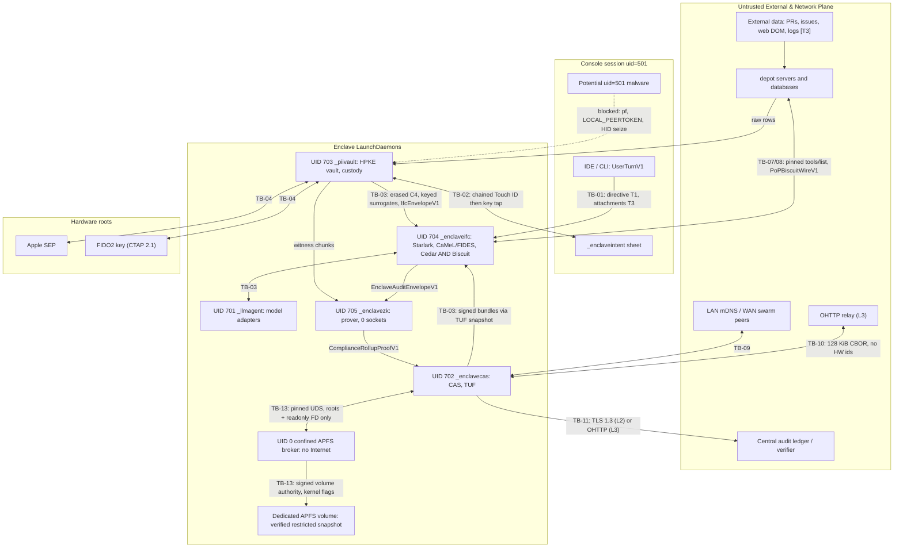

# Threat Model & Cryptographic Assurance Analysis

## Local LLM & Agentic PII Governance on Apple Silicon Workstations

* **Document ID:** `GOV-TM` · **Document Version:** **3.3.0** (supersedes 1.0.0 and 3.0.0; updated for Rust `v3.0` production reference workspace)
* **Generation:** covers `v1.0-Legacy` (Python simulation in `depot/`, `identity/`, `scripts/`), `v2.0-RFC` (`CORE-V2`) and `v3.0-Production` (native Rust workspace in `crates/`). Precedence per [`README.md §1.2`](../README.md#12-normative-precedence--architectural-lineage).
* **Status:** `LIVING DOCUMENT` — rates technical controls across the legacy simulation and the native Rust LaunchDaemon reference implementation.
* **Method:** STRIDE per trust boundary; risk ratings use the **OWASP Risk Rating Methodology** (`Likelihood × Impact`, rubric in `§6`), replacing the unrubricked DREAD integers of `1.0.0`.
* **Maintenance rule (`MUST`, `CONTRIBUTING.md`):** any PR that adds or changes an IPC socket, cryptographic envelope, parser, daemon, or trust boundary MUST update the `TB-*` table (`§4`) and any affected risk rows (`§7`) in the same PR.
* **Companion specifications:** [`FS-701`](FEATURE_POST_AR_MODEL_ADAPTERS.md), [`FS-702`](FEATURE_SWARM_SECURITY_PROFILES.md), [`FS-703`](FEATURE_HARDWARE_CUSTODY_PROFILES.md), [`FS-704`](FEATURE_AGENT_IFC_AND_DELEGATION.md), [`FS-705`](FEATURE_SILICON_EMTE_AND_ZK_COMPLIANCE.md), [`FS-706`](FEATURE_MDM_FLEET_DISTRIBUTION.md), [`CORE-V3`](bleeding_edge_future_adoption.md).

---

## 1. System Boundary & Assumptions

### 1.1 Scope by Generation

| Generation        | What exists                                                                                                                                                   | What this model rates                                                                                                                                                                                                                                              |
|:------------------|:--------------------------------------------------------------------------------------------------------------------------------------------------------------|:-------------------------------------------------------------------------------------------------------------------------------------------------------------------------------------------------------------------------------------------------------------------|
| `v1.0-Legacy`     | `pf` rules, Envoy config, Rego policies, Python depot proxy + SQL guard + DLP vault + hash-chained audit, DPoP simulation, bootstrap/verify/break-glass scripts | Real residual risk of running the simulation on a developer Mac. Software keys only (`key_custody = SIMULATION_ONLY_SOFTWARE_KEY`); no SEP.                                                                                                                        |
| `v2.0-RFC`        | Prose only (`CORE-V2`)                                                                                                                                        | Superseded topology; Cedar/WASI requirements retained.                                                                                                                                                                                                             |
| `v3.0-Production` | 11 Rust workspace crates (`crates/`), LaunchDaemons `UID 701–705`, auxiliary confined root APFS broker (ADR021), supervisor, `depot-enclave` CLI, adapters      | Reference implementation with revision-specific native fixture results; installed root broker, genuine APFS authority and physical custody acceptance remain unverified. Historical phase4 output does not certify this new boundary; see the F38 delivery matrix. |

### 1.2 Assumptions & Trusted Computing Base (TCB) Boundary (GAP-46)

1. **Formal Threat Model:** **"Malicious Developer Space & Compromised Tool Sandbox with Honest-but-Attacked Darwin OS Kernel."** The TCB explicitly comprises Apple Silicon hardware, the Secure Enclave (`SEP`), and the Darwin XNU kernel with SIP, FileVault and Secure Boot (Full Security) enabled.
2. The console user (`uid=501`) may run malware (`ADV-03`); root is **not** assumed compromised (root compromise is out of scope — it can unload `pf` and daemons). Host kernel compromise is mitigated via kernel attack surface minimization (`PT_DENY_ATTACH`, zero Mach task port debugging, `RLIMIT_CORE=0`) and long-term Type-1 `Virtualization.framework` guest virtualization.
3. At most **one** enclave daemon is compromised at a time (`ADV-04`); collusion of two daemons breaks `UID 703 + 704` tombstone co-signing and is out of scope.
4. The L3 APFS broker, its protected public TUF replica, bootstrap/code pins, signed volume policy and platform entitlement are additional TCB. A pre-existing root/kernel compromise is outside scope. Exploiting this root broker from a compromised UID702 is **in scope**; the existing root-compromise exclusion cannot dismiss a broker confused-deputy or memory-safety defect.
5. Cryptographic primitives (P-256, Ed25519, HPKE, BLAKE3, SHA-256, Poseidon2) are secure at their stated levels; STARK soundness claims are **conditional** on the `FS-705 §3.5` parameter regime and the unfinished Phase-0 benchmark.

---

## 2. Ranked Crown-Jewel Assets (`AST-01`–`AST-08`)

| Rank | ID       | Asset                                                                                                                         | Custody                                                | Required property                                                                                                            |
|:----:|:---------|:------------------------------------------------------------------------------------------------------------------------------|:-------------------------------------------------------|:-----------------------------------------------------------------------------------------------------------------------------|
|  1   | `AST-01` | Raw `C3`/`C4` customer PII and detokenization keys (`sk_detok_a3_epoch`, `sk_detok_a4`, `K_vault`, HPKE ciphertexts)          | `_piivault` (`UID 703`), `SEP`, YubiKey PRF            | Confidentiality; PAN/credentials erased at ingress (`ADR-007`); dual-key tier separation (`ADR-009`); `<= 12,000 mb`/24h QIF |
|  2   | `AST-02` | Agent control flow and tool/sub-agent authority (`EnclaveStarlarkV1` plans, `PoPBiscuitWireV1`, `IntentPayloadV1`, DPoP)      | `_enclaveifc` (`UID 704`), `UID 703`, `_enclaveintent` | Biba integrity (`T3` never in `AST_STRUCTURAL` slots); PoP non-replay; WYSIWYS                                               |
|  3   | `AST-03` | Policy, model/adapter and ZK proof integrity (`.cedar`, TUF metadata, `.safetensors`/`.mlpackage`, `ComplianceRollupProofV1`) | `UID 702`, `UID 705`, central ledger                   | Authenticity, freshness (TUF `snapshot` binding), proof soundness, `L3` unlinkability                                        |
|  4   | `AST-04` | Hardware root keys (`SEP` P-256, YubiKey `Ed25519`/`ES256`/`hmac-secret`, `k`-of-`n` SecOps quorum)                           | `SEP`, YubiKey secure element                          | Non-exportability, user presence/verification, anti-replay                                                                   |
|  5   | `AST-05` | Model latent and recurrent state (`MTLHeap` drafts, SSM state, screen frames)                                                 | `_llmagent` (`UID 701`)                                | Cross-session non-persistence; pre-encoder redaction; surprise-gated actuation                                               |
|  6   | `AST-06` | Swarm namespace confidentiality and peer metadata                                                                             | `_enclavecas` (`UID 702`)                              | Indistinguishability, licence and jurisdiction fencing (`FS-702`)                                                            |
|  7   | `AST-07` | Workstation availability and `8GB M1` headroom                                                                                | `launchd`, `pf`, `Jetsam`                              | Fail-closed without unauthenticated bricking; RSS `<= 200 MiB` steady state (`232 MiB` peak)                                 |
|  8   | `AST-08` | Hash-chained audit journals (`EnclaveAuditEnvelopeV1`)                                                                        | `UID 701–705`                                          | Completeness, tamper evidence, cross-daemon join by `rpc_seq_u64`                                                            |

---

## 3. Adversary Profiles (`ADV-01`–`ADV-07`)

| ID       | Adversary                                       | Capabilities                                                                                           | Bound                             |
|:---------|:------------------------------------------------|:-------------------------------------------------------------------------------------------------------|:----------------------------------|
| `ADV-01` | Indirect prompt / environment injector          | Controls `T3` data (PRs, issues, DB fields, web DOM, pixels); adaptive across turns and sessions       | No local code execution           |
| `ADV-02` | Malicious / compromised depot server or sub-agent | Controls `tools/list`, results, timing; holds one delegated Biscuit leaf                               | PPT; mid-session rug-pull         |
| `ADV-03` | Local console-user malware (`uid=501`)          | Arbitrary non-root code; can reach unguarded loopback ports, FIDO HID, window overlays                 | No root, SIP intact               |
| `ADV-04` | One compromised enclave daemon                  | RCE inside one of `UID 701–705`                                                                        | No second daemon                  |
| `ADV-05` | LAN insider / swarm peer / relay observer       | Valid `L1`/`L2` credential or passive network position; may collude with `OHTTP` gateway but not relay | PPT                               |
| `ADV-06` | Physical evil maid / USB interposer             | Brief physical access, hubs/docks, stolen sleeping laptop or one YubiKey                               | Cannot break `SEP`/secure element |
| `ADV-07` | Curious auditor / forging prover                | Central ledger extracting identity or PII, or enclave forging a proof                                  | Soundness/HVZK games              |

---

## 4. Trust Boundaries (`TB-01`–`TB-13`) & Current Disposition

| ID      | Boundary                                                                                      | Specified control (after remediation)                                                                                                                                                                                                                            | Implementation & Status                                                                                                                                                                                                                                    |
|:--------|:----------------------------------------------------------------------------------------------|:-----------------------------------------------------------------------------------------------------------------------------------------------------------------------------------------------------------------------------------------------------------------|:-----------------------------------------------------------------------------------------------------------------------------------------------------------------------------------------------------------------------------------------------------------|
| `TB-01` | Developer prompt ↔ `UID 704`                                                                  | `UserTurnV1` directive (`T1`, `<= 512 B`) vs. attachments (`T3`); Cedar static check of compiled plans (`ADR-014`)                                                                                                                                               | **Implemented** in `crates/enclave-agent-runtime/` (`src/plan/interpreter.rs`, `src/pdp.rs`); schema in `intent-payload-v1`                                                                                                                                |
| `TB-02` | `_enclaveintent` (`uid=501`) ↔ `UID 703`                                                      | Chained Touch ID (`CoreAuthUI`) → YubiKey on every `L2`/`L3` `A3`/`A4`; `PromptCooldown60s` (`ADR-009`)                                                                                                                                                          | **Implemented** in `crates/enclave-custody-vaultd/biometry-helper/` and `crates/enclave-custody-vaultd/` (`src/vault.rs`)                                                                                                                                  |
| `TB-03` | Inter-daemon UDS mesh                                                                         | `LOCAL_PEERTOKEN` (`audit_token_t` + `cdhash`); `rpc_seq_u64` anchored to SEP-signed `boot_epoch_id`; per-tier HPKE keys                                                                                                                                         | **Implemented** in `crates/enclave-core/` (`src/codesign.rs`, `src/ipc.rs`)                                                                                                                                                                                |
| `TB-04` | `UID 703` ↔ `SEP` / YubiKey                                                                   | `.app` bundle with `keychain-access-groups`; FIDO2 `CTAP 2.1`; MDS re-validation on TUF refresh; `L3` root-port only; DART fence `<= 4.5 ms`                                                                                                                     | **Implemented** in `crates/enclave-custody-vaultd/src/biometry.rs` and `crates/enclave-custody-vaultd/src/ctaphid_macos.rs`                                                                                                                                |
| `TB-05` | Loopback TCP (`lo0`)                                                                          | `pf`: `_llmagent` may reach only `8443`/`11434` (IPv4 + IPv6), all else dropped; Envoy admin on a `0600` UDS; OPA `8181` never reachable                                                                                                                         | **Implemented** in `gateway/pf-rules.conf` and monitored by supervisor (`crates/depot-enclave/src/deploy/health.rs`)                                                                                                                                         |
| `TB-06` | CPU VM ↔ GPU/ANE DMA                                                                          | `MTLSharedEvent` fence before `VM_PROT_NONE` release; `MTLHeap` isolation                                                                                                                                                                                        | **Implemented** in `crates/enclave-model-runnerd/src/arena_metal.rs`                                                                                                                                                                                       |
| `TB-07` | `UID 704` ↔ depot servers                                                                       | `tools/list` digest pinning; unannotated slots default `AST_STRUCTURAL`, outputs `(C3, T3)`; `Cedar.Allow ∧ Biscuit.Allow` (`FS-704 §4.2`)                                                                                                                       | **Implemented** in `crates/enclave-agent-runtime/src/service.rs`                                                                                                                                                                                           |
| `TB-08` | Parent ↔ sub-agent (A2A)                                                                      | `PoPBiscuitWireV1`: sealed Biscuit v3, `pop_holder` facts, detached Ed25519 PoP, boot-relative vs. UTC clocks (`ADR-015`)                                                                                                                                        | **Implemented** in `crates/enclave-crypto/src/pop_biscuit.rs`; schema `pop-biscuit-wire-v1`                                                                                                                                                                |
| `TB-09` | `UID 702` ↔ LAN/WAN swarm                                                                     | TUF 4-role metadata with `snapshot` binding; `L1` `public_l1` only; licence/jurisdiction fences                                                                                                                                                                  | **Implemented** in `crates/enclave-swarm-syncd/` (`src/tuf.rs`, `src/service.rs`)                                                                                                                                                                          |
| `TB-10` | `UID 702`/`705` ↔ `L3` `OHTTP`                                                                | `128 KiB` binary CBOR frames; no hardware identifiers on the wire (`ADR-016`)                                                                                                                                                                                    | **Implemented** in `crates/enclave-swarm-syncd/src/ohttp.rs`; schema `compliance-rollup-proof-v1`                                                                                                                                                          |
| `TB-11` | `UID 705` ↔ central verifier                                                                  | $\mathcal{R}_{\text{epoch}}$ over $\mathbb{F}_{p^5}$, `DuplexChallenger` absorbing all public inputs first, TUF-pinned `vk` (`ADR-017`)                                                                                                                          | **Implemented** in `crates/enclave-zk-auditor/` (`src/zk/engine.rs`)                                                                                                                                                                                       |
| `TB-12` | Repository / supply chain ↔ workstation                                                       | SHA-pinned Actions, `persist-credentials: false`, `contents: read`; `codesign --verify --strict` with TeamID requirement; `0700`/`0600` CA material outside `/tmp`                                                                                               | **Implemented** in `packaging/macos/build.sh`, `packaging/pkg/build-pkg.sh`, hardened runtime ad-hoc / Team ID signing, `codesign-pins.json`                                                                                                               |
| `TB-13` | Potentially compromised CAS UID702 ↔ confined root APFS broker ↔ dedicated APFS volume/kernel | Mutual kernel peer identity + independent code pins; broker independently verifies protected TUF/clock authority; root-only transaction state; fixed Publish/Reopen/Revoke interface; exact readonly FD verification; no caller paths/devices/options or network | **New privileged boundary; acceptance pending.** ADR021 / FS702 `SBR-01`–`SBR-14`; actual code/test/results and review findings must be traced in the F38 delivery matrix. Inert platform tests do not establish installed privilege or mount enforcement. |

---

## 5. Data-Flow Diagram (`v3.0-Target`, post-remediation)

---

## 6. Risk Rating Rubric (OWASP Risk Rating Methodology)

Each factor is scored `0–9`; **Likelihood** = mean of the 8 threat-agent and vulnerability factors, **Impact** = mean of the technical-impact factors (confidentiality, integrity, availability, accountability). Bands: `0 – <3` **Low**, `3 – <6` **Medium**, `6 – 9` **High**. Overall severity uses the OWASP matrix:

| Likelihood \ Impact | Low    | Medium | High     |
|:--------------------|:-------|:-------|:---------|
| **High**            | Medium | High   | Critical |
| **Medium**          | Low    | Medium | High     |
| **Low**             | Note   | Low    | Medium   |

Anchors used for the scores below: *Ease of exploit* `9` = no special tooling (e.g. a crafted SQL string), `5` = needs local code execution, `1` = needs physical access plus hardware attack. *Confidentiality loss* `9` = all `C4` data, `7` = bulk `C3`, `2` = minimal non-sensitive. CVSS v4.0 vectors MAY be added per row when a concrete implementation exists; none is assigned to unimplemented `v3.0` designs.

---

## 7. STRIDE Threat Register & Ratings

### 7.1 `v1.0-Legacy` Simulation (code in this repository)

| ID   | STRIDE | Threat                                                                                               | Control as implemented                                                                                                                                                                                       |  L  |  I  | Severity | Verification           |
|:-----|:------:|:-----------------------------------------------------------------------------------------------------|:-------------------------------------------------------------------------------------------------------------------------------------------------------------------------------------------------------------|:---:|:---:|:--------:|:-----------------------|
| `S1` |   S    | Local script impersonates the code assistant against the depot proxy                                   | DPoP (`identity/dpop.py`) with `jti` replay cache, `htm`/`htu`/`iat` checks; `require_dpop=True` by default. Simulation keys are software keys, so `uid=501` malware that reads the key file can still sign. | 4.9 | 6.0 |   High   | `V10`, `V14`           |
| `S2` |   S    | Replay of a captured proof                                                                           | `jti` cache + `±60s` `iat` window                                                                                                                                                                            | 2.6 | 6.0 |  Medium  | `V10`                  |
| `T1` |   T    | Local edit of Rego policy to widen access                                                            | Policies are plain files in the simulation; `opa check` / tests in CI. Signed bundles (TUF/cosign) are a `v3.0` target, **not implemented**.                                                                 | 5.4 | 7.5 |   High   | `V08`                  |
| `T2` |   T    | Tampered proxy binary passes attestation                                                             | `codesign --verify --strict --verbose=4` + TeamID requirement before trusting display output                                                                                                                 | 2.9 | 7.5 |  Medium  | `V09`                  |
| `R1` |   R    | Agent action leaves no tamper-evident record                                                         | `EnclaveAuditEnvelopeV1` SHA-256 hash chain, `0600`, logs `sql_sha256` only                                                                                                                                  | 3.0 | 5.0 |  Medium  | `V16`                  |
| `I1` |   I    | PII in tool output reaches the model context                                                         | Column classification (erase/tokenize/generalize), Luhn PAN, SSN (incl. unhyphenated), credential, date, ZIP patterns; keyed HMAC surrogates; unknown columns redacted                                       | 4.4 | 7.8 |   High   | `V13`, `V14`, `V17`    |
| `I2` |   I    | Free-text clinical/financial notes, personal names and unlabelled high-entropy secrets evade regexes | Free-text columns pass through pattern scrubbing only (labelled credentials, PEM, JWT, cloud keys, SSN/PAN/phone are caught — audit A-01/A-02); regex DLP is incomplete by nature                            | 6.1 | 7.0 |   High   | `V13` (known residual) |
| `I3` |   I    | `_llmagent` egress to network                                                                        | `pf` anchor: only `8443`/`11434` on `lo0` (IPv4/IPv6), all else dropped; effective only after `pfctl` load by an administrator                                                                               | 3.5 | 8.0 |   High   | `V05`, `V06`           |
| `D1` |   D    | Runaway agent loop / request flood                                                                   | Envoy local rate limit, circuit breakers, `5s` timeout                                                                                                                                                       | 4.0 | 3.0 |  Medium  | `V07`                  |
| `E1` |   E    | SQL injection or unsanctioned tool via proxy                                                         | `depot/sql_guard.py` SELECT-only parser (no `*`, comments, JOIN, UNION, sub-queries, `LIMIT <= 50`), SQLite authorizer + `query_only`, exact-key tool params, alias canonicalisation                           | 3.1 | 7.0 |   High   | `V08`, `V11`, `V12`    |
| `E2` |   E    | Break-glass misuse disables `pf` permanently                                                         | Ticket format, `<= 30 min`, root only, `pfctl -nf` validation, EXIT-trap relock, audited                                                                                                                     | 2.4 | 6.5 |  Medium  | `V20`                  |

### 7.2 `v3.0-Target` Design (unimplemented — ratings assume the spec is built as written)

| ID    | STRIDE | Threat (review link)                                                     | Specified control                                                                                                |  L  |  I  | Severity |
|:------|:------:|:-------------------------------------------------------------------------|:-----------------------------------------------------------------------------------------------------------------|:---:|:---:|:--------:|
| `X1`  |   E    | Pasted text steers plan compilation (`F-019`)                            | `UserTurnV1`; attachments `(C3,T3)`; Cedar static check                                                          | 3.0 | 8.0 |   High   |
| `X2`  |  S/E   | Biscuit tip forgery / cross-host clock replay (`F-020`)                  | Sealed Biscuit v3 + `pop_holder` + detached PoP; `local_boot_id` vs. `utc_epoch_ms ±2000 ms`                     | 2.3 | 8.0 |  Medium  |
| `X3`  |  T/E   | `tools/list` rug-pull, unannotated slots (`F-021`)                       | Digest pinning, `EPERM` on change, `AST_STRUCTURAL` default                                                      | 2.8 | 7.0 |  Medium  |
| `X4`  |   I    | QIF budget reset across sessions/URIs, fan-in overflow (`F-022`)         | `global_unstructured_c3_c4_24h_pool`, `E2BIG` at `> 64`, `L3` `C4` `4,000 mb`                                    | 3.4 | 6.5 |  Medium  |
| `X5`  |   I    | Shared detok key lets `A3` unlock `A4` data (`F-012`)                    | `sk_detok_a3_epoch` (`<= 64` `C3`/epoch) vs. `sk_detok_a4`                                                       | 2.5 | 9.0 |  Medium  |
| `X6`  |   S    | Reflexive tap on `L2` `A3` without biometrics (`F-013`)                  | Chained Touch ID → YubiKey                                                                                       | 2.8 | 8.0 |  Medium  |
| `X7`  |   D    | One malformed input bricks fleet via permanent latch (`F-017`)           | Graduated `HardwareIntegrityQuarantine`, null-deref exclusion, TUF fleet grant                                   | 3.0 | 5.5 |  Medium  |
| `X8`  |   I    | `L3` ledger de-anonymises workstations (`F-023`)                         | In-circuit Merkle membership, cohort `>= 32`, heartbeats, `128 KiB` frames                                       | 2.4 | 6.0 |  Medium  |
| `X9`  |   T    | Forged compliance proof via weak Fiat-Shamir (`F-024`)                   | Full public-input absorption, $\mathbb{F}_{p^5}$, 84 queries + 16-bit PoW (≥ 100-bit proven soundness), TUF `vk` | 2.1 | 8.5 |  Medium  |
| `X10` |   T    | TUF mix-and-match downgrade (`F-028`)                                    | `snapshot.json` binding of all targets                                                                           | 2.6 | 7.0 |  Medium  |
| `X11` |   I    | `uid=501` reads `FUSE-T` mounts (`F-029`)                                | `FUSE-T` only for `L1` public weights `> 1 GiB`, `pf` blocks `uid=501` to the NFS port                           | 3.0 | 4.0 |  Medium  |
| `X12` |   E    | World-model hallucinated safe state triggers destructive click (`F-026`) | CDP-browser confinement, DOM/AX target resolution, surprise abort; generative simulators are a Non-Goal          | 3.5 | 7.0 |   High   |
| `X13` |   D    | Prover OOM or egress stall on `8GB M1` (`F-025`, `F-038`)                | `12 MiB` thermal queue, incremental `L3` release, Phase-0 benchmark gate, `200 MiB` budget                       | 4.5 | 4.0 |  Medium  |

### 7.2.1 Exact-main metadata substitution and proof-artifact trust

This refines `X10` using FS-702 `ADM-01`–`ADM-06`, FS-701 §3.2.1 and the
bounded LAT-05 contract.

| Threat / boundary                                                                                  | Required control and evidence limit                                                                                                                                                                                                                                                                                                               |
|----------------------------------------------------------------------------------------------------|---------------------------------------------------------------------------------------------------------------------------------------------------------------------------------------------------------------------------------------------------------------------------------------------------------------------------------------------------|
| A selected same-root alias replaces the requested main metadata                                    | Preserve the requested record, coherent snapshot and exact content bindings through admission and the resulting certificate. Check valid main/companion admission as well as alias refusal. The demonstrated failure is in an abstract Lean catalog; it establishes no real hash collision, malicious publisher event or production Rust exploit. |
| Global catalog filtering silently denies a valid selected bundle because an unrelated alias exists | Check the complete declared acceptance relation, including legitimate positives in catalogs containing unselected aliases. Selected-record coherence is not a blanket global catalog-uniqueness requirement.                                                                                                                                      |
| A task solver weakens definitions/types, removes imports or substitutes proof/result artifacts     | Trusted verifier-owned definitions, theorem types, independent SEL relation and clean source rebuild; transitive axiom audit and actual imported-proof checks. Do not trust solver-controlled contracts, cached objects, binaries, rewards or logs. Preserve admitted positive histories so an always-refuse repair cannot pass.                  |

The existing full-repository gate protects its reviewed source snapshot. A future
task verifier must permit the declared admission/proof edits while retaining the
public semantic contract; a hash of the known solution alone is insufficient.
Its anti-tampering and hostile-trial acceptance are still authoring obligations.
These model requirements do not grant new root-helper authority or close TUF,
parser, physical descriptor, installed-isolation or hardware acceptance gaps.

### 7.3 Root APFS broker threats and required adversarial review

These new threats have high potential host-integrity impact. Likelihood and residual OWASP ratings are **unassessed**, pending integrated review and installed evidence; no numerical risk reduction is inferred from source or fixture success. The code/spec/test crosswalk must identify actual assertions for each row, or leave its evidence missing.

| ID    | STRIDE | Attack / trust consequence                                                                                                       | Required control and acceptance boundary                                                                                                                                                                                                                                                                                                                                                                                                                                                                                                               |
|-------|--------|----------------------------------------------------------------------------------------------------------------------------------|--------------------------------------------------------------------------------------------------------------------------------------------------------------------------------------------------------------------------------------------------------------------------------------------------------------------------------------------------------------------------------------------------------------------------------------------------------------------------------------------------------------------------------------------------------|
| `X14` | S/E    | Console malware or another daemon impersonates CAS; fake root server steals staged plaintext                                     | `SBR-02`: authenticate kernel audit-token identity and independent CAS/broker code pins before frame/FD processing; negative wrong UID, foreign signer, missing/stale pin and unpinned server controls. Same-UID fixture authentication cannot prove installed identity.                                                                                                                                                                                                                                                                               |
| `X15` | T/E    | Compromised CAS turns root helper into arbitrary write/mount/unmount/exec deputy                                                 | `SBR-03`–`SBR-06`,`SBR-11`: helper independently verifies protected TUF/volume authority; fixed roots-only enum, strict decoding and names; no caller paths/devices/options or shell; no Internet/keys. Probe forged metadata, wrong floor/profile, duplicate-root policy, traversal, option/argument injection and unsupported operations.                                                                                                                                                                                                            |
| `X16` | T/I    | Mutable FD, sparse/oversized file, FIFO/device/socket, symlink/hardlink or directory race substitutes bytes/targets              | `SBR-05`–`SBR-07`: exactly one O_RDONLY regular FD, bounded copy into private root object and hashes of stable copy; held nofollow directory descriptors and exact owned resources. Probe missing/extra/closed/RW descriptors, source mutation, short/trailing bytes and unsafe ancestry; no host-filling stress.                                                                                                                                                                                                                                      |
| `X17` | T/E    | Signed-device confusion, mounted boot/data volume or foreign mount affects host availability                                     | `SBR-06`–`SBR-09`: dedicated-volume/kernel identity checks; fixed snapshot operands and all required mount flags; fail closed on unavailable observations; cleanup only exact owned resource. Inert platform failure/order tests are required; actual native mount/foreign-volume refusal remains blocked on personal host.                                                                                                                                                                                                                            |
| `X18` | R/T/D  | Lost replies, crash/restart, concurrent same-root calls or metadata rotation erase authority or fabricate success                | `SBR-08`–`SBR-10`,`SBR-13`: durable owned intent/completion records, monotonic authority, serialized/idempotent operations, retained original revoke authority and explicit incomplete cleanup. An intent alone never proves ownership: EEXIST preserves foreign snapshots; unknown creation or crash before durable ownership evidence refuses automatic deletion and stays nonterminal. Probe fresh/partial/corrupt state, reply loss/retry, rotation/revocation, collision across restart/revoke and cleanup failure without injecting host faults. |
| `X19` | D      | Authenticated hostile CAS occupies root worker, floods frames/FDs or consumes staging resources                                  | `SBR-04`,`SBR-07`,`SBR-13`: bounded frames, FD counts, connections, buffers, operations, capacity and waits. Reject beyond quota before expensive effects. Record separate broker memory and queue outcomes; do not claim the five-daemon RSS/SLO envelope covers the new helper.                                                                                                                                                                                                                                                                      |
| `X20` | I/T    | Reopen or revoked snapshot FD survives Wipe/key removal and leaks stale plaintext                                                | `SBR-09`,`SBR-10`: current authorization before reopen, original-authority retraction and CAS lease/generation/full-closure checks. Already transferred immutable FDs survive unmount; holder termination and deadline need separate acceptance, and must stay unverified until demonstrated.                                                                                                                                                                                                                                                          |
| `X21` | E/T    | Packaging starts an unpinned/unconfined root helper, leaves stale helper on downgrade, or removes ownership state before cleanup | `SBR-11`,`SBR-12`: complete signing/pin/launch/install/health/removal inventory, authenticated readiness and stop/retract ordering, including a durable quiescence barrier serialized with whole accepted operations. A read-only empty-state check cannot authorize shutdown while an accepted request can still publish. Exercise actual tooling with private inert commands; require genuine signing/entitlement, root directory/mode and cross-UID runtime acceptance separately.                                                                  |

The root broker is not a general administrative service and has no user-controlled command path. Every new parser/RPC/privileged platform operation must map back to an SBR authorization and a threat above. Conversely, a prose mitigation without its actual negative/positive assertion stays unverified; review may require code changes rather than weakening the stated control. Historical root-immutability or complete fleet readiness claims do not cover this boundary.

---

## 8. Cross-Track Attack Trees (Top Assets, Post-Remediation)

**`G1` — obtain plaintext `C4` (`AST-01`)**

* `OR G1.1` *v1.0 baseline bypass* — read unredacted values from proxy output. **Mitigated in simulation** by column classification and keyed surrogates (`V13`, `V17`); residual: free-text (`I2`).
* `OR G1.2` *prompt injection → reflexive `L2` tap* (`F-019` → `F-013`). **Broken by** `UserTurnV1` (no `T3` in plan) **and** chained Touch ID.
* `OR G1.3` *intra-slab overflow on `M1`–`M4` → shared key* (`F-018` → `F-012`). **Broken by** root-key guard pages and dual-key separation; residual: cookie checks detect at free time only.
* `OR G1.4` *cross-session QIF amplification* (`F-022`). **Bounded by** the global 24h pool.

**`G2` — hijack control flow (`AST-02`)**

* `OR G2.1` *loopback policy overwrite (`8181`) or raw depot (`8080`)* — **blocked** by corrected `pf` (`V05`); *SQL alias / whitespace bypass* — **blocked** by the parser and alias map (`V08`, `V11`).
* `OR G2.2` *`tools/list` rug-pull* — **blocked** by digest pinning (`X3`).
* `OR G2.3` *cross-host monotonic-clock replay* — **blocked** by UTC clocks on mTLS (`X2`).
* `OR G2.4` *world-model hallucinated safe state* — **reduced** by DOM/AX resolution and surprise abort (`X12`).

**`G3` — subvert integrity, soundness or anonymity (`AST-03`)**

* `OR G3.1` *TUF mix-and-match* — `snapshot` binding (`X10`).
* `OR G3.2` *`FUSE-T` snooping* — `L1`-only, `pf` (`X11`).
* `OR G3.3` *`L3` de-anonymisation* — no hardware identifiers on wire (`X8`).
* `OR G3.4` *proof forgery* — transcript schedule (`X9`); residual until an implementation and audit exist.
* `OR G3.5` *compromise CAS → root broker confused deputy* — independent signed authority, fixed request grammar, FD/path bounds and exact owned lifecycle (`X14`–`X21`); residual remains unassessed until deep review and deployment acceptance.

---

## 8.5 Frontier AI Threat Matrix: OWASP Top 10 for LLMs & MITRE ATLAS Mapping

To ensure exhaustive coverage of frontier AI and agentic attack vectors, the enclave architecture maps every technical control to the **OWASP Top 10 for LLM Applications (2025/2026)** and the **MITRE ATLAS (Adversarial Threat Landscape for Artificial-Intelligence Systems)** framework:

| Threat Category                              | Framework Mapping                                         | Attack Vector / Threat Description                                                                                                   | Implemented Enclave Defense Architecture                                                                                                                                                                                                                                                              | Verification Gate                                                                                 |
|:---------------------------------------------|:----------------------------------------------------------|:-------------------------------------------------------------------------------------------------------------------------------------|:------------------------------------------------------------------------------------------------------------------------------------------------------------------------------------------------------------------------------------------------------------------------------------------------------|:--------------------------------------------------------------------------------------------------|
| **Prompt Injection (Direct & Indirect)**     | **OWASP LLM01** `ATLAS AML.T0051` `ATLAS AML.T0054` | Adversarial instructions hidden in retrieved web DOM, database fields, or developer prompts attempting to hijack agent control flow. | **`CaMeL + FIDES` Architectural Split (`ADR-014`):** `UserTurnV1` separates user directive (`T1`, $\le 512\text{ B}$) from untrusted attachments (`T3`). Attachment content is assigned taint `T3` and barred from compiled AST structural execution slots in `enclave-agent-runtime`.                | `tests/plan_interpreter.rs` `tests/checks.py V11`                                              |
| **Sensitive Data Disclosure & Exfiltration** | **OWASP LLM02** `ATLAS AML.T0048`                      | PII leakage into model context or covert exfiltration via markdown rendering (``), DNS tunneling, or external webhooks. | **Defense-in-Depth Quarantine:** 1. On-device ANE classifier and discrete HMAC pseudonymisation before model ingress. 2. Dynamic `CNRY_SEP_*` honeytokens inside `_piivault` (`UID 703`). 3. Darwin kernel `pf` anchor drops 100% of non-loopback egress from GID 8701 (`_llmagent`).        | `tests/pf.rs` `tests/checks.py V05, V13, V17`                                                  |
| **Supply Chain Vulnerabilities**             | **OWASP LLM03** `ATLAS AML.T0010`                      | Compromised model weights, malicious LoRA adapters, or tampered policy files distributed across developer fleets.                    | **4-Role TUF Canonical JSON (`ADR-019`):** Root-signed `snapshot.json` cryptographically binds all targets (`targets.json`). Weights verified via FastCDC + streaming Bao BLAKE3 slice hashes before ingestion into `enclave-model-runnerd`.                                                          | `crates/enclave-crypto/tests/tuf_interop.rs` `tests/checks.py V18`                             |
| **Data & Model Poisoning**                   | **OWASP LLM04** `ATLAS AML.T0043`                      | Poisoned training datasets or corrupted cache slices corrupting local model reasoning or bypassing safety guardrails.                | **In-Memory Streaming Slice Verification:** Chunks fetched over QUIC verified chunk-by-chunk outboard; corrupted slices fail closed (`EXIT 41`) without affecting active memory. Quorum governance uses discrete $k$-of-$n$ `Ed25519` multi-signatures instead of threshold FROST.                    | `crates/enclave-swarm-syncd/src/bao.rs` `crates/depot-enclave/tests/fleet.rs`                    |
| **Improper Output Handling**                 | **OWASP LLM05** `ATLAS AML.T0034`                      | Raw LLM output passed directly to shell, SQL interpreters, or desktop APIs without validation.                                       | **Capability-Based Sandboxing & Monotonic SSA:** Starlark execution engine treats tool outputs as opaque handles `(C1..C4, T0..T3)`. Output text cannot generate new AST plan branches without re-evaluation by the deterministic Cedar policy engine.                                                | `crates/enclave-agent-runtime/src/plan/interpreter.rs` `tests/checks.py V12`                   |
| **Excessive Agency & Unbounded Loops**       | **OWASP LLM06** `ATLAS AML.T0025`                      | Autonomous agent entering destructive infinite loops, mutating local files, or executing unauthorized high-risk operations.          | **Monotonic Risk Gating ($A1 < A2 < A3 < A4$):** Low-risk read actions ($A1/A2$) execute within pre-allocated fuel limits. High-impact destructive actions ($A3/A4$) require chained Touch ID (`CoreAuthUI`) followed by physical YubiKey FIDO2 (`CTAP 2.1+`) user presence verification (`ADR-009`). | `crates/enclave-custody-vaultd/src/vault.rs` `crates/depot-enclave/tests/fleet.rs`               |
| **System Prompt & Secret Extraction**        | **OWASP LLM07** `ATLAS AML.T0044`                      | Adversarial prompts attempting to extract developer API keys, private keys, or system configuration.                                 | **Privilege Separation (ADR-006):** Model runner (`UID 701`) executes in an isolated POSIX sandbox with zero access to `/var/db/enclave/vault/`. All cryptographic private keys reside strictly in the Apple Secure Enclave (SEP) or YubiKey hardware element.                                        | `crates/enclave-custody-vaultd/src/biometry.rs` `tests/checks.py V02`                          |
| **Vector & Embedding Poisoning**             | **OWASP LLM08** `ATLAS AML.T0043`                      | Indirect poisoning of local RAG databases to manipulate similarity retrieval and force exfiltration.                                 | **Pre-Embedding Pseudonymisation:** All customer data scrubbed into 128-bit HMAC surrogates before vector embedding generation. Vector databases encrypted locally under FileVault and per-session keys.                                                                                              | `crates/enclave-agent-runtime/src/heap.rs` `tests/checks.py V13`                               |
| **Misinformation & GUI Actuation Risks**     | **OWASP LLM09** `ATLAS AML.T0034`                      | World model hallucinating safe UI state and actuating destructive OS-level clicks or mouse movements.                                | **Confined Browser Actuation & Surprise Abort (`ADR-018`):** `Class 6` actuation is strictly confined to a sandboxed browser over Chrome DevTools Protocol (`CDP`). Targets resolved via DOM/AX tree; post-step surprise gate aborts execution if observed DOM deviates from prediction.              | `crates/enclave-model-runnerd/src/arena_metal.rs` `schemas/enclave-model.manifest.schema.json` |
| **Unbounded Resource Consumption**           | **OWASP LLM10** `ATLAS AML.T0025`                      | Adversarial prompts causing context-length explosion, memory exhaustion (OOM), or CPU/GPU starvation.                                | **Hard Mach Resource Enforcement:** Daemons bounded to strict `phys_footprint` caps (`UID 701 ≤ 48`, `702 ≤ 48`, `703 ≤ 24`, `704 ≤ 32`, `705 ≤ 48 MiB`; sum of `UID 702–705` = $152\text{ MiB}$; steady-state $\le 200\text{ MiB}$). Starlark plans capped by strict execution fuel.                 | `crates/depot-enclave/src/deploy/health.rs` `tests/checks.py V21`                                |

---

## 9. Regulatory Mapping (Design Alignment Only)

This section maps controls to regulatory *objectives*. **No certification, attestation or legal compliance is claimed**; see [`COMPLIANCE_EVIDENCE.md`](COMPLIANCE_EVIDENCE.md).

| Framework         | Objective                 | Related control                                                                      |
|:------------------|:--------------------------|:-------------------------------------------------------------------------------------|
| GDPR Art. 25      | Data protection by design | Ingress erasure / pseudonymisation before model context (`ADR-007`)                  |
| GDPR Art. 32      | Security of processing    | `pf` isolation, DPoP, hash-chained audit; `v3.0` hardware custody                    |
| GDPR Chapter V    | International transfers   | `jurisdiction_shard` (EU/US/APAC) fencing in `FS-702` (design)                       |
| CCPA / CPRA       | Minimisation              | Projection-only SQL, `LIMIT <= 50`, no `SELECT *`                                    |
| SOC 2 Type II     | —                         | Not claimed: SOC 2 is an audit of an operating organisation, not a property of code. |
| HIPAA Safe Harbor | —                         | Not claimed: the DLP does not implement removal of all 18 identifier classes.        |

---

## 10. Revision History

| Version   | Date           | Changes                                                                                                                                                                                                                                                                                                                                |
|:----------|:---------------|:---------------------------------------------------------------------------------------------------------------------------------------------------------------------------------------------------------------------------------------------------------------------------------------------------------------------------------------|
| 1.0.0     | 2026-10        | Initial `v1.0` STRIDE/DREAD whitepaper.                                                                                                                                                                                                                                                                                                |
| **3.0.0** | **2026-11-04** | `F-033`: full rewrite — generation scoping, `AST-01..08`, `ADV-01..07`, `TB-01..12` with post-remediation status, Mermaid DFD, attack trees, OWASP rubric replacing DREAD, `v1.0` and `v3.0` threat registers mapped to `V01`–`V22`. `F-036`: SOC 2 / HIPAA claims removed. `F-011`: `LOCAL_PEERTOKEN` replaces PID-based peer checks. |
| **3.2.0** | **2026-11-08** | Added §8.5 Frontier AI Threat Matrix mapping technical controls to OWASP Top 10 for LLMs (2025/2026) and MITRE ATLAS matrix (AML.T0010–T0054); updated trust boundaries TB-01–TB-12 to implemented Rust workspace status.                                                                                                              |
| **3.3.0** | **2026-11-12** | ADR021 adds root APFS broker TCB, TB13/DFD, threats X14–X21 and bidirectional SBR traceability; distinguishes compromised-CAS exploitation from pre-existing root compromise and inert fixtures from installed/native acceptance.                                                                                                      |
| **3.4.0** | **2026-11-18** | ADR-022 (Track C): `TB-02` gains the development same-UID composition, with builder-owned root-owned cdhash pins. `TB-03` gains the `UID 704` → `UID 703` `RevealRecord` and `A2` lease requests. Threats T-C1–T-C7 and their mitigations are below.                                                                                   |

### Current X20 implementation qualification — 2026-11-12

Snapshot-holder revocation is missing source work as well as unavailable installed acceptance. Existing enforcement receives canonical CAS inode identity; immutable snapshot FD/mmap identity is not passed to it. Darwin's current FD-only observation also misses a mapped vnode after its FD closes and treats some observation errors as absence. Required correction must derive identity from independently owned broker state/held FD, authenticate a separately versioned supervisor boundary with fresh exact broker identity, retain production daemon-only signaling/refusal policy, and use bounded mapped-vnode observations with explicit incomplete/error outcomes. Do not add arbitrary CAS-supplied inode or PID signaling, broaden the broker's fixed three-operation grammar, or infer erasure from unmount. This assessment is retained in the F38 authority/source-gap record; physical/installed deadlines remain separately NOT RUN.

Six [Lean model subsets](formal/transport-lean-implementation.md) now check
cancellation, broker ownership, keyring history, supported capability semantics,
closure and startup assumptions. Explicit current-release race and partial-state
restoration counterexamples remain in their tests. Hash/type and transitive
axiom gates guard proof integrity. The later
[selected main-source guard increment](formal/transport-guard-source-contract.md)
adds exact bounded guard relations through a trusted shallow translator, including
length/query checks relevant to X16 and arithmetic bounds relevant to X19. It does
not verify broker parsing, production quota wiring, cryptography, caller/OS
refinement, kernel observations or hardware. No threat rating or installed
acceptance is upgraded by these proofs. A hostile task
verifier must rebuild source with verifier-owned contracts and probes rather
than trust solver-controlled manifests, compiled objects or success reports.

### Track C development composition and reveal — 2026-11-18 (ADR-022)

These are additions to `TB-02` and `TB-03` for the development fleet with
real custody (`depot_ENCLAVE_REAL_CUSTODY=1`). The installed boundaries are
unchanged.

| ID   | Threat (STRIDE)                                                         | Mitigation                                                                                                                                                                            | Residual                                                                          |
|------|-------------------------------------------------------------------------|---------------------------------------------------------------------------------------------------------------------------------------------------------------------------------------|-----------------------------------------------------------------------------------|
| T-C1 | Spoofing: a substituted helper or custody binary in the dev fleet       | Identifier plus cdhash checked against root-owned pins on every connection; pins are written by the builder with `sudo`                                                               | A same-UID process cannot re-pin, but can reach the dev daemons (no UID boundary) |
| T-C2 | Elevation: the development helper shipped to a fleet                    | Marker string; `packaging/macos/build.sh` refuses it; osquery can detect it                                                                                                           | Only a package built outside the project's packaging could skip the check         |
| T-C3 | Information disclosure: a reveal sends plaintext to the caller or a log | `RevealTurnHandle` returns only `d_jcs`; custody shows the value only on the prepared helper display; the journal holds length and digest; the wire type's `Debug` prints length only | The display itself is the intended disclosure, after an approved `A3`             |
| T-C4 | Tampering: the caller words the Touch ID sheet                          | Custody sets the tool, verb and row bound and binds the value's digests itself; the sheet text comes from custody alone                                                               | none                                                                              |
| T-C5 | Elevation: a lease releases plaintext                                   | Every plaintext release path refuses below `A3`; leases cover `A2` only; each approval has its own <= 10 s dispatch window                                                            | `A2` tool routing through the lease is not built                                  |
| T-C6 | Denial of service / prompt bombing through `A2`                         | The three-prompt limit counts `A2` when a sheet is shown; cooldown and single-flight bind every ceremony                                                                              | Lease hits are unthrottled, but show no prompt                                    |
| T-C7 | Spoofing at enrollment: a helper registers a key it doesn't hold        | Custody verifies the approval's signature with the returned key, and refuses a missing or mismatched key; sealed before adoption                                                      | First enrollment trusts the pinned helper (trust on first use, operator-run)      |
