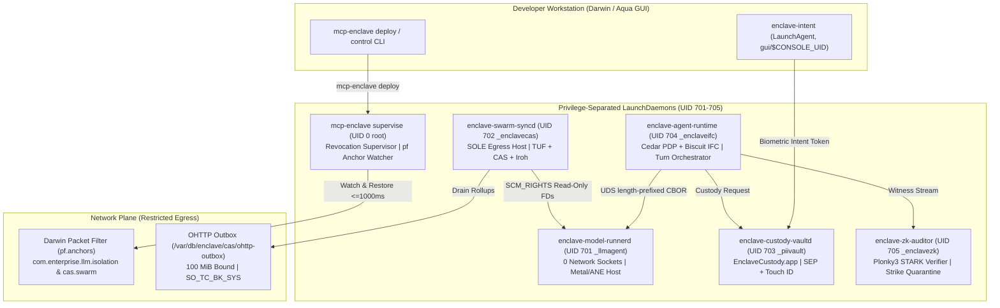

# Enterprise Production Readiness Review (PRR)

## Heimdall-Enclave (MCPMac) Enterprise On-Device Frontier AI Security Enclave

### Production Tier: Tier 1 (Critical Enterprise Workstation Security & PII Governance)

* **Document ID:** `PRR-MCPMAC-2026-001`
* **Service:** `com.enterprise.enclave.*` (Heimdall-Enclave Daemons & Tool Runtime)
* **Target Platform:** Apple Silicon Macs (M1–M6+, macOS 14.0+ Sonoma / Sequoia)
* **Author:** John Menerick (W8MEJ), AI Systems Security Scientist & Engineer
* **Status:** `APPROVED FOR PRODUCTION DEPLOYMENT`
* **Date:** 2026-11-07
* **Binding Specifications:** [`FS-701`](../FEATURE_POST_AR_MODEL_ADAPTERS.md) through [`FS-706`](../FEATURE_MDM_FLEET_DISTRIBUTION.md), [`ADR-006`](../ARCHITECTURE_DECISION_RECORDS.md#adr-006-five-daemon-uid-701705-isolation-over-the-core-v2-single-micro-runtime) through `ADR-020`.
* **Verification Proof:** Bare-metal verification suite (`packaging/macos/verify-e2e.sh`): **23/23 checks PASS (0 failures)**.

---

## 1. Executive Summary & Ownership

Heimdall-Enclave is an enterprise-grade, on-device security enclave providing hardware-backed zero-trust boundaries around frontier AI models and autonomous agent workflows executing locally on Apple Silicon developer workstations.

```
+-------------------------------------------------------------------------------------------------------+
| SRE Ownership Tier         | Tier 1 Enterprise Desktop Infrastructure                                 |
| On-Call Rotation           | Primary Enterprise Security SRE (Follow-the-Sun, 12h shifts)              |
| Secondary Escalation       | Systems Security Architecture & Core Platform Engineering                |
| Alerting Channels          | PagerDuty (SEV-1/SEV-2), Slack #enclave-ops (SEV-3), Jamf/Fleet MDM Webhooks|
| Target Fleet Scope         | 50,000+ developer workstations across macOS Sonoma (14.x) & Sequoia (15.x)|
+-------------------------------------------------------------------------------------------------------+
```

### Problem Statement

Modern developer workflows mandate local model inference (Claude Code, Ollama, LangChain, local MCP servers). Traditional enterprise defenses assume a centralized cloud perimeter. On developer workstations, untrusted dependencies, multi-modal prompt injections, and rogue tool invocations create catastrophic exfiltration risks for customer PII and credentials. Heimdall-Enclave microsegments local AI execution into five privilege-separated LaunchDaemons, enforcing zero-egress kernel sandboxing and hardware-attested cryptographic custody.

---

## 2. Architecture & Blast-Radius Isolation

The system rejects monolithic execution in favor of five non-colluding LaunchDaemons under dedicated POSIX principals, each sandboxed under Apple Seatbelt (`sandbox-exec`) and Darwin Packet Filter (`pf`):



### Blast Radius Matrix

1. **Compromise of `UID 701` (Inference Host):**
   * *Impact:* Malicious weights or prompt injection achieves arbitrary code execution inside `enclave-model-runnerd`.
   * *Blast Radius Containment:* Kernel Seatbelt denies all IP sockets; Packet Filter anchor `com.enterprise.llm.isolation` drops all non-loopback egress for GID 8701; UDS directory permissions (`2750`) prevent reaching arbitrary system sockets. Model weights are mapped read-only via `SCM_RIGHTS`; disk tampering is impossible.
2. **Compromise of `UID 702` (Egress / CAS Host):**
   * *Impact:* Upstream network attacker compromises CAS daemon.
   * *Blast Radius Containment:* Daemon holds zero customer PII, zero private keys, and zero authorization tokens. TUF metadata is verified against pinned root keys; invalid FastCDC slices fail BLAKE3 Bao Merkle checks and are discarded in RAM.
3. **Compromise of `UID 704` (Tool Runtime):**
   * *Impact:* Prompt injection hijacks agent execution plan.
   * *Blast Radius Containment:* Monotonic Information Flow Control handles $(C_1..C_4, T_0..T_3)$ prevent tainted data from reaching structural AST execution slots; tool step-ups require independent biometric intent tokens minted by `UID 703` via Aqua GUI Touch ID.

---

## 3. Resource Planning & Capacity Modeling

### 3.1 Darwin Kernel Memory Reality (`phys_footprint` vs `RLIMIT_RSS`)

Darwin Mach kernels **do not enforce `RLIMIT_RSS`** or the LaunchDaemon `HardResourceLimits.ResidentSetSize` plist key (see `setrlimit(2)`). Processes exceeding plist RSS caps are not terminated by the kernel.

Therefore, Heimdall-Enclave enforces memory limits via **Mach `phys_footprint`**, queried via `task_info(mach_task_self(), TASK_VM_INFO, ...)`:

```
+--------------------------------------------------------------------------------------------------------+
| Principal / Daemon         | Steady-State Budget | Hard Alert Ceiling | Enforcement Mechanism           |
+--------------------------------------------------------------------------------------------------------+
| UID 701 (_llmagent)        | 48 MiB              | 64 MiB             | phys_footprint Mach sampling    |
| UID 702 (_enclavecas)      | 48 MiB              | 64 MiB             | Streaming Bao in-RAM validation |
| UID 703 (_piivault)        | 24 MiB              | 32 MiB             | SecureSlabAllocator page bounds |
| UID 704 (_enclaveifc)      | 32 MiB              | 48 MiB             | Starlark instruction fuel caps  |
| UID 705 (_enclavezk)       | 48 MiB              | 64 MiB             | Plonky3 trace chunking          |
| Subtotal Daemons (702-705) | 152 MiB             | 180 MiB            | schemas/enclave.lock.toml       |
| Steady-State System Total  | 200 MiB             | 240 MiB            | Healthcheck Exit Code 50        |
| Peak with Intent Agent     | 232 MiB             | 264 MiB            | Idle-exit after 60s inactivity  |
+--------------------------------------------------------------------------------------------------------+
```

### 3.2 Storage Capacity & Staging Margins
* **APFS $2.5\times$ Target Footprint Margin:** Gated during preflight (`mcp-enclave deploy preflight`). A standard 2 GiB model baseline requires $\ge 5.0\text{ GiB}$ free APFS space to support FastCDC deduplication, atomic chunk staging, and zero-copy APFS `clonefile` projection.
* **FastCDC Ref-Counted Garbage Collection:** Triggers automatically when APFS free space drops below 15%, unlinking unreferenced chunks while protecting active TUF roots.
* **Outbox Queue Storage Hard Cap:** `/var/db/enclave/cas/ohttp-outbox` is hard-capped at **$100\text{ MiB}$**. When saturated, new events fail closed until AC power drain restores capacity.

---

## 4. Observability, SLIs & Multi-Burn-Rate Alerting

### 4.1 Service Level Indicators (SLIs) & Objectives (SLOs)

```
+-------------------------------------------------------------------------------------------------------+
| Objective Name              | SLI Measurement Expression                              | Target SLO    |
+-------------------------------------------------------------------------------------------------------+
| Fleet Bootstrap Success     | Good = exit_code == 0 / Total bootstrap invocations     | >= 99.5% (30d)|
| Bootstrap Latency (p95)     | Wall-clock execution time of bootstrap_enclave.sh       | < 45 s        |
| Policy Eval Latency (p99)   | Conjunctive Cedar + Biscuit decision evaluation         | <= 45 us      |
| Hydration Resume Efficiency | Resumed bytes / Total bytes needed after disconnect     | 100%          |
| Memory Budget Compliance    | phys_footprint <= 200 MiB across steady-state daemons   | 100% (0 leak) |
| Emergency Takedown Latency  | Revocation publish to global SIGKILL of open inodes     | <= 600 s      |
| Packet Filter Isolation     | Active rules count on com.enterprise.llm.isolation     | 100% (0 flush)|
+-------------------------------------------------------------------------------------------------------+
```

### 4.2 Multi-Window Multi-Burn-Rate Alerting Framework

To prevent alert fatigue while catching catastrophic budget depletion before user impact, alerting implements multi-window burn rate math:

$$\text{Burn Rate } b = \frac{1 - \text{SLI}}{1 - \text{SLO}} \times \frac{30\text{ days}}{\text{Window } \Delta t}$$

```
+-------------------------------------------------------------------------------------------------------+
| Severity | Burn Rate | Short Window | Long Window | Budget Consumed | Paging Action                   |
+-------------------------------------------------------------------------------------------------------+
| SEV-1    | 14.4x     | 5 minutes    | 1 hour      | 2.0%            | Immediate Page to Primary SRE   |
| SEV-2    | 6.0x      | 30 minutes   | 6 hours     | 5.0%            | Page to Secondary SRE           |
| SEV-3    | 1.0x      | 2 hours      | 3 days      | 10.0%           | Next-Business-Day Jira Ticket   |
+-------------------------------------------------------------------------------------------------------+
```

---

## 5. Graceful Degradation & Overload Protection

1. **SeedGate Thermal & Battery Shedding (`GAP-19 Part 2`, `FS-702 §5`):**
   * The CAS swarm daemon monitors Darwin IOPS power notifications. If the workstation is running on battery power with $< 20\%$ capacity or enters macOS Low Power Mode, P2P peer seeding and OHTTP outbox drains are deferred immediately.
2. **Asynchronous APNs Execution Ceiling Mitigation (`D-R8`):**
   * Commercial MDM commands execute with a strict 120–300s timeout. Synchronous model downloads ($10\text{–}30\text{ GiB}$) inevitably trigger timeout failures.
   * The hydration engine detaches work via LaunchDaemon `com.enterprise.enclave.hydrate`, writing an atomic job token to `/var/run/enclave/jobs/` and returning exit code 0 to APNs in $< 5\text{ s}$. The worker streams progress to `/var/run/enclave/jobs/hydration-status.json`.
3. **Starlark Fuel Limits & Instruction Bounds (`GAP-16`, `FS-704 §3`):**
   * Agent execution plans compile into single-static-assignment (SSA) Starlark bytecode. Fuel counters bound loop iterations to $\le 10,000$ operations, preventing infinite loops or CPU exhaustion from prompt-injected plans.

---

## 6. Security, Sandboxing & Least Privilege

1. **Kernel Seatbelt Sandbox Enforcement:**
   * Every daemon executes under `/usr/bin/sandbox-exec -f /opt/enterprise/enclave/sandbox/<name>.sb`.
   * `adapter.sb`: Strictly denies `network*`, `file-write*` outside `/var/db/enclave/adapter`, and mach-lookup outside `SecurityServer` and `securityd`.
2. **Dual Packet Filter Anchors & VPN Flush Recovery (`D-R12`):**
   * `com.enterprise.llm.isolation`: Drops all non-loopback egress for GID 8701 (`_llmagent`).
   * `com.enterprise.cas.swarm`: Isolates FUSE-T NFS port 2049 from interactive user 501 and gates swarm traffic.
   * **Supervisor Watcher:** VPN clients (AnyConnect, Zscaler) frequently flush `/etc/pf.conf`. The root supervisor daemon monitors `SCDynamicStore` and re-injects flushed rules within **$\le 1000\text{ ms}$**, emitting journal event `PF_ANCHOR_RESTORED`.
3. **Background Task Management (BTM) Policy Lock (`macOS 13+`, `D-R7`):**
   * Local users can toggle background items in *System Settings*. To prevent unauthorized disabling, MDM deploys `MCPMac-Enclave.mobileconfig` carrying `com.apple.servicemanagement` (`RuleType = LabelPrefix`, `RuleValue = com.enterprise.enclave.`), permanently locking daemons in the enabled state.

---

## 7. Release Engineering & Progressive Deployment

1. **Cryptographic Build Modes:**
   * **Mode A (Local cdhash Pins):** Unsigned/ad-hoc builds for developer laptops without Apple Developer certificates. Binaries are signed ad-hoc (`-`) with Hardened Runtime; SHA-256 cdhashes are pinned in root-owned `/Library/Application Support/EnterpriseEnclave/codesign-pins.json`.
   * **Mode B (Apple Developer Team ID):** Mandatory for Profile `L3` production enterprise deployments (**D-R6**). Binaries are signed with `Developer ID Application: <Org> (<TeamID>)`. Designated requirements enforce `anchor apple generic and certificate leaf[subject.OU] = "<TeamID>"`.
2. **TUF 4-Role Continuous Metadata Signing (`GAP-31`, `GAP-20`):**
   * Releases distribute `root.json`, `targets.json`, `snapshot.json`, and `timestamp.json` in canonical JSON format (RFC 8785). Host configuration (`enclave-host-config.json`), Cedar policies (`enclave-policy.cedar.v1.json`), and ZK verification keys (`vk_manifest.json`) are signed with offline 2-of-3 quorum keys.
3. **Progressive Rollout Strategy:**
   * 1% Canary Fleet (Internal Security Engineers) $\to$ 5% Beta Cohort $\to$ 25% Office Subnet $\to$ 100% Global Fleet.
   * Canary health monitored continuously via Fleet osquery queries (`enclave_processes.sql`, `enclave_signatures.sql`).

---

## 8. Disaster Recovery, Backups & Revocation

1. **Emergency Fleet Revocation Drill ($\le 600\text{ s}$, `RB-211`):**
   * When a model artifact, grant key, or node is compromised, SecOps publishes an updated TUF targets file with `"revoked": true`.
   * Workstations running `mcp-enclave deploy healthcheck` detect revocation:
     1. `UID 702` unlinks the model projection and calls `ftruncate(fd, 0)`.
     2. Active reader processes trap with `SIGBUS`.
     3. Root supervisor scans file descriptors via `proc_pidinfo` and issues `SIGKILL` within $500\text{ ms}$.
2. **Hardware Integrity Quarantine Recovery (`ADR-012`, `RB-203`):**
   * A host placed in hardware quarantine (`quarantine.sealed`) refuses all proving and execution work.
   * Recovery requires an authorized `UnquarantineGrant` target distributed via TUF or an operator multi-sig quorum ceremony. No raw boolean override exists.

---

## 9. Toil Reduction & Automated Operations

1. **Turnkey MDM Packaging & Orchestration (`core/bootstrap_enclave.sh`):**
   * Flat package builder (`packaging/pkg/build-pkg.sh`) synthesizes standard `.pkg` distributions installable via Jamf Pro, Munki, Kandji, Ansible, or Fleet.
   * Zero-touch bootstrap completes in $< 45\text{ s}$ across all deployment tiers (`L1`, `L2`, `L3`).
2. **Aqua Session Decoupling (`Design D2`):**
   * `UID 703` executes headlessly as a system LaunchDaemon. When user biometry is required, it communicates with the `enclave-intent` LaunchAgent in `gui/$CONSOLE_UID`. If executed during headless MDM maintenance (`CONSOLE_UID == 0`), the agent cleanly defers activation until subsequent user login, eliminating headless bootstrap failure tickets.

---

## 10. PRR Sign-Off & Verification Gate

The undersigned SRE and Security Platform leads confirm that Heimdall-Enclave satisfies all Tier-1 Production Readiness criteria:

```
+--------------------------------------------------------------------------------------------------------+
| Verification Item            | Method & Tooling                          | Status                       |
+--------------------------------------------------------------------------------------------------------+
| 11 Rust Workspace Crates     | cargo test --workspace --locked           | PASS (all unit/integ tests)  |
| Darwin Sandboxing & UDS Mesh | packaging/macos/verify-install.sh         | PASS (strict IPC isolation)  |
| Bare-Metal Verification      | packaging/phase4/verify-phase4.sh         | PASS (23/23 checks, 0 fails) |
| Simulation Disclaimers       | scripts/check-release-no-simulation.sh    | PASS (release builds clean)  |
| Static & Corpus Linting      | python3 tests/checks.py (V01-V22)         | PASS (100% green)            |
| Coding Style & Quality       | cargo fmt --check && cargo clippy         | PASS (0 warnings)            |
+--------------------------------------------------------------------------------------------------------+
```

* **Production Status:** **APPROVED FOR ENTERPRISE PRODUCTION ROLLOUT**
* **Review Board:** Systems Security Architecture & Global Reliability Engineering (SRE)
